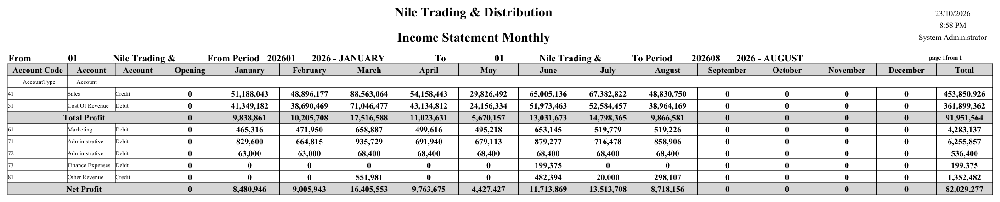
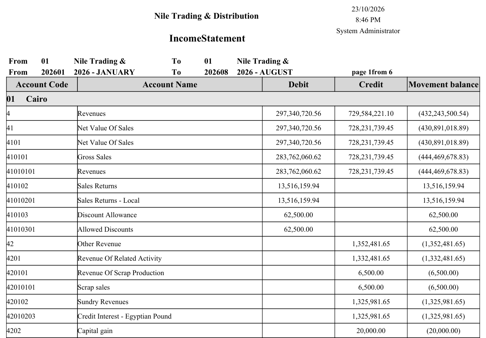
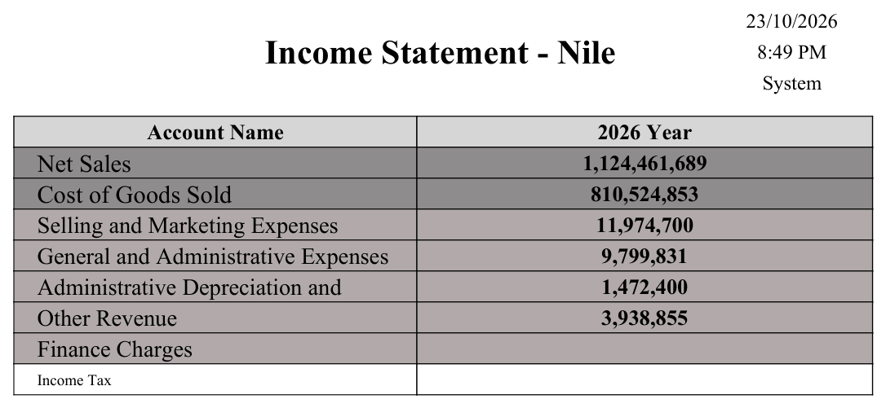
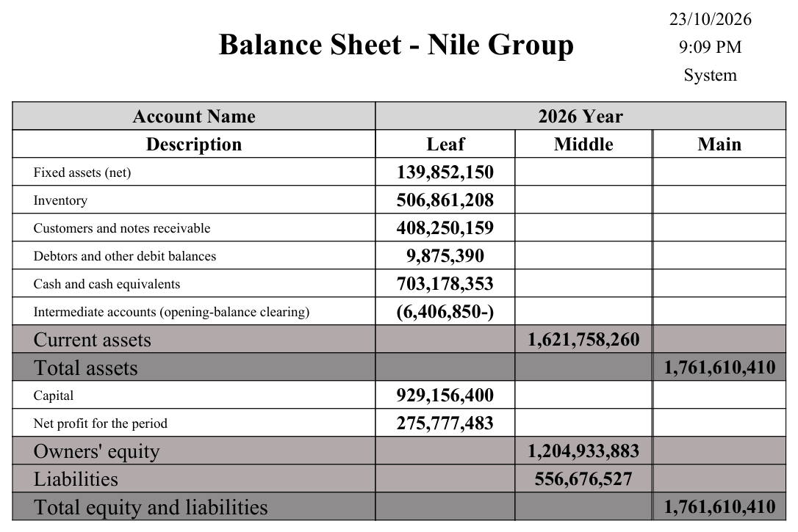

# Financial Statements

Every company needs an income statement and a balance sheet, but no two companies want them laid out exactly the same way — different line groupings, different subtotals, different comparison columns. Rather than hard-code a fixed report, Nama gives you a **configurable financial-statements engine**: you describe the shape of the statement once, then *issue* it for any period to get the numbers. The income statement, balance sheet and cash-flow reports you print are all output of this one engine.

::: info Required license
The financial-statements engine is part of the core `accounting` license. Its screens are under **Accounting > Financial Statement**.
:::

## The building blocks

You design a statement from four screens, working from the small pieces up to the finished report:

1. **FS Account Group** (`Accounting > Financial Statement > FS Account Group`) — a named bundle of accounts, so a statement line can say "Operating Revenue" and pull a whole group instead of listing accounts one by one.
2. **FS Equation** (`Accounting > Financial Statement > FS Equation`) — a reusable formula. Lines use equations to compute their value: a balance, a debit/credit movement, an opening figure, or a total rolled up from other lines.
3. **FS Settings File** (`Accounting > Financial Statement > FS Settings File`) — the **template**: the ordered set of lines that *is* the statement's structure, plus how it's grouped, compared and displayed.
4. **Issuing Financial Statement File** (`Accounting > Financial Statement > Issuing Financial Statement File`) — the **computed snapshot**: run a settings file for a period and it captures the actual numbers, ready to print and to compare against later issues.

## Designing the statement (the settings file)

The **FS Settings File** is where the statement takes shape. It carries an Arabic and English **report title**, and a grid of **lines** — each line is a row of the finished statement:

- a **level** that sets the row's place in the hierarchy (headings, sub-lines, totals), and an Arabic/English **description**,
- an **equation** that produces the row's value — there are separate equation slots for the **balance/movement**, the **debit-credit**, the **opening**, and the **totals**, so a single line can behave correctly whether it's a normal line or a subtotal,
- alternatively a **constant value**, or a reference to another line's value by its **source line code**,
- per-line **dimension limits** — "limit lines to branch / sector / department / analysis set / subsidiary / reference…" — so a line can be restricted to just one branch or cost center,
- and flags such as **invisible in reports** (a working line used only in calculations) and **spread out in lines / spread subsidiaries in lines** (explode a group or its subsidiaries into individual rows).

At the header you also choose how the whole statement behaves:

- the **comparison type** — **One Year**, **Two Years**, a **Period Set** (a run of consecutive periods, i.e. month-by-month columns), or **Two Period Sets** (the same months across two years),
- up to five **grouping axes** (**group by** legal entity, branch, department, sector, analysis set, references, record, or subsidiary) — so the same statement can be broken down by dimension,
- and display options: **create totals lines**, **hide zero-value balances**, **hide equal-balanced transactions**, **show to level** (collapse detail beyond a depth), and **consider debit and credit charts**.

## Issuing a statement

A settings file is just the design; the numbers come from an **issue**. The **Issuing Financial Statement File** runs a settings file for a chosen period and stores the computed result as a saved issue. That snapshot is what the FS-issue reports print — and because each issue is preserved, you can compare this month's issue against last month's, or this year against last.

## Drilling down from a figure (link configurations)

An accountant reading the income statement sees "Operating expenses: 184,500" and immediately asks *which* entries make that up. A **link configuration** answers the question from inside the report: it turns each figure of the issue-driven statements into a link that opens another report, already filled in with the right period, accounts and dimensions for that figure.

You build one on **Issuing Financial Statement Link Configuration** (`Accounting > Financial Statement > Issuing Financial Statement Link Configuration`):

- **Report Definition** — the report the link opens. The list offers the reports your team designed (user reports); system reports are not offered.
- the **Sources** grid — one row per parameter of that report. **Parameter Name** suggests the chosen report's own parameters; **Parameter Source** says where the value comes from:
  - the statement line itself: **Source** (the account, account group or category the line reads), **Source Accounts** (every account behind that source, as a list), and **Group By 1** to **Group By 5** (the dimension values the line is grouped by),
  - the period of the figure that was clicked: **Fiscal Period**, **Fiscal Period Start Date**, **Fiscal Period End Date**, **Fiscal Year**, **Fiscal Year Start Date**, **Fiscal Year End Date**, **Fiscal Year First Period** and **Fiscal Year Last Period**,
  - the issue file's own header: **From/To Date**, **From/To Period** (each with a **1** and **2** variant for the first and second year of a two-year comparison; the plain one follows the column clicked), **From/To Legal Entity**, **Branch**, **Sector**, **Department**, **Analysis Set**, and **Settings File**,
  - a typed **Constant Value**, or an **Expression** — a field of the issue file written as a field path — for anything else. A row whose source is Constant Value must have its **Constant Value** filled, and an Expression row its **Expression**.

You then attach the configuration on the **FS Settings File**:

- **period values link configuration**, on each line of the details grid, links that line's figures — the year column on the one- and two-year statements, and each month's column on the monthly ones. Lines left empty print as plain numbers.
- **period open link configuration** and **period total link configuration**, on the same grid, link the two extra columns of the monthly statements (**Period Set** and **Two Period Sets**): the opening column and the total column. Each column uses its own configuration, so the opening figure can open one report and the total another — say, an account statement up to the start of the range for the opening, and the full movement of the range for the total. Fill only the ones you need: a column whose configuration is empty prints as plain numbers, whatever the other two hold. The one- and two-year statements have no such columns and ignore these two.
- **Trial Balance Link Configuration**, in the header's **Trial Balance** group, does the same for every row when the statement is issued as a trial balance.

The links are worked out when the statement is generated, so after adding or changing a link configuration press **Generate Financial Statement** on the issue file again. The issue-driven reports — `SYSR-FNS010` to `SYSR-FNS015` and the FS trial balances `SYSR-FNS016` and `SYSR-FNS017` — then show each linked figure as a clickable value.

## Actions on these screens

Designing a statement from an empty settings file is a long job, so the screen offers both a starting point and tools for editing many lines at once.

**On the FS Settings File:**

- **Create Income Statement Settings File And Groups**, **Create Balance Sheet Settings File And Groups** and **Create Cash Flow Flow Settings File And Groups** — each builds a complete, ready-made settings file for that statement, together with the account groups its lines refer to, and opens it as a new record. Each asks one question first: whether to create those groupings as an **FS Account Group** or as an **Account Category**. Start here and adapt, rather than typing the structure from scratch.
- **Select All Lines**, **Unselect All Lines** and **Reverse Selected Lines** — tick, untick, or invert the selection on the lines grid. They matter because of the header's bulk-change fields — **Change Balance Type**, **Change Debit Credit Type**, **Change Open Type**, **Change Totals Type** and **Change Level Type**: pick a value in one of them and it is applied to every **selected** line at once. Selecting is how you edit fifty lines without touching fifty rows.
- **Clear Lines Code** — empties the code on every line. Useful when you are re-coding a statement and the old codes are still being picked up by lines that reference them by **source line code**.

**On the Issuing Financial Statement File:**

- **Generate Financial Statement** — the button that turns the design into numbers. Save the issue file first with its settings file and period chosen, then press it; the screen refreshes with the computed result stored as this issue. Press it again whenever the underlying transactions have moved and the snapshot needs refreshing.

## The reports

The printed statements all come out of this engine, under the report menu (`Acc-FNS`, codes `SYSR-FNS*`):

- **Income statement** — by accounts (`SYSR-FNS001`), monthly (`SYSR-FNS002`), and grouped by dimension (`SYSR-FNS009`).
- **Balance sheet** — by accounts (`SYSR-FNS003`), monthly (`SYSR-FNS004`), by balances and by account category.
- **Cash-flow statement.**
- **Issue-driven statements** that print from a saved issue: monthly income statement one/two years (`SYSR-FNS010`/`SYSR-FNS011`), yearly income statement one/two years (`SYSR-FNS012`/`SYSR-FNS013`), yearly balance sheet one/two years (`SYSR-FNS014`/`SYSR-FNS015`), plus an FS trial balance.

::: details More samples: income statements and the yearly balance sheet
**Monthly income statement** (`SYSR-FNS002`) — one row per account category, placed by the category's **Equation Type** (see [Chart of Accounts](../ledger-setup/chart-of-accounts.md)); a category whose Equation Type is empty is left out, and when none is set the report prints no data:

**Income statement grouped by dimension** (`SYSR-FNS009`) — here grouped by branch:

**Issue-driven yearly income statement** (`SYSR-FNS012`) — printed from a saved issue file:

**Issue-driven yearly balance sheet** (`SYSR-FNS014`) — from a balance-sheet settings file whose lines take each chart node's balance at the end of the period, add the period's profit to equity through an equation line, and total with further equation lines; each line's level puts it in the Leaf, Middle or Main column:

:::

## For Support

- **"A line shows the wrong number"** — check the line's **equation** (balance vs debit-credit vs opening vs totals) and any **dimension limits** on it; a line limited to one branch only sums that branch.
- **"A subtotal isn't adding up"** — totals lines use the **totals equation** and reference other lines by **source line code**; verify those references and the line **levels**.
- **"The comparison columns are missing/wrong"** — that's the **comparison type** (One Year / Two Years / Period Set / Two Period Sets) on the settings file.
- **"The figures are out of date"** — the issue-driven reports print a saved **issue**; re-issue the settings file for the period to refresh the snapshot.
- **"The figures in the statement are not clickable"** — the line needs a **period values link configuration** (the opening and total columns of a monthly statement need the **period open link configuration** and **period total link configuration**; the settings file a **Trial Balance Link Configuration**), and the issue must be generated again after that was set; links are worked out at generation time.
- **"Zero/empty rows clutter the statement"** — turn on **hide zero-value balances** (and **show to level** to collapse deep detail).

## Messages you may see

| Message | Why | What to do |
|---|---|---|
| *You must choose Settings File in field {0}* — «يجب إختيار القيمة ملف إعدادات فى الحقل {0}» | A settings-file line points its **source** at another settings file while its equation type is something else. | Set the line's equation type to **Settings File** — that is what makes the source a settings file. |
| *Source Type must be Settings File* — «نوع المصدر يجب أن يكون إعدادات قائمة مالية» | The mirror image of the previous message: the line's equation type is **Settings File** but its **source** points at something else. | Point the source at a financial-statement settings file, or change the equation type. |
| *Code {0} is repeated at line {1}* — «الكود {0} مكرر فى السطر رقم {1}» | Two lines of the settings file carry the same **code**; totals lines reference other lines by that code, so it must be unique. | Give one of the two lines a different code and fix any totals equation that referred to it. |
| *You must fill field {0} before fill this field {1}* — «يجب ملئ الحقل {0} قبل ملئ الحقل {1}» | The **group by** levels are filled out of order — a later level is set while an earlier one is empty. | Fill the grouping levels from the first one down, with no gaps. |
| *Group {0} is repeated* — «التجميع بـ {0} مكرر» | The same grouping level value is chosen twice in the group-by chain. | Choose a different value for one of them, or leave the later level empty. |
| *You must fill at least one of the following fields: {0}, {1}* — «{1} ,يجب ملء حقل واحد على الأقل من الحقول الأتية : {0}» | The issue file's **comparison type** needs a period range (or a second one, for Two Period Sets) and the range is completely empty. | Fill the from/to fields the message names for the comparison type you chose. |
