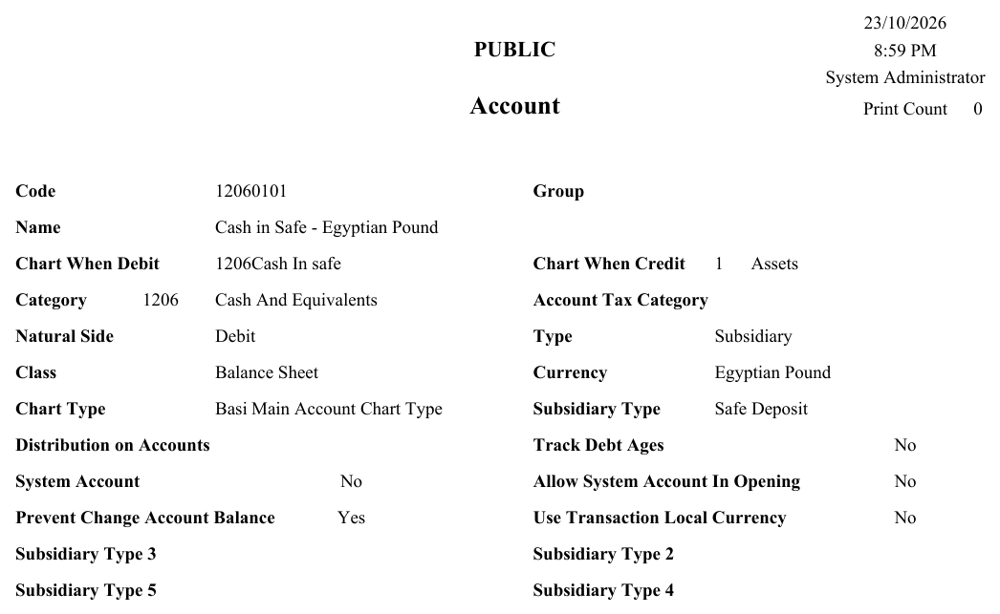

# Accounts

If the chart of accounts is the structure, the **Account** is the unit balances are actually recorded on. Every accounting entry — whatever its source — ends up recording a debit or credit amount on an account. And because most ledger-entry errors and reversed "subsidiary" balances trace back to the account's own setup, this is one of the most important screens for support staff to understand well.

You'll find accounts under **Accounting → Master Files → Account**.

::: info Required license
Accounts are part of the core `accounting` license.
:::

## The two account types: Detail or Subsidiary

The most important field on the screen is **Type**, with two values that define the account's entire behavior:

- **Detail** — an ordinary account holding a single aggregated balance (like a "Rent" or "Electricity" account). You look at it and see one balance.
- **Subsidiary** — an account whose balance breaks down by **party**: customer, supplier, employee, bank, safe... A "Customers" account of type Subsidiary doesn't give you just one number; it gives a balance per individual customer, plus a grand total. This is what lets you know "how much does customer A owe us" without opening a separate account for every customer.

## Linking the account to the chart: Debit chart and Credit chart

Notice the account has two separate links to the chart: **Chart When Debit** and **Chart When Credit**. Why two? Because some accounts must appear in a different place in the statements depending on their balance's nature. A bank current account, for example, may appear under assets when it's in debit, and under liabilities when in credit (an overdraft). Specifying two different nodes for debit and credit keeps the presentation in the financial statements correct in both cases. In ordinary cases both links point to the same node. The two nodes must have the same chart type and the same class; otherwise the save is refused with *{0} is not consistent with {1}* — «{0} ليس متوافقا مع {1}».

Alongside them:

- **Natural Side** (`Debit`/`Credit`) — the natural side of the account's balance. You set it.
- **Class** — the financial-statement classification (Balance Sheet / Income Statement / Other). It is not entered: every save copies it from the account's chart node.
- **Chart Type** — the chart type it belongs to. It is copied from the chart node on every save in the same way.
- **Currency** — the account's currency. A transaction in any other currency is translated at the exchange rate (see [Currencies and exchange rates](../../../platform/shared-master-files/currencies-and-exchange-rates.md)).
- **Account Category** and **Account Tax Category** — the two angles feeding the income statement, cash-flow statement, and tax reports (see [Chart of Accounts](./chart-of-accounts.md)).

## Consolidation settings

Two fields serve the [consolidated statements](../financial-reporting/consolidated-statements.md) of a group:

- **Intercompany** — marks the account as holding business with other group companies, so the consolidated reports eliminate it. An account under a chart node flagged Intercompany (on either its debit or its credit chart) is ticked when you save it. You can also tick it on a single account whose chart is not flagged.
- **Consolidation Rate** — **Closing**, **Average** or **Historical**: the rate the consolidated reports translate this account at. Leave it empty to inherit from the chart, as described on [Chart of Accounts](./chart-of-accounts.md#Consolidation-settings). A value on the account wins over the chart.

Each company's **Mediator account**, on the Legal Entity screen, should be an intercompany account. When a company's mediator account is set or changed to an account without the flag, the Legal Entity screen saves but warns: *The mediator account {0} is not marked as intercompany, so the consolidated reports will not eliminate its balances. Mark the account, or a chart above it, as intercompany.* — «الحساب الوسيط {0} غير محدد كحساب بين شركات المجموعة، لذلك لن تستبعد التقارير الموحدة أرصدته. حدد الحساب، أو إحدى شجرات الحسابات الأعلى منه، كحساب بين شركات المجموعة.»

## Subsidiary types (up to five)

When the account is of type **Subsidiary**, you set its **Subsidiary Type** — the kind of party the balance breaks down by (customer, supplier, employee, bank, bank account, safe, fixed asset, item, project... the list is long and includes entities from every licensed module). You can combine up to **five subsidiary types** on the same account (subsidiary type 2 through 5), so its balance breaks down across more than one dimension at once — for example customer × project.

::: tip
The **Allow System Transactions without Subsidiary and Vice Versa** option lets the entries the system builds when it processes documents skip the subsidiary check on this account: a line without a party is accepted, and so is a party where none belongs. It works only together with **Enable Allow System Transactions without Subsidiary and Vice Versa in Accounts** in [Accounting Configuration](../support/accounting-configuration.md) - the account cannot even be saved with the option ticked until that switch is on. Journal entries and receipt/payment vouchers that users enter still need the party: on those the account keeps refusing with
*The account {0} must have a subsidiary* — «يجب تحديد ذمة للحساب {0}».
By default, subsidiary accounts require the party; don't enable this without a clear reason.
:::

## The control flag set

The part that makes this screen pivotal for support is the set of flags (checkboxes) that govern the account's behavior when entries are recorded on it:

- **System Account** — marks an account whose balance the system builds by itself, and locks it against manual entry: a journal entry, receipt/payment voucher, bank transfer or inter-company transfer naming it is refused with *"The Account {0} Can Be Used Only By The System"*. Documents generated automatically are unaffected. Three things can reopen it — a module option per document type, the flag below, or a dated exception record; all three are on [System Accounts & Transaction Exceptions](./system-accounts-and-exceptions.md).
- **Allow System Account In Opening** — a companion to the flag above: it lets the account be used manually in any period that is **not** a Normal one (opening, adjustment, closing), so opening balances and year-end adjustments can be recorded on it while it stays locked during the year.
- **Prevent Change Account Balance Nature** — blocks a transaction that would flip the account's balance to its unnatural side (e.g., making a cash balance credit). A safeguard against errors. The account cannot be saved with this flag ticked until **Enable Prevent Change Account Balance Nature** is on in [Accounting Configuration](../support/accounting-configuration.md). The refusal names the balance the document would have produced: *The balance of account {0} will become {1}, You can not change the natural side of the account balance from Debit to Credit* — «رصيد الحساب {0} سيكون {1}, فلذلك لا يمكن تغيير طبيعة رصيد الحساب من مدين إلى دائن» — with a *from credit to debit* twin and a dated variant ending *on {2}*.
- **Track Debt Ages** — enables debt-age tracking for this account, a prerequisite for the account appearing in debt-age reports.
- **Do Not Automatically Include In Exchange Rate Update** — excludes the account from periodic foreign-currency revaluation.
- **Use Transaction Local Currency** — makes the account keep its value in the transaction's local currency.
- Dimension restrictions: **Must Use With Public Sector/Branch/Department/Analysis Set Only**, or their opposites **Do Not Use With Public ...**, require or forbid using a public dimension with this account. Ticking both the *Must Use* and the *Do Not Use* flag of the same dimension is refused with *You can not enable both {0} and {1} at the same time* — «لا يمكن تفعيل {0} و {1} في نفس الوقت».
- Data enforcement: six flags, each forcing one field to be filled on every entry line recorded on the account — **Do Not Allow Empty Entity Dimension When Moving This Account**, **Do Not Allow Empty Reference 1 When Moving This Account** (also **Reference 2** and **Reference 3**), **Do Not Allow Empty Narration When Moving This Account** and **Do Not Allow Empty Narration 2 When Moving This Account**.

## Budget control on the account

If you use financial budgets, the **Budget Exceeded Behavior** and **Prevent Save If No Budget Was Found For The Account** fields determine how the system reacts when spending exceeds its budget:

- **Allow** — records the transaction and tolerates a silent overrun.
- **Prevent Saving** — rejects the over-budget transaction with *The account {0} has a budget {1}, and this document will exceed the budget because it will it make the balance {2}* — «موازنة الحساب {0} قيمتها {1} و هذا السند سيتعدى الموازنة حيث أنه سيجعل الرصيد {2}».
- **Request Approval** — halts the transaction pending approval. This route needs three things in place, and each has its own refusal when it is not: the accounting-configuration option (*You must enable the option {0} in accounting configuration to be able to use request approval when budget is exceeded*), an approval definition that matches the document (*The document {0} exceeded the budget and no appropriate approval definition was found* — «المستند {0} تعدى الموازنة و لم يجد النظام تعريف موافقة مناسب ليتم الموافقة على تعدي الموازنة»), and **exactly one** such definition — two matching definitions stop the save with *The document {0} exceeded the budget and should be approved by the approval definition {1}, but it also should be approved using the approval definition {2}. This is a conflict and the system can not decide which to choose*.

Saving the account itself with **Prevent Saving**, **Request Approval** or **Prevent Save If No Budget Was Found For The Account** is refused until the matching option is on in the accounting configuration; those refusals, and *The account {0} does not have a budget*, are listed on [Financial Budgets](../planning-and-commitments/financial-budgets.md#Messages-you-may-see).

## When an account is closed to transactions by date

A separate master file, **Prevent Transactions On Accounts Or Subsidiaries**, closes an account or a subsidiary to movement for a date range — it is not a flag on the account itself, which is why nothing on this screen explains the refusal. Its two refusals both end with *please review Prevent Accounts Transactions file*; the messages, how a line matches, and how to lift the block are on [Year-End Closing & Period Control](/modules/accounting/ledger-setup/year-end-and-period-control#Prevent-Accounting-Transactions). Nothing on the account or on the security profile overrides it.

## Actions on this screen

One button on the account does real work, and it is the one you reach for after a currency mistake:

- **Update Balances Currency** — re-stamps the account's stored balances with the currency currently set on the account. Use it when an account was created (or imported) with the wrong currency and the balances were already built against the old one; correcting the **Currency** field alone leaves the existing balances behind. The button asks you to tick a confirmation first, because it rewrites balance records. The same button is on the account list view, so you can select several corrected accounts and run it once over all of them.

**Correcting the currency of an account that already has transactions.** Once any journal line uses the account, the system refuses to save a new **Currency**:

*{0} can not be changed after transactions, old value was {1}, new value is {2}* — «لا يمكن تغيير {0} بعد إنشاء حركات - القيمة السابقة {1} و تم تغييرها إلى {2}»

The field unlocks in two cases: when the account has no transactions left, or when *Allow Changing Subsidiary Accounts After Usage In Accounts* is on in [accounting configuration](../support/accounting-configuration.md). That switch also unlocks the account type and the subsidiary types. The lock only protects a value that is already set: an empty **Subsidiary Type 2** to **Subsidiary Type 5** can be filled in on an account that already has transactions, without the switch. After you change the currency, run **Update Balances Currency**. Then recommit the documents that record entries on this account, from the [Business Requests list](/platform/background-processing/business-requests), so their entries are rebuilt in the new currency. You do not need to reprocess the whole database.

## Reports

This account's statements and balances (general/subsidiary/detail account statement, trial balance, debt ages) are all on the [Account statements & trial balance](../financial-reporting/reports-account-statements-and-trial-balance.md) page.

The account record itself prints on the **Account** form (`SYSF-ACC019`): its charts, category, natural side, type, currency, subsidiary types and control flags:

## In practice

- A new company starts with roughly 170 accounts, and about 5 in 6 companies add their own. A typical company ends up with around 230 accounts, and the largest tenth with more than 400.
- Closing accounts by date is less common: fewer than 1 in 10 companies keep a **Prevent Transactions On Accounts Or Subsidiaries** record, usually just one.

## For Support

Most "the entry won't save" or "the balance is wrong" tickets are resolved from this screen:

- **"Blocking message on save: change of balance nature"** — the account has **Prevent Change Account Balance Nature** enabled and the transaction would have flipped its balance to the unnatural side. Review the transaction logic or the setup.
- **"The system asks for a subsidiary/customer and won't save"** (*The account {0} must have a subsidiary* — «يجب تحديد ذمة للحساب {0}») — the account is of type **Subsidiary** and no party was specified. On a journal entry or voucher a user entered, specify the party: no option lifts that. When the line comes from a document the system processed, either fill the party on the document or (only if necessary) tick **Allow System Transactions without Subsidiary and Vice Versa** on the account, with the matching switch on in Accounting Configuration, then reprocess the document - see [Failed business requests](/admin/troubleshooting/failed-business-requests).
- **"The system mandatorily requires a reference/narration"** — one of the **Do Not Allow Empty … When Moving This Account** flags (Reference 1 to 3, Narration, Narration 2, Entity Dimension) is enabled on the account.
- **"The account doesn't appear in the debt-age report"** — the **Track Debt Ages** flag is off.
- **"The account isn't revalued with currency differences"** — the **Do Not Automatically Include In Exchange Rate Update** flag is on.
- **"A transaction rejected because of the budget"** — the account's **Budget Exceeded Behavior** is **Prevent Saving** or **Request Approval**.
- How the account's debit/credit figures are built during document processing is covered in [How documents are processed into accounting effects](../support/accounting-request-processing.md), and dimension restrictions in [Dimensions, Cost Centers & Distribution](/modules/accounting/support/accounting-dimensions-and-distribution).
