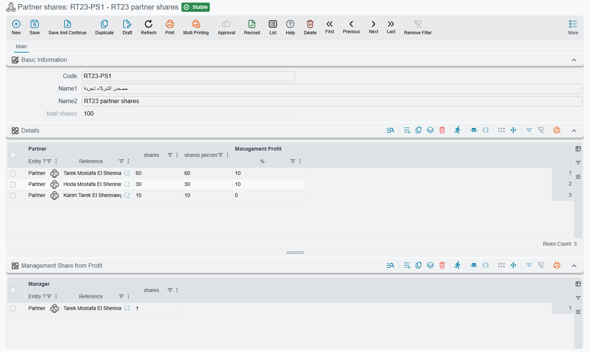

# Partner Shares & Profit Distribution

When a business is owned by partners, the end of every period raises the same question: of this period's profit, how much does each partner get, and how much goes to whoever runs the business? Nama answers it with two screens. **Partner shares** records once who owns how much and who manages; the **Profits Distribution Doc** takes a period's net profit and splits it according to that record, then books each partner's and each manager's part.

::: info Required license
The **Profits Distribution Doc** needs the `accounting` license; **Partner shares** is a `basic` master file. **Partner shares** is under **Accounting > Master Files**, the **Profits Distribution Doc** under **Accounting > Documents**.
:::

## Partner shares — who owns what

A **Partner shares** record (`Accounting > Master Files > Partner shares`) is the ownership table the distribution reads. It has two grids:

- **Shares** — one row per partner: the **Partner**, the number of **shares** the partner holds, and **Management Profit | %** — the part of this partner's profit that is handed to management. A partner can be a **Partner** record (`Accounting > Master Files > Partner`), an **Employee** or a **Third Party**.
- **Management Share from Profit** — one row per manager, with the manager's number of **shares** in the management pool. A manager can be a partner, an employee or a third party too.

When you save, Nama adds up the shares into **total shares** and works out each partner's **shares percentage**. You only ever type share counts; the percentages follow. So "60, 30, 10" and "6, 3, 1" give the same split.

Keep one Partner shares record per ownership structure. If the partners or their shares change, change the record (or make a new one) before the next distribution: a distribution always reads the record as it is when the distribution is saved.

## The Profits Distribution Doc — splitting a period's profit

The **Profits Distribution Doc** (`Accounting > Documents > Profits Distribution Doc`) is filled in like this:

1. Pick the **Partner Shares** record. The **Partners Profit** grid fills with one line per partner, carrying the management percentage, and the **Management Shares** grid fills with one line per manager. The management grid is filled for you and cannot be edited.
2. Enter the profit. Either type it straight into **Amount**, or fill **Income**, **Costs** and **General Costs** and let the screen work it out: **Total Profit** is Income minus Costs, **Net Profit** is Total Profit minus General Costs, and Net Profit is copied into **Amount**. **From Date** and **To Date** record the period the profit belongs to.
3. Per partner, type anything that should change that partner's result: **Additional Expenses** (an expense borne by this partner alone, taken off their share) and **Partner Capital** (capital to hand back with the profit). Both stay on the partner's line when the document is saved again.
4. Save. Every figure in both grids is recalculated from the Partner shares record on each save.

### How the split is calculated

For each partner:

- **Original Profit Share** = Amount × the partner's shares ÷ total shares.
- The partner's profit is Original Profit Share minus **Additional Expenses**.
- **Management Profit | Amount** = the partner's profit × **Management Profit | %**.
- **Profit Share** = the partner's profit minus Management Profit | Amount. This is what the partner earns as an owner.

The management amounts taken from all partners form the management pool. The **Management Shares** grid splits that pool between the managers by their shares, in **Value**. A partner who is also a manager gets their part of the pool on their own line too, as **Partner Management Share**, and **Total due amount** is Profit Share + Partner Management Share + Partner Capital: everything the business owes that partner from this distribution.

In the header, **Management Shares** is the whole pool and **Partners Shares** is Amount minus all additional expenses minus the pool. If rounding leaves a fraction over, it is added to the first partner's Profit Share, so the lines always add up to the header.

::: tip A worked example
Three partners hold 60, 30 and 10 shares. The first two give 10% of their profit to management; the third gives nothing. The first partner is also the only manager. Income is 15,000, Costs 3,000 and General Costs 2,000, so Net Profit, and Amount, is 10,000. The second partner has 500 of Additional Expenses, and the first is owed 1,000 of capital.

| Partner | Original Profit Share | Additional Expenses | Management Profit (10%) | Profit Share | Partner Management Share | Partner Capital | Total due amount |
|---|---|---|---|---|---|---|---|
| First (60) | 6,000 | 0 | 600 | 5,400 | 850 | 1,000 | 7,250 |
| Second (30) | 3,000 | 500 | 250 | 2,250 | 0 | 0 | 2,250 |
| Third (10) | 1,000 | 0 | 0 | 1,000 | 0 | 0 | 1,000 |

The management pool is 600 + 250 = 850, all of it going to the first partner as manager. The header shows Management Shares 850 and Partners Shares 10,000 − 500 − 850 = 8,650.
:::

## What it books

The document's term decides the accounts. It has two pairs of account sides:

- **Profit Debit** / **Profit Credit** — one entry per partner line, for that partner's **Profit Share**.
- **Management shares Debit** / **Management shares Credit** — one entry per manager line, for that manager's **Value**.

The header **Subsidiary** (a safe, a bank account or an account) and each line's **Line Subsidiary** can feed those sides. **Partner Capital** and **Total due amount** are not booked by this document; they are on the lines so you can see, and print, what each partner is owed. The side options are listed under [Profits Distribution Doc](../document-terms/acc-terms-journals-and-closing#Profits-Distribution-Doc) in the term reference.

The document's printed form is `SYSF-ACC023`.

## For Support

- **"The partners grid is empty"** — the **Partner Shares** field is empty, or the record it points to has no lines in its **Shares** grid.
- **"A partner's share is wrong"** — check the shares on the Partner shares record, then the line's **Additional Expenses** and **Management Profit | %**. The percentage on the document comes from the Partner shares record.
- **"The manager got nothing"** — the management pool is made of the partners' **Management Profit | %**. If every partner's percentage is zero, there is nothing to share between the managers.
- **"Partner capital was not booked"** — it is not meant to be; Partner Capital only feeds **Total due amount**.
- **"Amount keeps changing back"** — while Income, Costs or General Costs hold a value, Amount is always Net Profit. Clear those three fields to type Amount yourself.
