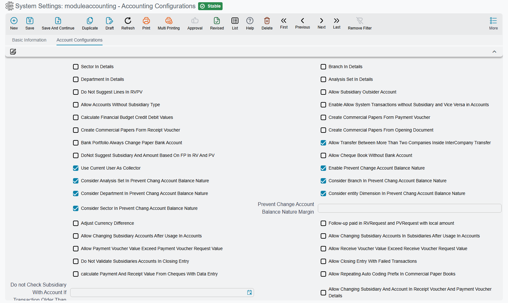

# Accounting Configuration (module option catalog)

Many of the accounting module's behaviors aren't coded — they're **configured** from the accounting module's configuration screen (Accounting → Settings → Accounting Configurations). This page is a reference catalog of these options, grouped by purpose: what each option does, and which behavior it changes. It's designed to answer the recurring support question: "where do I set this behavior?"

The **Field id** column gives each option's identifier — the name to search for in a support script, an import file or the data model.



## Dimensions in details

The five dimensions themselves — and the composite dimension — are covered in [Dimensions and Composite Dimensions](/platform/shared-master-files/dimensions-and-composite-dimensions).

| Option | Field id | Effect |
|---|---|---|
| Show branch / department / analysis set / sector in details | `value.branchInDetails`, `value.departmentInDetails`, `value.analysisSetInDetails`, `value.sectorInDetails` | Show each dimension at the document line level, not just the header. |

## Receipt and payment vouchers

| Option | Field id | Effect |
|---|---|---|
| Do not suggest lines in receipt/payment voucher | `value.doNotSuggestLinesInRVPV` | Turn off the automatic suggestion of voucher lines. |
| Use current user as collector | `value.useCurrentUserAsCollector` | Auto-fill the collector with the current user. |
| Allow multiple payment methods in receipt/payment vouchers | `value.allowMultiplePaymentInRVPVDocs` | Enable multiple payment methods in the voucher. |
| Use local amount in receipt and payment | `value.useLocalAmountInPVAndRV` | Adopt the local value in the voucher. |
| Allow changing subsidiary in receipt/payment details | `value.allowChangingSubsidiaryInRVPVDetails` | Allow changing the subsidiary at the line level. |
| Allow voucher value to exceed request value (receipt/payment) | `value.allowPVValueExceedPVRequest`, `value.allowRVValueExceedRVRequest` | Permit the voucher to exceed its request's value. |
| Do Not Suggest Subsidiary And Amount Based On FP In RV And PV | `value.doNotSuggestSubsidaryAndAmountBasednFPInRVAndPV` | When a cheque or other commercial paper is picked on a receipt or payment voucher, the voucher normally fills its empty subsidiary, related subsidiary, currency, rate and amount from the paper. Ticked, the voucher takes only the paper itself and leaves its header as you typed it. |
| Calculate Payment And Receipt Value From Cheques With Data Entry | `value.calcPaymentAndReceiptValueFromChequesWithDataEntry` | Normally a paper's value is copied to the voucher amount only while that amount is still empty. Ticked, the voucher amount is recalculated as the total of its papers every time one is picked, even when an amount is already there. It has no effect while the option above is ticked. |

## System accounts per document type

| Option | Field id | Effect |
|---|---|---|
| Allow using a system account in receipt / payment / bank transfer / journal entry | `value.canUseSysAccForRVVoucher`, `value.canUseSysAccForPVVoucher`, `value.canUseSysAccForBankTransfer`, `value.canUseSysAccForJournalEntry` | Permit manually picking a "system" account in each type individually. |

Each of these switches the check off for a whole document type — every user, every account, every date — so it is the bluntest of the three ways to open a system account. Prefer a dated exception record instead; both routes, and the account flags behind them, are on [System Accounts & Transaction Exceptions](../ledger-setup/system-accounts-and-exceptions.md).

## Prevent change of account balance nature

| Option | Field id | Effect |
|---|---|---|
| Enable prevent changing account balance nature | `value.enablePreventChangAccBalanceNature` | Turn on the guard that blocks flipping an account's balance to its unnatural side. |
| Prevent balance-nature-change margin | `value.preventChangAccBalanceNatureMargin` | A tolerance value at which the prevention is bypassed. |
| Consider department/sector/analysis set/entity dimension/branch in the prevention | `value.considerDepInPreventChangAccBalanceNature`, `value.considerSectorInPreventChangAccBalanceNature`, `value.considerAnalysisSetInPreventChangAccBalanceNature`, `value.considerEntityDimInPreventChangAccBalanceNature`, `value.considerBranchInPreventChangAccBalanceNature` | Choose which dimensions are accounted for when applying the prevention. |

(This corresponds to the **Prevent Change Account Balance Nature** flag on the [account](../ledger-setup/accounts.md) itself.)

## Subsidiaries

| Option | Field id | Effect |
|---|---|---|
| Allow accounts without a subsidiary type | `value.allowAccountsWithoutSubsidiaryType` | Permit a subsidiary account with no party type set. |
| Enable allow transactions without subsidiary | `value.enableAllowTransactionsWithoutSubsidiary` | Permit transactions on a subsidiary account with no party. |
| Allow Subsidiary Outsider Account | `value.allowSubsidiaryOutsiderAccount` | Off (the default), a journal-entry or voucher line that names a customer, supplier or other subsidiary must use one of that subsidiary's own accounts. Ticked, any account is accepted with any subsidiary. |
| Allow changing subsidiary accounts after usage | `value.allowChangingSubsidiaryAccountsAfterUsage` | On an [account](../ledger-setup/accounts.md) that already has transactions, allow changing its currency, type and subsidiary types. Off, those fields cannot be changed once the account has been used. |
| Allow Changing Subsidiary Accounts In Subsidiaries After Usage In Accounts | `value.allowChangingSubsidiaryAccountsInSubsidiariesAfterUsage` | The same idea on the party side: on a customer, supplier or other subsidiary, allow replacing one of its accounts (main account, account 1 … 20) after entries have been recorded on it for that party. Off, the save is refused with *Account {0} can not be changed to account {1}, because account {2} has {3} lines in LedgerTransLine* — «لا يمكن تغيير الحساب {0} الي الحساب {1}, بسبب وجود الحساب {2} في {3} حركات في سطور القيد النظامي». |
| Do not check subsidiary with account (until a date) | `value.doNotCheckSubsidiaryWithAcount` | Disable the subsidiary-account consistency check before a date. |
| Do not validate subsidiaries in the closing entry | `value.doNotValidateSubsidiariesInClosingEntry` | Skip the subsidiary check at closing. |

## Financial papers and banks

| Option | Field id | Effect |
|---|---|---|
| Create financial papers from payment / receipt / opening document | `value.createFinancialPapaersFromPaymentVoucher`, `value.createFinancialPapaersFromReceiptVoucher`, `value.createFinancialPapersFromOpeningDocument` | Auto-generate financial papers from these documents. |
| Delete generated papers when deleting the owner document | `value.deleteGeneratedFPWhenDeletingOwnerDoc` | Auto-clean dependent papers. |
| Allow the paper's due date to be empty | `value.allowFinancialPaperDueDateToBeEmpty` | Don't mandate the due date. |
| Allow a notice on created papers | `value.allowNoticeOnCreatedPapers` | Allow a bank notice on a paper in "Created" status. |
| Allow a chequebook without a bank account | `value.allowChequeBookWithoutBankAccount` | Don't mandate linking the book to a bank account. |
| Allow dealing with bills of exchange | `value.allowDealingWithBillOfExchange` | Enable bills of exchange alongside cheques. |
| Aggregate paper lines with similar cheque numbers | `value.aggregateFPLinesBySimilarChequeNumbers` | Merge similar lines. |
| Bank Portfolio Always Change Paper Bank Account | `value.bankPortfolioAlwaysChangePaperBankAccount` | A bank portfolio normally refuses a cheque that already carries a different bank account: *Bank Account in Commercial paper {0} is inconsistent with header bank account* — «الحساب البنكي فى الورقة التجارية {0} غير متوافق مع الحساب البنكي فى المستند». Ticked, the portfolio accepts it and moves the paper to the portfolio's own bank account. |

## Currency differences

| Option | Field id | Effect |
|---|---|---|
| Adjust currency difference | `value.adjustCurrencyDifference` | Enable automatic adjustment of currency differences. |

## Closing

| Option | Field id | Effect |
|---|---|---|
| Allow making the closing entry even with unprocessed transactions | `value.allowClosingEntryWithFailedTransactions` | Bypass blocking the close when there are stuck business requests (see [How documents are processed](./accounting-request-processing.md)). |

## Budgets

These options sit in the **Budget Validation Options** group; how they act on a budget is on [Financial Budgets](../planning-and-commitments/financial-budgets.md).

| Option | Field id | Effect |
|---|---|---|
| Enable approvals for budgets | `value.enableApprovalsForBudgets` | Require approval when a budget is exceeded. |
| Enable prevent saving for budgets | `value.enablePreventSavingForBudgets` | Reject saving when a budget is exceeded. |
| Use from-date/to-date in validation and approval | `value.useFromDateToDateInBudgetValidationAndApproval` | Adopt the date range in budget checking. |
| Consider sector / branch / department / analysis set / subsidiary / entity dimension / reference 1–3 / fiscal period | `value.budgetValidationOptions.considerSector`, `value.budgetValidationOptions.considerBranch`, `value.budgetValidationOptions.considerDepartment`, `value.budgetValidationOptions.considerAnalysisSet`, `value.budgetValidationOptions.considerSubsidiary`, `value.budgetValidationOptions.considerEntityDimension`, `value.budgetValidationOptions.considerRef1`, `value.budgetValidationOptions.considerRef2`, `value.budgetValidationOptions.considerRef3`, `value.budgetValidationOptions.considerFiscalPeriod` | Which values a document must share with a budget line for that line to be the one it is checked against. |
| Calculate Financial Budget Credit Debit Values | `value.calcFBudgetCredDebitValues` | Adds a debit and a credit column beside each year's value in the financial budget lines, filled with the account's debit and credit movements when the budget brings in actual balances — not only the net balance. This option sits in the first group of the screen, not in the budget group. |

## Tax and e-invoicing

| Option | Field id | Effect |
|---|---|---|
| Add tax fields to payment / receipt voucher | `value.addTaxFieldsInfoToPaymentVoucher`, `value.addTaxFieldsInfoToReceiptVoucher` | Show tax fields on the vouchers. |
| Add tax 1 / 2 fields to the journal entry | `value.addTax1FieldsToJournalEntry`, `value.addTax2FieldsToJournalEntry` | Show the tax sides in the manual entry. |
| Update tax-registration and commercial-registration numbers on save in misc purchase invoices | `value.updateTaxRegNoAndCommercialRegNoWithSaveInAccMiscInvoices` | Auto-update tax data. |

## Loans, deposits, and facilities

| Option | Field id | Effect |
|---|---|---|
| Days per year for credit-facility interest calculation (**Credit Facility Setting** group) | `value.daysNumberPerYearOfInterestCalculationForCreditFacility` | The interest-calculation basis (default 365). |
| Do not collect deposit interest payment lines after the deposit's end date | `value.doNotCollectDepositInterestPaymentLinesAfterDepositEndDate` | Tune deposit-interest calculation. |
| Do not validate loans and deposits before a date | `value.doNotValidateLoansAndDepositsBefore` | Skip validation before a given date. |

## Financial statements

The **Issuing Financial Statement File** group holds one option for the
[financial statements](../financial-reporting/financial-statements.md) engine.

| Option | Field id | Effect |
|---|---|---|
| Show Debit And Credit Values In Financial Statement Document Lines | `value.showDebitAndCreditInFSDocLines` | Adds a debit and a credit column beside every period and year value in the lines of the Issuing Financial Statement File, so each issued figure shows its two sides as well as its net. |

## Coding and others

| Option | Field id | Effect |
|---|---|---|
| Merge accounts and charts auto-coding | `value.mergeAccountsAndChartsAutoCoding` | Unify the auto-coding logic. |
| Allow repeating the auto-coding prefix in the paper book | `value.allowRepeatingAutoCodingPrefixInFPBook` | Permit prefix repetition. |
| Create System Transaction for Empty Lines | `value.createTransactionsForEmptyLines` | When a document's term writes no lines (every account side empty), still write an entry with no lines. Off, such a document is processed with no entry at all. |
| Allow transfers between more than two companies in inter-company transfer | `value.allowTransBetweenMoreThanTwoComInsideInterComTrans` | Extend inter-company transfer beyond two parties. |

## Serial numbers of system entries

Every processed document writes a system entry (a ledger transaction), and that entry carries a **Serial**.
Without any setup the entry keeps its ordinary serial; the **Serial Configurations** grid
(`value.info.serialConfigLines`) lets you number the entries yourself — for example a separate
sequence per company and per year, such as `C1-2026-00001`.

When an entry is written, the grid is read from the top and the **first row that fits** the entry
numbers it:

| Column | Field id | What it does |
|---|---|---|
| Legal Entity, Branch, Sector, Department, Analysis Set | `value.info.serialConfigLines.dimensions.legalEntity`, `value.info.serialConfigLines.dimensions.branch`, `value.info.serialConfigLines.dimensions.sector`, `value.info.serialConfigLines.dimensions.department`, `value.info.serialConfigLines.dimensions.analysisSet` | The row applies only to entries with these dimensions. Leave a column empty to accept any value. |
| Type | `value.info.serialConfigLines.entityTypeDF` | The row applies only to entries written by this document type. Empty means every type. |
| Prefix | `value.info.serialConfigLines.prefix` | The text the serial starts with. |
| Date Formula | `value.info.serialConfigLines.dateFormula` | A date pattern added after the prefix, taken from the entry's value date — `yyyy` for the year, `MM` for the month, `yyyyMM` for both. |
| Suffix Length | `value.info.serialConfigLines.suffixLength` | How many digits the running number is padded to (`5` gives `00001`). |

The running number restarts for every distinct prefix-plus-date text, so a pattern with `yyyy` starts a
fresh sequence each year without any extra setup. Put the most specific rows first: a row that accepts
everything placed at the top numbers every entry and the rows below it are never reached.

Because the date pattern is case-sensitive and the two most common slips produce a wrong year or a minute
count, the screen refuses them: *Date formula can not contain Y capital* and
*Date formula can not contain m small* (both appear in English on Arabic screens). Use `yyyy` and `MM`.

## Reconciliation import formulas

[Bank reconciliation](../banks-and-cheques/bank-reconciliation.md) and
[subsidiary reconciliation](../money-in-and-out/subsidiary-reconciliation.md) can import the other
party's statement from a file (`.csv`, `.txt`, `.xls` or `.xlsx`). No two banks lay out their
statements alike, so each layout is described once here, as a formula:

| Option | Field id | Used by |
|---|---|---|
| Bank Reconciliation Formula | `value.bankNamesFormulas` | **Import Bank Lines** / **Import Subsidiary Lines** on the bank reconciliation. The names of its formulas are the choices of the document's **Bank** field. |
| Subsidiary Reconciliation Formula | `value.subsidiaryFormulas` | The same buttons on the subsidiary reconciliation, whose formula-name field lists the names written here. |

Each field holds **one formula per line**: a name, `=`, then one `#`-token per column of the file, in
column order. For example:

```
NBE=#date{dd/MM/yyyy}#narration#ignore#transDebit#transCredit#ignoreLinesFromTop{1}
```

Here the file's first column is the date, the second the description, the third is skipped, the fourth and
fifth are the amounts, and the header row is ignored.

The syntax is the one the attendance-machine formulas use, explained in depth on
[Attendance and Departure Formulas](/modules/hr/attendance-machine-formula). The tokens a reconciliation
import understands are:

| Button | Inserts | Meaning |
|---|---|---|
| **Date** | `#date{dd-MM-yyyy}` | This column is the transaction date, in the pattern between the braces. |
| **Narration** | `#narration` | This column is the description. Use it on several columns to join them into one narration. |
| **Trans Debit**, **Trans Credit** | `#transDebit`, `#transCredit` | The debit and the credit amount columns. Thousands commas are ignored, and a negative amount is moved to the opposite side. |
| **Empty Column** | `#ignore` | A column to skip. Any token the import does not know also skips its column. |
| **Ignore Lines From Top**, **Ignore Lines From End** | `#ignoreLinesFromTop{1}`, `#ignoreLinesFromEnd{1}` | Skip header or total rows; change the number to suit. |
| **No Date Parsing** | `#noDateParsing` | For Excel files: keep date cells as the text the sheet shows, so your `#date{…}` pattern reads them. |
| **Trim** | `#trim{date}` | Strip the spaces around the date before it is read — the cure for dates padded with blanks. |

The control tokens (`#ignoreLinesFrom…`, `#noDateParsing`, `#trim`) still occupy a position in the
sequence, so always put them **after** all the column tokens — placed first, they push every column one
place to the right. Rows whose date is empty, cannot be read, or falls outside the reconciliation's dates are skipped,
and the imported lines are sorted by date.

The buttons all write into the **Bank Reconciliation Formula** field, appending their token to its end; type
subsidiary formulas by hand (or build one in the bank field and move it). Their labels are in English on
Arabic screens too. The **Separator**, **Copy Lines**, **Remove Empty Columns** and three **Merge With
Previous…** buttons belong to the attendance-machine formulas and do nothing in a reconciliation import.

## For Support

- For any "where do I enable/disable this behavior?" question, start from this screen before assuming it's a code issue.
- Account and subsidiary options intersect with the [account](../ledger-setup/accounts.md) setup itself; review both together.
- Period and closing options are complemented by the [Year-end & period control](../ledger-setup/year-end-and-period-control.md) page.
