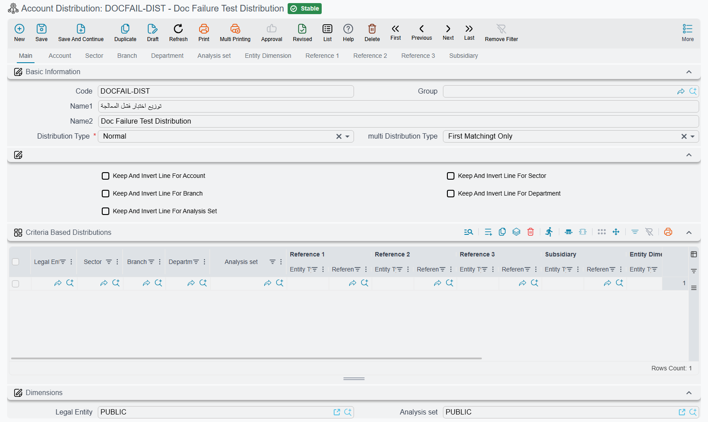

# Dimensions, Cost Centers & Distribution

An account answers "what" — cash, sales, salaries. **Dimensions** answer everything else: *which* branch, *which* department, *which* cost center, *which* project. They're the extra coordinates carried on every ledger line, and they're what turn a flat trial balance into reports you can slice by branch, by sector, by cost center. This page explains the dimension set as the ledger sees it, how accounts can restrict which dimensions they accept, and how **account distribution** spreads a value across them automatically. The five master files themselves — where a branch or a cost centre is created, and the composite dimension that stands for several at once — are in [Dimensions and Composite Dimensions](/platform/shared-master-files/dimensions-and-composite-dimensions).

## The dimension set

Every accounting line can carry a standard set of dimensions:

- **Legal Entity** — the company the line belongs to (in a multi-company database).
- **Sector**, **Branch**, **Department** — the organizational coordinates.
- **Analysis Set** — the free-form **cost-center tree** (`Basic > Dimensions > Analysis Set`). Unlike the fixed sector/branch/department, the analysis set is a tree you shape to your own cost-centre or project structure, so it's the most flexible dimension.
- **References 1–3** and a **record (entity dimension)** — extra hooks for finer analysis.

Alongside these, an account can carry up to **five subsidiary types** (customer, supplier, employee, etc.), so a single account can be analyzed by more than one kind of party.

## Restricting dimensions on an account

Not every account should accept every dimension. On the account itself you can tighten this:

- **Must Use With Public Sector Only** (and the same for **Branch**, **Department** and **Analysis Set**) — the account only accepts the public value of that dimension, not a specific one,
- **Do Not Use With Public Sector** (and the same for **Branch**, **Department** and **Analysis Set**) — the opposite: the account refuses the public value, so a specific one must be named,
- **Do Not Allow Empty Entity Dimension / Reference 1 … 3 / Narration / Narration 2 When Moving This Account** — force the user to fill the record, a reference or a narration on lines hitting this account.

These rules keep your analysis clean: a department-expense account can be made to *require* a department, a head-office account can be barred from department analysis entirely.

## Account distribution: spreading a value automatically

Sometimes one figure needs to be split across many dimensions — shared rent across all branches, a marketing cost across several departments. Rather than entering the split by hand every time, an **Account Distribution** rule (`Accounting > Settings > Account Distribution`) describes how to spread a value, and the system applies it.

A distribution rule sets, **for each dimension** (account, analysis set, branch, department, sector, references, subsidiary, record), how that dimension participates:

- a **policy** — **None** (don't distribute over this dimension), **Distribute Public Only** (distribute a line only when its own value for this dimension is the public one; a line that already names a specific value is left as it is), or **Distribute Any** (distribute every line, whatever value it carries). The account, record, reference and subsidiary policies offer only **None** and **Distribute Any**,
- an **order** (which dimension is distributed first), a **minimum undistributed value** (below which it won't bother splitting), and a **keep-and-invert** option,
- and for advanced cases, a **query** or **script** that computes the split dynamically.

The **distribution type** is either **Normal** or **Composite** (a distribution built up from other distributions). When several rule lines could apply, the **Multi Distribution Type** setting decides which fire: **First Matching Only**, **All Matching Consecutively**, or **All Matching Consecutively Consider Order**.

Finally, a distribution can be driven by the **other side** of the entry — "distribute based on the other side's branch / department / sector / subsidiary…" — and narrowed with **other-side criteria**, so the split mirrors how the opposite side of the transaction was analyzed.

## For Support

- **"A line won't accept a department / analysis set"** — the account is restricted; check its dimension rules (**Must Use With Public … Only** / **Do Not Use With Public …**).
- **"The system forces a reference or narration"** — that account has one of the **Do Not Allow Empty Reference … / Narration … When Moving This Account** options ticked.
- **"A value isn't being split the way I expect"** — review the **Account Distribution** rule: each dimension's **policy**, its **order**, the **minimum undistributed value**, and the **Multi Distribution Type**.
- **"The cost-center list is wrong"** — cost centers are the **Analysis Set** tree under `Basic > Dimensions`; fix it there.
- For where a document's *accounts* (not dimensions) come from, see [Document terms](./accounting-document-terms.md).
