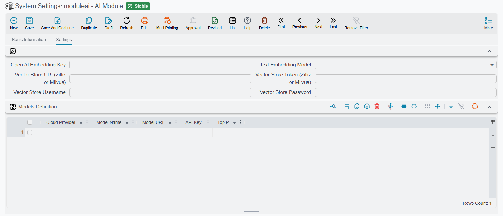

# AI Module Configuration

Before the [AI assistant](./ai-assistant.md) answers a question, or an [MCP client](./ai-mcp-server.md) connects to the system, the module needs basic setup: **which language model do you use? with which key? and where is the semantic index stored?** All of that is configured in the **AI Module settings**, which are system-wide.

::: info Required License
These settings require the AI module to be installed and licensed.
:::

## Chat Models (Models Definition)

The heart of the setup is the **Models Definition** grid: each line is a language model that becomes available to pick in the assistant window. For each model:

| Field | Role |
|---|---|
| **Cloud Provider** | The service provider (see the list below) |
| **Model Name** | The model name/id at the provider, such as `gpt-4o` or `claude-...` |
| **Model URL** | The endpoint address. Only two providers read it: DeepSeek, which falls back to `https://api.deepseek.com/v1` when it is empty, and the OpenAI-compatible provider, which falls back to `http://localhost:11434/v1` (a local Ollama). Every other provider ignores it |
| **API Key** | The authentication key at the provider (stored encrypted) |
| **Top P** | An optional parameter controlling answer diversity. Only the Gemini and OpenAI providers use it; the others ignore it |

::: tip More than one model at once
Define several models to let the user pick the most suitable one for each task from the model list at the top of the assistant window — an economical, fast model for everyday questions and a stronger one for complex analysis.
:::

### Supported Providers

Pick one of these seven in **Cloud Provider** (the labels are as the field shows them):

| Cloud Provider | The service |
|---|---|
| **OPEN AI** | OpenAI |
| **Anthropic** | Anthropic (Claude) |
| **GEMINI** | Google Gemini |
| **DeepSeek** | DeepSeek |
| **Mistral** | Mistral |
| **Zhipu AI** | Zhipu AI |
| **Opean AI Compatible** (spelled that way on screen) | Any endpoint that speaks the OpenAI API — a self-hosted model such as Ollama, or another vendor's compatible service; put its address in **Model URL** |

## Semantic Search and Embedding Setup

Many of the module's capabilities rest on **semantic search**: instead of matching text literally, the system turns records and documents into numeric representations (embeddings) stored in a **vector store**, making it possible to find the record "closest" to a meaning rather than just its text. This is what lets the assistant understand an approximate customer name, and pick the right tools for a question (see [How the assistant picks its tools](./ai-assistant.md#How-the-assistant-picks-its-tools)).

### Semantic Index Settings

The semantic search infrastructure is configured in the module settings themselves:

| Field | Role |
|---|---|
| **Open AI Embedding Key** | The OpenAI key used to generate embeddings |
| **Text Embedding Model** | The embedding model: `text-embedding-3-small`, `text-embedding-3-large`, or `text-embedding-ada-002` |
| **Vector Store URI** | The vector store address (Zilliz or Milvus) |
| **Vector Store Token** | The access token for the vector store |
| **Vector Store Username / Password** | Alternative vector store credentials (optional) |

### Choosing the Indexed Entities

Deciding **which records get indexed** is done in the **AI Record Embedding Config** screen: each line holds:

- **Master File Entity Type**: the master file type to index (customers, items, vendors, ...).
- **Extra Fields For Embedding**: extra fields included in the index to improve match accuracy (alongside the code and name).

Once indexed, the type becomes available for semantic search: the assistant — and query tools with a reference parameter — can find the record from free text rather than the explicit code (see [Type 1: Query Based](./ai-tool-definitions.md#Type-1-Query-Based)).

::: warning The in-app assistant needs this; MCP clients do not
The [in-app assistant](./ai-assistant.md) cannot start a conversation without the **Open AI Embedding Key**, the **Text Embedding Model** and the **Vector Store URI**: it uses them to choose which tools to offer the model for each message. For an external [MCP client](./ai-mcp-server.md) the whole section is optional — the tools work with explicit codes without any embedding setup; only finding a reference from free text needs the vector store and the entity to be indexed.

The documentation search tool (`AINamaERPDocsTool`) does not use the vector store at all. It asks Nama's own documentation search service, so all it needs is for the server to reach `https://nlm.namasoft.com` over HTTPS.
:::

## What You Need Before Connecting an MCP Client

Connecting an external client through the [MCP server](./ai-mcp-server.md) requires — in addition to the above — a committed **API Credentials** record (**Basic → Documents → API Credentials**) linked to a user via its **User** field. The endpoint, authentication, and client-setup details are in the [Nama ERP MCP Server guide](./ai-mcp-server.md).
