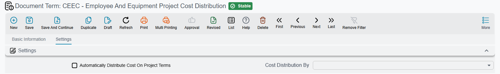

# Other Contracting Document Terms

Once the extracts, the material streams and the payment documents are configured, what remains is a long tail of terms that are mostly very small: one debit, one credit, and a guard or two. This page takes them in the order a reader is likely to meet them — cost capture first, then purchasing, then the two estimating documents.

There is a pattern worth holding on to. **A contracting term is short when the document's job is short.** The cost execution rolls figures up and needs one switch. The equipment statement books one journal entry and needs one pair of accounts. The analysis card creates no journal entry at all, so its term is about how lines are built rather than where they land. Only where a document is genuinely an invoice — the miscellaneous purchase invoice, the labour-and-plant invoice, the contracting purchase order — does the term grow into the full supply chain shape, and in those cases the right thing to read is the [supply chain reference](/modules/supplychain/document-terms/doc-term-accounting-effects.md) rather than this page.

The other thing to carry into this page is a caution about defaults. Two of the purchasing terms control the same idea — whether a document writes contracting cost and quantity figures at all — but one is phrased positively and the other negatively, so **out of the box they behave in opposite directions.** That is spelled out below, and it is the single most common surprise in this group.

## Cost capture

### Contracting Cost Execution

The [cost execution](/modules/contracting/costs/contracting-cost-execution.md) gathers the cost documents raised against a contract and derives an actual unit cost per term. Its term is one page with a single option.

| Option | What it does |
|---|---|
| **Manually Collect Cost Documents** `termConfig.manuallyCollectCostDocs` | The cost documents are gathered by an explicit user action instead of automatically. Use it where a quantity surveyor wants to choose which documents belong to this roll-up rather than accepting everything dated within the period |

### Daily Labour Book

The [daily labour book](/modules/contracting/costs/contracting-daily-labour.md) is a self-contained wage record: it books its own journal entry, and it can raise a subcontractor fine for deductions made against a labour supplier. Its term supplies both.

| Option | What it does |
|---|---|
| **Debit** and **Credit** `termConfig.debit2` / `termConfig.credit2` | The two sides of the labour book's own journal entry — typically project cost against wages payable or against the labour supplier |
| **Contractor Contract Fine Book** `termConfig.contractorContractFineBook` | The document book of the [subcontractor fine](/modules/contracting/contractor-contracting/contracting-contractor-fines.md) the labour book generates |
| **Contractor Contract Fine Term** `termConfig.contractorContractFineTerm` | And that generated fine's own document term |
| **Do Not Save If Actual Quantity Greater Than Planned Quantity** `termConfig.doNotSaveIfActualQtyGreatrThanTotalQty` | Refuses to save the labour book when the labour quantity it records against a term pushes that term's actual quantity above the planned quantity — the same ceiling as on the [material terms](/modules/contracting/document-terms/contracting-terms-materials.md) |
| **Do Not Save If Actual Cost Greater Than Planned Cost** `termConfig.doNotSaveIfActualCostGreatrThanTotalCost` | The same ceiling for cost: the save is refused when the labour cost recorded against a term takes its actual cost above the planned cost |

::: tip A generation chain that is easy to miss
The book and term for the fine a labour book raises are set **here**, on the labour book's term — not on the fine's term. If deductions recorded on a labour book never appear as fines, this pair being empty is the first thing to check.
:::

### Equipment Statement Document

The equipment statement books a journal entry and nothing else. Its term is correspondingly small: a **debit** and a **credit** (`termConfig.debit2` / `termConfig.credit2`), and that is the whole of what a reader needs to set. The two analysis-card ceilings also appear on this screen, but the equipment statement records no contracting term cost, so they never come into play — leave them alone.

### Employee And Equipment Project Cost Distribution

This is the document that turns an allocation of a person or a machine into project cost, sliced across the terms they worked on. Its term decides whether the slicing is manual.

| Option | What it does |
|---|---|
| **Automatically Distribute Cost On Project Terms** `termConfig.automaticallyDistributeCostOnTerms` | The collected cost is spread across the project's terms without the user entering a line per term |
| **Cost Distribution By** `termConfig.costDistributeType` | The proportional basis used for that automatic spread |

Leave the first option off and the cost lines are typed by hand, which is what a project controller wants when the machine genuinely worked on two terms in a ratio no formula would guess.

### Contracting Employee And Equipment Issue Invoice

This document's term is the supply chain **invoice** term — read it under [supply chain](/modules/supplychain/document-terms/doc-term-accounting-effects.md). Set the main accounting sides, the tax sides and the discount sides there, exactly as for a purchase invoice.

One fact belongs here rather than there, because readers assume the opposite: **this invoice books a payable and contributes no project actual cost.** Project cost from an allocation comes from the cost-distribution document above, not from the invoice. So a project whose crane hire shows on the invoice but not in the cost reports is behaving correctly — the missing step is the distribution document.

## Purchasing and spending

### Contracting Purchase Order

The contracting purchase order — the document the English menu lists as *Contractor Purchase Order*, although its contract field accepts only a **project** contract — uses the supply chain purchase term plus a handful of contracting additions. All the accounting sides, the tax behaviour and the invoice groups are the supply chain ones; read them [there](/modules/supplychain/document-terms/doc-term-accounting-effects.md), and note that with the main accounting sides empty the order books nothing.

| Contracting addition | What it does | Default |
|---|---|---|
| **Do Not Apply Contracting Cost And Quantity Effects** `termConfig.doNotApplyContactingCostAndQtyEffects` | Suppresses the contracting cost and quantity effect entirely, so the order does not reserve cost against a term | Off — meaning the effects **are** applied |
| **Do Not Exceed Quantity** `termConfig.doNotExceedQuantity` | Blocks ordering beyond the reference quantity | Off |
| **Do Not Exceed Analysis Card Quantity** `termConfig.doNotExceedAnalysisCardQuantity` | Blocks ordering beyond the quantity on the term's [analysis card](/modules/contracting/setup/contracting-term-analysis-cards.md) | Off |
| **Effect In Contracting Term Cost Entries Before Approval** `termConfig.effectInCNTRTermCostEntriesBeforeApproval` | Writes the contracting term-cost entries as soon as the order is saved, before the approval cycle finishes — so committed spend shows against the term while the order is still being approved | Off |
| **Add Term Analysis Card Lines** `termConfig.addTermAnalysisCardLines` | When a line names an [analysis card](/modules/contracting/setup/contracting-term-analysis-cards.md), the card's material lines are pulled onto the order automatically | Off |
| **Do Not Copy Contract Terms When Selected** `termConfig.doNotCopyContractTermsWhenSelected` | Picking the project contract on the order does not copy its terms onto the lines | Off — meaning the terms **are** copied |

The two analysis-card ceilings described on the [material terms page](/modules/contracting/document-terms/contracting-terms-materials.md) — `termConfig.doNotSaveIfActualQtyGreatrThanTotalQty` and `termConfig.doNotSaveIfActualCostGreatrThanTotalCost` — are also on this term, with the same scope: they bite when the line targets an analysis-card line.

### Contracting Purchase Request

The purchase request's term is the same supply chain shape, and it carries the positive twin of the option above:

| Option | What it does | Default |
|---|---|---|
| **Apply Contracting Cost And Quantity Effects** `termConfig.applyContactingCostAndQtyEffects` | Enables the contracting cost and quantity effect | Off — meaning the effects are **not** applied |
| **Add Term Analysis Card Lines** `termConfig.addTermAnalysisCardLines` | Pulls the analysis card's lines in when a line names a card | Off |
| **Do Not Copy Contract Terms When Selected** `termConfig.doNotCopyContractTermsWhenSelected` | Selecting a contract does not copy its terms onto the lines | Off |

::: info The request and the order behave oppositely out of the box
On the **order** the switch is phrased *Do Not Apply*, so leaving it alone means contracting cost and quantity effects **are** applied. On the **request** the switch is phrased *Apply*, so leaving it alone means they are **not**. Two adjacent documents, factory defaults, opposite behaviour. Decide explicitly for both terms and tick accordingly, rather than assuming one matches the other.
:::

### Executive Budget Item Request

This is the request for material spend against an [executive budget](/modules/contracting/budgets/contracting-executive-budget.md), and its term carries the module's only budget-derived spending ceilings.

| Option | What it does |
|---|---|
| **Allow To Exceed Approved Quantity** `termConfig.allowToExceedApprovedQty` | Lets the request go beyond the quantity the customer approved |
| **Allow To Exceed Approved Price** `termConfig.allowToExceedApprovedPrice` | Lets it go beyond the agreed price |

Both are permissions, so the control is what happens when they are **off** — the request is refused. There is a condition on that control, and it is the important part: the two checks are performed only on lines that carry a **customer submittal**. A line with the submittal left blank is not compared against anything. If the budget ceiling is the reason you are using this document, make the submittal a habit on every line; the full picture is on [Budget Item Requests](/modules/contracting/budgets/contracting-budget-item-requests.md).

### Miscellaneous Contracting Request, Order and Invoice

The three miscellaneous-contracting documents cover non-stock spend — a service, a hired fence, a site utility. They share one set of term options presented through more than one screen arrangement, so the same option may sit in a different place depending on which of the three you are configuring. The options themselves are the same.

| Option | What it does |
|---|---|
| **Debit** and **Credit** `termConfig.config.debit` / `termConfig.config.credit` | The two sides of the document's entry |
| **Shorten Ledger** `termConfig.config.shortenLedger` (in the Credit group) | Collapses the per-line journal rows into one row per account |
| The tax options — **Taxable** `termConfig.taxable`, **Tax Plan** `termConfig.taxPlan`, **Modifiable Tax** `termConfig.modifiableTax`, and the tax sides `termConfig.tax`, `termConfig.tax2`, `termConfig.htax`, `termConfig.htax2` | Whether the document is taxed, under which plan, and where the tax lands |
| **Allow Editing Header Tax In Details** `termConfig.allowEditingHdrTaxInDetails` | Copied onto each new document: lets a line carry a different tax from the header's. Off by default |
| **Sales Not Purchase** `termConfig.isSalesNotPurchase` | Treats the document as a sale rather than a purchase, which flips the direction of the whole entry |
| **Return Invoice** (invoice only) `termConfig.returnInvoice` | Marks the term as producing credit notes |
| **Project Term Code is Optional in Cost Documents** `termConfig.optionalProjectTermCodeInCostDocuments` | Makes the project term code optional on the lines |
| **Executive Budget Term Code is Mandatory in Cost Documents** `termConfig.mandatoryExecutiveBudgetTermCodeInCostDocuments` | Forces the executive-budget term code |
| **Estimated Budget Term Code is Mandatory in Cost Documents** `termConfig.mandatoryEstimatedBudgetTermCodeInCostDocuments` | Forces the estimated-budget term code |
| **Exclude Tax1 From Cost** … **Exclude Tax4 From Cost**, **Exclude Discount 1 From Cost** … **Exclude Discount 8 From Cost** — `termConfig.excludeTax1FromCost` … `termConfig.excludeTax4FromCost`, `termConfig.excludeDiscount1FromCost` … `termConfig.excludeDiscount8FromCost` | Each removes that one tax or discount amount from the cost the line records against the project term — the same capitalise-or-not decision as on the [subcontractor extract](/modules/contracting/document-terms/contracting-terms-extracts.md). Only the invoice records project cost, so these matter on the invoice term only |
| **Do Not Save If Actual Quantity Greater Than Planned Quantity** `termConfig.doNotSaveIfActualQtyGreatrThanTotalQty`, **Do Not Save If Actual Cost Greater Than Planned Cost** `termConfig.doNotSaveIfActualCostGreatrThanTotalCost` | The spending ceilings described on the [material terms page](/modules/contracting/document-terms/contracting-terms-materials.md): the save is refused when the cost or quantity recorded against a term overruns the plan. Like the exclusions, they act on the invoice only, because the request and the order record no project cost |
| **Track Quantity Fields From Doc** `termConfig.trackQuantityFieldsFromDoc` | When a document is built from an earlier miscellaneous document — an order from a request, an invoice from an order — its quantities are recorded as consumed on the source document's lines, in **Consumed Quantity 1** (*Track In First*) or **Consumed Quantity 2** (*Track In Second*). Leave it empty and nothing is tracked |
| **Copy Remaining Quantity From Doc Considering Fields** `termConfig.copyRemainingQtyFromDocConsideringFields` | When the source document's lines are copied in, each quantity is reduced by what that line has already consumed — in *Consumed Quantity 1* or *2*, as chosen — and fully consumed lines are left out. Empty, the full quantities are copied |
| **Link With Invoice Lines In Accounting Document** `termConfig.linkWithInvoiceLinesInAccountingDocument` | Receipt and payment vouchers carry the document's lines in their invoice grid |
| The invoice-discount and line-discount sides `termConfig.invoiceDiscount`, `termConfig.lineDiscount` | Where discounts on the document land |
| **E-Invoice Bank Account Field**, **E-Invoice Payment Terms Field** (invoice only, *Electronic Invoice* group) — `termConfig.eInvoiceBankAccountField`, `termConfig.eInvoicePaymentTermsField` | For the [Egyptian electronic invoice](/modules/invoicing/egypt-einvoice-guide.md): the document field whose value is reported as the bank account and as the payment terms |

Everything else on these screens is the standard supply chain invoice set — [pricing, taxes and discounts](/modules/supplychain/document-terms/doc-term-pricing-taxes-discounts.md) and [accounting effects](/modules/supplychain/document-terms/doc-term-accounting-effects.md).

The fact to hold on to: **of the three, only the invoice contributes project cost.** The request and the order carry the term codes and the analysis, but neither of them puts cost against a project term, and there is no option that makes them. Plan the flow so that the invoice always arrives — see [Miscellaneous Contracting Spend](/modules/contracting/costs/contracting-misc-spend.md).

## Estimating documents

### Term Analysis Card

The [analysis card](/modules/contracting/setup/contracting-term-analysis-cards.md) creates no journal entry, so its term is not about accounts at all. It is about how the card's lines are built and how the components roll into a unit cost.

| Option | What it does |
|---|---|
| **Spread Item Revision Lines** `termConfig.spreadItemRevisionLines` | The explode action produces one line per item revision |
| **Spread Item Colors And Sizes Lines** `termConfig.spreadItemColorAnsSizeLines` | And one line per colour and size combination |
| **Call Post Action Of Field After Spreading Revisions Or Sizes** `termConfig.callPostActionOfFieldAfterSpreadingRevisionsOrSizes` | Names a post-actor to be fired on the resulting lines after the explode has run. Leave it blank and no follow-up runs. It is only meaningful together with one of the two options above, which gate the spreading itself. On the Arabic screen this one field's caption appears in English |
| **Do Not Copy From Doc Details** `termConfig.doNotCopyFromDocDetails` | Building the card from a source document does not copy that document's detail lines |
| The unit-cost effects grid `termConfig.effectsUnitCostConfigLines` (columns `.fieldID`, `.valueType`, `.percentBasis`, `.multiplyBy`) | One row per cost component, saying how that component rolls into the unit cost: the field it reads, the value type, the percentage basis and a multiplier |

The grid is the reason the analysis card can express "labour is 40% of material" or "overheads are 8% of everything above" rather than only absolute amounts.

### Contracting Assay

The [assay](/modules/contracting/project-contracting/contracting-assays.md) — the priced bill of quantities — does create journal entries, but it uses a deliberately narrow set of effects. Its term screen is a single page, and what the assay actually books is:

| Group | What it records |
|---|---|
| **Debit** and **Credit** `termConfig.debit2` / `termConfig.credit2` | The main value of the assay's lines |
| **Tax 1** `termConfig.tax1Debit` / `termConfig.tax1Credit` | The first tax |
| **Tax 2** `termConfig.tax2Debit` / `termConfig.tax2Credit` | The second tax |
| The discount effects | One discount entry only. The assay draws on the **first discount debit** `termConfig.discount1Debit` and the **second discount credit** `termConfig.discount2Credit`, so those are the two sides to fill — set both or the discount line arrives one-sided |

Tax 3, tax 4, the cost pair, the actual-cost pair, the cost-variance pair and the variance groups are not part of what an assay books, so leave them out of your set-up plan for this document. The cumulative-pricing options belong to extracts.

## Worked example — the tail end of Tower A's configuration

Tower A needed five of the terms on this page, and none took long:

| Term | Document | What was set |
|---|---|---|
| `CCE-STD` | Contracting Cost Execution | *Manually Collect Cost Documents* on, because the QS chooses which cost documents belong in each monthly roll-up |
| `DLB-STD` | Daily Labour Book | Debit *project labour cost*, credit *wages payable*; fine book `CCF` and fine term `CCF-STD` so that deductions from the labour supplier become subcontractor fines automatically |
| `CEC-STD` | Employee And Equipment Project Cost Distribution | *Automatically Distribute Cost On Project Terms* on, distributed proportionally — the tower's crane serves every term and no one wants to slice 20 days by hand |
| `CPO-STD` | Contracting Purchase Order | Supply chain accounting sides for the purchase, *Do Not Apply Contracting Cost And Quantity Effects* left off so cost is reserved against the term, and *Do Not Exceed Analysis Card Quantity* on |
| `MCI-STD` | Misc Contracting Invoice | Debit *site expenses*, credit *supplier payable*, taxable under the standard plan, executive-budget term code compulsory |

The one deliberate asymmetry: the purchase **request** term `CPR-STD` was left with *Apply Contracting Cost And Quantity Effects* **off**, because on Tower A cost is reserved at the order, not at the request. That is a decision, not a default inherited from the order's term — and being explicit about it is the point of this page.
