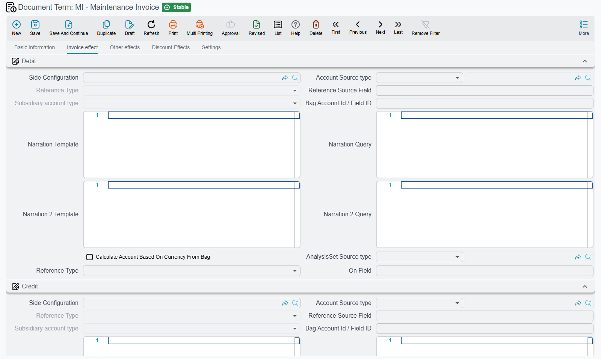

# Maintenance Document Terms

::: info Licence
The machine-maintenance terms need the `crm-maintenance` licence code; the service-maintenance
terms need `crm-maintenance-services`.
:::

The maintenance suites are where CRM document terms do real work. Almost everything that looks
automatic in maintenance — a contract that fans out into a year of work plans, a work plan that
turns into orders, an order that hands each machine to a technician as an execution sheet, an
invoice that empties the parts out of the warehouse — is driven from a term. Get the terms right
once and the whole cycle runs off button presses. Get them wrong and the buttons quietly do
nothing.

If you have not read [How CRM Document Terms Work](/modules/crm/document-terms/crm-terms-basics)
yet, start there: it explains the accounts block, the generation block and the one-sided-term trap
that applies here too.

## One term configuration, two products

The machine suite and the services suite are separate products under separate licences, but five
of the term configurations are literally the same shape used twice:

| Term configuration | Machine document | Services document |
|---|---|---|
| Order term | Maintenance Order (أمر صيانة), Maintenance Order Request (طلب أمر صيانة) | Maintenance Service Order (أمر خدمة صيانة) |
| Contract term | Maintenance Contract (عقد صيانة) | Maintenance Service Contract (عقد خدمة صيانة) |
| Invoice term | Maintenance Invoice (فاتورة صيانة) | Maintenance Service Invoice (فاتورة خدمة صيانة) |
| Invoice return term | Maintenance Invoice Return (مردود فاتورة صيانة) | Maintenance Service Invoice Return (مردود فاتورة خدمة الصيانة) |
| Work plan term | Maintenance Work Plan (خطة عمل صيانة) | Maintenance Service Work Plan (خطة عمل خدمة صيانة) |

The screens are adjusted per document — the services versions swap in their own book-and-term
fields and hide the account sides the services document cannot use — but the settings underneath
are shared. The services documents do less than their machine twins — no warranty contracts, no
payment schedules — so the last section of this page lists what the services terms use.

Four more terms are not shared at all: the Maintenance Estimation term, the Maintenance Order
Execution term, the Maintenance Visit term and the CRM Maintenance Plan term. The Maintenance
Service Order Execution has **no term configuration of any kind**.

## The generation pairs — what every generate button actually runs on

This is the single most important table in maintenance setup. Each row is a book-and-term pair
that lives on one term and produces one kind of document.

| Configured on the term for | Fields | Field ids | Produces | When |
|---|---|---|---|---|
| Maintenance Contract | دفتر خطة العمل / Work Plan Book · توجيه خطة العمل / Work Plan Term | `termConfig.mnWorkPlanBook` / `termConfig.mnWorkPlanTerm` | Maintenance Work Plans | Button *Generate maintenance work plans* |
| Maintenance Service Contract | دفتر خطة عمل خدمة صيانة / Service Work Plan Book · توجيه خطة عمل خدمة صيانة / Service Work Plan Term | `termConfig.mnSrvWorkPlanBook` / `termConfig.mnSrvWorkPlanTerm` | Maintenance Service Work Plans | The equivalent button |
| Maintenance Work Plan | دفتر أمر الصيانة / Mn Order Book · توجيه أمر الصيانة / Mn Order Term | `termConfig.mnOrderBook` / `termConfig.mnOrderTerm` | Maintenance Orders | Button *Generate maintenance orders* |
| Maintenance Service Work Plan | دفتر أمر خدمة صيانة / Service Order Book · توجيه أمر خدمة صيانة / Service Order Term | `termConfig.mnSrvOrderBook` / `termConfig.mnSrvOrderTerm` | Maintenance Service Orders | The equivalent button |
| Maintenance Order / Order Request | دفتر سند التنفيذ / Mn Execution Doc Book · توجيه سند التنفيذ / Mn Execution Doc Term | `termConfig.mnExecutionBook` / `termConfig.mnExecutionTerm` | Maintenance Order Executions | Buttons *create execution for all lines* / *for selected lines* |
| Maintenance Service Order | the service execution book and term | `termConfig.mnSrvExecutionBook` / `termConfig.mnSrvExecutionTerm` | Maintenance Service Order Executions | The equivalent buttons |
| Maintenance Order / Order Request | دفتر عقد الضمان / Warranty Contract Book · توجيه عقد الضمان / Warranty Contract Term | `termConfig.warrantyContractBook` / `termConfig.warrantyContractTerm` | A warranty Maintenance Contract | **Automatically**, on commit, when Order Type is *Installation* |
| Maintenance Invoice / Service Invoice | دفتر سند صرف مخزني / Stock Issue Book · توجيه سند صرف مخزني / Stock Issue Term, plus *Generate Stock Issue With Spare Parts* and *Generate Stock Issue With Service Items* | `termConfig.stockIssueBook` / `termConfig.stockIssueTerm`, `termConfig.genStockIssueWithSpareParts`, `termConfig.genStockIssueWithServiceItems` | A supply-chain Stock Issue | **Automatically**, on commit |
| Maintenance Invoice Return / Service Invoice Return | دفتر سند توريد مخزني / Stock Receipt Book · توجيه سند توريد مخزني / Stock Receipt Term, plus the two *Generate Stock Receipt With…* switches | `termConfig.stockReceiptBook` / `termConfig.stockReceiptTerm`, `termConfig.genStockReceiptWithSpareParts`, `termConfig.genStockReceiptWithServiceItems` | A supply-chain Stock Receipt | **Automatically**, on commit |

Read that table as a chain and the worked example falls straight out of it. Contract `MC-0021` is
saved under book `MC` with term `T-MC-STD`; that term names work-plan book `WP` and term
`T-WP-STD`, so *Generate maintenance work plans* produces `WP-0087` … `WP-0098`, one per month.
Term `T-WP-STD` in turn names order book `MO` and term `T-MO-STD`, so pressing *Generate
maintenance orders* on a plan produces `MO-0513`. Term `T-MO-STD` names execution book `OEX` and
term `T-OEX-STD`, so the order's execution buttons produce `OEX-0771` … `OEX-0773`. Finally
invoice `MINV-0298` is saved under book `MINV` with term `T-MINV-STD`, whose stock-issue book `SI`
and term `T-SI-CRM` produce the supply-chain issue `SI-1904` on commit.

Break any link in that chain by leaving a book or term empty and the chain stops there.

::: warning Generation needs both the book and the term
The manual buttons refuse politely: they answer with a message asking you to set the book and term
on the named term, and no documents appear. The automatic ones say nothing at all — an invoice
whose term has no stock-issue book simply commits without generating a stock issue, and nobody is
told.

Two details worth knowing while you configure:

- Work-plan generation from a contract also needs the **contract start and end dates** filled in.
  Without them the button fails, whatever the term says.
- The order-generation and execution-generation checks only fire when **both** the book and the
  term are empty. Fill one and leave the other and the check stays silent, so always set the pair
  together.
:::

## Which maintenance documents reach the ledger

Only some of them, and always through the term's Debit and Credit sides.

| Document | Its term's accounting behaviour |
|---|---|
| Maintenance Order, Maintenance Order Request | An **Effect** (التأثير) page with a single Debit and Credit pair (`termConfig.debit`, `termConfig.credit`). Set both and the document creates a two-sided journal entry over its spare-part and service lines. |
| Maintenance Contract, Maintenance Service Contract | An **Invoice effect** (تأثير الفاتوره) page — the full invoice shape: Debit and Credit (`termConfig.config.debit`, `termConfig.config.credit`), with tax, discount, cash and approximation-discount (`termConfig.approximationDiscount`) sides. |
| Maintenance Invoice, Maintenance Service Invoice | The same full invoice shape. The **Settings** page of **both** invoice terms adds the **Serivce Fees** group (the label is misspelt on screen) with four Service Fees debit/credit pairs (`termConfig.serviceFees1Debit` … `termConfig.serviceFees4Credit`) — see [the service-fee switches](#The-rest-of-the-machine-suite-settings) below. The machine invoice also has a **Services Debit** / **Services Credit** pair (مدين الخدمات / دائن الخدمات, `termConfig.servicesDebit` / `termConfig.servicesCredit`): fill both and the service lines are booked against them instead of the invoice's main sides, so labour revenue can sit apart from spare-parts revenue. Leave either empty and the service lines use the main sides. |
| Maintenance Invoice Return, Maintenance Service Invoice Return | The same, in the opposite direction — including the Services Debit / Credit pair on the machine invoice return. |
| Maintenance Estimation | It creates no accounting entry. |
| Maintenance Service Order | Its term shows no account sides, and the document creates no accounting entry. |
| Maintenance Order Execution | Tax settings only. It creates no accounting entry and moves no stock. |
| Maintenance Notice, both sales orders, both sales quotations, Maintenance Visit, the plans | Nothing. |

As on every CRM term, the effect only happens when **both** sides are configured. One side alone
means no journal entry, no error message and nothing in Business Requests, because no request was
ever raised.

## Stock issue: the invoice term or the manual buttons

::: warning Issue spare parts by one route only
Stock generation is configured on the maintenance invoice term, as `T-MINV-STD` does in our
example. The manual *Spare parts issue* buttons on the order, the execution and the invoice are an
**alternative** to that term-driven generation, never an addition to it. They open a pre-filled
supply-chain document for someone to save, with no "already issued" check, so using both routes
for the same repair takes the same parts out of the warehouse twice. Choose one route per site and
train people on it. See
[Maintenance Invoicing](/modules/crm/maintenance-cycle/crm-maintenance-invoicing).
:::

## The warranty contract an installation order creates

An order whose Order Type is *Installation* automatically creates a warranty Maintenance Contract
on commit, using the warranty-contract book and term on the order's own term. That generated
contract is a full copy — machines, spare parts, services **and the whole money block**.

::: warning Leave the warranty-contract term without account sides
The warranty contract is a contract like any other, so if the term you name in *Warranty Contract
Term* has Debit and Credit configured, the installation revenue reaches the ledger twice: once
from the order, once from the contract it generated. Nothing warns you.

Point *Warranty Contract Term* at a term whose account sides are deliberately empty. See
[Maintenance Orders](/modules/crm/maintenance-cycle/crm-maintenance-orders).
:::

::: warning A maintenance order *request* is not a neutral request
The Maintenance Order Request shares the order term's shape, Effect page and all, and it creates
its journal entry the same way the order does. A document whose whole purpose is to *ask* for work
will reach the ledger the moment it is saved if its term carries account sides. Give requests their
own term with the sides left empty.
:::

## The rest of the machine-suite settings

The order term also carries **Do Not Copy Header Data Of From Doc** and **Do Not Copy Details Of
From Doc** (`termConfig.doNotCopyHeaderDataOfFromDoc`, `termConfig.doNotCopyDetailsOfFromDoc`), the
tax group (**Tax Plan**, **Taxable**, **Modifiable Tax**, **Allow Editing Header Tax In Details** —
`termConfig.taxPlan`, `termConfig.taxable`, `termConfig.modifiableTax`,
`termConfig.allowEditingHdrTaxInDetails`), **Consider Task Templates Tasks When Creating Executions**
(اعتبار مهام قوالب المهام عند إنشاء عمليات التنفيذ, `termConfig.considerTaskTemplatesTasksWhenCreatingExecutions`
— take the checklist from the header task template rather than the machine line's), and on the
machine order only, a reward-points configuration and a discount-coupon group and book
(`termConfig.rewardPointsConfig`, `termConfig.discountCouponGroup`, `termConfig.discountCouponBook`).

The invoice term adds **Consider Lines Of FromDoc** (`termConfig.considerLinesOfFromDoc`), **Copy
Remaining To Cash** (`termConfig.copyRemainingToCash`), **Price List Default Price**
(`termConfig.priceListDefaultPrice`), **Allow Payment More Than Invoice Amount**
(`termConfig.allowPaymentMoreThanInvoiceAmount` — unticked, receipts are capped at the invoice's
net), and on the machine invoice the same reward-points and coupon fields. The rest of its
**Settings** page:

| Option | Field id | What it does |
|---|---|---|
| **Use Payment Docs As Debt Ages** (استعال سندات الدفع في أعمار الديون) | `termConfig.usePaymentDocsAsDebtAges` | Machine invoice only. The invoice's external payment lines — the receipts recorded against it — also count as debt-age rows, so the debt-age analysis sees them. Unticked, they do not. |
| **Service Fees 1 Deduction** … **Service Fees 4 Deduction** (خصم مصاريف خدمة 1 … 4) | `termConfig.serviceFees1Deduction` … `termConfig.serviceFees4Deduction` | Both invoices. Treats that service fee as a deduction from the invoice's net value instead of an addition, and reverses its entry accordingly. |
| **Do Not Add Service Fees Effect Without Account Side** | `termConfig.doNotAddServiceFeesEffectWithoutAccSide` | Both invoices. A service-fee line whose own debit or credit side is empty is left out of the entry, instead of being booked to the term's main sides. |

The **Discount Effects** page of the Maintenance Contract and Maintenance Invoice terms — and of the
[CRM Service Contract term](/modules/crm/document-terms/crm-terms-basics#The-CRM-Service-Contract-term)
— ends with the **External Effects** grid (تأثير سندات الدفع, `termConfig.externalEffectLines`). Each
row adds a debit/credit pair to the document's own journal entry for every receipt recorded against
it, using the receipt's value: **For Type** (`termConfig.externalEffectLines.forType`) limits the row
to one payment-document type, **Apply When Payment Document Matches Criteria** / **… Query**
(`termConfig.externalEffectLines.applyWhenPaymentDocMatchesCriteria`,
`termConfig.externalEffectLines.applyWhenPaymentDocMatchesQuery`) filter the receipts, and **Debit** /
**Credit** (`termConfig.externalEffectLines.debit`, `termConfig.externalEffectLines.credit`) are the
sides of the added pair.

Both the order term and the invoice term offer **Update Machine Dysfunction Warranties**
(تحديث جدول ضمانات الأعطال في الآلة, `termConfig.updateMachineDysfunctionWarranties`), which writes
the machine's dysfunction-warranty rows.

::: warning Tick Update Machine Dysfunction Warranties on one term, not two
If both the invoice's term and its source order's term have this option on, the invoice is
**refused outright** with a message naming the two files. Decide whether the order or the invoice
is the document that registers warranties at your site — in our example it is the order term
`T-MO-STD` — and switch it off on the other.
:::

The smaller terms hold almost nothing: the Maintenance Order Execution term has only the four tax
settings, the Maintenance Visit term has only *Consider Lines Of FromDoc*
(`termConfig.considerLinesOfFromDoc`), and the CRM Maintenance Plan term is completely empty.

## The services-suite terms

Everything above applies to the services suite with the shared fields renamed. Two points are
specific to the service terms:

- On the **Maintenance Service Order** term, the service execution book and term
  (`termConfig.mnSrvExecutionBook`, `termConfig.mnSrvExecutionTerm`) drive the service
  order's execution buttons. They are the two fields immediately below the do-not-copy switches, and
  their labels appear untranslated on screen in both languages.
- On the **Maintenance Service Invoice** term, tick **Generate Stock Issue With Spare Parts**
  (`termConfig.genStockIssueWithSpareParts`) to have
  the invoice issue its spare parts from the warehouse. The generated stock issue carries the
  spare-part lines; on the **Maintenance Service Invoice Return** term, *Generate Stock Receipt With
  Spare Parts* (`termConfig.genStockReceiptWithSpareParts`) does the same in reverse.

See [Services or Machines?](/modules/crm/services-suite/crm-services-suite-overview) for the wider
picture of what the services branch does.

The **Maintenance Service Order Execution** has no term
configuration at all, so its Document Term offers only the platform's standard options. In our
example `SEX-0090` is saved under book `SEX` with no term.
