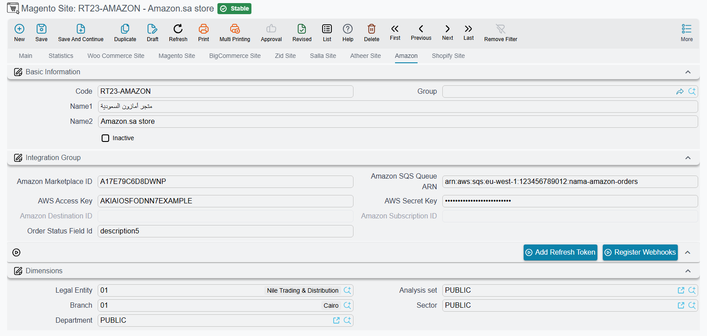

# Amazon Order Notifications

If you sell on Amazon, you don't want to sit refreshing Seller Central waiting for orders to ship so you can punch them into the ERP by hand. This guide shows you how to wire your Amazon Seller account to Nama so that **every change Amazon makes to an order reaches Nama on its own** — typically, an order marked as shipped turns into a Sales Order without anyone typing it.

It uses Amazon's SP-API `ORDER_CHANGE` notifications — Amazon's way of telling you "something happened to this order" the moment it happens.

## How it works (the short version)

Here's the one thing that shapes the whole setup: **Amazon will not push notifications directly to your ERP.** The only place Amazon agrees to deliver order notifications is an **Amazon SQS queue** — a message inbox that lives in *your* AWS account. So the flow looks like this:

```
Amazon changes an order (for example, ships it)
   → an ORDER_CHANGE notification lands in your SQS queue (in your AWS account)
   → Nama polls that queue on a schedule
   → for every order whose status changed, Nama reads it fresh and creates the document your site's
     generation lines call for (normally a Sales Order)
```

You set the queue up once, hand Nama three values so it can read the queue, and schedule a small task to do the polling. After that it just runs.

::: tip Why a queue instead of a direct push
Because Nama *pulls* from the queue rather than waiting to be pushed to, this works even when your ERP isn't reachable from the internet — on-premise installations included. Notifications wait safely in the queue until the next poll, so nothing is lost if the ERP is briefly down or busy.
:::

## What you need before you start

- An Amazon **SP-API app** with the **Notifications** role enabled, and a completed authorization for the seller account.
- An **AWS account** of your own, in the **same region** as your Amazon marketplace.

---

## Part 1 — Set up AWS (once, in your own AWS account)

### Step 1: Create the SQS queue

In the AWS Console go to **SQS → Create queue**, choose type **Standard**, give it a name like `NamaOrderQueue`, and create it.

On the queue's page, copy the **ARN** shown at the top — Nama needs it later. It looks like this:

```
arn:aws:sqs:us-east-1:123456789012:NamaOrderQueue
```

::: warning Region must match your marketplace
Create the queue in the **same AWS region** as your Amazon marketplace. Nama reads the region straight out of this ARN, so if they don't match, notifications won't flow.
:::

### Step 2: Let Amazon send to the queue

Amazon needs permission to drop messages into your queue. On the queue, open **Access policy → Edit** and allow Amazon's SP-API account to send messages:

```json
{
  "Version": "2012-10-17",
  "Statement": [
    {
      "Sid": "AllowAmazonSPAPISend",
      "Effect": "Allow",
      "Principal": { "AWS": "arn:aws:iam::437568002678:root" },
      "Action": "sqs:SendMessage",
      "Resource": "arn:aws:sqs:us-east-1:123456789012:NamaOrderQueue"
    }
  ]
}
```

Swap the `Resource` ARN for your own queue's ARN from Step 1. The number `437568002678` is Amazon's fixed SP-API account — without this statement, registering the notification destination in Part 2 will fail.

### Step 3: Create an IAM user so Nama can read the queue

Nama needs its own credentials to pull and delete messages. In **IAM → Users → Create user** (call it something like `nama-sqs-reader`), then attach an **inline policy** scoped to just this one queue:

```json
{
  "Version": "2012-10-17",
  "Statement": [
    {
      "Effect": "Allow",
      "Action": [
        "sqs:ReceiveMessage",
        "sqs:DeleteMessage",
        "sqs:GetQueueAttributes"
      ],
      "Resource": "arn:aws:sqs:us-east-1:123456789012:NamaOrderQueue"
    }
  ]
}
```

Then on the user, go to **Security credentials → Create access key**, choose *Application running outside AWS*, and copy the **Access Key ID** and **Secret Access Key** now — AWS shows the secret only once.

---

## Part 2 — Configure the Amazon site in Nama

Open the **Magento Site** record of your Amazon store (**Site Type** = Amazon) and fill in:

| Field | What to put there |
|-------|-------------------|
| **User Name (Consumer Key)** / **Password (Consumer Secret)** | Your SP-API app **client ID** / **client secret** |
| Amazon Marketplace ID | Your marketplace |
| **Amazon SQS Queue ARN** | The ARN from Part 1, Step 1 |
| **AWS Access Key** | The Access Key ID from Part 1, Step 3 |
| **AWS Secret Key** | The Secret Access Key from Part 1, Step 3 |
| **Order Status Field Id** | **Required on Amazon sites** — the site will not save without it. The id of a text field on the sales document (for example a spare text field) where Nama writes the order's Amazon status. Nama compares each notification with the status already saved there and skips the order when nothing changed. |

**Save** the record, then:

1. Click **Add Refresh Token** and paste into **Refresh Token** the refresh token Amazon gave you when you authorized the app for the seller account. Nama stores it on the site.
2. Click **Register Webhooks**. This tells Amazon to start delivering `ORDER_CHANGE` notifications to your SQS queue. Behind the scenes Nama registers the queue as a notification *destination* and subscribes to `ORDER_CHANGE`; on success the **Amazon Destination ID** and **Amazon Subscription ID** fields fill in.

::: tip Re-registering is safe
If you click **Register Webhooks** again, Nama reuses the destination already registered for your queue instead of creating duplicates, so you won't end up with stray subscriptions.
:::



---

## Part 3 — Schedule the polling task

The last piece is the recurring job that drains the queue. Create a **Task Schedule** with **Task Type** = Action running `com.namasoft.modules.magento.utils.EAEcommerceReadAmazonNotifications`, scheduled every one or two minutes:

- **Parameter 1 — Site Code:** the code of your Amazon site.
- **Parameter 2 — Max Messages Per Run:** leave empty for 500.
- **Parameter 3 — Process Notifications For Last (N) days:** leave empty to start from the site's **Orders Updated Until** date.
- **Parameter 4 — Process Only Order Statuses:** for example `Shipped`, to create Sales Orders only for shipped orders. Leave it empty to process **every** status.

Every run pulls the new notifications waiting in the queue, reads each changed order fresh from Amazon and passes it to the site's document generation lines. Notifications left out by Parameters 3 and 4 are deleted from the queue, and several notifications for the same order cost a single read; [EAEcommerceReadAmazonNotifications](/entity-flows/magento/EAEcommerceReadAmazonNotifications) explains each parameter and the order of the steps.

An order whose Amazon status equals the one already saved in the **Order Status Field Id** of its document is skipped, so a repeated notification never creates a second document.

---

## Checking that it works

- **Quick test:** In the AWS console open the queue → **Send and receive messages** → send a test `ORDER_CHANGE` message. On the next poll Nama processes it — watch the server log.
- **Real test:** Mark a test order as **Shipped** in Amazon Seller Central. Within one polling interval the matching Sales Order should appear in Nama.

A notification that fails to process stays on the queue and is retried on the next run; after the queue's maximum receive count, SQS moves it to the queue's dead-letter queue if you configured one.
