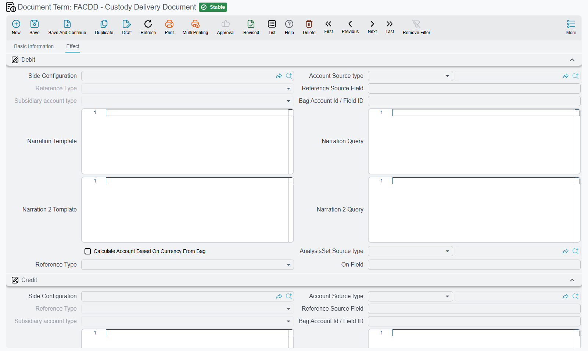

# Terms for Custody and Letters of Credit

Two chains in this module keep their own accounting, and both are configured differently enough from
the main asset documents to deserve their own page.

**Custody** is a separate register — laptops, phones, tools issued to staff — that is never
depreciated, so its terms are not about cost and depreciation at all. They are about moving a value
from one holder to another. **Letters of credit** are the opposite problem: several documents collect
costs over months and one closing document turns the accumulated total into an asset cost.

## Custody Terms

Custody documents have no asset accounts to fall back on, so — unlike the fixed asset documents — the
term supplies **both** sides of every entry. The four custody terms are all account wiring and nothing
else.

### The custody purchase term

Buying a custody item is an invoice, and its term reads like one. It has three pages: the term's own
identity and tax settings, then the invoice effect, then the other effects.

The settings page carries the same tax options as the fixed asset purchase term — **Taxable**
(`termConfig.taxable`), **Tax Plan** (`termConfig.taxPlan`), **Is tax modifiable** (`termConfig.modifiableTax`) and
header taxes editable per line (`termConfig.allowEditingHdrTaxInDetails`) — plus **Link with invoice lines in the
accounting document** (`termConfig.linkWithInvoiceLinesInAccountingDocument`), which ties each ledger line back to the
invoice line that produced it.

The **invoice effect** page carries the two sides of the purchase — the group `مدين` / Debit
(`termConfig.config.debit`) and the group `دائن` / Credit (`termConfig.config.credit`) — plus the shorten-ledger option
(`termConfig.config.shortenLedger`), the payment-order rule (`termConfig.payInstallmentsInOrder`), the same
link-with-invoice-lines switch again, and **Allow Payment More Than Invoice Amount**
(`السماح بدفع مبلغ أكبر من قيمة الفاتورة`, `termConfig.allowPaymentMoreThanInvoiceAmount`). With that last one off, a
payment document that would push the purchase's remaining amount below zero is refused with
*Remaining {0} in document {1} became negative* — «المتبقي {0} فى المستند {1} أصبح بالسالب»; switch it on to
accept overpayments. The **other effects** page carries the tax 1 group (`termConfig.tax`, with its other-side option
`termConfig.taxesOtherSide.tax1OtherSide`) and the cash group (`termConfig.cash`).

When Al-Waha buys the `CDY-0033` laptop for 6,000:

| | Debit | Credit |
|---|---|---|
| Custody value — *the term's debit side* | 6,000 | |
| Supplier — *the term's credit side* | | 6,000 |

Note what has *not* happened: the 6,000 did not become an expense. It is sitting in whatever account
you named on the debit side, waiting to be assigned to a person. That is the whole point of the custody
register, and the delivery term below is what moves it.

### The custody delivery term

The delivery document is where a purchased item becomes somebody's responsibility. Its term is a single
page holding one debit account side (`termConfig.config.debit`) and one credit account side
(`termConfig.config.credit`), and there is nothing else on it.

The setup that makes custody reporting work is this: make the **debit** an account resolved from the
**employee**, so that each person's holdings land in their own subsidiary account, and make the
**credit** the account the purchase parked the value in — "custodies in store", or whatever you called
it. Handing the laptop to Khaled Al-Mutairi then moves 6,000 out of store and onto Khaled.

The amount recorded is the custody's price multiplied by the percentage of it that holder takes, so a car
shared 60/40 between two staff produces two lines that add up to its price.

### The custody transfer term

A transfer moves an item from one holder to another, which is two movements in one document: value
comes off the people who had it, and goes onto the people who now have it. The term therefore carries
**two pairs of account sides** — one pair for the holders the item is leaving (`termConfig.custodyLinesConfig.debit` /
`termConfig.custodyLinesConfig.credit`), one for the holders it is joining (`termConfig.currentLinesConfig.debit` /
`termConfig.currentLinesConfig.credit`).

In the ordinary case both pairs point at the same two accounts as the delivery term, and the effect is
a reversal off the old holder and a charge onto the new one. Keeping them separately configurable is
what lets you route, say, a transfer to a different branch through a mediating account.

### The custody disposal term

Disposal ends the custody's life — scrapped, sold, lost, written off. Its term carries two pairs of
account sides as well: one pair that **clears the value the custody was carrying**
(`termConfig.custodyLinesConfig.debit` / `termConfig.custodyLinesConfig.credit`), and one pair for the **disposal value**
itself (`termConfig.disposalConfig.debit` / `termConfig.disposalConfig.credit`).

::: info There is no gain or loss account here
Unlike the fixed asset disposal, the custody disposal term has no profit and no loss account. If a
laptop carried at 6,000 is sold for 1,500, the difference is not computed into a separate line — the
accounts you nominate on the two pairs have to absorb it. Choose them with that in mind: most sites
point the disposal pair at a write-off account precisely so the difference has somewhere sensible to
land.
:::

## Letter of Credit Terms

The letter-of-credit chain has four documents, and three of them have something to configure.

### The letter of credit and the proforma invoice

The **letter of credit** itself (`اعتماد أصول`) has no term at all — it is the folder that the other
three documents hang off, not a financial document.

The **proforma invoice** (`فاتوره اعتماد مبدئية`) books nothing. This is the document that lists the goods —
Press A at 300,000 and Press B at 200,000 for Al-Waha's `LC-2026-004` — and those figures are a *distribution
base*, not a cost. They tell the system how to share out the expenses; they never capitalise by themselves, so
its term has no accounts.

What its term does have is one switch on its Settings page: **Create Asset If Not Found**
(`إنشاء الأصول إذا لم تكن موجودة`, `termConfig.createAssetIfNotFound`). With it on, committing the proforma invoice
creates a fixed asset record, in its initial state, for every line that does not yet name one — taking the asset
type, name, coding group and classifications from the line — and writes the new asset back onto the line, so the
expense and cost documents that follow have an asset to load. It only works when the module setting *Add Fixed Assets
Creation Columns To Fixed Assets Opening And Purchase* is on as well; with either one off, every line must point at
an asset somebody registered beforehand. See [module configuration](/modules/fixedassets/fixedassets-configuration.md).

### The expense document term

Every cost that lands on the shipment is entered on expense documents: the supplier's goods value,
freight, customs duty, clearance, insurance, bank charges. Its term is a single page, and it is the
page where you set the two sides of the expense entry — the account the cost is collected into while it
waits for the closing document (`termConfig.config.debit`), and the account of whoever is owed the money
(`termConfig.config.credit`).

That second side is more interesting than it looks. Because it is a full account side, it can resolve
per document rather than being a fixed account: point it at the letter of credit's **insurance party**
or **customs party** and each expense document credits the right company automatically, instead of
forcing one clearing account to stand in for everyone.

The same page carries:

- **four tax pairs**, a debit and a credit account each (`termConfig.tax1Debit` / `termConfig.tax1Credit` …
  `termConfig.tax4Debit` / `termConfig.tax4Credit`);
- **a discount pair** (`termConfig.discount1Debit` / `termConfig.discount1Credit`);
- **Do Not Affect On Cost** (`عدم التأثير في التكاليف`, `termConfig.donotAffectOnCost`) — the switch that marks a line as booked but
  excluded from the landed cost, for charges you want in the ledger but not in the machine's value;
- **Taxable** (`termConfig.taxable`), **Editable Taxes** (`termConfig.editableTaxes`) and **Tax Plan** (`termConfig.taxPlan`).

For `LC-2026-004` the expense documents collect 615,000: goods 500,000, freight 40,000, customs duty
60,000 and clearance 15,000.

### The cost document term — the one that takes the asset's own account

The closing document sums each asset's share of everything the expense documents collected, writes it
onto the asset as its cost, and puts the machines into service. Its entry reverses what the expense
documents built up.

Here is the fact that surprises people, and the reason this term screen looks almost empty: **the cost
document debits each asset's own main account, taken from the asset — not from the term.** However you
configure this term, the asset side comes from the machine's accounts bag, normally inherited from its
asset type. So the term has exactly one thing to set: the **clearing account on the credit side**
(`termConfig.config.credit`), the account the expense documents debited and that this document now empties.

For `LC-2026-004`, with the 615,000 distributed by value — 60% to Press A and 40% to Press B:

| | Debit | Credit |
|---|---|---|
| `PRS-0001` Press A cost account — *from the asset* | 369,000 | |
| `PRS-0002` Press B cost account — *from the asset* | 246,000 | |
| Letter-of-credit clearing — *the term's credit side* | | 615,000 |

The practical consequence is that **getting an imported machine into the right cost account is an asset
type question, not a term question**. If Press A is landing in the wrong account, look at
`FAT-MCH — Machinery & Equipment` and at the press's own accounts bag; changing the cost document's
term will not move it.

See [the cost document](/modules/fixedassets/letters-of-credit/fixedassets-lc-cost-document.md) for what
else that document does to the assets — the depreciation parameters, the status change, and the closing
of the credit.
