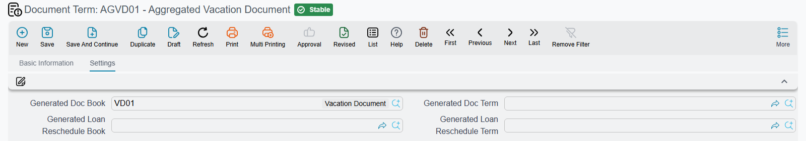

# Attendance and Vacation Document Terms

Vacation and attendance documents rarely create an accounting entry by themselves — a vacation does not move
money, it moves a balance, and the money follows later on a salary document. So the terms on this
family are mostly about **what else gets created** when the document is saved, and only occasionally
about accounts.

The shared mechanics — what a term is, why most aggregated terms only name a book and a term, and
the three differently-named accounting switches — are on
[Salary and Dues Document Terms](/modules/hr/document-terms/hr-terms-salary-and-dues#How-HR-document-terms-work).

## The Vacation Document term

The vacation document's term is a small set of side effects.

| Option | Field | What it does |
|---|---|---|
| **Generate Delegation** | `termConfig.generateDelegation` | Saving the vacation also creates a **delegation** document from the employee to the vacation's **Alternative Employee**, for the vacation's start date to its return date, so somebody is formally covering the absentee's responsibilities while they are away. The delegation is created only when the vacation document has an **Alternative Employee** and its **From Document** is filled (as it is on a vacation document generated from another document); otherwise nothing is created. |
| **Generated Delegation Book** | `termConfig.generatedDelegationBook` | The book that delegation is filed in. With the switch ticked and this book empty, no delegation is created. |
| **Change Employee State Only If Vacation Start Date Matches Today** | `termConfig.changeEmpStateIfDateMatchToday` | Saving a vacation document changes the employee's state to the one named in **Change Employee State To** on the vacation reason or, failing that, on the vacation type. With this option ticked, a vacation whose start date is later than today does not change the state when it is saved; the state changes when, on or after the start date, the document is saved again or the entity flow *Change Employee State From Query Based On Vacation Documents* runs over it. Leave it off and a vacation entered three weeks ahead moves the employee's state today. |
| **Generated Loan Reschedule Book / Term** | `termConfig.generatedLoanRescheduleBook`, `termConfig.generatedLoanRescheduleTerm` | When the vacation document has **Postpone Loans During Vacation** ticked, saving it creates an **Aggregated Loan Installment Reschedule** that pushes the employee's unpaid instalments out. These two name that document's book and term, and both must be for the Aggregated Loan Installment Reschedule type. |

Loans are postponed only for a vacation document that has **Postpone Loans During Vacation** ticked —
the term alone never postpones anything. With the box ticked and this book or term empty, the
document is refused (see [Vacation Documents](/modules/hr/vacations/vacation-documents#Postponing-loans-during-the-vacation)).

## The aggregated vacation terms

Three aggregated documents cover a batch of employees, and their terms do what aggregated terms
usually do — name the book and term of what they create.

| Term | Fields | What it creates |
|---|---|---|
| **Aggregated Vacation Document** | `termConfig.generatedAggVacationDocTerm`, `termConfig.generatedAggVacationDocBook`, plus its own *Generated Loan Reschedule Book / Term* | One vacation document per line. When the aggregated document itself has **Postpone Loans During Vacation** ticked, it also creates one Aggregated Loan Installment Reschedule in that book and term, and is refused if either is empty. |
| **Multi Employee Vacation** | `termConfig.generatedAggVacationDocTerm`, `termConfig.generatedAggVacationDocBook` | One vacation document per employee, with no loan reschedule. |
| **Aggregated Vacation work Starting document** | `termConfig.generatedWorkStartingDocBook` | The work-starting documents that record a batch of employees coming back. Note it names only a **book** — there is no term field here. |

## The Vacation Compensation term

Paying an employee for vacation they did not take is one of the few attendance-family documents that
does have an accounting effect, so its term carries one pair of account sides on its *Effect* tab,
shown under the group titles **Debit** and **Credit**. Their field ids are `termConfig.debit2` and
`termConfig.credit2`; there is no other pair.

The field that matters most is **Compensation Value Calculation Formula**
`termConfig.compensationCalcFormula`: the component calculation formula that decides what a day of
untaken vacation is actually worth. Is it basic salary only, or basic plus allowances? That question
is answered here, not on the document, which is why two compensation terms with different formulas
are a normal arrangement.

The **aggregated** compensation term is the usual short one: *Vacation Compensation Book* and
*Vacation Compensation Term* (`termConfig.compensationBook`, `termConfig.compensationTerm`).

See [Vacation Compensation and Transfer](/modules/hr/vacations/vacation-compensation-and-transfer).

## The Holidays and Rest Balance term

This document compensates employees for public holidays and weekly rest days they worked, by adding
to a vacation balance rather than by paying cash. Its term says **which balance**:

| Option | Field | What it does |
|---|---|---|
| **Rest Days Compensation Vacation Type** | `termConfig.restDaysCompensationVacationType` | The vacation type that a worked weekly rest day is credited to. |
| **Holidays Compensation Vacation Type** | `termConfig.holidaysCompensationVacationType` | The vacation type that a worked public holiday is credited to. |
| **Recalculate Employee Attendance Lines** | `termConfig.reCalculateEmpAttendanceLines` | Saving the document re-runs the employee's system attendance calculation, so the days it compensates are re-read rather than taken from what was calculated before. |

Pointing both types at the same vacation type is legitimate and common; keeping them apart lets a
customer give rest-day work and holiday work different expiry or carry-over rules, since those live
on the vacation type.

::: tip Compensating in balance, not in cash
Because this document credits a vacation balance, nothing appears on a payslip. If a customer
expects money, the tool is a salary component driven by the rest-day and holiday overtime
indicators, not this document. See
[Overtime and Lateness](/modules/hr/attendance/overtime-and-lateness).
:::

## The aggregated leave permission and mission terms

Both are the pure two-field shape:

- **Aggregated Leave Permission** — *Leave Permission Term* `termConfig.leavePermissionTerm` and
  *Leave Permission Book* `termConfig.leavePermissionBook`.
- **Aggregated Mission Document** — *Mission Document Term* `termConfig.missionDocTerm` and
  *Mission Document Book* `termConfig.missionDocBook`.

The individual leave permission and mission documents have **no term configuration of their own** —
everything that governs them is on [HR Configuration](/modules/hr/setup/hr-configuration) (the
permission ceilings, the overlap priorities, whether either adds to overtime) or on the document
itself. So if you are hunting for a setting that changes how a mission behaves, the term is the
wrong place to look.

## Related pages

- **[Salary and Dues Document Terms](/modules/hr/document-terms/hr-terms-salary-and-dues)** — the
  shared mechanics and the money documents.
- **[Vacation Documents](/modules/hr/vacations/vacation-documents)** — the documents themselves.
- **[Vacation Types and Balances](/modules/hr/vacations/vacation-types-and-balances)** — what the
  compensated balances are.
- **[Leave Permissions and Missions](/modules/hr/attendance/leave-permissions-and-missions)**
- **[HR Configuration](/modules/hr/setup/hr-configuration)** — where the attendance rules actually
  live.
