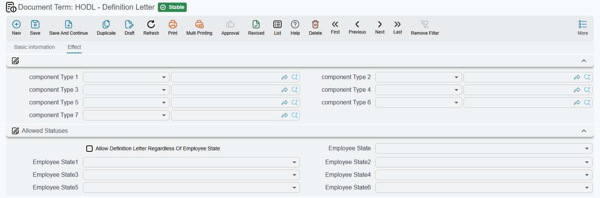

# Employment and Government Relations Document Terms

These are the documents that change **who somebody is** rather than what they are paid: the offer
that hires them, the update that changes their salary or their department, the relocation, the
termination, and — in the Gulf countries — the residence, sponsorship and visa paperwork that keeps
them legally employed.

Almost none of them has an accounting effect. Their terms are about what else gets created and what the document is
allowed to change.

The shared mechanics — what a term is, why most aggregated terms only name a book and a term, and
the three differently-named accounting switches — are on
[Salary and Dues Document Terms](/modules/hr/document-terms/hr-terms-salary-and-dues#How-HR-document-terms-work).

## Job offers

**The Job Offer term** has exactly one field, and it answers a question every implementation hits:
*Do Not Change Hiring Date Of Employee* `termConfig.doNotChangeHiringDateOfEmployee`. Normally
saving a job offer made to an existing employee, with its **Start Date** filled, sets both the
employee's **Commencement date** and **Hiring date** to that Start Date. Tick this and the hiring date is
left alone (the commencement date still changes) — which is what you want when the offer is a
re-issue, a correction, or a formality for somebody who has been working for months.

**The Candidate Job Offer term** repeats that option and adds the pair that makes it an aggregated
document: *Generated Job Offer Book* and *Generated Job Offer Term* (`termConfig.genJobOfferBook`,
`termConfig.genJobOfferTerm`) — the book and term of the job offers created from candidates.

Recruitment is on [Job Offers and Tests](/modules/hr/recruitment/job-offers-and-tests).

## Updating employee information

The employee update document is how almost every change to an employee is recorded — a raise, a
transfer, a new job position, a change of vacation entitlement. Its term has three fields, and two
of them are about provisions.

| Option | Field | What it does |
|---|---|---|
| **Employee Provision Book** | `termConfig.employeeProvisionBook` | The book of the provisions recalculation document the update creates. |
| **Employee Provision Term** | `termConfig.employeeProvisionTerm` | Its term. |
| **Copy Boolean Fields To Employee** | `termConfig.copyBooleanFieldsToEmployee` | The five generic yes/no fields on the update document are copied onto the employee master file, not only the values and references. The shipped Arabic label keeps the English word *Boolean*. |

The provisions pair matters more than it looks. A raise changes what the end-of-service provision
should be, so saving the update document creates (or updates) an employee provisions recalculation
document — but only when the value of at least one component whose component type has **Generate
Auto Adjustment If Value Changed** ticked has changed, and only when both the book and the term are
filled here. An empty pair here is a common cause of provisions that quietly stop tracking salary
changes.

**The aggregated update term** names *update Employee Info Book* and *Update Employee Info Term* for
the individual documents, and adds two tolerances: *Allow Empty Employee In Components*
`termConfig.allowEmptyEmployeeInComponents` and *Allow Empty Employee In Vacations*
`termConfig.allowEmptyEmployeeInVacations`. Both let a batch carry component or vacation rows that
name no employee, which is how a template row is applied to everybody the batch collects instead of
being repeated per person.

## Relocation and termination

**The Employee Relocate term** carries a single *Without Accounting Effect*
`termConfig.withoutAccountingEffect`. By default a relocation creates an entry that moves the
employee's open balance-sheet balances from the old dimensions to the new ones; ticking this stops
that entry. The entry itself is explained on
[Employee Relocation](/modules/hr/recruitment/employee-relocation).

**The firing terms** — both the aggregated firing document and the aggregated firing request — share
one field inherited from a common shape: *Generated Firing Document Book*
`termConfig.generatedFiringBook`. Neither adds anything of its own. Saving the aggregated document
creates one document per line in this book: a **Firing Document** per line from the Aggregated
Firing Document, and a **Firing Request** per line from the Aggregated Firing Request. With the
book empty the save is refused with *You must fill firing book in term {0}*.

What the termination actually pays is not here: it is on the dues liquidation term, covered in
[Salary and Dues Document Terms](/modules/hr/document-terms/hr-terms-salary-and-dues).

## The definition letter term

A definition letter («خطاب تعريف موظف») is the letter an employee asks for to show a bank or an embassy:
it confirms that they work here and what they earn. Its term decides **which salary the letter
states**.

**Seven component slots.** *Component Type 1* through *Component Type 7*
(`termConfig.componentType1` … `termConfig.componentType7`) name the salary component types that
add up to the letter's **Monthly Salary**. This is the whole point of having more than one definition
letter term: a letter for a bank might state basic salary and housing allowance, and a letter for a
visa application might state the full package. How the amount is read from the salary documents is on
[Government Relations Overview](/modules/hr/government-relations/government-relations-overview).

## The Gulf government-relations terms

Three aggregated documents drive the government paperwork, and all three are the two-field shape —
the book and term of the individual requests the batch creates:

| Term | Fields |
|---|---|
| **Aggregated Residence Renewal Request** | *Residence Request Book* `termConfig.residenceReqBook`, *Residence Request Term* `termConfig.residenceReqTerm` |
| **Aggregated Sponsorship Transfer Document** | *Generated Sponsorship Transfer Document Book* `termConfig.generatedHOSponsorshipTransferDocBook`, *Generated Sponsorship Transfer Document Term* `termConfig.generatedHOSponsorshipTransferDocTerm` |
| **Aggregated Exit / Re-Entry Visa Request** | *Exit ReEntry Visa Book* `termConfig.hoExitReEntryVisaBook`, *Exit ReEntry Visa Term* `termConfig.hoExitReEntryVisaTerm` |

The residence renewal term adds one thing the others do not: an **Excluded Nationalities** grid
`termConfig.excludedNationalities`. Employees whose **Nationality** is listed are skipped by the
**Collect Employees** action — which is how a renewal run leaves out nationals of the country itself, or any group whose residence
is handled outside the system.

Government relations are on
[Government Relations Overview](/modules/hr/government-relations/government-relations-overview),
[Residence Renewal](/modules/hr/government-relations/residence-renewal) and
[Social Insurance and Sponsorship](/modules/hr/government-relations/social-insurance-and-sponsorship).

## Related pages

- **[Salary and Dues Document Terms](/modules/hr/document-terms/hr-terms-salary-and-dues)** — the
  shared mechanics and the money documents.
- **[Insurance Document Terms](/modules/hr/document-terms/hr-terms-insurance)** — health and car
  insurance, the other half of the Gulf paperwork.
- **[Employee HR Information](/modules/hr/setup/employee-hr-information)** — what an update document
  changes.
- **[Firing and Termination](/modules/hr/end-of-service/firing-and-termination)**
