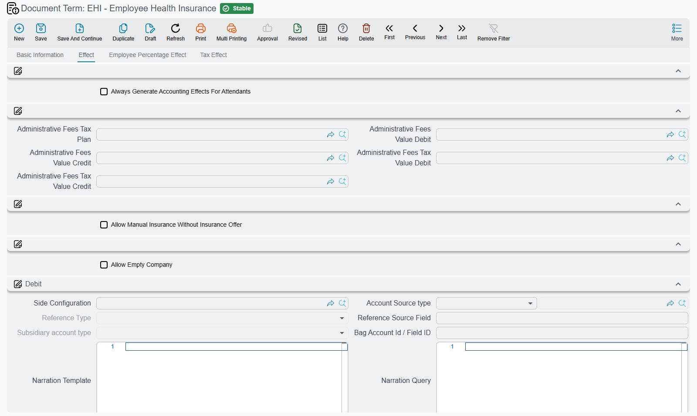

# Insurance Document Terms

Two insurance products live in the HR module and they are not related to each other. **Employee
health insurance** — adding staff and their dependants to a medical policy, upgrading them, claiming
against it — needs the Gulf health-insurance licence (`humanresource-gulf-health-insurance`).
**Car insurance** — a fleet policy, cars added to and removed from it, and the instalments proved
against it — needs the car-insurance licence (`humanresource-car-insurance`).

What they have in common is that both genuinely have an accounting effect, both involve a third party who invoices you,
and both carry tax. Their terms are therefore the most account-heavy in the module after dues
liquidation.

The shared mechanics — what a term is, why most aggregated terms only name a book and a term, and
the three differently-named accounting switches — are on
[Salary and Dues Document Terms](/modules/hr/document-terms/hr-terms-salary-and-dues#How-HR-document-terms-work).

## The health insurance terms

Five documents — the employee insurance itself, an upgrade, an upgrade request, a deletion, and a
credence — share one long common shape, and each then adds a little of its own. The claim document
has a term of its own, described at the end of this section.

### What every health insurance term carries

**The Effect tab.** Three groups of account sides, titled **Debit**, **Credit** and **Discount**.
Their field ids are `termConfig.debit2`, `termConfig.credit2` and `termConfig.firstDiscountAcc` — the
"2" in the ids is historical; there is no first pair on these terms.

**The Employee Percentage Effect tab.** The employee's own share of the premium is recorded on its
own pair, again shown under the group titles **Debit** `termConfig.coveringDebit` and **Credit**
`termConfig.coveringCredit`. The employee's share of tax has its own pair beside it, *Employee Tax
Debit* `termConfig.empTaxDebit` and *Employee Tax Credit* `termConfig.empTaxCredit`. The same tab
shows *Previous Insurance Value Credit* `termConfig.previousInsValueCredit` and *Previous Insurance
Value Debit* `termConfig.previousInsValueDebit` on every health term, but only the upgrade document
uses them — on the other four they have no effect.

**The Tax Effect tab.** The tax sides, under the group titles **Debit** `termConfig.tax` and
**Credit** `termConfig.tax2`; *Tax Plan* `termConfig.taxPlan` names the plan; *Modifiable Tax*
`termConfig.modifiableTax` lets a user override the computed tax on the document; and *Tax After
Discount* `termConfig.taxAfterDiscount` decides whether tax is calculated on the gross or on the net
after discount.

**Administrative fees.** Insurers charge a handling fee, and it is tracked separately: *Administrative
Fees Value Debit* `termConfig.administrativeFeesValueDebit` / *Credit*
`termConfig.administrativeFeesValueCredit`, *Administrative Fees Tax Value Debit*
`termConfig.administrativeFeesTaxValueDebit` / *Credit* `termConfig.administrativeFeesTaxValueCredit`,
and its own *Administrative Fees Tax Plan* `termConfig.administrativeFeesTaxPlan` — because the fee
is often taxed at a different rate from the premium.

**Two tolerances.**

| Option | Field | What it does |
|---|---|---|
| **Allow Empty Company** | `termConfig.allowEmptyCompany` | The insurance document may be saved without naming the insurance company. |
| **Allow Manual Insurance Without Insurance Offer** | `termConfig.allowManualInsuranceValues` | Values may be typed in directly instead of coming from an insurance offer. This is the term for insuring somebody outside the normal offer process. Not on the upgrade request's term. The shipped Arabic label misspells «التأمينات». |

**Always Generate Accounting Effects For Attendants** `termConfig.genAccountingEffectsForAttendants`
— dependants ("attendants") always produce their own accounting effect, rather than being folded
into the employee's. Only the **Employee Health Insurance** and **Employee Health Insurance Delete**
terms show it.

### What each document adds

**The Health Insurance Upgrade term** is the interesting one. Upgrading somebody's insurance
category mid-year means reversing part of what was already booked, so it carries a group titled
*Previous Insurance Category Credit and Debit* with sides for the **previous** arrangement: *Previous
Insurance Category Credit* `termConfig.previousInsCategoryCredit` and *Debit*
`termConfig.previousInsCategoryDebit`, plus *Refund Tax Debit* `termConfig.refundTaxDebit` and
*Refund Tax Credit* `termConfig.refundTaxCredit` for the tax on the refunded portion. The *Previous
Insurance Value* pair on the Employee Percentage Effect tab is read for this document too.

It also carries **Use Health Insurance Upgrade Document To Downgrade Employee Insurance**
`termConfig.useHealthInsuranceUpgradeDocToDowngradeEmpInsurance` — the same document, run in
reverse, moves an employee to a **cheaper** category. Without this the upgrade document only ever
goes up, and a downgrade has to be done by deleting and re-adding.

**The Health Insurance Upgrade Request term** uses the same screen as the upgrade term, without
*Allow Manual Insurance Without Insurance Offer*. A request creates no accounting entry, so the only
option on it that changes anything is *Use Health Insurance Upgrade Document To Downgrade Employee
Insurance*: ticked, the request may name a lower category; unticked, a line that names the same or a
lower category is refused with:

*Cant upgrade To Low or same Category* — «لايمكن الترقية إلى نفس الفئة او فئة اقل»

The account sides on a request's term are ignored.

**The Health Insurance Delete term** adds *Do Not Override Value With Save*
`termConfig.doNotOverrideValueWithSave`: the refund value typed by the user is kept instead of being
recalculated every time the document is saved. Useful when the insurer has told you the exact refund
and it does not match what the system would compute.

**The Health Insurance Credence term** adds nothing at all beyond the common shape.

**The Health Insurance Claim term** is separate and short: an *Effect* tab with one pair of account
sides, shown under the group titles **Debit** `termConfig.debit2` and **Credit** `termConfig.credit2`.
There is no other pair.

Health insurance is on
[Employee Health Insurance](/modules/hr/health-insurance/employee-health-insurance).

## The car insurance terms

Four documents — the policy, a car added, a car removed, and an instalment proof — have terms that
look alike, but each shows a different subset of the same fields. All four have an *Effect* tab that
opens with the same two groups:

- **Accounts** — *Credit* `termConfig.credit` and *Debit* `termConfig.debit`, the premium itself.
- **Taxes** — *Credit 2* `termConfig.credit2` and *Debit 2* `termConfig.debit2`, which are the tax
  sides, and *Tax Plan* `termConfig.taxPlan`.

After that they differ:

| Field | Policy | Adding | Removing | Instalment Proof |
|---|---|---|---|---|
| **Discounts** group — *Discount Credit* `termConfig.discountCredit`, *Discount Debit* `termConfig.discountDebit` | ✓ | — | ✓ | ✓ |
| **Fees Value** group — *Fees Credit* `termConfig.feesCredit`, *Fees Debit* `termConfig.feesDebit` | ✓ | — | — | — |
| **Fees Taxes** group — *Fees Taxes Credit* `termConfig.feesTaxesCredit`, *Fees Taxes Debit* `termConfig.feesTaxesDebit` | ✓ | — | — | — |
| *Use As Cost Source Document In Contracting* `termConfig.useAsSourceCostDoc` | ✓ | ✓ | — | ✓ |
| *Calculate Day Cost From Value After Discount* `termConfig.calculateDayCostFromValueAfterDiscount` | ✓ | ✓ | — | ✓ |
| *Contracting Cost Debit* `termConfig.contractingCostDebit` / *Credit* `termConfig.contractingCostCredit` | ✓ | ✓ | — | ✓ |
| *Modifiable Tax* `termConfig.modifiableTax` | ✓ | ✓ | — | — |
| The instalment proof chain (below) | ✓ | ✓ | — | — |
| *Allow Adding Insurances Without Insurance Request or Insurance Offer* `termConfig.allowAddingInsuranceWithoutRequestOrOffer` | ✓ | ✓ | — | — |
| *Allow Adding Car To Insurance If It Found In Policy* `termConfig.allowAddingCarToInsuranceIfItFoundInPolicy` | — | ✓ | — | — |

So the **Removing** term is the leanest — accounts, taxes and discount only — and only the **Policy**
term has the fees.

::: warning The fees labels are borrowed from another module
The Arabic labels on *Fees Debit* and *Fees Credit* read «مدين/دائن رسوم انهاء خطاب الضمان» —
letter-of-guarantee termination fees — which has nothing to do with car insurance. The fields work
correctly; only the caption was copied from elsewhere. Read them as the insurance fees.
:::

**Cost and the daily rate.** *Calculate Day Cost From Value After Discount* decides whether the
per-day cost of insuring a car is derived from the gross premium or from the net after discount —
which matters because that daily figure is what gets charged when a car joins or leaves the policy
part-way through the year. *Use As Cost Source Document In Contracting* and the two *Contracting
Cost* sides carry the insurance to a contracting project's cost.

**The instalment proof chain.** Three fields work together on the policy and adding terms:

| Option | Field | What it does |
|---|---|---|
| **Generate Insurance Installment Proof Document** | `termConfig.generateInsuranceInstallmentProofDoc` | Saving the document also creates the entry that proves the premium instalment is due. |
| **Proof Document Book** / **Proof Document Term** | `termConfig.proofDocBook`, `termConfig.proofDocTerm` | Where that proof document is filed and what accounting effect it has. |
| **Save Insurance Installment Proof Document As Draft** | `termConfig.saveInsuranceInstallmentProofDocAsDraft` | The proof is created as a draft, so somebody reviews it before it reaches the accounts. |

**Allow Adding Insurances Without Insurance Request or Insurance Offer** is the car-side equivalent
of the health side's manual tolerance: insurance may be added without a request or an offer behind
it.

**Allow Adding Car To Insurance If It Found In Policy**, on the adding term only, lets a car already
on the policy be added again. Normally that is a mistake, but it is legitimate when a car is re-added
after a mid-term removal.

## The Car Action term

A [Car Action](/modules/hr/employee-services#Recording-what-happened-to-a-car-Car-Action) records
what a company car cost — a repair, an accident, a licence renewal — and splits that cost between
the company and the responsible employee. Its term decides where each part of the split lands.

The term has two tabs. Each pair below creates entries only when **both** its sides are filled.

**Effect** — the company's part:

| Option | Field | What it does |
|---|---|---|
| **Debit** / **Credit** (group titles) | `termConfig.coveringDebit`, `termConfig.coveringCredit` | The part of each line's cost before tax that the company covers — the cost minus the responsible employee's share. |
| **Tax Credit** / **Tax Debit** (group *Tax*) | `termConfig.taxCredit`, `termConfig.taxDebit` | The company's share of the tax. If the responsible-tax pair on the other tab is empty, this pair takes the whole tax. |
| **Tax Plan** | `termConfig.taxPlan` | The plan whose rate is put on each line's tax percentage when the term is chosen on the document. |
| **Update Tax Percent** | `termConfig.updateTaxPercent` | **Ticked by default**: the tax percentage on each line stays as the user left it when the document is saved. Untick it and every save resets each line's tax percentage to the tax plan's rate. |
| **Do Not Copy From Date And To Date To Car Licence Start Date And Licence End Date** | `termConfig.doNotCopyFromDateAndToDateToCarLicenceDate` | Normally, saving a *License Renewal* action copies the line's From and To dates onto the car's licence start and end dates (when the new end date is not earlier than the car's current one). Tick this to leave the car's licence dates alone. |

**Responsability Effect** (the label is spelled that way on screen) — the responsible employee's
part:

| Option | Field | What it does |
|---|---|---|
| **Debit** / **Credit** (group titles) | `termConfig.debit2`, `termConfig.credit2` | The responsible employee's share of each line's cost before tax — typically a receivable on the employee. |
| **Responsible Tax Credit** / **Responsible Tax Debit** | `termConfig.respTaxCredit`, `termConfig.respTaxDebit` | The responsible employee's share of the tax. If the company tax pair is empty, this pair takes the whole tax. |

## Related pages

- **[Salary and Dues Document Terms](/modules/hr/document-terms/hr-terms-salary-and-dues)** — the
  shared mechanics and the money documents.
- **[Employment and Government Relations Document Terms](/modules/hr/document-terms/hr-terms-employment-and-government)**
- **[Employee Health Insurance](/modules/hr/health-insurance/employee-health-insurance)**
- **[Account Side Configuration](/platform/shared-master-files/accounting-side-config)** — how a debit or credit side
  finds its account.
