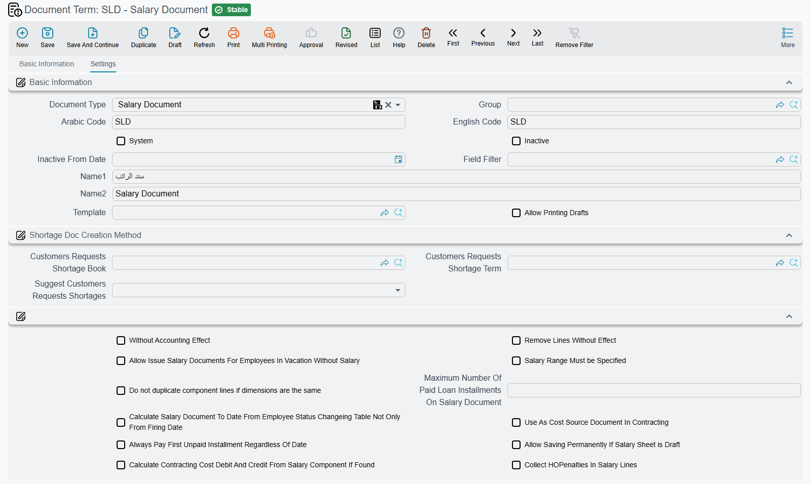

# Salary and Dues Document Terms

A salary document knows everything about the month it pays for. It knows the employee, the basic
salary, the overtime hours, the loan instalment and the absence deduction. The one thing it does not
know is which account any of those figures belongs in, or whether it should create an accounting entry at all.

That is the job of the **document term** («توجيه المستند»). Every HR document carries a Term field
beside its book, and the term is the record that answers the accounting and behaviour questions the
document itself cannot. Change the term and the same salary document produces a different journal
entry — or none.

This page covers the terms behind the money documents: salary documents and sheets, daily salary,
dues liquidation, annual increases and the employee provisions documents. The other HR terms are on
the sibling pages listed at the end.

## How HR document terms work

Three things are worth knowing before you open any HR term, because they are true of all of them.

**A term belongs to one document type.** The Term screen shows different fields depending on the
document type it is for; a salary document's term and a vacation document's term have almost
nothing in common. Most implementations end up with a handful of terms per document type, each
paired with its own book — one for monthly staff and one for daily labour, one that creates an entry and one
that does not.

**Most aggregated terms only name a book and a term.** Half the HR document types come in pairs: an
*aggregated* document that processes a batch of employees, and the individual documents it creates
for each of them. The aggregated document's term is usually very short, because its whole job is to
say **which book and which term the generated documents get**. If a batch produces documents that
hit the wrong accounts, the term to fix is almost never the aggregated one — it is the term the
aggregated one hands out.

::: warning The switch that turns the accounting effect off has three different names
The same idea is spelled three ways across HR terms, and the sense is inverted between them:

- **Without Accounting Effect** («بدون تاثير محاسبي») — tick it to stop the accounting entry.
- **Generate Accounting Effects** («إنشاء تأثير محاسبي») — tick it to **start** creating the entry.
- **With Accounting Effect** on the reward and penalty term — same sense as the second.

So a ticked box means "no entry" on a salary document and "an entry" on a salary sheet. Read the
label, not the tick.
:::

## The Salary Document term

This is the most consequential term in the module. It carries no accounting sides of its own — a
salary document's accounts come from the [salary components](/modules/hr/payroll/salary-components)
— but it decides a great deal about how the document behaves.

| Option | Field | What it does |
|---|---|---|
| **Without Accounting Effect** | `termConfig.withoutAccountingEffect` | The document produces no journal entry at all. This is the term to use for a parallel or simulated payroll run. |
| **Remove Lines Without Effect** | `termConfig.removeLinesWithoutEffect` | Drops component lines that came out as zero, which makes a long payslip readable. |
| **Salary Range Must be Specified** | `termConfig.salaryRangeMustBeSpecified` | Refuses the document unless a salary generation range is named. |
| **Allow Issue Salary Documents For Employees In Vacation Without Salary** | `termConfig.allowIssueForInVacationEmps` | Issues a document for an employee on unpaid leave. The label notes what it is for: *(other components only)* — the basic is not paid, but other components can still reach them. |
| **Do not duplicate component lines if dimensions are the same** | `termConfig.doNotDuplicateComponents` | Merges component lines that differ only by a dimension that is in fact identical. |
| **Calculate Salary Document To Date From Employee Status Changeing Table Not Only From Firing Date** | `termConfig.calcSalaryToDateFromStateSysEntry` | The document's To Date is taken from the employee's status-change history rather than from the firing date alone — which matters when someone was suspended or moved states mid-month. |
| **Maximum Number Of Paid Loan Installments On Salary Document** | `termConfig.maxNumberOfPaidLoanInstallments` | Caps how many loan instalments one document may settle. Without it, a document that covers several months' arrears can swallow several instalments at once. |
| **Always Pay First Unpaid Installment Regardless Of Date** | `termConfig.alwaysPayFirstUnpaidInstallmentRegardlessOfDate` | The oldest unpaid instalment is always taken, even if its due date has not arrived. |
| **Allow Saving Permanently If Salary Sheet is Draft** | `termConfig.allowSavingPermanentlyIfSalarySheetDraft` | Lets a salary document be saved permanently while the sheet above it is still a draft. |
| **Update Currency Rate Value With Save** | `termConfig.updateCurrencyRateValueWithSave` | Refreshes the exchange rate on every save instead of keeping the rate the document was created with. |
| **Collect HOPenalties In Salary Lines** | `termConfig.collectHOPenaltiesInSalaryLines` | Government penalty documents that carry a salary component are collected into the payslip's lines. |
| **Fetch Previous Other Issuance Salary Docs** | `termConfig.fetchPreviousOtherIssuanceSalaryDocs` (column `termConfig.fetchPreviousOtherIssuanceSalaryDocs.issuance`) | A grid of salary issuances. Its label explains the case: when no salary document exists for the same period under the issuance being processed, the system looks for one in a previous period under the issuances listed here. |

Four more options matter only when the Contracting module is in play: **Use As Cost Source Document
In Contracting** `termConfig.useAsSourceCostDoc`, **Contracting Cost Debit**
`termConfig.contractingCostDebit` and **Contracting Cost Credit** `termConfig.contractingCostCredit`,
and **Calculate Contracting Cost Debit And Credit From Salary Component If Found**
`termConfig.calculateContractingCostDebitAndCreditFromSalaryComponentIfFound`. Together they let
payroll land on a project's cost rather than only on a salary expense account, with the component's
own accounts winning where it has them.

::: info Where the "last salary document before firing" flag lives
The **Last Salary Doc for Employee before Firing** flag — the one that selects the *In Last Salary
Document* deduction set on [HR Configuration](/modules/hr/setup/hr-configuration) — is not on this
term screen. It is ticked on the salary document itself, on the salary sheet line, or automatically by
the salary sheet term's *Mark Salary Document As Last…* option described below.
:::

## The Salary Sheet term

The sheet is the batch; the salary documents under it are what actually pay. Its term is therefore
mostly about **which documents get created and what they inherit**.

**The generated documents' identity.** *Generated Doc Term* `termConfig.generatedDocTerm` and
*Generated Doc Book* `termConfig.generatedDocBook` name the term and book every salary document
created by this sheet is given. This is the pairing to check first when documents hit the wrong accounts.

**Or a book per dimension.** The *Generated Docs Books* grid `termConfig.lines` holds dimension/book
pairs — columns `termConfig.lines.dimensions.legalEntity`, `termConfig.lines.dimensions.branch`,
`termConfig.lines.dimensions.sector`, `termConfig.lines.dimensions.department`,
`termConfig.lines.dimensions.analysisSet` and `termConfig.lines.documentBook` — and
*Calculate Book From Employee* `termConfig.calcBookFromEmployee` makes the sheet pick a book from
that grid based on the employee's own dimensions instead of using the single book above. This is how
one payroll run files its documents into a different book per branch or per company.

**What the documents copy from the employee.** Five switches — *Copy Legal Entity / Sector / Branch
/ Department / AnalysisSet From Employee* (`termConfig.copyLegalEntityFromEmployee`,
`termConfig.copySectorFromEmployee`, `termConfig.copyBranchFromEmployee`,
`termConfig.copyDepartmentFromEmployee`, `termConfig.copyAnalysisSetFromEmployee`) — decide whether each dimension is taken from the employee rather than from the sheet.
These are read alongside the four dimension groups on
[HR Configuration](/modules/hr/setup/hr-configuration), which decide the same question at line
level; a sheet that copies from the employee and a configuration that overrides from the document
will fight, and the configuration wins on the line.

**Ignore Legal Entity In Collecting Employees** `termConfig.ignoreLegalEntityInCollectingEmployees`
— collection crosses company boundaries. Useful for a shared-services payroll, and dangerous
everywhere else.

**Mark Salary Document As Last If There is a Firing Document Found In Current Period**
`termConfig.markLastSalaryDocIfFiringDocFoundInPeriod` — the sheet sets the *Last Salary Doc before
Firing* flag automatically on any employee whose firing document falls in the period. This is the
reliable way to get the last-document deduction rules applied; the alternative is ticking the flag by
hand on each salary document or sheet line.

**Generate Accounting Effects** `termConfig.generateAccountingEffects` — remember that here a tick
means "do create the entry", the opposite of the salary document's own switch. *Salary Range Must be Specified*
`termConfig.salaryRangeMustBeSpecified` and *Allow Issue Salary Documents For Employees In Vacation
Without Salary* `termConfig.allowIssueForInVacationEmps` repeat the salary document's options at sheet
level.

Which employees a sheet collects at all is a longer story, told on
[Salary Documents and Sheets](/modules/hr/payroll/salary-documents).

## The Daily Salary term

Daily Salary is the one payroll document whose entry comes from its term rather than from components, so
its term is a plain set of five debit/credit pairs:

| Pair | Fields |
|---|---|
| **Daily Wage Total** | `termConfig.dailyWageTotalDebit` / `termConfig.dailyWageTotalCredit` |
| **OverTime Total** | `termConfig.overTimeTotalDebit` / `termConfig.overTimeTotalCredit` |
| **Deduction Total** | `termConfig.deductionTotalDebit` / `termConfig.deductionTotalCredit` |
| **Other Additions** | `termConfig.otherAdditionsDebit` / `termConfig.otherAdditionsCredit` |
| **Other Deductions** | `termConfig.otherDeductionsDebit` / `termConfig.otherDeductionsCredit` |

Each side is an account-side configuration of the usual kind — see
[Account Side Configuration](/platform/shared-master-files/accounting-side-config) for how a side picks its account and
its subsidiary.

## The Dues Liquidation term

End-of-service settlement is the most account-heavy document in HR, and its term is correspondingly
the longest.

**The effect grid.** *configuration List* `termConfig.configList` is where the money goes. One row
per liquidation component, each with:

- **Liquidation Component Type** `termConfig.configList.liquidationComponentType` — *Termination*,
  *Vacations* or *Both*, which says which half of the settlement the row belongs to.
- **Liquidation Component** `termConfig.configList.liquidationComponent` — the component itself
  (required).
- **Debit** `termConfig.configList.debit` and **Credit** `termConfig.configList.credit` — the two
  account sides (both required).
- **Included Component Effects In** `termConfig.configList.includeComponentEffectsIn` — *Dues
  Liquidation Doc Effect*, *Payment Voucher Creation Event*, or *Both*. This is the subtle one: it decides whether the row is recorded when the liquidation
  is processed, when the payment voucher for it is created, or on both occasions. Getting it wrong
  is how a settlement ends up recorded twice or not at all.

**Rounding.** *Rounding Mode* `termConfig.roundingMode` and *Decimal Fractional Places*
`termConfig.fractionalPlaces` apply to the settlement's arithmetic.

**Do Not Shorten Ledger For Created Documents** `termConfig.doNotShortenLedger` — **on by default**,
and unusually so: most documents shorten their ledger entries by netting off lines against the same
account. A settlement keeps them separate, so each component stays visible in the entry.

**Subsidiary accounts.** Ten *Subsidiary Account Type1 … 10 (Vacations)* slots
(`termConfig.subsidiaryAccountType1` … `termConfig.subsidiaryAccountType10`) and ten *Subsidiary
Account Type1 … 10 (Termination)* slots (`termConfig.trSubsidiaryAccountType1` …
`termConfig.trSubsidiaryAccountType10`) each name one of the employee's subsidiary account types. On
every calculation the settlement reads the employee's ledger balance on that account, up to the
liquidation date, into the matching subsidiary amount on the vacations side or the termination side
— so an advance or a custody balance sitting on the employee's account is picked up automatically. If
the employee has no account of a named type, saving reports the following message, which has no
Arabic text and appears in English on Arabic screens too:

*No Account {0} For Subsidiary {1}*

*Subsidiary Employee Accounts For Salary Documents*
`termConfig.subsidiaryEmpAccount` sits beside them for the employee's own account.

**What the settlement counts.**

| Option | Field | What it does |
|---|---|---|
| **Subtract Absence Days From Net Worked Days** | `termConfig.considerAbsenceDays` | Absence reduces the service days the settlement is calculated on. |
| **Vacation Type For Dues Liquidation Days (Paid Vacation Period)** | `termConfig.typeForPaidVacationPeriod` | Which vacation type represents the paid-leave portion of the settlement. |
| **Calculate liquidation amount from actual date** | `termConfig.calcLiquidationAmountFromActualDate` | The amount is computed from the actual date rather than the document's nominal one. |
| **Calculate Last Liquidation Date From Last Liquidation Document** | `termConfig.calcLastLiquidationDateFromLastLiquidationDoc` | The "liquidated up to" field is derived from the previous settlement instead of being typed. |

**Salary documents and loans that the settlement absorbs.**

| Option | Field | What it does |
|---|---|---|
| **Collect Unpaid Salary Documents For Employee With First Save Only** | `termConfig.collectUnpaidSalaryDocumentsForEmployeeWithFirstSaveOnly` | Unpaid salary documents are pulled in on the first save and not re-collected afterwards, so later edits do not keep adding rows. |
| **Collect All Unpaid Loans With Save** | `termConfig.collectAllUnpaidLoansWithSave` | Every outstanding loan is collected onto the settlement. |
| **Do Not Deduct Total Loans From Should Issue** | `termConfig.doNotDeductTotalLoansFromShouldIssue` | The loan total is shown but not subtracted from the remaining amount — for settlements where the loan is settled separately. |

**Contracting cost.** *Use As Cost Source Document In Contracting* `termConfig.useAsSourceCostDoc`
makes the settlement a cost source for contracting projects, and *Contracting Cost Debit*
`termConfig.contractingCostDebit` / *Contracting Cost Credit* `termConfig.contractingCostCredit` are
the sides its project-cost entries are recorded on. Leave all three empty unless the Contracting
module carries end-of-service cost to projects.

The **aggregated** dues liquidation term is the short one: *Dues Liquidation Doc Book* and *Dues
Liquidation Doc Term* (`termConfig.duesLiquidationDocBook`, `termConfig.duesLiquidationDocTerm`)
name what the batch creates. Everything above belongs to the individual document's term.

## The Annual Increases term

Two fields. *Update Emp Info Book* `termConfig.updateEmpInfoBook` names the book of the employee
update documents the increase run creates — because an annual increase is applied by writing a new
employee information document, not by editing the employee. *Increase Relative To Service Months*
`termConfig.increaseRelativeServMonths` prorates the increase by how many months of the year the
employee actually served, which is what you want for someone hired in September.

Annual increases are described on
[Annual Increases](/modules/hr/payroll/hr-annual-increases).

## The Employee Provisions terms

Three documents share a small family of terms: the opening document that establishes a provision
balance, the recalculation document that restates it, and the aggregated recalculation that runs the
restatement for a batch of employees.

**Employee Provisions Opening** `EmpProvisionOpenTerm` has a single field, *Without Accounting
Effect* `termConfig.withoutAccountingEffect` — an opening document that only establishes the balance
without an entry.

**Employee Provisions Recalculation** adds the interesting part: a **details grid**
`termConfig.details` of day bands, each row carrying *From Day* `termConfig.details.fromDay`, *To Day*
`termConfig.details.toDay`, *Multiply By* `termConfig.details.multiplyBy` and *Divide On*
`termConfig.details.divideOn`. This is the accrual scale — "from day 1 to day 365, one half month per year; from day
366 onward, one month per year" is expressed as two rows. Alongside it, *Current Day Value
Fractional Places* `termConfig.currentDayValFracPlaces` controls rounding of the per-day value,
*Without Accounting Effect* `termConfig.withoutAccountingEffect` stops the entry, and the Contracting
cost fields (`termConfig.useAsSourceCostDoc`, `termConfig.contractingCostDebit`,
`termConfig.contractingCostCredit`) appear again for implementations that carry provisions to project
cost.

The **aggregated** recalculation term, as usual, only names the book and term of the individual
recalculation documents it creates: *Employee Provision Recalculate Book*
`termConfig.empProvisionRecalcBook` and *Employee Provision Recalculate Term*
`termConfig.empProvisionRecalcTerm`.

See [HR Provisions](/modules/hr/end-of-service/hr-provisions) for what the provisions mean and
[Dues Liquidation](/modules/hr/end-of-service/dues-liquidation) for the settlement itself.

## Related pages

- **[Attendance and Vacation Document Terms](/modules/hr/document-terms/hr-terms-attendance-and-vacations)**
- **[Loan, Reward and Penalty Document Terms](/modules/hr/document-terms/hr-terms-loans-rewards-and-penalties)**
- **[Employment and Government Relations Document Terms](/modules/hr/document-terms/hr-terms-employment-and-government)**
- **[Insurance Document Terms](/modules/hr/document-terms/hr-terms-insurance)**
- **[Document Books](/platform/documents-and-records/document-books)** — the book beside the term.
- **[Account Side Configuration](/platform/shared-master-files/accounting-side-config)** — how a debit or credit side
  finds its account.
