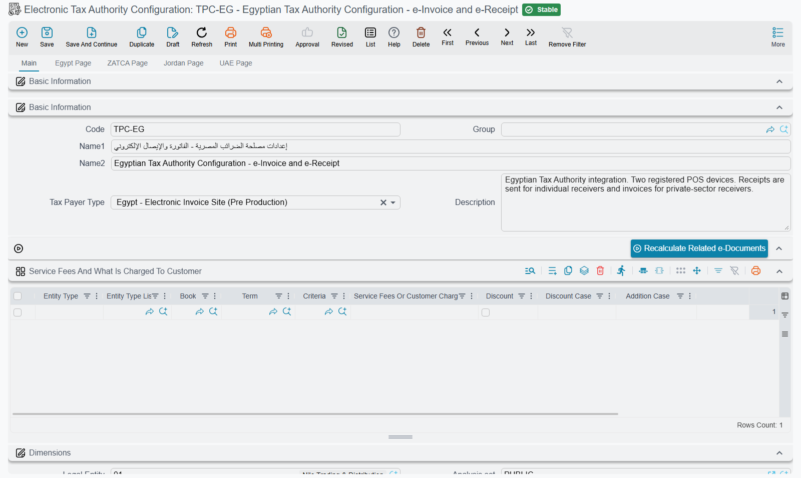

# Electronic Invoicing in Nama ERP

Most tax authorities no longer accept a printed invoice as the record of a sale. The invoice has to reach them electronically, in their format, within their deadline — and in some countries the invoice is not even legally valid until the authority has stamped and returned it. Saudi Arabia, Egypt, Jordan and the UAE each run their own platform, with their own rules about who may send, what an item code looks like, and how long you have to correct a mistake.

Nama ERP puts one machine behind all of them. Whichever country you operate in, the parts you work with are the same, and only the plug at the end changes. This page explains that shared machine — what the pieces are, how an invoice travels from a saved sales document to an accepted government record, and where to look when it does not arrive. Once you understand it, the country guide you need is a short read, because it only covers what is genuinely different.

## The three pieces

**The Electronic Tax Authority Configuration** is the record that holds everything about your relationship with one authority: which platform you are talking to, the credentials that identify you, the codes your items and taxes must be translated into, and the rules about what may be sent and when. You create one per authority and per establishment — a company registered in two countries has two, and so does a group whose branches file separately.

**The sales documents themselves** need no special treatment. Staff raise invoices, returns and receipts exactly as they always have. What makes a document eligible for submission is decided in the configuration, not on the document.

**The Tax Authority Submission Document** is the vehicle. It gathers the documents that are due, shows them to you as lines, and carries them to the authority. Every submission you have ever made stays on file as one of these records, together with what the authority answered — which is what makes it possible to prove, months later, exactly what was sent.

## Switching e-invoicing on

Before any of the screens are useful, the system has to know which country's page to show inside your invoices. In **Global Configuration**, page 2, set **e-Invoice Page To Show**:

<GlobalConfigOption option-code="value.info.einvoicePageShowType" />

The choices are **Egypt Page**, **ZATCA Page** (Saudi Arabia), **Jordan Page**, the UAE page, or **All Pages** if you file in more than one country. After changing it, run a **Regen UI** — the extra page will not appear on documents until you do.

Then create the configuration record and pick its **Tax Payer Type**. This single field selects both the country and the environment:

| Tax Payer Type | Country | Environment |
|---|---|---|
| Saudi Arab - Electronic Invoice Sandbox | Saudi Arabia | Developer sandbox |
| Saudi Arab - Electronic Invoice Simulation Site | Saudi Arabia | Simulation / trial |
| Saudi Arab - Electronic Invoice Site | Saudi Arabia | Live |
| Egypt - Electronic Invoice Site (Pre Production) | Egypt | Trial |
| Egypt - Electronic Invoice Site | Egypt | Live |
| Jordan - Electronic Invoice | Jordan | Live |
| UAE (Orchida) staging and live | UAE | Trial and live |

::: tip Always start on the trial platform
Picking the type fills in the **API URL** for you, so moving from trial to live later is a matter of changing this one field. Work through your real scenarios — an ordinary invoice, a return, an exempt line, an individual customer with no tax number — on the trial platform first. Rejections there cost nothing; rejections on the live platform are on your public record.
:::

Proving your identity to the authority is the one part that is genuinely country-specific: Saudi Arabia issues you a certificate through an onboarding sequence driven by a one-time password, Egypt registers each sending device and hands you a client id and secret, and the others differ again. That belongs to the country guides below.

## What the configuration decides

The configuration is long, but it answers only five questions. Knowing which question a field belongs to makes it much easier to find.

**Who are we?** — the tax registration number, the activity code, and the branch or legal entity whose address and commercial registration are sent as the seller. Authorities validate the seller's address in detail, so an incomplete branch address is one of the most common reasons a first submission fails.

**Which documents are eligible?** — this one is answered on the documents' side, not here. A document is sent when its **document book** or **term** has **Send To Tax Authority** ticked and names this configuration in its **Tax Configuration** field; a document whose book and term do neither is never collected. The configuration only adds the date limits described below.

**How do our items and taxes translate?** — authorities do not accept your internal item codes and tax names as they stand. Here you say where the item code comes from and how to build it, where the item's description comes from, and how each of the four tax slots maps to the authority's tax type and sub-type — including which code to send for exempt, zero-rated and out-of-scope lines, and whether a tax with a zero value should be sent at all.

**When may we send?** — **Start Sending From Date** draws the line before which nothing is submitted, so switching the feature on does not sweep up last year's invoices. **Max Days To Send Invoices** and **Max Days To Cancel Sent Invoices** hold you to the authority's deadlines.

**How much at a time?** — how many documents go in one request to the authority, and how many lines a single collection may pull in. Both matter on high-volume days: too large and the authority times out, too small and you are creating submission documents all afternoon.

## Shared settings on every country page

Each country page repeats a block of settings that work the same way whatever the country. They are described once here, and the country guides link back to this section. The field ID next to each one is what you search for in the import tools or quote to a developer.

### Unit price, quantities and rounding

An invoice line in Nama goes through several steps — the price, up to eight discounts, the header discount and four taxes — in the order the line's tax configuration sets. The authority receives a single unit price per line, so the configuration has to say which step that price is read from.

| Field | Field ID | What it does |
|---|---|---|
| **Unit Price Source** | `unitPriceSource` | The step of the line's calculation the unit price is taken from: **Main Price** (the default), **Discount 1**–**Discount 8**, **Header Discount**, or **Tax 1**–**Tax 4**. Discounts up to and including that step are already inside the price, so they are not sent again as discounts. Taxes that the price includes are taken out. |
| **Unit Price Source Type** | `unitPriceType` | Which amount of that step is used. **Unit Price Source After Value** (the default) is the line amount once the step has been applied. **Unit Price Source Apply Value** is the amount the step was calculated on. |
| **Quantity Fractional Places** | `quantityFractionalPlaces` | How many decimal places the quantity is sent with. Zero or empty means the same number of decimals the country uses for amounts. |
| **Ignore and Round Amount if Scale is Greater Than Allowed Scale** | `ignoreAndRoundAmountIfScaleIsInvalid` | When a unit price multiplied by the currency rate has more decimals than the authority allows, the document stops with the message below. Tick this to round the amount instead. |
| **Max Number Of Lines When Collect Tax Auth Docs** | `maxNumberOfLinesWhenCollectTaxAuthDocs` | How many lines one **Collect Tax Authority Documents** may bring in. When it is empty, the Global Configuration field of the same name applies, and when that is empty too, 750. |

::: tip Example
A line has 10 units at 100, a 10% **Discount 1** and 15% VAT. With **Unit Price Source** set to **Main Price**, the authority receives a unit price of 100 and a discount of 100. Set it to **Discount 1** with **Unit Price Source After Value**, and the authority receives a unit price of 90 and no discount, because the discount is already inside the price.
:::

The rounding message has no Arabic text and appears in English on Arabic screens:

*Unit price is {0} and currency rate is {1} multiplication result is {2} with {3} scale, result scale should be {4} or less*

### Discount Configs

By default Nama decides where each discount goes from its position in the line's calculation. A discount applied before the taxes is sent as a line discount, a discount applied after the taxes is sent as a discount after tax, and the header discount counts as before tax. The **Discount Configs** grid (`discountConfigs`) overrides that, discount by discount.

| Column | Field ID | What it does |
|---|---|---|
| **Discount** | `discountConfigs.discount` | **Header Discount** or **Discount 1**–**Discount 8**. Leave it empty for a row that covers every discount. |
| **E Invoice Discount Location** | `discountConfigs.einvoiceDiscountLocation` | **Before Tax**, **After Tax**, or **Ignore**, which leaves the discount out of the e-invoice. |
| **Discount Value Query** | `discountConfigs.discountValueFormula` | A query run on the invoice line. Its result is sent as the discount's value instead of the value on the line. |
| **Add To Unit Price** | `discountConfigs.addToUnitPrice` | Adds the discount back to the unit price sent, so the authority sees the price before that discount. |

Nama reads the rows from the top and uses the first one that matches, so put a row for a particular discount above a row with an empty **Discount**. Each discount may appear only once. Saving refuses a repeat with *Discount {0} is repeated at line {1}* — «الخصم {0} مُكرر في السطر {1}», or, for a second row with an empty **Discount**, *Line {0} for all discounts is repeated* — «السطر {0} لكل الخصومات مكرر».

### Service Fees And What Is Charged To Customer

This grid (`serviceFeesAndChargesToCustomerConfigs`) sits on the **Main** page of the configuration, not on a country page. It tells Nama what to do with a document's **Service Fees 1**–**4**, and with lines ticked **Charged To Customer**, a column on sales return lines and contracting extracts. A line charged to the customer is never sent as a line of its own.

The first five columns pick the documents a row applies to; an empty column matches everything. The rest say what to do with one amount.

| Column | Field ID | What it does |
|---|---|---|
| **Entity Type** | `serviceFeesAndChargesToCustomerConfigs.entityType` | One document type the row applies to. |
| **Entity Type List** | `serviceFeesAndChargesToCustomerConfigs.entityTypeList` | Several document types the row applies to. |
| **Book** | `serviceFeesAndChargesToCustomerConfigs.book` | Limits the row to documents in this book. |
| **Term** | `serviceFeesAndChargesToCustomerConfigs.term` | Limits the row to documents with this term. |
| **Criteria** | `serviceFeesAndChargesToCustomerConfigs.criteriaDefinition` | Limits the row to documents that match the criteria. |
| **Service Fees Or Customer Charges** | `serviceFeesAndChargesToCustomerConfigs.serviceFeesOrChargedToCustomer` | The amount the row handles: **Service Fees 1**–**4**, or **Charged To Customer**, the total of the lines charged to the customer. |
| **Discount** | `serviceFeesAndChargesToCustomerConfigs.discount` | Tick to send the amount as a discount spread over the document's other lines, in proportion to their net value. Required for **Charged To Customer**. |
| **Discount Case** | `serviceFeesAndChargesToCustomerConfigs.discountCase` | With **Discount** ticked: the discount slot, **Discount 1**–**8**, that carries each line's share. Required. |
| **Addition Case** | `serviceFeesAndChargesToCustomerConfigs.additionCase` | With **Discount** cleared. **Item** sends the service fee as an extra invoice line. The other choices, **Service 1 Fees Tax**–**Service 4 Fees Tax**, need **Invoice tax apply on**. Required. |
| **Item** | `serviceFeesAndChargesToCustomerConfigs.item` | For **Item**: the item the extra line is sent under. The line carries that item's code and a quantity of one, priced at the service fee. Required. |
| **Invoice tax apply on** | `serviceFeesAndChargesToCustomerConfigs.taxLocation` | The tax slot, **Tax 1**–**Tax 4**, used with a **Service N Fees Tax** addition case. Required there. |

::: tip Example
A company adds a delivery charge to its sales invoices as **Service Fees 1**. A row with **Service Fees Or Customer Charges** = **Service Fees 1**, **Discount** cleared, **Addition Case** = **Item** and a "Delivery" item sends that charge as one more line on each e-invoice, under the Delivery item's code.
:::

Two messages guard the grid when you save:

- *Field {0} must be true in case of field {1} is {2}* — «الحقل {0} يجب ان يكون مفعلا في حالة ان تكون قيمة الحقل {1} ب {2}». A **Charged To Customer** row has **Discount** cleared. Tick it.
- *You should not select service fees tax in field {0} with the same service fees type in field {1}* — «لا يمكنك اختيار ضريبة خدمات في الحقل {0} لنفس نوع الخدمة في الحقل {1}». A row names its own service fee as its tax, such as **Service Fees 1** with **Service 1 Fees Tax**.

A service fee with no row in the grid is handled the way each country does it. Saudi Arabia and Jordan send it as a document-level charge, described in the ZATCA guide under [Service fees sent as a document charge](./zatca-guide.md#Service-fees-sent-as-a-document-charge).

## Sending: collect, check, send

Open a new **Tax Authority Submission Document**, choose the configuration, and set the range you want to cover — a date range, a document range, or a narrowing by legal entity, branch, department, sector or analysis set.

1. **Collect Tax Authority Documents** fills the grid with every eligible document in that range that has not been accepted yet. Nothing has left the building at this point.
2. **Validate Tax Authority Documents** runs the authority's rules against the collected lines and reports what would be rejected — a missing buyer identity, an item with no registered code, an address field left blank. Fix the source documents, collect again, and repeat until it is clean.
3. **Preview Documents Before Sent** shows you the exact payload that will be transmitted, for when the validation message is not enough to explain itself.
4. **Sign Documents** (or **Sign Selected Documents**) applies the digital signature where the country requires one.
5. **Send Selected Documents** transmits the lines you ticked; **Send Not Sent Documents** transmits everything on the record that has not gone yet.

::: tip Validate before you send, every time
Validation checks the collected documents without committing anything. It is the difference between fixing ten invoices quietly and having ten rejections recorded against your tax file.
:::

### What the statuses mean

Each line carries a status that answers "where is this document now?":

| Status | Meaning |
|---|---|
| **Not Sent** | Collected but not yet transmitted. |
| **Sent** | The authority accepted it. |
| **Not Send Correctly** | Transmitted and refused. The line carries the authority's reason — fix the source document and send again. |
| **Cancelled** | Withdrawn after acceptance, within the days the authority allows. |
| **Rejected** | The authority rejected it after acceptance. |
| **Rejected by Receiver** | The buyer rejected it during the window their platform gives them. Nothing is wrong with your data — the customer disputed the document. |

**Check Tax Authority Status For Sent Document** re-asks the authority about the lines you have already sent and updates their status, which is how the last three states usually appear: they happen after your submission succeeded, on someone else's initiative.

From the invoice itself, **View Invoice At E Invoice Site** opens the document on the authority's own portal — the fastest way to answer a customer who says they cannot see it.

## Keeping it running without anyone watching

Collecting and sending by hand is fine while you are settling in, and unsustainable afterwards. Scheduled flows take it over:

- **[Auto Collect, Sign and Send](/entity-flows/core/EAAutoCollectSignAndSentEInvoice)** — runs the whole cycle unattended: collects the eligible documents, creates the submission records, signs them and sends them.
- **[Auto Send e-Invoice](/entity-flows/core/EAAutoSendEInvoice)** — submits each invoice on its own, as soon as it is committed, for businesses that want the document on the authority's record within minutes rather than overnight.
- **[Check Rejected by Receiver Documents](/entity-flows/core/EACheckTaxAuthorityRejectedByReceiverDocuments)** — watches recent submissions through the buyer's review window and brings back rejections and cancellations you would otherwise learn about from the customer.

There is also a retry flow that walks the submission documents still holding lines at *Not Sent* or *Not Send Correctly* and sends them again, in batches. It is worth scheduling even if you collect and send by hand, because it turns an evening when the authority's platform was down into a non-event.

## When a document does not arrive

Work from the line outward. The submission line holds the authority's own message, and it is usually specific: a buyer with no tax number and no accepted identity document, an item whose code is not registered, a tax with no mapped category, an address missing a building number. For Egypt, the messages Nama itself raises before anything is sent are listed under [Messages you may see](./egypt-einvoice-guide.md#Messages-you-may-see), together with the portal's signature refusal. The Saudi messages are under the ZATCA guide's [Messages you may see](./zatca-guide.md#Messages-you-may-see). Search those tables for the text the customer pasted. Fix it on the source document rather than on the submission — the submission is a snapshot, and the next collection will pick up the corrected version.

If the authority accepted a document but you have since changed it, the two export actions settle the argument. **Export Cleared / Sent XML For Selected Lines** gives you the payload the authority actually holds; **Export Current XML For Selected Lines** regenerates it from today's data. If the two differ, the document was edited after submission — which in most countries means it must be cancelled and re-issued rather than quietly corrected.

Deadlines are the other frequent cause. A document older than **Max Days To Send Invoices** will not be collected at all, which looks like the system ignoring it. That is deliberate: the authority would refuse it. Getting it accepted then means going through the authority's own late-submission process, not changing anything in Nama.

## The country guides

| Country | Guide |
|---|---|
| 🇸🇦 Saudi Arabia | [ZATCA (Fatoora)](./zatca-guide.md) — onboarding, clearance vs. reporting, VAT categories and buyer identity |
| 🇪🇬 Egypt | [e-Invoice and e-Receipt](./egypt-einvoice-guide.md) — connecting, buyer identity, EGS and GS1 item codes, receipts and POS devices, bank details, signing, cancelling |
| 🇦🇪 UAE | [UAE e-Invoicing through Orchida osTax](./uae-orchida-einvoice-guide.md) |
| 🇯🇴 Jordan | [JoFotara](./jofotara-jordan-guide.md) — credentials, buyer identity, and what the portal returns |
