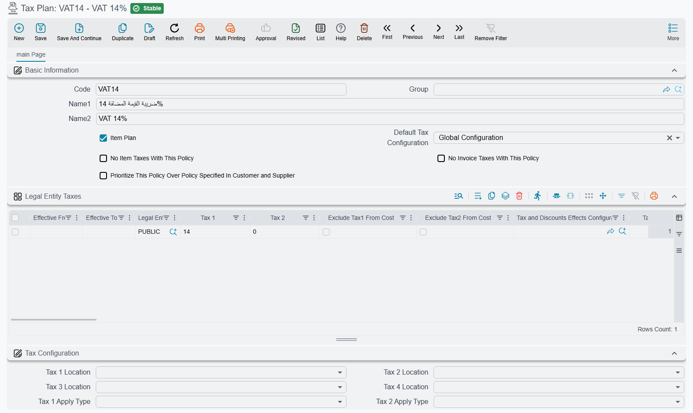

# Invoice Discounts and Tax Calculation System - Comprehensive Guide
## Overview

This guide explains how Nama works out the discounts and taxes on an invoice line: which tax configuration a document uses, the order in which discounts and taxes are applied, and the options that change each step. Every option is named as it appears on screen, with its field id beside it in the tables.

::: tip Key Features
- Support for 8 sequential line discounts plus 1 header discount
- 4 configurable tax types with flexible application points  
- Complex discount-tax interactions and custom ordering
- Multi-currency and multi-rate support
- Extensive configuration options for different business scenarios
- Tax can be configured as addition or deduction
:::

## Understanding the Calculation Flow

### Basic Calculation Sequence

When an invoice is processed, Nama ERP follows this general calculation sequence:

1. **Line Total Calculation**: Quantity × Unit Price = Line Total
2. **Line Discounts Application**: Apply Discount1 through Discount8 in sequence
3. **Header Discount Application**: Apply single discount to entire invoice
4. **Tax Calculations**: Apply Tax1 through Tax4 at configured points
5. **Final Totals**: Calculate net amounts and remaining balances

::: info Important Note
The order can be changed with a **Tax and Discounts Effects Configuration** record (see [Advanced Effects Configuration](#Advanced-Effects-Configuration)), so discounts and taxes can be applied in whatever order the business needs.
:::

## Which Tax Configuration Applies

The tax options described further down are not chosen per document. They include where each tax sits in the sequence, what it is calculated on, and whether the price already includes it. They travel together as one *tax configuration*, and a document takes its configuration from one of three places. Nama checks them in this order and stops at the first one that gives an answer:

1. **The document's tax plan.** If the document header names a **Tax Plan**, that plan's **Default Tax Configuration** decides:
   - **Global Configuration**: use the tax options on the global configuration's [Taxes tab](/platform/global-config/global-config-taxes).
   - **Tax Plan Header**: use the **Tax Configuration** filled in on the tax plan itself.
   - **Tax Plan Line**: use the first row of the plan's **Legal Entity Taxes** grid that matches the document. A row matches when all three hold:
     - its **Legal Entity** is the document's legal entity, or is empty;
     - the document date falls between **Effective From** and **Effective To** (an empty date leaves that end open);
     - its **Entity Type** or **Entity Type List** includes the document's type, or both are empty.

     If no row matches, Nama moves on to step 2.
   - Left empty: Nama moves on to step 2.
2. **The line's tax plan**, which comes from the item, read the same way.
3. **The global configuration's Taxes tab**, when neither plan gives an answer. A document with no tax plan on the header or the item goes straight here.

For example, a tax plan set to **Tax Plan Line** has two rows: one for legal entity A, effective from 1 January 2025, and one with the legal entity left empty. An invoice of legal entity B uses the second row. So does an invoice of legal entity A dated December 2024, because the first row had not started yet. Row order matters: put the specific rows above the catch-all one.

### Tax Plan Configuration Fields

#### Core Tax Plan Fields

| Field Name | Database Field | Description | Impact |
|------------|---------------|-------------|---------|
| **Item Plan** | `itemPlan` | Marks the plan as an item plan | Ticked: the plan is offered in the item's **Tax Plan** field. Unticked: it is offered in a document term's **Tax Plan** field. It cannot be ticked together with **No Item Taxes With This Policy** |
| **No Item Taxes With This Policy** | `noItemTaxesWithThisPolicy` | Disables Tax1 and Tax2 | When the document header's tax plan has it ticked, Tax 1 and Tax 2 are zeroed on every line regardless of rates |
| **No Invoice Taxes With This Policy** | `noInvoiceTaxesWithThisPolicy` | Disables Tax3 and Tax4 | When a line's tax plan (from the item) has it ticked, Tax 3 and Tax 4 are zeroed on that line regardless of rates |
| **Prioritize This Policy Over Policy Specified In Customer and Supplier** | `priorityPolicyOverCusOrSup` | Policy precedence control | When true, this plan overrides customer/supplier tax settings |
| **Default Tax Configuration** | `defaultTaxConfig` | Source of tax configuration | Options: **Global Configuration** (the default on a new plan), **Tax Plan Header**, **Tax Plan Line** |
| **Tax Configuration** | `taxConfiguration` | Embedded tax behavior settings | Contains all tax calculation rules |
| **Legal Entity Taxes** | `legalEntityTaxes` | Tax rates by entity and date | List of entity-specific tax rates |
| **Subsidiary Accounts** | `subsidiaryAccounts` | Account-level settings | Contains tax exemption flags |

#### Legal Entity Tax Fields

Each row of the **Legal Entity Taxes** grid holds:

| Field Name | Database Field | Description |
|------------|---------------|-------------|
| **Legal Entity** | `legalEntity` | Specific legal entity or null for all |
| **Effective From** | `effectiveFrom` | Start date for tax rates |
| **Effective To** | `effectiveTo` | End date for tax rates |
| **Tax 1** | `tax1` | Tax1 rate (percentage or value) |
| **Tax 2** | `tax2` | Tax2 rate (percentage or value) |
| **Entity Type** | `entityType` | Specific document type |
| **Entity Type List** | `entityTypeList` | Multiple document types |
| **Revision ID** | `revisionId` | Item revision this rate applies to; empty applies to every revision |
| **Tax Configuration** | `taxConfiguration` | Override configuration for this entity |



## Discount System Configuration

### Types of Discounts

#### Line Discounts (Discount 1-8)
- **Sequential Application**: Each discount applies after the previous one
- **Configurable Base**: Each discount can apply to different base amounts
- **Percentage or Value**: Can be specified as percentage or fixed amount
- **Individual Control**: Each discount has independent configuration

#### Header Discount
- **Invoice-Wide**: Applied to the entire invoice total
- **Proportional Distribution**: Distributed across all invoice lines proportionally
- **Configurable Timing**: Can be applied at different points in the calculation sequence

### Discount Configuration Fields

The options that set each discount's base and behaviour (**Discount N Apply Type**, **Header Discount Apply Type**, **Calculate discount N percentage from value**, and the **Discount Tax 1**–**Discount Tax 4** group of each discount) are set on the global configuration's Discounts tab and are explained there, with their options and field ids: see [Discount 1 through Discount 8](/platform/global-config/global-config-discounts#Discount-1-through-Discount-8) and [General discount settings](/platform/global-config/global-config-discounts#General-discount-settings).

### How Discounts Are Calculated

#### Percentage-Based Discounts
```
Discount Amount = (Base Amount × Discount Percentage) ÷ 100
New Total = Base Amount - Discount Amount
```

#### Value-Based Discounts
```
Discount Amount = Fixed Discount Value
New Total = Base Amount - Discount Amount
```

#### Tax-Inclusive Discounts
When a discount's group ticks **Discount Tax N**, that tax is first taken out of the discount's base, and the discount percentage is applied to what is left. How the tax part is worked out depends on whether the price includes that tax:
```
Tax Part = Base Amount - (Base Amount × 100) ÷ (100 + Tax Percentage)    (Price Includes Tax N on)
Tax Part = (Base Amount × Tax Percentage) ÷ 100                          (Price Includes Tax N off)
Discount Amount = ((Base Amount - Tax Part) × Discount Percentage) ÷ 100
```

::: tip Discounts that disappear when the term or customer changes
Changing the term, the value date, the subsidiary or the customer can make the document recalculate every line's price and discount. When it does, hand-entered discounts are replaced. What triggers this, and the term options that stop it, are on the term's [Price-Update Control](/modules/supplychain/document-terms/doc-term-pricing-taxes-discounts#Price-Update-Control) section.
:::

## Tax System Configuration

### The Tax Options

A tax configuration carries the same group of options for each of the four taxes, whichever of the three places above it comes from: **Tax N Location**, **Tax N Apply Type**, **Tax N Is Discount**, **Tax N Is Value Not Percentage**, **Tax N Value Is For Total Not Per Piece**, **Price Includes Tax N**, **Tax N Not Included In Total** and **Do Not Use TaxN Percentage As Additional ValueN**. Each one is explained once, with its options, on the global configuration's [How a tax is described](/platform/global-config/global-config-taxes#How-a-tax-is-described). On a tax plan the same options sit on the plan header (field ids such as `taxConfiguration.tax1Location`) and on each **Legal Entity Taxes** row (`legalEntityTaxes.taxConfiguration.tax1Location`). The rest of this section shows how they combine in the arithmetic.

### Tax as Addition vs Deduction

Whether a tax adds to or subtracts from the invoice total depends on **Tax N Is Discount**:

#### When Tax Adds to Total (Standard Tax)
- **Setting**: **Tax N Is Discount** off
- **Calculation**: New Total = Base Amount + Tax Amount
- **Use Case**: VAT, GST, Sales Tax
- **Example**: 
  ```
  Line Total: $100
  Tax1 (15%): $15
  Final Total: $100 + $15 = $115
  ```

#### When Tax Reduces Total (Discount Tax)
- **Setting**: **Tax N Is Discount** on
- **Calculation**: New Total = Base Amount − Tax Amount
- **Use Case**: Withholding Tax, Discount Tax, Rebates
- **Example**:
  ```
  Line Total: $100
  Tax3 (5% withholding): $5
  Final Total: $100 - $5 = $95
  ```

### Tax Calculation Methods

#### Percentage-Based Taxes

| Setting | Tax amount | Line after the tax |
|---|---|---|
| Added to the price (**Price Includes Tax N** off, **Tax N Is Discount** off) | Base × % ÷ 100 | Base + tax |
| Included in the price (**Price Includes Tax N** on) | Base − Base × 100 ÷ (100 + %) | Base (the price already holds the tax) |
| A deduction (**Tax N Is Discount** on) | Base × % ÷ 100 | Base − tax |

#### Value-Based Taxes

With **Tax N Is Value Not Percentage** on, the rate is an amount rather than a percentage:

| Setting | Tax amount |
|---|---|
| **Tax N Value Is For Total Not Per Piece** off | Rate × quantity |
| **Tax N Value Is For Total Not Per Piece** on | Rate, once for the whole line |

## Advanced Effects Configuration

### Tax and Discounts Effects Configuration

When the fixed sequence does not fit, create a **Tax and Discounts Effects Configuration** (*Basic → Master Files*) and select it in the **Tax and Discounts Effects Configuration** field of the tax configuration. It takes full control of the sequence:

#### Effects Order Configuration

| Field Name | Database Field | Description |
|------------|---------------|-------------|
| **Effects Order** | `effectsOrder` | List defining sequence of effects |
| **Effect 1 Type** | `effect1Type` | Type of first effect (Tax1-4, Discount1-8, HeaderDiscount) |
| **Effect 1 Basis Lines** | `effect1BasisLines` | Calculation rules for effect 1 |
| **Effect 2 Type** | `effect2Type` | Type of second effect |
| **Effect 2 Basis Lines** | `effect2BasisLines` | Calculation rules for effect 2 |
| ... | ... | ... |
| **Effect 13 Type** | `effect13Type` | Type of thirteenth effect |
| **Effect 13 Basis Lines** | `effect13BasisLines` | Calculation rules for effect 13 |

#### Effect Basis Line Configuration

Each effect basis line contains:

| Field Name | Description | Impact |
|------------|-------------|---------|
| **Source Type** | What value to use (MainPrice, CurrentTotal, Discount1-8, Tax1-4, etc.) | Determines base value |
| **Source Value** | Which aspect of source (Value, AfterValue, Percentage) | Specifies exact value to extract |
| **Source Operation** | Mathematical operation (Add, Subtract, Multiply, Divide, CalcPercentage, CalcInversePercentage) | How to apply the value |

### Custom Calculation Operations

The system supports these operations for custom effect calculations:

| Operation | Formula | Use Case |
|-----------|---------|----------|
| **Add** | `total + value` | Standard addition |
| **Subtract** | `total - value` | Standard subtraction |
| **Multiply** | `total × value` | Scaling calculations |
| **Divide** | `total ÷ value` | Division operations |
| **CalcPercentage** | `(total × value) ÷ 100` | Percentage calculations |
| **CalcInversePercentage** | `total - (total ÷ ((100 + value) ÷ 100))` | Tax-inclusive extractions |

## Special Configuration Options

### Free Item Handling

Ticking **Free Item** on a document line does something more precise than "make the line free". The **Unit price** stays exactly as it was typed, untouched and visible to whoever reads the document. What gets zeroed is everything downstream of it: the line's **total price**, and every **After value** from Discount 1 through Discount 8. The line is then never added into the document's **Total**.

Because the unit price survives while the value drops out of the total, the checkbox is also the practical way to put an **optional item** in front of a customer on a quotation — a line whose price they can read but which the quoted total does not include. That is a consequence of how a giveaway is priced, not a feature of its own: the line still means *free*, and it still behaves as a giveaway everywhere else in the system.

| Field Name | Database Field | Description | Impact |
|------------|---------------|-------------|---------|
| **No Taxes For Free Item** | `noTaxesForFreeItem` | Disable taxes on free items | All taxes zeroed for lines marked as free |

**Net value on a free line is not automatically zero.** Discounts are forced to zero, but tax percentages are not — a free line still contributes its tax to the document's Net value even though it contributed nothing to the Total. Switch **No Taxes For Free Item** on when a giveaway is meant to cost nothing at all; leaving it off is the usual reason a total comes out slightly higher than anyone can account for.

::: danger Force Price List refuses hand-made free lines
When the document term has **Force Price List** on, a free line that no offer produced is rejected on save with *Invalid Free Item {0}* — «الصنف المجاني غير صحيح {0}». The system assumes a free line arrived from a promotion, checks it against the offers engine, and finds nothing that would have generated this one.

The switch that lets it through is **Ignore Force Price List With Free Item** on the [term's pricing page](/modules/supplychain/document-terms/doc-term-pricing-taxes-discounts). With Force Price List off the check never runs at all, which is why the same free line saves happily under one term and is refused under another.
:::

Two further term settings belong here. **Do Not Calculate Prices, Discounts, and Free Items If Unit Price Exists**, on that same pricing page, stops the pricing engine overwriting a unit price somebody typed by hand. And when a free line ends up at a zero unit price anyway, the [EARecalcFreeLinesUnitPriceIfZero](/entity-flows/supplychain/EARecalcFreeLinesUnitPriceIfZero) entity flow re-runs pricing for just those lines and puts a price back.

### Additional Value Usage

**Do Not Use Tax1 Percentage As Additional Value1** through **Do Not Use Tax4 Percentage As Additional Value4** (`doNotUseTax1PercentageAsAdditionalValue1` … `doNotUseTax4PercentageAsAdditionalValue4`) decide whether the figure in a line's tax percentage field is also added to the line's total price as an additional value. They are explained with the other tax options under [How a tax is described](/platform/global-config/global-config-taxes#How-a-tax-is-described).

### Subsidiary Account Tax Exemptions

Customers and suppliers can have tax exemptions configured in their subsidiary accounts:

| Field Name | Description | Impact |
|------------|-------------|---------|
| **Tax 1 Exempt** | `subsidiaryAccounts.tax1Exempt` | When true, Tax1 is zeroed for this entity |
| **Tax 2 Exempt** | `subsidiaryAccounts.tax2Exempt` | When true, Tax2 is zeroed for this entity |
| **Tax 3 Exempt** | `subsidiaryAccounts.tax3Exempt` | When true, Tax3 is zeroed for this entity |
| **Tax 4 Exempt** | `subsidiaryAccounts.tax4Exempt` | When true, Tax4 is zeroed for this entity |

### Document-Level Extra Discount (Egypt Tax Authority)

A cash ("pay-now") discount granted on an Egyptian e-invoice after tax can be reported in the authority's separate **Extra Discount** field: **Document Level Extra Discount Location** on the **Electronic Tax Authority Configuration** names the discount slot that carries it, and that slot must come after all the taxes in the line's calculation. The rule, the message you get when the slot sits before a tax, and a worked example are in the Egypt e-invoice guide under [The other line settings](/modules/invoicing/egypt-einvoice-guide#The-other-line-settings).

## Common Scenarios and Examples

### Scenario 1: Standard VAT with Trade Discount

**Configuration:**
- **Discount 1 Apply Type**: Total Price
- **Tax 1 Location**: Header Discount
- **Price Includes Tax 1**: off
- **Tax 1 Is Discount**: off

**Calculation:**
```
Line Total: $1,000
Discount 1 (10%): $100
After Discount: $900
VAT (15%): $135
Final Total: $900 + $135 = $1,035
```

### Scenario 2: Tax-Inclusive Pricing with Discount

**Configuration:**
- **Price Includes Tax 1**: on
- **Discount 1 Apply Type**: Total Price
- **Discount Tax 1** in Discount 1's group: on

**Calculation:**
```
Quoted Price (includes 15% VAT): $1,150
VAT Component: $150
Net Price: $1,000
Discount Base (net): $1,000
Discount (10%): $100
Final Net: $900
Final VAT: $135
Final Total: $1,035
```

### Scenario 3: Withholding Tax Configuration

**Configuration:**
- **Tax 3 Is Discount**: on (makes it a deduction)
- **Tax 3 Location**: Header Discount
- **Tax 3 Not Included In Total**: off

**Calculation:**
```
Line Total: $1,000
VAT (15%): $150
Subtotal: $1,150
Withholding (5%): $50 (deducted)
Final Total: $1,150 - $50 = $1,100
```

### Scenario 4: Complex Effects Order

**Configuration using a Tax and Discounts Effects Configuration:**
```
Effect 1: Discount1 (10% trade discount)
Effect 2: Discount2 (5% volume discount)  
Effect 3: Tax1 (15% VAT)
Effect 4: HeaderDiscount ($25 promotional)
Effect 5: Tax3 (3% withholding)
```

**Calculation:**
```
Line Total: $1,000
After Discount1: $900
After Discount2: $855
After Tax1: $855 + $128.25 = $983.25
After Header Discount: $958.25
After Withholding: $958.25 - $28.75 = $929.50
```
