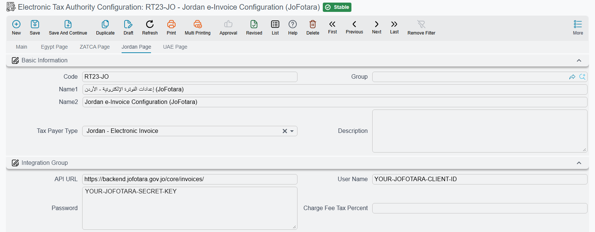

# Integration with JoFotara (Jordan)

Jordan's Income and Sales Tax Department runs the national e-invoicing portal **JoFotara**. Every sales invoice and every return has to reach it, and the portal answers by handing you back a signed copy of your own invoice together with the QR code that belongs on the printed version. That last detail is what makes Jordan comfortable to live with: you never sign anything yourself, and there is no accredited service provider standing between you and the authority — Nama ERP sends straight to the portal.

Everything about how invoices are gathered, checked and submitted is the same machinery described in the [electronic invoicing overview](./e-invoices-guide.md). Read that first. This page covers only the parts that are genuinely Jordanian.

## What is different about Jordan

Compared with its neighbours, the Jordanian integration is the short one.

| | How Jordan works |
|---|---|
| **Onboarding** | None. There is no certificate request, no one-time password, no approval step. You copy two credentials out of the portal and start sending. |
| **Environments** | One. There is no Jordanian sandbox to practise on — the tax payer type you pick is the live portal. |
| **Signing** | Done by the portal. Nama does not sign the invoice and the signing actions do not appear on the Jordanian submission document. |
| **QR code** | Returned by the portal with the accepted invoice, rather than generated locally. |
| **Currency** | Always Jordanian dinar. |

## Connecting to the portal

Switch the country page on first. In **Global Configuration**, page 2, set **e-Invoice Page To Show** to **Jordan Page** (or **All Pages** if you also file elsewhere), then run a **Regen UI** so the page appears.

Then create the **Electronic Tax Authority Configuration** — *Basic → Electronic Tax Authority Configuration* — and set **Tax Payer Type** to **Jordan - Electronic Invoice**. Choosing it fills the **API URL** (`apiUrl`) in for you; leave it as it is unless the department publishes a new address.

Two credentials identify you, and both come from your own account on the JoFotara portal:

| Field on the Jordan page | What to put in it |
|---|---|
| **User Name** (`userName`) | The **Client Id** issued to your establishment by JoFotara |
| **Password** (`password`) | The **Secret Key** that goes with that Client Id |

They are sent with every request, so a rotated secret key on the portal has to be updated here on the same day or submissions start failing.

::: warning There is no trial platform for Jordan
Saudi Arabia and Egypt both give you somewhere to rehearse. Jordan does not — the only tax payer type is the live one. Do your rehearsing on a small number of real, low-value documents that you are prepared to see on your tax record, and work through the **Validate Tax Authority Documents** action before anything is sent.
:::

## Who the portal thinks you are

Jordan asks far less about the seller than Saudi Arabia does. There is no national address to complete and no building number to chase — the seller block that leaves your system carries the establishment's name, its tax registration number, and its country. Three settings supply it:

- **Branch Id From** (`branchIdDimension`) names the dimension — legal entity, branch, sector, and so on — whose record is used as the issuer. Its name and country travel on the invoice, so the record has to be a real one with a country set.
- **Tax Registeration NO** (`taxRegNo`) is your establishment's sales tax number, sent as the seller's tax identifier.
- **Activity Type** (`activityType`) is the taxpayer activity code your registration was issued under. Jordan requires it and sends it as a separate seller block on every invoice, so an empty **Activity Type** is one of the first things to check when the portal starts refusing documents.

## Who the portal thinks the customer is

The buyer's identity is decided by the **The legal entity of the company** field on the customer's tax data, and Nama translates it into the identity scheme JoFotara expects:

| Customer's legal entity | Identity sent | Value taken from |
|---|---|---|
| **Government** or **Private Sector** | Tax number | **Tax Registeration NO** on the customer |
| **Individual** | National identity number | **Id Number** on the customer |
| **Foreigner**, or left empty | Passport number | **Id Number** on the customer |

The practical consequence is that the legal entity field is not cosmetic in Jordan. A business customer left as *Individual* has its tax number ignored and its personal ID number sent instead, which the portal will not match to a registered taxpayer.

Beyond the identity, only the buyer's name, postal code, governorate and country are transmitted.

## What Jordan accepts

| Document | Supported |
|---|---|
| Invoice | Yes |
| Return (credit note) | Yes |
| Debit note | No |

Everything Nama sends to JoFotara is a **general sales tax invoice** — the ordinary commercial invoice type — and a return is sent as the credit note against it. A return must carry a reference back to the invoice it reverses: the original invoice's number, its unique identifier, and the original total. The submission fills these from the source document's link to the invoice it was raised from, so a return created without that link has nothing to reference.

::: warning Debit notes cannot go to Jordan
JoFotara has no debit note. If a document configured as a debit note is collected for a Jordanian configuration, the submission stops and tells you so. Correct the customer with a return and a fresh invoice instead.
:::

## Amounts, currency and tax

Every value on a Jordanian invoice is expressed in **Jordanian dinar**, whatever currency the source document was raised in. When the two differ, Nama converts the document's figures at the rate held on the document itself, so the invoice the portal receives is arithmetically self-consistent in dinar rather than a mixture.

Tax is described the way the rest of the UBL world describes it: each line carries its tax category and rate under the UN/ECE category list, and the tax itself under the UN/ECE tax-type list. Which of your four tax slots maps to which code is set in the tax groups on the configuration page, exactly as for the other countries. The one Jordanian specific is that an **exempt or zero-rated line is sent under category `Z`**, so that is what you map a zero-rated tax to.

**Quantity Fractional Places** (`quantityFractionalPlaces`) deserves a look before you go live. Jordan checks that the unit price multiplied by the quantity really does produce the line total, to the number of decimal places you declare here. If your prices carry more precision than you declare, the arithmetic the portal performs will not match the totals you sent.

::: tip The line's item name is the item code
JoFotara does not want a registered item code as Egypt does — it identifies the goods on each line by a name. Nama fills that name from the item code settings, **Calculate Item Code From** (`itemCodeFrom`) and **Item Code Template** (`itemCodeTemplate`), not from the description template. By default it is the item's **Tax Authority Code**, or the item's code when that is empty. To send a name a reader recognises, set **Calculate Item Code From** to **From Item Code Template** and build the name in **Item Code Template**.
:::

## The rest of the Jordan page

The sections above cover what is Jordanian. The other fields on the page work as they do for every country:

| Field | Field ID | What it does |
|---|---|---|
| **Charge Fee Fields**, **Charge Fee Value**, **Charge Fee Tax Percent**, **Exclude Service Fees With No Configs** | `chargesFeeFields`, `chargesFeeIncludeTax`, `chargesFeeTaxPercent`, `excludeServiceFeesWithNoConfigs` | How service fees are sent as a charge on the whole invoice. They work as for Saudi Arabia — see [Service fees sent as a document charge](./zatca-guide.md#Service-fees-sent-as-a-document-charge). |
| **Unit Price Source**, **Unit Price Source Type** | `unitPriceSource`, `unitPriceType` | Which step of the line's calculation the unit price is read from. See [Unit price, quantities and rounding](./e-invoices-guide.md#Unit-price-quantities-and-rounding). |
| **Ignore and Round Amount if Scale is Greater Than Allowed Scale** | `ignoreAndRoundAmountIfScaleIsInvalid` | Rounds an over-precise unit price instead of stopping the document. Same section. |
| **Max Number Of Lines When Collect Tax Auth Docs** | `maxNumberOfLinesWhenCollectTaxAuthDocs` | How many lines one collection may bring in. Same section. |
| **Don Not Send Assembly Components** | `dontSendAssemblyComponentLines` | Sends an assembly item as one line rather than as its components. |
| **Calculate Tax Codes Types From** | `taxCodesType` | Where each tax's type and category are read from: this page (the default), or the tax plan on the term, the item or the customer. |
| *Tax 1*–*Tax 4* groups | `taxesCodes.tax1TaxAuthType`, `taxesCodes.tax1TaxAuthSubType`, and so on | The tax type and category sent for each tax slot. The *Zero* pair (`taxesCodes.tax1ZeroTaxAuthType`, `taxesCodes.tax1ZeroTaxAuthSubType`) is sent instead when the tax on a line is zero. **Send Tax N With Zero** (`taxesCodes.sendTax1WithZero`) sends the tax with a zero rate and a zero amount. **Do Not Send Tax N If Codes Not Provided** (`doNotSendTax1IfNoCode`) leaves out a slot that has no codes. |
| **Tax Codes Sources** grid | `taxCodesSource` | Overrides **Calculate Tax Codes Types From** for chosen document types, books, terms, criteria, value dates or dimensions. The first matching row wins. |
| **Max Days To Send Invoices** | `maxDaysToSendInvoice` | How old a document may be and still be sent; 3 days when empty. Once its book or term sends to JoFotara, an older document cannot be saved, and one that ages past the limit is no longer collected. |
| **Start Sending From Date** | `startSendingFromDate` | Documents dated before this day are never sent. |
| **Days To Allow Save Document In Future** | `futureDaysToAllowSaveDoc` | How many days ahead a document that goes to JoFotara may be dated. Zero means not at all. |
| **Discount Configs** grid | `discountConfigs` | Sends a discount before tax, after tax, or not at all, discount by discount. See [Discount Configs](./e-invoices-guide.md#Discount-Configs). |

Six fields on the page do not affect a Jordanian invoice: **Run Item Description Template On**, **Item Description Template**, **Run Item Nama Code Template On**, **Item Internal Code Template**, **Internal Item Code Maximum Length** and **Document Level Extra Discount Location**. The service-fees grid on the **Main** page applies too — see [Service Fees And What Is Charged To Customer](./e-invoices-guide.md#Service-Fees-And-What-Is-Charged-To-Customer).

## Sending, and what comes back

The submission itself follows the usual sequence on the **Tax Authority Submission Document**: **Collect Tax Authority Documents**, then **Validate Tax Authority Documents**, then **Send Selected Documents** or **Send Not Sent Documents**. The signing and status-checking actions are deliberately absent — in Jordan there is nothing to sign and nothing to poll, because the portal decides and answers in the same call.

When the portal accepts a document, three things land on its line:

| Column | What it holds |
|---|---|
| **Status In Tax Authority** | The portal's own status for the accepted invoice |
| **Signed Invoice Base 64** | The signed copy of your invoice, as JoFotara returned it |
| **Qr Code Base 64** | The QR code to print on the customer's copy |

and the line's status becomes **Sent**.

When it refuses, the line's status becomes **Not Send Correctly** and the portal's explanation is written into **Tax Authority Errors** — usually more than one message, one per rule that failed. Fix the source document rather than the submission line, collect again, and send again. The refusal is recorded on the submission and stays there, so nothing is lost by trying.

::: tip Every invoice carries a sequence number
Jordan expects the invoices from one establishment to form a single unbroken sequence, so each submission stamps the next number in that sequence onto the invoice as it goes out. The counter belongs to the configuration record and is kept for you — there is nothing to set. It does mean, though, that a second configuration created for the same establishment starts counting again from the beginning, so an establishment should have exactly one Jordanian configuration.
:::
