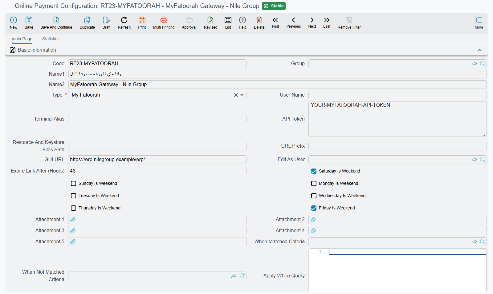

# Online Payments Integration

Nama ERP's online payment module lets you accept payments directly from your customers through secure payment gateways (KNet, MyFatoorah and Geidea) and through GoPay SADAD bills in Saudi Arabia. Whether you're sending a single invoice payment link or generating hundreds of payment links for outstanding balances, this module handles the entire flow from link generation to payment confirmation and automatic receipt creation.

## Understanding the Payment Flow

When a customer clicks a payment link, here's what happens behind the scenes:

1. **Link Validation** - The system checks if the link is still valid (not expired) and if the document still requires payment
2. **Payment Page Display** - The customer sees a customized payment page showing the amount due and document details
3. **Gateway Redirect** - When ready to pay, the customer is redirected to the payment gateway (KNet or MyFatoorah). Geidea works differently: the link opens Geidea's own page (see [Geidea](#Geidea))
4. **Payment Processing** - The gateway processes the payment and returns the result
5. **Success Handling** - On successful payment, Nama can automatically run entity flows, add the payment to the document, and even create receipt vouchers
6. **Confirmation Page** - The customer sees a success or error page with transaction details

## Supported Payment Gateways

### KNet (Kuwait)

KNet is Kuwait's national payment network. To integrate KNet, you'll need:

| Field | Field id | Description |
|-------|----------|-------------|
| **User Name** | `userName` | Your KNet portal ID (tranportal ID) |
| **Terminal Alias** | `terminalAlias` | The alias assigned to your terminal by KNet |
| **GUI URL** | `guiUrl` | Your server's public URL where payment callbacks will be received |
| **URL Prefix** | `urlPrefixIdentifier` | A unique identifier for your payment URLs (e.g., "mycompany") |
| **Resource And Keystore Files Path** | `resourceAndKeystoreFilesPath` | Server path containing `resource.cgn` and `keystore.bin` files from KNet |

::: warning Important
KNet requires two certificate files (`resource.cgn` and `keystore.bin`) that must be placed on your server. These files are provided by KNet during merchant registration and contain your encryption keys.
:::

### MyFatoorah

MyFatoorah is a popular payment gateway in the Middle East supporting multiple payment methods including cards, Apple Pay, and local payment options.

| Field | Field id | Description |
|-------|----------|-------------|
| **API Token** | `apiToken` | Your MyFatoorah API token from the merchant dashboard |
| **GUI URL** | `guiUrl` | Your server's public URL for payment callbacks |

MyFatoorah is simpler to set up since it uses API-based authentication rather than certificate files.

### Geidea

Geidea is a card acquirer in Saudi Arabia, the UAE and Egypt. Unlike KNet and MyFatoorah, the customer does not pay on a Nama page: Nama asks Geidea for a payment link, Geidea hosts the payment page, and Nama asks Geidea whether the link was paid.

| Field | Field id | Description |
|-------|----------|-------------|
| **User Name** | `userName` | Your Geidea merchant public key. Required. |
| **API Token** | `apiToken` | The API password Geidea issued with that key. Required. |
| **API Base URL** | `apiBaseUrl` | Leave it empty and Nama picks Geidea's address from the document's currency: SAR goes to the Saudi platform, AED to the UAE one, EGP to the Egyptian one. Any other currency is refused. Fill it only to use another address, such as a test environment Geidea gave you. |
| **Minimum Payment Amount** / **Maximum Payment Amount** | `minPaymentAmount`, `maxPaymentAmount` | The range of amounts Nama will send to Geidea. Empty or zero means no limit on that side. A zero or negative amount is always refused. |
| **GUI URL** | `guiUrl` | Your server's public address. Geidea calls it back when a link is paid, but only when it is a public `https` address; on a local or plain `http` server Nama finds out about payments by asking Geidea instead (see [Taking payments with Geidea](#Taking-payments-with-Geidea)). |

A Geidea configuration saves without a success entity flow or a payment method, because the invoice button and the point of sale take the payment before the document is saved. Links sent for documents that are already saved still apply the payment through the [payment actions](#Payment-Actions---Automating-Post-Payment-Workflows), so fill those when you use links.

## Setting Up Online Payment Configuration

Navigate to **Basic > Documents > Online Payment Configuration** to create your payment gateway settings.

### Basic Setup

1. **Create a new configuration** and give it a meaningful code (e.g., "KNET-MAIN" or "MYFATOORAH-PROD")
2. **Select the Type** (`type`) - Choose KNet, My Fatoorah or Geidea
3. **Enter the gateway credentials** based on your provider (see fields above)
4. **Set the GUI URL** (`guiUrl`) - This is your server's public address, typically something like `https://yourcompany.com/erp/`
5. **Edit As User** (`editAsUser`) - The user Nama acts as when a KNet reply updates the document. Left empty, the `admin` user is used.



### Link Expiration Settings

Payment links don't last forever. You can control how long they remain valid:

- **Expire Link After (Hours)** (`expireLinkAfter`) - Number of hours before the link expires. If left empty, links expire after one year.

The system is smart about expiration - it can skip weekends and holidays when calculating expiry times. Configure this using:

- **Weekend Days** (`saturdayIsWeekend` … `fridayIsWeekend`) - Check which days are weekends (Friday/Saturday for GCC, Saturday/Sunday elsewhere)
- **Holidays** (`holidays`: `holidays.holidayDate`, `holidays.remarks`) - Add specific dates that should be excluded from expiry calculations

For example, if you set "Expire After 24 Hours" and Friday/Saturday are weekends, a link generated on Thursday at 10 AM won't expire until Sunday at 10 AM (skipping Friday and Saturday).

### Payment Templates

Templates control what your customers see at each stage of the payment process. Each template supports dynamic placeholders that get replaced with actual document values.

| Template | Field id | When It's Shown |
|----------|----------|-----------------|
| **Payment Template** | `paymentActions.paymentTemplate` | The initial payment page showing invoice details and "Pay Now" button |
| **Success Template** | `paymentActions.successTemplate` | Displayed after successful payment |
| **Error Template** | `paymentActions.errorTemplate` | Shown when the payment fails or is declined |
| **Bad Transaction Template** | `paymentActions.badTransactionTemplate` | Displayed when the transaction isn't approved |
| **Expired Link Template** | `paymentActions.expiredLinkTemplate` | Shown when clicking an expired payment link |
| **Totally Paid Template** | `paymentActions.totallyPaidTemplate` | Displayed when the invoice has already been fully paid |
| **Not Found Document Template** | `paymentActions.notFoundDocumentTemplate` | Shown when the document doesn't exist |
| **Type Not Supported For Payment Template** | `paymentActions.typeNotSupportedForPaymentTemplate` | Displayed when the document type doesn't support online payments |

::: tip Loading Default Templates
Click the **"Calculate Default Templates"** button to load the system's default HTML templates. You can then customize them to match your branding.
:::

### Using Placeholders in Templates

Templates support the Nama template engine. You can include document fields using curly braces:

```html
<h2>Invoice #{code}</h2>
<p>Amount Due: {currency.code} {netTotal}</p>
<p>Customer: {customer.name1}</p>
```

After payment, you can also access the payment response:

```html
<p>Transaction ID: {opResponse.transId}</p>
<p>Authorization: {opResponse.auth}</p>
<p>Amount Paid: {opResponse.amt}</p>
<p>Date: {opResponse.date}</p>
```

#### Payment Response Map Reference (`$map.opResponse`)

The `opResponse` object is available in templates (via `{$map.opResponse.fieldName}`) and in entity flows (via `x=$map.opResponse.fieldName`). The available fields differ by payment gateway:

::: details KNet Response Fields (Click to expand)
```json
{
  // Core Transaction Data
  "result": "CAPTURED",           // Transaction result (CAPTURED, NOT CAPTURED, etc.)
  "amt": "150.000",               // Transaction amount
  "auth": "123456",               // Authorization code from bank
  "ref": "789012345678",          // Reference number
  "transId": "1234567890123456",  // Transaction ID
  "paymentId": "12345678901234",  // Payment ID
  "trackId": "9876543210",        // Your tracking ID
  "date": "01/15/2025 14:30:00",  // Transaction date/time

  // Card Information
  "card": "************1234",     // Masked card number
  "type": "VISA",                 // Card type (VISA, MASTERCARD, etc.)
  "member": "CARDHOLDER NAME",    // Cardholder name
  "expMonth": "12",               // Card expiry month
  "expYear": "2027",              // Card expiry year

  // Currency & Amount
  "currency": "414",              // Currency code (414 = KWD)
  "convertedCrncyCD": "",         // Converted currency code (if applicable)

  // User Defined Fields
  "udf1": "",                     // Custom field 1
  "udf2": "",                     // Custom field 2
  "udf3": "",                     // Custom field 3
  "udf4": "",                     // Custom field 4
  "udf5": "",                     // Custom field 5
  "custid": "",                   // Customer ID

  // 3D Secure / Authentication
  "eci": "",                      // Electronic Commerce Indicator
  "cavv": "",                     // Cardholder Authentication Verification Value
  "xid": "",                      // 3D Secure transaction ID
  "authStatus": "",               // Authentication status
  "enrolmntStatus": "",           // 3D Secure enrollment status

  // Error Information
  "error": "",                    // Error code
  "error_text": "",               // Error description
  "errorMessage": "",             // Combined error message (on failure)

  // Response Codes
  "responseCode": "",             // Gateway response code
  "avr": "",                      // Address verification result
  "cvv2Verification": "",         // CVV2 verification result

  // Additional Technical Fields
  "action": "1",                  // Action type (1 = Purchase)
  "language": "en",               // Language code
  "responseURL": "",              // Callback URL
  "errorURL": "",                 // Error callback URL
  "alias": "",                    // Terminal alias
  "tranportalId": "",             // Tranportal ID
  "rawResponse": ""               // Raw response from gateway
}
```
:::

::: details MyFatoorah Response Fields (Click to expand)
```json
{
  // Core Transaction Data (Success)
  "amt": "150.000",               // Paid amount
  "date": "15/01/2025",           // Transaction date
  "paymentId": "07012345678901",  // MyFatoorah payment ID
  "transId": "1234567890123456",  // Transaction ID
  "ref": "REF123456",             // Reference ID
  "auth": "AUTH123",              // Authorization ID

  // Error Information (Failure)
  "errorMessage": "MF002: Bank declined" // Error message with code
}
```

**MyFatoorah Error Codes in `errorMessage`:**
- `MF001` - 3DS authentication failed
- `MF002` - Bank declined (insufficient funds, invalid card)
- `MF003` - Gateway blocked (fraud detection)
- `MF004` - Insufficient funds
- `MF005` - Session timeout
- `MF006` - Transaction canceled
- `MF007` - Card expired
- `MF008` - Issuer not responding
- `MF009` - Denied by risk
- `MF010` - Wrong CVV
- `MF020` - Unspecified failure
:::

#### Using in Entity Flows

When configuring entity flows that run after payment (Success Entity Flow or Error Entity Flow), you can access these values using the `$map` variable:

```
// In entity flow parameter expressions:
x=$map.opResponse.auth           // Get authorization code
x=$map.opResponse.amt            // Get paid amount
x=$map.opResponse.transId        // Get transaction ID
x=$map.opResponse.errorMessage   // Get error message (on failure)
```

### Payment Actions - Automating Post-Payment Workflows

This is where the real power lies. When a payment succeeds (or fails), you can automatically trigger actions in the system.

| Field | Field id | Purpose |
|-------|----------|---------|
| **On Success Entity Flow** | `paymentActions.successEntityFlow` | An entity flow to run after successful payment (e.g., mark invoice as paid, change status, send a notification) |
| **On Error Entity Flow** | `paymentActions.errorEntityFlow` | Run this flow when payment fails |
| **Payment Method** | `paymentActions.paymentMethod` | Automatically add a payment line to the document using this method |
| **When Matched Criteria** / **When Not Matched Criteria** | `paymentActions.entityWhenMatched`, `paymentActions.entityWhenNotMatched` | Limit the header's actions to documents that match (or do not match) a criteria definition |
| **Apply When Query** / **Do Not Apply When Query** | `paymentActions.applyWhenQuery`, `paymentActions.doNotApplyWhenQuery` | The same, with a query |

The **Payment Method** is particularly useful - when set, the system automatically adds a payment to the invoice upon successful online payment, which can trigger receipt voucher creation if configured.

### Conditional Payment Actions

Sometimes you need different behaviors based on the document type or specific conditions. The **Details** collection lets you create conditional rules:

| Field | Field id | Purpose |
|-------|----------|---------|
| **For Type** | `details.forType` | Apply this rule only to a specific document type (e.g., Sales Invoice, Sales Order) |
| **Entity Type List** | `details.entityTypeList` | Or apply to multiple document types from a predefined list |
| **Apply When Query** | `details.paymentActions.applyWhenQuery` | A query condition that must be true for this rule to apply |
| **Do Not Apply When Query** | `details.paymentActions.doNotApplyWhenQuery` | Skip this rule when this condition is true |

Each detail line has its own payment actions (`details.paymentActions.*`: criteria, success and error flows, payment method and the eight templates), so you can have different success flows, payment methods and templates for different scenarios.

**Example:** You might want:
- Sales Invoices to trigger a "Mark as Paid" flow and send an email
- Sales Orders to trigger a "Confirm Order" flow and send a different email
- High-value invoices (over 1000) to send an additional notification to the sales manager

### Fields Mapping (KNet)

For KNet integration, you can pass additional data to the payment gateway using User Defined Fields (UDF1-UDF5) and Customer ID:

| Field Type | Description |
|------------|-------------|
| **UDF1 - UDF5** | Custom fields that appear in your KNet settlement reports |
| **CustomerId** | The customer identifier for the transaction |

The grid is **Fields Map Lines** (`fieldsMapLines`); pick the gateway field in **Field** (`fieldsMapLines.field`). The **Value Template** column (`fieldsMapLines.valueTemplate`) supports placeholders, so you can dynamically populate these fields:

```
{customer.code}
{code}
{netTotal}
```

### Subsidiary Source Configuration

When using the **Payment Links Creation Document** for bulk link generation, you need to tell the system which field contains the customer/subsidiary for each document type:

| Field | Field id | Purpose |
|-------|----------|---------|
| **Entity Type** | `paymentLinksCreationDocSubsidiarySourceLines.entityType` | The document type (e.g., SalesInvoice) |
| **Field ID** | `paymentLinksCreationDocSubsidiarySourceLines.fieldId` | The field that contains the subsidiary reference (e.g., `customer`) |

This mapping is used when aggregating invoices by customer for bulk payment link creation.

## Generating Payment Links

There are two ways to generate payment links:

### Method 1: Direct Link Generation

For documents that implement online payment support (like Sales Invoices), you can generate a payment link directly. The system creates an encrypted URL containing:
- The payment configuration ID
- The document type and ID
- The expiry timestamp

The URL format looks like: `https://yourserver.com/erp/op/prefix/ENCRYPTED_DATA`

::: tip Automated Link Generation via Entity Flows
You can automatically generate KNet payment URLs using the **EAGenerateKNetPaymentURLs** entity flow. This is useful when you want to generate payment links as part of an automated workflow (e.g., when an invoice is approved). The flow generates both direct gateway URLs and redirect URLs, storing them in specified document fields. See the [EAGenerateKNetPaymentURLs documentation](/entity-flows/core/EAGenerateKNetPaymentURLs.md) for parameters and setup details.
:::

### Method 2: Bulk Payment Links (Payment Links Creation Document)

Navigate to **Basic > Documents > Payment Links Creation Document** for bulk generation.

This powerful tool lets you:
1. Filter documents by type, date range, book, term, or period
2. Find invoices with installments due within a certain number of days
3. Aggregate amounts by customer
4. Generate payment links for all selected customers at once

#### Using the Payment Links Creation Document

1. **Select Document Type** - Choose Sales Invoice, Sales Order, or Miscellaneous Purchase Invoice
2. **Set Filters** - Define date ranges, books, terms, or periods to narrow down documents
3. **Remaining Days Filter** - Find installments due within X days
4. **Click "Collect Docs"** - The system finds matching documents and aggregates by customer
5. **Review the Details** - See individual invoices/installments in the Details tab
6. **Review Link Lines** - See aggregated amounts per customer with their contact info
7. **Save and Create Links** - Click "Create Payment Links" to generate links for all customers

The system automatically:
- Groups invoices by customer
- Pulls customer contact information (email, mobile)
- Creates individual payment links per customer
- Stores the links for later reference

#### Link Lines Fields

| Field | Field id | Description |
|-------|----------|-------------|
| **Subsidiary** | `linksLines.subsidiary` | The customer/vendor |
| **Customer Name** | `linksLines.customerName` | Auto-populated from the subsidiary |
| **Customer Email** | `linksLines.customerEmail` | Email for payment link delivery |
| **Mobile Country Code** | `linksLines.customerMobileCountryCode` | Country code for SMS delivery |
| **Mobile Number** | `linksLines.customerMobileNumber` | Phone number for SMS delivery |
| **Customer Reference** | `linksLines.customerReference` | Your own reference for the customer, passed to MyFatoorah with the link |
| **Value** | `linksLines.value` | Total amount to collect |
| **Payment Link** | `linksLines.paymentLink` | The generated link (after clicking "Create Payment Links") |

#### Notification Options (MyFatoorah)

MyFatoorah can automatically send the payment link to customers:
- **LNK** - Just generate the link (no automatic sending)
- **EML** - Send via email
- **SMS** - Send via SMS
- **ALL** - Send via both email and SMS

The system automatically selects the appropriate option based on which contact fields you provide.

## Transaction Tracking

Every payment attempt is recorded in the **Online Payment Transaction System Entry**. This record tracks:

| Field | Description |
|-------|-------------|
| **Document** | The invoice/order being paid |
| **Online Payment Config** | Which payment configuration was used |
| **Track ID / Invoice ID** | The gateway's transaction identifier |
| **Transaction Status** | Current status (Initial, Captured, Paid, etc.) |
| **Paid Amount** | The amount that was paid |
| **Authorization Number** | The bank's authorization code |
| **Transaction ID** | The gateway's transaction ID |
| **Reference** | Additional reference from the gateway |
| **Link Status** | Whether the link is Valid, Paid, or Expired |

## Automatic Receipt Voucher Creation

When the customer pays a link from a **Payment Links Creation Document**, Nama can create the receipt vouchers for the documents that link covered. This is set on the document's term, on its **Settings** page:

| Field | Field id | Description |
|-------|----------|-------------|
| **Receipt Voucher sCreation Method** | `termConfig.receiptVouchersCreationMethod` | **Without** creates nothing. **Receipt Voucher Per Invoice** creates one voucher for each paid document. **Receipt Voucher Per Subsidiary** creates one voucher per customer, covering all their documents in the link. |
| **Receipt Voucher Term** | `termConfig.receiptVoucherTerm` | The term of the created vouchers. |
| **Receipt Voucher Book** | `termConfig.receiptVoucherBook` | The book of the created vouchers. |
| **Default Values Template** | `termConfig.defaultValuesTemplate` | Applied to each new voucher before anything else is filled. |
| **Fields Map** | `termConfig.fieldsMap` | Copies further values from the Payment Links Creation Document to the voucher. |

Each voucher gets one line per paid document, for the customer's account, and an installment line per installment, so the payment settles the right installments. The voucher is committed straight away. If a voucher already exists for the same document (or, per subsidiary, the same customer), Nama adds to it instead of creating a second one.

## Taking payments with Geidea

There are four ways to take a Geidea payment. The first two take the payment while the customer is in front of you, so the invoice is saved already paid. The last two send a link for a document that already exists.

### Pay with Geidea on the sales invoice

The sales invoice has a **Pay with Geidea** button beside its payments grid. To use it, create a **Payment Method** and set its **Online Payment Configuration** (`onlinePaymentConfig`) to the Geidea configuration. Then:

1. Press **Pay with Geidea**. Nama uses the payment line you are standing on, or adds one. The amount is that line's value, or the invoice's amount when the line is empty.
2. The dialog shows the amount and asks for the **Customer Mobile**. Press **Send Link by SMS** to have Geidea text the customer a link, or **Show QR Code** to let the customer scan it from your screen. **Copy Link** copies the link for any other channel.
3. While the dialog shows *Waiting for the customer to pay*, Nama asks Geidea every five seconds.
4. When the customer has paid, the dialog closes and fills the payment line: the payment method, Geidea's payment id in **Authorization Number** (`paymentLines.authorizationNumber`) and the amount actually paid.

If you close the dialog before the customer pays, Nama deletes the link at Geidea so nobody can pay an invoice that was never saved. A link the customer paid in the meantime is kept and used.

When the line's payment method is not linked to Geidea, Nama uses the first payment method that is. When the invoice is saved, every Geidea payment line is checked again with Geidea: it must be confirmed as paid, it must not be used by another document, and its value must not be more than the amount Geidea collected.

### At the point of sale

A POS payment method linked to a Geidea configuration shows a **Pay Through Payment Provider** button next to its payment line. It opens the same kind of dialog, with **Send Payment Link (SMS)** and **Show Payment QR Code**.

### A link for a saved document

The **EAGenerateGeideaPaymentLink** entity flow creates a Geidea link for a saved document that supports online payment, such as a sales invoice. Its parameters are: the configuration's code, the text field the link is written to, the field holding the customer's name (for example `customer.name1`), the mobile country code (a field, or a fixed value such as `'+966'`; empty takes the country of the currency), the mobile number field, the e-mail field, and whether Geidea sends the link by **SMS**, **Email** or **Both**. A document that is already totally paid is refused.

When the customer pays, Geidea calls your **GUI URL** and Nama applies the payment through the configuration's payment actions, exactly as for the other gateways. If Geidea cannot reach your server, run the **EACheckGeideaPaymentLinks** entity flow: on a document it checks that document's open links, and from a scheduled task it checks every open Geidea link.

### The Payment Links Creation Document

With a Geidea configuration, **Create Payment Links** creates one Geidea link per customer line and has Geidea send it by both SMS and e-mail. The customer needs a mobile number or an e-mail address. When the link is paid, the amount is spread over that customer's documents in the details grid, in order, and receipt vouchers are created as the [document term](#Automatic-Receipt-Voucher-Creation) says.

## GoPay: SADAD bills for Saudi Arabia

GoPay works the other way round from the gateways above. Instead of a payment link, Nama uploads the document to GoPay as a **SADAD bill**. The customer pays it from any Saudi bank's SADAD service using the SADAD number, and GoPay tells Nama when the bill is paid. It is set up in **Basic → Documents → GoPay Configuration**.

| Field | Field id | Description |
|-------|----------|-------------|
| **User Name** / **Password** | `userName`, `password` | Your GoPay credentials. Required. |
| **GoPay URL Type** | `goPayURLType` | **Test URL** (the default) for GoPay's test platform, **Production URL** once you go live. |
| **Entity Activity ID** | `entityActivityId` | The GoPay activity the bills are raised under. Required, and once the activities grid has lines it must be one of them. |
| **Allow Partial Payment** | `allowPartialPayment` | Lets the customer pay a bill in several parts. |
| **Use Recurring Invoicing** | `useRecurringInvoicing` | Raises the bills against a GoPay account per customer instead of as one-off bills; see below. |
| **Public Key** | `publicKey` | The key GoPay gave you. Nama uses it to check that each payment notification really comes from GoPay. Required. |
| **Create Receipt Voucher After Payment** | `createRVAfterPayment` | When GoPay reports a payment, Nama creates a draft receipt voucher for it. |
| **Save Receipt As User** | `saveReceiptAsUser` | The user the receipt voucher is created as. It also gives the voucher its dimensions. Required when the switch above is on. |
| **Receipt Voucher Fields Map** | `rvFieldsMap` | Copies values from the paid document to the receipt voucher, in the same form as an entity flow's fields map. It must give the voucher a **book**, or the voucher is not created. |

**Fetch Activities From GoPay** fills the **GoPay Activities** grid (`goPayActivities`) with the activities GoPay holds for your account: **Entity Activity ID** (`goPayActivities.entityActivityId`), **Activity Name** (`goPayActivities.activityName`), **Arabic Activity Name** (`goPayActivities.activityNameAr`), **English Activity Name** (`goPayActivities.activityNameEn`), **IBAN** (`goPayActivities.iban`), **Code** (`goPayActivities.code`) and **Status** (`goPayActivities.status`). Copy the right id into **Entity Activity ID**.

### Recurring invoicing and GoPay accounts

With **Use Recurring Invoicing**, every customer gets a **GoPay Account** (**Basic → Documents → GoPay Account**) whose number is the SADAD number they pay to, and each bill is added to it with a due date. Nama creates the account the first time it uploads a bill for that customer. The **Account Creation Config** page (`accountCreationConfig`) says how, one line per document type:

| Column | Field id | Description |
|--------|----------|-------------|
| **Document Type** / **Entity Type List** | `accountCreationConfig.documentType`, `accountCreationConfig.entityTypeList` | The documents the line covers. A document with no matching line is refused. |
| **Reference Number Expression** | `accountCreationConfig.referenceNumberExpression` | The value that identifies the customer at GoPay, read from the document. Empty uses the customer's own id. A customer who already has an account under that reference reuses it. |
| **Extra Fields Map** | `accountCreationConfig.extraFieldsMap` | Copies further values from the document to the new GoPay Account, such as the customer's name and ID number. |

### Sending bills and receiving payments

A document is sent with **Upload Invoice To GoPay**, which asks for the **GoPay Configuration** and an **Expiry Date**; **Cancel Invoice From GoPay** withdraws it, and **Upload Bulk Invoices To GoPay** in the list view's **More** menu sends several at once. These buttons are on the rent accrual ledger; see [Rent Installment Accrual Ledgers](/modules/realestate/rent/realestate-rent-accrual-ledger). Each bill sent is listed in **Invoices** on the configuration and on the customer's GoPay Account, with its SADAD number, amount, amount paid and remaining.

Every payment GoPay reports is listed in **GoPay Payment Notification** on the configuration, failed ones included with their error. A cash receipt you record in Nama for a GoPay bill can be reported back to GoPay with the [EAPostGoPayOfflinePayment](/entity-flows/core/EAPostGoPayOfflinePayment) entity flow, so the bill does not stay open there.

## Security Considerations

- Payment links use strong encryption to protect document and configuration IDs
- Links expire automatically based on your configuration
- The system validates that documents exist and still require payment before processing
- All payment attempts are logged for audit purposes
- API tokens and credentials should be kept secure and not shared

## Common Scenarios

### Scenario 1: Simple Invoice Payment

1. Create an Online Payment Configuration for your gateway
2. Set up default templates and optionally a success entity flow
3. Generate payment links from your invoices
4. Share links with customers via email or messaging
5. Customers pay, and the system handles the rest

### Scenario 2: Monthly Statement Collection

1. Create a Payment Links Creation Document
2. Filter for unpaid invoices from the previous month
3. Generate links for all customers with outstanding balances
4. MyFatoorah automatically sends payment links via email/SMS
5. Track payments as they come in

### Scenario 3: Different Rules for Different Document Types

1. In Online Payment Configuration, add Detail lines
2. Set different rules for Sales Invoices vs Sales Orders
3. Configure different success flows, payment methods and templates for each
4. The system automatically applies the correct rules based on document type

## Error Codes (MyFatoorah)

When payments fail, MyFatoorah provides specific error codes:

| Code | Meaning |
|------|---------|
| MF001 | 3DS authentication failed (wrong password, not enrolled, or issuer issue) |
| MF002 | Bank declined (invalid card, insufficient funds, expired card) |
| MF003 | Gateway blocked (unsupported card, fraud detection, security rules) |
| MF004 | Insufficient funds |
| MF005 | Session timeout |
| MF006 | Transaction canceled by user |
| MF007 | Card is expired |
| MF008 | Card issuer not responding |
| MF009 | Denied by risk management |
| MF010 | Wrong security code (CVV) |
| MF020 | Unspecified failure |

These error codes help you and your customers understand why a payment failed and what corrective action to take.

## Messages you may see

| Message | Why | What to do |
|---|---|---|
| *You should configure field {0} or field {1} for handle success transaction* — «يجب عليك إدخال الحقل {0} او {1} لنجاح عملية الدفع» | The **Online Payment Config** has neither a **success entity flow** nor a **payment method** — on the header when there are no detail lines, or on a detail line that inherits neither from the header. | Fill one of the two on the header, or on each detail line; without them a successful payment has no follow-up action. |
| *You can not leave more than 1 line  with no entity type lines are {0} and {1}* — «لا يمكنك ترك أكثر من سطر بدون تحديد النوع في السطر رقم {0} و {1}» | Two lines of the subsidiary-source grid both leave **entity type** empty; one blank line is the catch-all, two are ambiguous. The numbers are the two line numbers. | Give one of them an entity type, or delete it. |
| *Payment links lines must be filled* — «لا يمكن ترك سطور روابط الدفع فارغة» | A **Payment Links Creation Document** is being saved with an empty links grid. | Fill the links lines (or run the button that fills them) before saving. |
| *Subsidiary {0} has line in links lines but does not have detail line* — «الذمة {0} لها سطر في سطور روابط الدفع ولكن ليس لها سطر في التفاصيل» | A party appears in the links grid with no matching line in the document details, so there is no amount to build a link from. | Add the party to the details grid, or remove its links line. |
| *You can not delete payment link lines which have payment link* — «لا يمكنك حذف سطور روابط الدفع التي لديها رابط دفع» | Lines that already carry a generated payment link are being removed from a saved document; the link is live with the provider. | Leave those lines in place. A link that must not be used is cancelled with the provider, not deleted here. |
| *Amount {0} can not be paid with Geidea, allowed amounts are from {1} to {2}* — «لا يمكن دفع المبلغ {0} عن طريق جيديا، المبالغ المسموح بها من {1} إلى {2}» | The amount is outside the configuration's **Minimum Payment Amount** / **Maximum Payment Amount**, or is zero. A limit of 0 means none. | Take the rest another way, or change the limits. |
| *Customer mobile number or email is required to create a Geidea payment link* — «رقم جوال العميل أو بريده الإلكتروني مطلوب لإنشاء رابط دفع جيديا» | Geidea needs a way to reach the customer. | Fill the mobile or the e-mail on the link line, or in the fields the entity flow reads. |
| *Currency {0} is not supported by Geidea* — «العملة {0} غير مدعومة في جيديا» | The document is in a currency other than SAR, AED or EGP and **API Base URL** is empty. | Fill **API Base URL** with the address Geidea gave you for that currency. |
| *Geidea rejected the request: {0}* — «رفضت جيديا الطلب: {0}» | Geidea refused the call; its own reason follows the colon. | Correct what Geidea's reason names and try again. |
| *There is no payment method linked to a Geidea online payment configuration* — «لا توجد طريقة دفع مرتبطة بإعدادات دفع إلكتروني من نوع جيديا» | **Pay with Geidea** found no payment method whose **Online Payment Configuration** is a Geidea one. | Link a payment method to the Geidea configuration. |
| *The payment with {0} is not confirmed by Geidea, use Pay with Geidea to take it* — «الدفع عن طريق {0} لم تؤكده جيديا، استخدم ادفع عن طريق جيديا لتحصيله» | A payment line uses a Geidea payment method, but its **Authorization Number** is not a payment Geidea confirmed. | Take the payment with **Pay with Geidea** instead of typing the line. |
| *Geidea payment {0} is already used in document {1}* — «عملية الدفع {0} في جيديا مستخدمة بالفعل في المستند {1}» | The same Geidea payment is on another saved document. | Take a new payment for this document. |
| *The payment value {0} is more than the amount paid through Geidea {1}* — «قيمة الدفع {0} أكبر من المبلغ المدفوع عن طريق جيديا {1}» | The line's value was raised after the payment was taken. | Put the line back to the amount paid, and take the difference separately. |
| *The online payment config file is not My Fatoorah or Geidea online payment method* — «ملف إعدادات الدفع الإلكتروني ليس ماي فاتورة أو جيديا» | A Payment Links Creation Document points at a KNet configuration. | Choose a MyFatoorah or Geidea configuration. |
| *Entity activity id {0} must exist in go-pay activities* | The GoPay configuration's **Entity Activity ID** is not one of the lines in **GoPay Activities**. This message shows in English on Arabic screens too. | Pick an id from the grid, or fetch the activities again. |
| *You must choose document book for Receipt Voucher in GoPay configuration file* — «يجب اختيار دفتر لسند القبض فى ملف إعدادات GoPay» | A GoPay payment arrived but **Receipt Voucher Fields Map** gives the voucher no book. | Add the book to the fields map. |
| *The entity type {0} does not support GoPay* — «النوع {0} لا يدعم خدمة GoPay» | The document type cannot be sent to GoPay. | Send only the documents described under [GoPay](#GoPay-SADAD-bills-for-Saudi-Arabia). |
