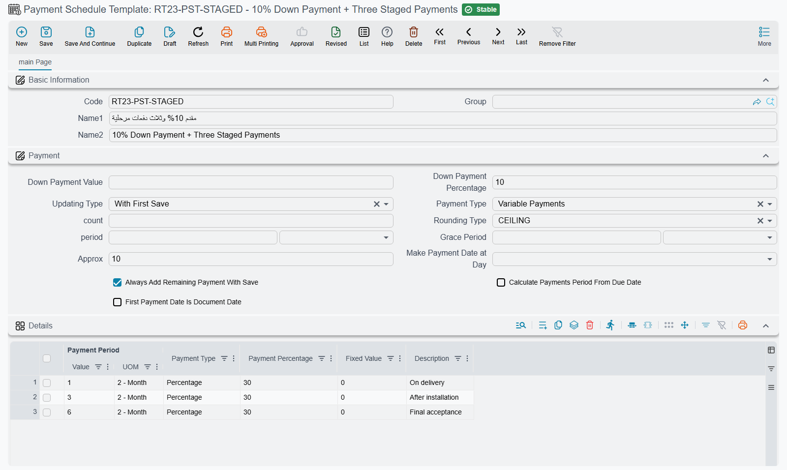

# Payment Schedules User Guide

## Overview

The Payment Schedules feature in Nama ERP allows you to define flexible payment terms and installment plans for sales and purchase documents. This guide covers the setup and usage of payment schedule templates and their application to those documents.

## Understanding Payment Schedules

Payment schedules allow businesses to:
- Define installment payment plans for customers
- Set up down payments and deferred payment terms
- Automatically calculate payment dates and amounts
- Track payment collections against scheduled payments
- Manage both fixed-value and percentage-based payment plans

### Key Components

1. **Payment Schedule Template** (نموذج جدولة الدفعات): Master file defining reusable payment terms
2. **Schedule Lines**: Individual payment installments with dates and amounts
3. **Payment Tracking**: System tracking of actual payments against scheduled amounts

## Payment Schedule Templates

Payment Schedule Templates are master files that define standard payment terms that can be applied to many documents.

### Template Fields

#### Basic Information
- **Code** (الرمز): Unique identifier for the template
- **Name** (الاسم): Descriptive name for the template
- **Description** (الوصف): Detailed description of payment terms

#### Payment Configuration

##### Down Payment Settings
- **Down Payment Value** (قيمة الدفعة المقدمة): Fixed amount for down payment
- **Down Payment Percentage** (نسبة الدفعة المقدمة): Percentage of total as down payment

When you pick the template on a document, the down payment is written into the document's **Paid** field (المدفوع نقدا), so the instalments cover only what is left after it.

::: warning
You cannot specify both a fixed down payment value AND a percentage. Choose one method only.
:::

##### Payment Type (طريقة السداد)
- **Variable Payments**: Different amounts for each installment
- **Equal Payments**: Same amount divided across all installments

##### Updating Type (طريقة التحديث)
Whatever this is set to, picking the template on a document fills its schedule on screen. The option decides whether saving the document rebuilds the schedule from the template:
- **Manual** (the default on a new template): saving never rebuilds the schedule
- **With First Save**: the schedule is rebuilt when the document is saved for the first time only
- **With Every Save**: the schedule is rebuilt on every save

::: tip
Use "With First Save" for contracts where payment terms should remain fixed after initial agreement.
:::

#### Equal Payments Configuration

When using Equal Payments type:
- **count** (عدد الدفعات): Number of installments
- **period** (مدة الدفعات): Time between payments
  - Value: Numeric value (e.g., 30)
  - Unit: Day/Week/Month/Year
- **Grace Period** (فترة السماح): Initial delay before first payment
  - Value: Numeric value
  - Unit: Day/Week/Month/Year

#### Advanced Settings
- **Approx** (التقريب): Rounding value for payment amounts
- **Rounding Type** (نوع التقريب): How to round payment values
- **Make Payment Date at Day** (جعل تاريخ الدفعة يوم): A day of the week, such as Sunday. When the document is saved, each due date that does not already fall on that weekday is moved forward to the next one, so every instalment lands on, say, a Sunday
- **Always Add Remaining Payment With Save** (إضافة دفعة بالمتبقي دائما مع الحفظ): When the document is saved and its schedule lines add up to less than what is left to pay, a final line is added for the difference
- **Calculate Payments Period From Due Date** (احتساب مدة الدفعات من تاريخ الاستحقاق): Count the payment periods from the document's due date instead of its date
- **First Payment Date Is Document Date** (تاريخ أول دفعة هو تاريخ السند): For Equal Payments picked on a document, the first instalment falls on the document date instead of one period after it



## Creating Payment Schedule Templates

### Step 1: Access Payment Schedule Templates

Navigate to: **Purchases > Master Files > Payment Schedule Template** (المشتريات > الملفات > نموذج جدولة الدفعات). The same screen is also under **Sales > Master Files**.

### Step 2: Create New Template

1. Click **New** to create a template
2. Enter basic information:
   - Code (required)
   - Name (required)
   - Description (optional)

### Step 3: Configure Payment Method

#### For Equal Payments:
```
Payment Type: Equal Payments
count: 12
period: 30 Days
Grace Period: 0 Days
```

#### For Variable Payments:
```
Payment Type: Variable Payments
Configure individual payment lines in the Details grid
```

### Step 4: Set Down Payment (Optional)

Choose one method:
- **Fixed Value**: Enter specific amount
- **Percentage**: Enter percentage (0-100)

### Step 5: Configure Payment Lines (Variable Payments Only)

In the Details grid, for each payment line:

| Field | Description | Example |
|-------|-------------|---------|
| Payment Type (نوع الدفعة) | Fixed Value or Percentage | Percentage |
| Payment Percentage (نسبة الدفعة) | Percentage of what is left to pay after the down payment | 25% |
| Fixed Value (القيمة الثابتة) | Fixed payment amount | 5,000 |
| Payment Period (مدة السداد) | Time until this payment; see [Date Calculations](#Date-Calculations) for the date it is counted from | 30 Days |
| Remarks (ملاحظات) | Notes about this payment | First installment |

::: info
When using percentage-based payments, ensure the total of all percentages plus down payment equals 100%.
:::

### Step 6: Configure Update Behavior

Select the Updating Type:
- **Manual**: For templates that should not auto-calculate
- **With First Save**: For fixed contracts
- **With Every Save**: For dynamic pricing

### Step 7: Save Template

Click **Save** to store the template for use in documents.

## Payment Types and Methods

### Equal Payments Method

The system automatically divides the remaining amount into equal installments:

**Calculation Formula:**
```
Payment Amount = (Total - Down Payment) / Number of Payments
Last Payment = Adjusted for rounding differences
```

**Example:**
- Invoice Total: 120,000
- Down Payment Value: 20,000
- Remaining: 100,000
- Payments: 10
- Each Payment: 10,000

### Variable Payments Method

Define custom payment amounts or percentages for each installment:

**Percentage-Based:**
```
Payment Amount = Remaining (after the down payment) × Payment Percentage
```

**Fixed Value:**
```
Payment Amount = Specified Fixed Value
```

**Mixed Example:**
| Payment | Type | Value | Amount |
|---------|------|-------|--------|
| 1 | Percentage | 30% | 36,000 |
| 2 | Fixed | - | 20,000 |
| 3 | Percentage | 25% | 30,000 |
| 4 | Percentage | 28.33% | 34,000 |

## Applying Templates to Sales Documents

Payment Schedule Templates can be applied to any document with a **Payment Template** field (نموذج الدفع), among them:
- Sales Quotations, Sales Orders and Sales Invoices
- Purchase Quotations, Purchase Orders and Purchase Invoices
- Documents of other modules, such as contracting contracts and extracts, fixed asset purchases and course contracts

### Application Process

1. **Open Sales Document**
2. **Select Payment Template** in the Payment Schedule section
3. **System Calculates** schedule based on:
   - Document total amount
   - Template configuration
   - Update type settings
4. **Review Generated Schedule** in the Schedule Lines grid
5. **Manual Adjustments**: edit the lines if needed. A template set to **With Every Save** rebuilds the lines on every save, and **With First Save** on the first save, replacing your edits
6. **Save Document** to finalize schedule

### Generated Schedule Information

For each scheduled payment:
- **Payment Date**: Calculated based on template periods
- **Payment Value**: Calculated amount
- **Payment Percent**: Percentage of total
- **Remaining**: Outstanding amount after payments
- **Installment Code**: Unique identifier for tracking

## Payment Schedule Calculations

### Date Calculations

The start date is the document date, or the document's due date when **Calculate Payments Period From Due Date** is ticked. The dates then depend on when the schedule is built.

**When the document is saved** with a template set to **With First Save** or **With Every Save**:
```
Equal Payments:
  First Payment Date = Start Date + Grace Period
  Next Payment Date  = Previous Payment Date + period
Variable Payments:
  Each line's date   = Document Date + that line's Payment Period
```

**When you pick the template on the document**:
```
Equal Payments:
  First Payment Date = Start Date + period
                       (Start Date itself when First Payment Date Is Document Date is ticked)
  Next Payment Date  = Previous Payment Date + period
Variable Payments:
  First line's date  = Start Date + first line's Payment Period
  Each later line    = Previous line's date + that line's Payment Period
```

So a template whose lines give the months as 1, 2, 3 … from the document date (as in Scenario 5 below) must be set to **With First Save** or **With Every Save**, so that saving the document rebuilds the dates from the document date.

### Amount Calculations

#### With Down Payment:
```
Remaining Amount = Total - Down Payment - External Payments
Payment Amount = Remaining Amount × Payment Configuration
```

#### Rounding and Approximation:
```
Rounded Payment = Round(Payment Amount, Approximation, Rounding Type)
Last Payment = Remaining Amount - Sum of Previous Payments
```

### Messages you may see

The percentages on a template that has detail lines are checked against 100, counting the down payment percentage too. They must add up to exactly 100 unless a line is of type **Fixed Value** or **Always Add Remaining Payment With Save** is ticked - then they only must not go above 100, because a fixed amount or the automatic remaining payment covers the rest.

| Message | Why | What to do |
|---|---|---|
| *Sum of payments percentages must be one hundred* — «مجموع نسب الدفعات يجب أن يكون مائة» | The template's percentages, down payment included, do not add up to 100, and no line is a Fixed Value line and Always Add Remaining Payment With Save is off. | Correct the percentages, or tick **Always Add Remaining Payment With Save** so the shortfall becomes a final payment. |
| *Sum of payments percentages can not be greater than one hundred* — «مجموع النسب لا يمكن أن يكون أكبر من مائة» | The percentages, down payment included, add up to more than 100. | Lower them. |
| *Must enter either the value or the percentage* — «يجب إدخال قيمة الدفعة أو قيمة النسبة» | Both **Down Payment Value** and **Down Payment Percentage** are filled. | Clear one of them. |
| *Must enter payment period value* — «يجب إدخال قيمة فترة الدفعة» | A line has a **Payment Period** unit but no number. | Type the number of days, weeks, months or years. |
| *Payments total {0} is not equal to remaining {1}* — «مجموع الدفعات {0} لا يساوي قيمة المتبقي {1}» | Raised on an invoice: the payment schedule lines do not add up to what is left to pay after the down payment and external payments. | Correct the schedule lines. The check can be switched off with **Do Not Compare Remaining With Payment Total In Invoices** in the global configuration. |


## Common Scenarios

### Scenario 1: 50% Down Payment, Balance in 30 Days

```
Template Configuration:
- Down Payment Percentage: 50%
- Updating Type: With First Save
- Payment Type: Equal Payments
- count: 1
- Grace Period: 30 Days
```

### Scenario 2: Monthly Installments Over One Year

```
Template Configuration:
- Down Payment: 0
- Payment Type: Equal Payments
- count: 12
- period: 1 Month
- First Payment Date Is Document Date: Yes
```

### Scenario 3: Custom Payment Plan

```
Template Configuration:
- Payment Type: Variable Payments
- Updating Type: With First Save
- Details (Payment Period counted from the document date):
  Line 1: 30% immediately
  Line 2: 30% after 30 days
  Line 3: 40% after 60 days
```

### Scenario 4: Quarterly Payments with Grace

```
Template Configuration:
- Payment Type: Equal Payments
- Updating Type: With First Save (the grace period is applied when the document is saved)
- count: 4
- period: 3 Months
- Grace Period: 15 Days
- Make Payment Date at Day: Sunday (each due date moves forward to the next Sunday)
```

### Scenario 5: Ten Monthly Instalments Plus Two Lump Sums

A customer wants to pay an invoice over twelve instalments: ten monthly instalments of 5% each, plus two extra instalments of 25% in months 5 and 10.

```
Template Configuration:
- Payment Type: Variable Payments
- Updating Type: With First Save
- Details (each line a Percentage, period in Months):
  Lines 1-10: 5% at months 1, 2, ... 10
  Line 11: 25% at month 5
  Line 12: 25% at month 10
```

The ten monthly lines make 50% and the two lump sums the other 50%, so the plan totals 100%. When the invoice is saved, months 5 and 10 each produce **two** instalments on the same date — one of 5% and one of 25%.

::: details JSON for direct import
```json
{
  "paymentType": "VariablePayments",
  "updatingType": "WithFirstSave",
  "roundingType": "CEILING",
  "details": [
    {
      "paymentPeriod": {
        "value": 1,
        "uom": "Month"
      },
      "paymentType": "Percentage",
      "paymentPercent": 5
    },
    {
      "paymentPeriod": {
        "value": 2,
        "uom": "Month"
      },
      "paymentType": "Percentage",
      "paymentPercent": 5
    },
    {
      "paymentPeriod": {
        "value": 3,
        "uom": "Month"
      },
      "paymentType": "Percentage",
      "paymentPercent": 5
    },
    {
      "paymentPeriod": {
        "value": 4,
        "uom": "Month"
      },
      "paymentType": "Percentage",
      "paymentPercent": 5
    },
    {
      "paymentPeriod": {
        "value": 5,
        "uom": "Month"
      },
      "paymentType": "Percentage",
      "paymentPercent": 5
    },
    {
      "paymentPeriod": {
        "value": 6,
        "uom": "Month"
      },
      "paymentType": "Percentage",
      "paymentPercent": 5
    },
    {
      "paymentPeriod": {
        "value": 7,
        "uom": "Month"
      },
      "paymentType": "Percentage",
      "paymentPercent": 5
    },
    {
      "paymentPeriod": {
        "value": 8,
        "uom": "Month"
      },
      "paymentType": "Percentage",
      "paymentPercent": 5
    },
    {
      "paymentPeriod": {
        "value": 9,
        "uom": "Month"
      },
      "paymentType": "Percentage",
      "paymentPercent": 5
    },
    {
      "paymentPeriod": {
        "value": 10,
        "uom": "Month"
      },
      "paymentType": "Percentage",
      "paymentPercent": 5
    },
    {
      "paymentPeriod": {
        "value": 5,
        "uom": "Month"
      },
      "paymentType": "Percentage",
      "paymentPercent": 25
    },
    {
      "paymentPeriod": {
        "value": 10,
        "uom": "Month"
      },
      "paymentType": "Percentage",
      "paymentPercent": 25
    }
  ]
}
```

Open a new Payment Schedule Template, then **More → Import Into Current Record** and paste it — see [Importing Into the Record You Have Open](/platform/import-export/importing-records.md#Importing-Into-the-Record-You-Have-Open).
:::

## Payment Documents and Installment Tracking

Once payment schedules are created and applied to sales documents, the system provides comprehensive tracking through payment documents that can mark installments as paid.

### Receipt Vouchers and Payment Vouchers

Both **Receipt Vouchers** (سندات القبض) and **Payment Vouchers** (سندات الدفع) include an **Installment Lines** (الأقساط) collection that enables payment tracking against scheduled installments:

- **Receipt Vouchers**: Used primarily for sales documents to record customer payments
- **Payment Vouchers**: Used primarily for purchase documents to record supplier payments

### Installment Lines Collection

The installment lines grid in payment documents contains the following key fields:

| Field | Arabic Name | Description |
|-------|-------------|-------------|
| **Installment doc** | مستند القسط | Reference to the document containing the payment schedule |
| **Installment Code** | كود القسط | Unique code identifying the specific installment |
| **Paid Value** | القيمة المدفوعة | Amount being paid against this installment |
| **Due Date** | تاريخ الاستحقاق | Original due date of the installment |
| **Remaining** | المتبقي | Outstanding balance after this payment |
| **Net value** | الصافي | Total value of the installment |
| **Collection Discount** | خصم التحصيل | A discount granted on this installment when it is collected — for paying early, say. It counts toward the installment's paid amount together with **Paid Value**, so the installment is settled even though less money changed hands. The voucher books it through the **Collection Discount** sides of its term. It cannot be negative: *Collection discount can not be negative* — «خصم التحصيل لا يمكن أن يكون سالبًا». |

### Payment Processing Logic

When a payment document is saved, the system goes back to every document whose installments it pays and:

1. **Updates the paid amount**: adds up every payment line against each installment (with any collection discount) into that installment's system-paid amount on the source document
2. **Recalculates remaining balances**: across all related installments
3. **Checks the payment order** when the installment document requires it (see [Payment Order Enforcement](#Payment-Order-Enforcement))
4. **Prevents overpayments**: paid amounts may not exceed installment values

### Payment Tracking Process

#### Step 1: Create Payment Document
1. Open Receipt Voucher or Payment Voucher
2. Enter basic payment information (customer/supplier, amount, date)
3. Navigate to the **Installment Lines** tab

#### Step 2: Add Installment Payments
1. Click **Add Line** in the Installment Lines grid
2. Select the **Installment doc**: a sales invoice, sales replacement or purchase invoice, or a real estate sales document, collection document or rent contract
3. Choose the specific **Installment Code** from the document
4. Enter the **Paid Value** (can be partial or full payment)
5. Repeat for multiple installments if needed

#### Step 3: Payment Validation
The system automatically validates:
- Payment amounts don't exceed installment balances: *The installment {0} in document {1} has excess payment {2} in {3}* — «كود القسط {0} في المستند {1} تعدى قيمة القسط بمقدار {2} في الحقل {3}»
- Payment order follows due date sequence (if configured)
- Referenced installments exist in the source document: *Installment code {0} is not found in the document {1}* — «كود القسط {0} غير موجود بالمستند {1}»
- The installment lines do not add up to more than the voucher amount: *Document total {0} is less than installments total {1}* — «إجمالي المبلغ {0} وهو أقل من إجمالي الأقساط {1}». The voucher term's **Do Not Check Total Installments With Total Amount** switches this check off, and its **Validate Remaining And Installments Total Equality** requires the two to be equal

#### Step 4: Effect Application
Upon saving the payment document:
- Installment balances are updated across the system
- Related sales/purchase documents show updated payment status
- Aging reports reflect the new payment information
- Customer/supplier accounts are updated

### Multi-Document Payment Support

Payment documents can process installments from multiple source documents in a single transaction:

```
Receipt Voucher RV-2024-001
├── Customer: ABC Company
├── Total Amount: 150,000
└── Installment Lines:
    ├── Invoice INV-001, Installment #1: 50,000
    ├── Invoice INV-001, Installment #2: 25,000
    └── Invoice INV-002, Installment #1: 75,000
```

### Payment Order Enforcement

The order is checked only when the term of the document that holds the installments (the sales invoice, purchase invoice and so on) has **Pay Installments In Order** (دفع الأقساط بالترتيب) ticked. With it off, which is the default, installments can be paid in any order. With it on, a payment to an installment is refused while an installment with an earlier due date is not fully paid:

*The installment {0} in document {1} with due date {2} is not fully paid, you can not pay the installment {3} before paying that installment* — «القسط {0} في المستند {1} الذي تاريخ استحقاقه {2} لم يدفع بالكامل , لا يمكن دفع القسط {3} قبل دفع هذا القسط»

### Installment Payment Entry System

Behind the scenes, each installment line of a saved voucher is recorded as an installment payment entry that tracks:
- **Payment Document**: Which receipt/payment voucher made the payment
- **Installment Document**: Which sales/purchase document contains the installment
- **Installment Code**: Specific installment being paid
- **Effect Type**: Which paid amount of the installment it updates, set by the voucher term's **installment Effect** (تأثير الأقساط): **System Paid**, **Collected By Commercial Paper** or **Requested Collect**
- **Paid Value**: Amount applied to the installment
