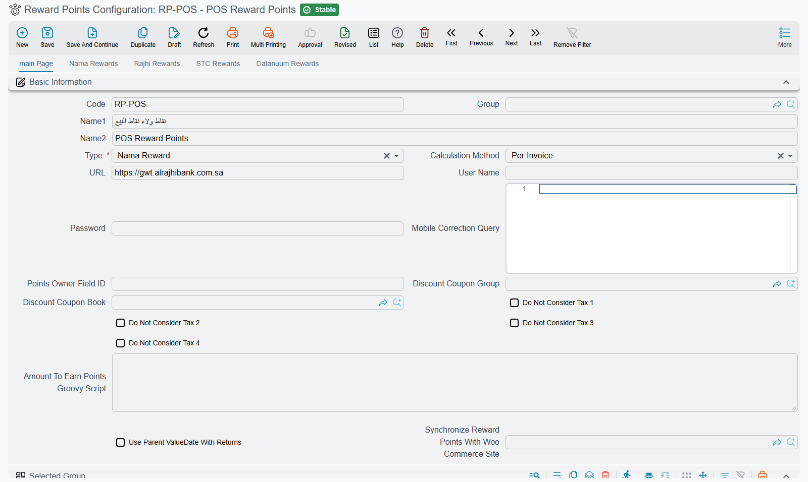
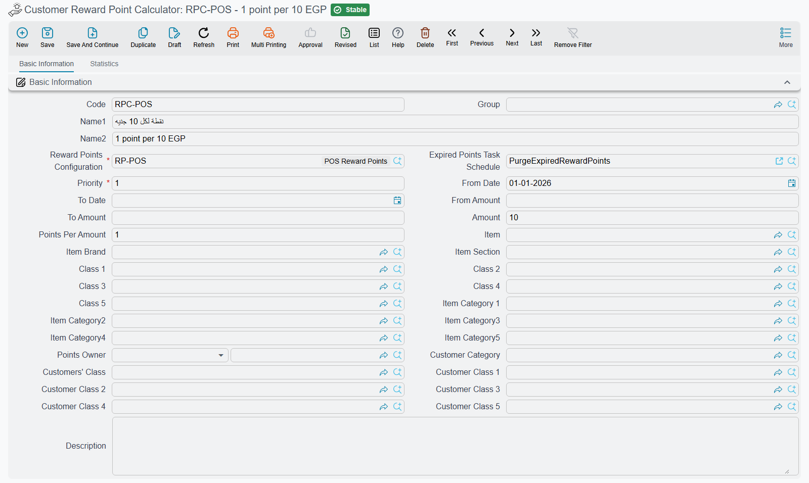

# Setting Up Nama Reward Points

This page walks through setting up Nama's own loyalty programme: how customers earn points on their invoices, when those points become usable and when they expire, how they are spent, and how to load opening balances or bar a customer. The notification templates and the STC Qitaf connection are on [Customer Reward Points](/modules/invoicing/reward-points).

All five screens are under **Basic → Documents**.

## 1. The programme: Reward Points Configuration

Create a **Reward Points Configuration** and set **Type** (`type`) to **Nama Reward**. The other types connect Nama to an outside provider (Al Rajhi, ANB, STC, Bonat, Kangaroo, Datanuum), which keeps the balance on its own side; their connection settings are on [Customer Reward Points](/modules/invoicing/reward-points#Outside-providers-connection-settings). Everything below is about Nama Reward, where Nama keeps the balance itself.

On the first page:

- **Calculation Method** (`calculationMethod`): **Per Invoice** grants points on each invoice as it is saved. **Periodic** only records what each customer spends; the points are granted later by a grant document (step 5).
- **Do Not Consider Tax 1** to **4** (`doNotConsiderTax1` … `doNotConsiderTax4`): points are earned on the line's net value, which includes tax. Tick a tax here to earn on the value without it.
- **Amount To Earn Points Groovy Script** (`amountToEarnPointsGroovyScript`): replaces that rule altogether. When it is filled, the script decides the value each invoice line earns on, and the four tax switches above are ignored. The script receives `invoice`, `line` and `price` and must return a number. Leave it empty unless the standard rule cannot express what you need.
- **Points Owner Field ID** (`pointsOwnerFieldId`): the field on the invoice that holds the party who earns and spends the points. Empty means `customer`. Fill it only when the points belong to someone other than the invoice's customer.
- **Selected Group** (`applyOn`): limits which documents earn points. Each row can name a document type, book, term, dimensions, an **Apply When Query** or **Criteria**, and an **Applicability** of **Include** or **Exclude**. The first matching row decides. Once the grid has rows, a document that matches none of them earns nothing.
- **Use Parent ValueDate With Returns** (`useParentValueDateWithReturns`): a sales return is matched against the earning rules using the original invoice's date instead of its own.
- **Discount Coupon Book** / **Discount Coupon Group** (`discountCouponBook`, `discountCouponGroup`): where the coupon created by a redemption takes its code from (step 4).
- **Synchronize Reward Points With Woo Commerce Site** (`synchronizeRewardPointsWithWooCommerceSites`): keeps one balance between Nama and a WooCommerce shop. Pick the shop's site record; how the two sides exchange points is on [WooCommerce Integration](/modules/ecommerce/woocommerce-integration#Reward-points).

On the **Nama Rewards** page:

- **Deserve Points After (Days)** (`deservePointsAfterDays`): points become usable this many days after the invoice date. Leave it at 0 to make them usable at once.
- **Points Expiration Period (Days Count)** (`pointsExpiresAfterDays`): how long points stay usable, counted from the day they become usable. Fill it in: an empty value means zero days, so points expire on the day they become usable.
- **Points Expire At The End Of Their Creation Year** (`pointsExpireAtEndOfCreationYear`): in addition, every point expires on 31 December of the year of the invoice that earned it. Whichever date comes first wins. With 365 days and this option ticked, points earned on 1 March expire on 31 December of that year, and points earned on 20 December expire eleven days later.
- **Amount Per Points For Redeeming (Multiplied By)** and **Point Per Amount (Divided On)** (`multiplyPointsByWhenRedeem`, `dividePointsOnWhenRedeem`): convert points to money when they are spent. Both are required. With both set to 1, one point is worth one unit of the company's currency.
- **OTP Notification**, **OTP Character Count**, **OTP Expires After In Minutes** (3 when left empty) and **Redeem Points Without OTP** (`otpNotification`, `otpCharacterCount`, `otpExpiresAfterInMinutes`, `redeemWithoutOtp`): how the customer confirms a redemption. The notification is required.
- **OTP Format** (`otpFormat`): what the code is made of: **Only Numbers**, **Only Character** or **Numbers And Character**. Left empty, the code mixes letters and digits. Only Numbers is easier when the code is read out over the phone.

Finally, point the sales document terms at the configuration: **Reward Points Configuration** on the term's [pricing page](/modules/supplychain/document-terms/doc-term-pricing-taxes-discounts). For the point of sale, set it on the register or on the POS settings. A document whose term names no configuration earns nothing.

## 2. The earning rate: Customer Reward Point Calculator

The rate lives in a separate screen, **Customer Reward Point Calculator**, and one configuration can have several of them. Each calculator names its **Reward Points Configuration** (`rewardPointsConfig`), a **Priority** (`priority`), an optional **From Date** / **To Date** (`fromDate`, `toDate`), and the rule itself. The rule fields sit under `rewardPointsCriteriaFields` in the header and `details.rewardPointsCriteriaFields` in the grid:

- **Amount** and **Points Per Amount** (`amount`, `pointsPerAmount`): the customer earns *Points Per Amount* for every *Amount* of value. Amount 10 and Points Per Amount 1 gives one point per 10 of value, so a line worth 250 earns 25 points.
- Who it applies to: a single **Points Owner** (`pointsOwner`), or customer classes and categories.
- What it applies to: an item, a section, a brand, item classes and categories, and the dimensions at the bottom of the screen.
- **From Amount** / **To Amount** (`fromAmount`, `toAmount`): used by the periodic method. The customer's total spend for the period must fall in this band.

Values filled in the header are copied into every line of the grid, so the header holds what the lines share. Calculators are tried in ascending **Priority** order, and for each invoice line the first rule that matches the item, the customer and the date gives the rate. A line that no rule matches earns nothing. The share of an invoice paid with discount coupons, which is how redeemed points are paid, earns no points.

**Expired Points Task Schedule** (`expiredPointsTaskSchedule`): when it is left empty, saving the calculator links it to a daily task schedule coded `PurgeExpiredRewardPoints` (and creates the schedule if needed). That task moves expired points out of each customer's balance.

## 3. What happens on save, return and cancel

When an invoice is processed, its points are recorded against the customer. The customer's screen lists them with their usable-from and expiry dates. A sales return takes back the points earned on the returned value. If the customer no longer has enough usable points to give back, the return is refused. Cancelling an invoice is refused for the same reason.

## 4. Redeeming

On the invoice, **Request Redeem Customer Amount** shows the customer's remaining points and their value and asks for the amount to redeem. It creates a discount coupon worth that amount and sends the customer a one-time code, unless **Redeem Points Without OTP** is ticked. Once the code is entered, the coupon is added to the invoice's payments and the points are deducted, oldest first. At the point of sale the same thing happens through the reward points dialog (see [Payment and tender](/modules/pos/pos-payment-and-tender)).

## 5. Opening balances, periodic grants and restrictions

- **Reward Points Opening** loads balances from an earlier system: one line per customer with **Points**, a **Reward Date** and an optional **To Date** (`details.points`, `details.rewardDate`, `details.toDate`). **Points Value** (`details.pointsValue`) is calculated, and the document term records that value through the **Debit** and **Credit** sides on its **Effects** tab (`termConfig.debit1`, `termConfig.credit1`).
- **Periodic Reward Points Grant Document** is the second half of the **Periodic** method. Give it a **From Date** and a **To Date**. On save it adds up each customer's spend in that period, picks the calculator line whose **From Amount** / **To Amount** band contains the total, and grants the points as of the **Reward Date** (`rewardDate`; the To Date when left empty). The lines list shows each customer's total amount, points and their value.

  The grant also records what those points are worth. Its document term's **Effects** tab has a **Debit** side (`termConfig.debit`) and a **Credit** side (`termConfig.credit`), and each customer's line posts its **points value**, in the company's main currency, between them: typically a loyalty expense on the debit side and a points liability on the credit side. Each side is filled like any other account side, with an account source and account, a subsidiary account type, narrations and dimension sources (`termConfig.debit.accountSource.type`, `termConfig.debit.accountRef`, `termConfig.debit.subsidiaryAccountType`, `termConfig.debit.narrationTemplate`, and the same under `termConfig.credit.`). [Accounting Side Config](/platform/shared-master-files/accounting-side-config) explains each of them.
- **Reward Points Restriction** bars customers for a date range. Each line names a customer with a **From Date** and **To Date** and ticks **Prevent Granting**, **Prevent Redeem** or both. Leave the configuration in the header empty to bar the customer from every programme.

## Messages you may see

| Message | Why | What to do |
|---|---|---|
| *Available loyalty points {0} for customer {1} is less than deducted points {2}* — «نقاط المكأفاة المتاحة {0} للعميل {1} أقل من النقاط المخصومة {2}» | A return or a cancellation would take back points the customer has already spent. | Reverse the redemption first, or return less. |
| *You cannot redeem, available points is zero* — «لا يمكنك الإسترجاع, ليس هناك نقاط متاحه» | The customer has no usable points on that date. Points may still be waiting out **Deserve Points After (Days)**, or may have expired. | Check the customer's points list. |
| *Redeem points {0} is greater than available points {1} for customer {2}* — «النقاط المطلوب إسترجاعها {0} اكبر من المستحق {1} للعميل {2}» | The amount asked for needs more points than the customer has. | Redeem a smaller amount. |
| *Invalid OTP* — «كود تحقق غير صالح» | The code is wrong or has expired. | Request a new code. |
| *The customer {0} prevented from rewards point redeem* — «العميل {0} ممنوع من صرف نقاط مكافأة» | A restriction bars this customer from redeeming on that date. | Check the Reward Points Restriction lines. |
| *Reward points config file {0} must be {1} type* — «ملف إعدادات نقاط المكافأة {0} يجب ان يكون من النوع {1}» | A calculator points at a configuration that is not Nama Reward. | Choose a Nama Reward configuration. |
| *You can not cancel the document because there are {1} redeemed points for customer {0}* | A periodic grant whose points have been spent cannot be cancelled. This message has no Arabic text and shows in English on Arabic screens too. | Reverse the redemptions first. |
| *You can not remove the customer {0} because there are {1} redeemed points* | An opening line whose points have been spent cannot be removed. Shown in English on Arabic screens too. | Keep the line. |
