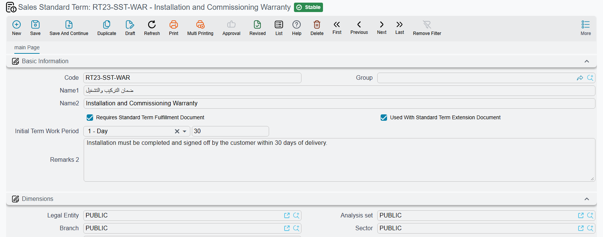

# Standard Terms and Conditions Feature Documentation

## Overview

The Standard Terms feature in Nama ERP provides a comprehensive mechanism for tracking terms and conditions in sales documents (invoices, quotations, etc.) and monitoring whether these terms have been fulfilled. This system allows businesses to define standardized terms, attach them to documents, track their fulfillment status, and manage extensions when needed.

## Key Components

### 1. Sales Standard Term (Master File)
**Entity**: `SalesStandardTerm`  
**Type**: Master File

This is the master definition of standard terms that can be attached to sales documents.

#### Configuration Fields:
- **Code** (`code`): Unique identifier for the term
- **Name 1** (`name1`): Primary name/description of the term
- **Requires Standard Term Fulfillment Document** (`requiresTermFulfillment`): Boolean flag indicating if this term needs formal fulfillment tracking
- **Used With Standard Term Extension Document** (`useWithTermExtension`): Boolean flag indicating if this term can be extended
- **Initial Term Work Period** (`initialTermWorkPeriod`): Default duration for the term (includes value and unit of measure)
- **Remarks 2** (`remarks2`): Additional notes or detailed description of the term

### 2. Standard Term Fulfillment Document
**Entity**: `StandardTermFulfillment`  
**Type**: Document File

Document used to formally record that specific terms have been fulfilled.

#### Key Fields:
- **From Document** (`fromDoc`): Generic reference to the source document (e.g., Sales Invoice)
- **Details** (`details`): Collection of fulfillment lines

#### Fulfillment Line Fields:
- **Standard Term** (`standardTerm`): Reference to the Sales Standard Term being fulfilled
- **Fulfillment Date** (`fulfillmentDate`): Date when the term was fulfilled

### 3. Standard Term Extension Document
**Entity**: `StandardTermExtension`  
**Type**: Document File

Document used to extend the deadline for standard terms that allow extensions.

#### Key Fields:
- **From Document** (`fromDoc`): Generic reference to the source document
- **Details** (`details`): Collection of extension lines

#### Extension Line Fields:
- **Standard Term** (`standardTerm`): Reference to the Sales Standard Term being extended
- **Extension Period** (`extensionPeriod`): Additional time period for the extension
- **Extension Fine** (`extensionFine`): Monetary penalty for the extension

## Implementation in Sales Documents

### Sales Invoice Standard Terms Line
Sales quotations, sales orders, sales invoices, sales replacements and purchase invoices carry a standard terms grid, and so do some documents of other modules (real estate sales and rent contracts, rental invoice requests, and the service center's sales order, sales approval and proforma sales invoice).

#### Line Fields:
- **Standard Term** (`standardTerm`): Reference to the Sales Standard Term
- **Remarks** (`remarks`): Additional notes specific to this instance
- **Standard Term Planned End Date** (`termPlannedEndDate`): Original deadline for the term
- **Standard Term End Date After Extension** (`termExtendedEndDate`): Updated deadline after extensions (system-calculated)
- **Fulfillment Date** (`fulfillmentDate`): Date when fulfilled (system-updated)
- **Total Extension Fine** (`extensionFines`): Accumulated fines from all extensions (system-calculated)
- **Fulfillment Doc** (`fulfillmentDoc`): Reference to the Standard Term Fulfillment document (system-updated)

#### Additional Custom Fields:
The system provides flexible fields for custom data:
- **Reference Fields** (`ref1` to `ref5`): Generic references for linking to other entities
- **Numeric Fields** (`n1` to `n5`): Decimal values for custom calculations
- **Text Fields** (`text1` to `text5`): Text values for additional information
- **Date Fields** (`date1` to `date5`): Date values for tracking milestones
- **Attachments** (`attachment1` to `attachment3`): Binary data for supporting documents

## Business Process Flow

### 1. Setup Phase
1. Create Sales Standard Terms in the master file
2. Configure each term with:
   - Whether it requires fulfillment tracking
   - Whether it can be extended
   - Default work period duration

### 2. Document Creation
1. Add standard terms to sales documents (invoices, quotations, etc.)
2. When `termPlannedEndDate` is empty, the system fills it on save from:
   - Document value date
   - Term's initial work period (the value date itself when the term has none)

   A planned end date already on the line is kept.
3. For terms with **Used With Standard Term Extension Document** ticked, the system calculates `termExtendedEndDate` considering any existing extensions

### 3. Term Extension Process
1. Create a Standard Term Extension document
2. Reference the source document
3. Add extension lines specifying:
   - Which terms to extend
   - Extension period
   - Extension fines
4. System updates:
   - `termExtendedEndDate` on the original document
   - `extensionFines` accumulation

### 4. Term Fulfillment Process
1. Create a Standard Term Fulfillment document
2. Reference the source document
3. Add fulfillment lines specifying:
   - Which terms are fulfilled
   - Fulfillment dates
4. System validates and updates:
   - `fulfillmentDate` on the original document
   - `fulfillmentDoc` reference

## Validation Rules

### Term Uniqueness
- A standard term that requires fulfillment or is used with extensions can appear only once per document. Saving a document that repeats it is refused with *Standard term {0} is repeated at line {1}* — «البند {0} مكرر في السطر {1}»

### Finding the Term
- A fulfillment or extension document needs its **From Document** (`fromDoc`), and each term may appear on it only once (the same *Standard term {0} is repeated at line {1}* message)
- Only a term with **Requires Standard Term Fulfillment Document** ticked can go on a fulfillment document, and only a term with **Used With Standard Term Extension Document** ticked on an extension document. Any other term is refused with *Standard term {0} could not be used with {1}* — «البند {0} لا يمكن استخدامه مع {1}»
- A fulfillment line needs its **Fulfillment Date**, and an extension line both the value and the unit of its **Extension Period**
- Every line of a fulfillment or extension document must name a term that is on the source document's standard terms grid, otherwise it is refused with *Could not find standard term {0} in document {1}* — «لا يمكن إيجاد البند {0} في المستند {1}»

### Extension Validation
- Each extension of a term moves its end date on by the extension's **Extension Period**, and the fines of all of them add up into **Total Extension Fine**
- Once a term has been fulfilled, its extensions are checked in order of value date, then creation date, and one that starts on or after the fulfillment date is refused with *Standard term {0} was fulfilled at date {1} with document {2}, you can not extend after this date using doc {3}* — «البند {0} تم تحقيقه في التاريخ {1} بالمستند {2}, لا يمكن تمديد البند بالمستند {3} بعد هذا التاريخ»

### Fulfillment Validation
- A term can only be fulfilled once. When another fulfillment document already fulfils it, saving is refused with *You could not fulfillment term {0} with document {1}, document {2} assign fulfillment* — «لا يمكنك تحقق البند {0} بالمستند {1}, المستند {2} يحقق البند»
- The same date check as above runs when a term is fulfilled: its fulfillment date must fall after the end date that was in force before each of its extensions
- Deleting or cancelling a fulfillment document clears the fulfillment date and document on the source line; cancelling an extension takes its period and fine back off

## Configuration Examples

### Example 1: Payment Terms
**Term Setup**:
- Code: `PAY30`
- Name: "Payment within 30 days"
- Requires Fulfillment: Yes
- Allows Extension: Yes
- Initial Period: 30 days

**Usage**: Attached to sales invoices to track payment deadlines and extensions.

### Example 2: Delivery Terms
**Term Setup**:
- Code: `DEL7`
- Name: "Delivery within 7 days"
- Requires Fulfillment: Yes
- Allows Extension: No
- Initial Period: 7 days

**Usage**: Attached to sales orders to track delivery commitments.

### Example 3: Warranty Terms
**Term Setup**:
- Code: `WAR365`
- Name: "One year warranty"
- Requires Fulfillment: No
- Allows Extension: Yes
- Initial Period: 365 days

**Usage**: Attached to sales invoices for warranty tracking.
