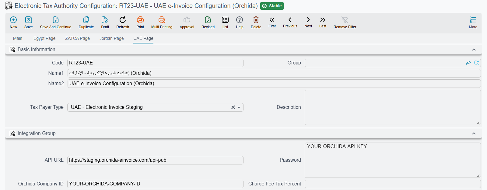
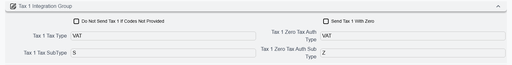

::: warning In Progress
This document is still in progress, not yet finished
:::

# UAE E-Invoicing Integration via Orchida osTax

## Overview

NamaERP supports sending electronic invoices to the UAE Federal Tax Authority (FTA) through the Orchida osTax service provider. Orchida acts as an Accredited Service Provider (ASP) in the UAE's Peppol-based 5-corner e-invoicing model.

The system sends invoices in JSON format to Orchida, which validates them, reports tax data to the FTA, and routes them to the buyer through the Peppol network.

## Prerequisites

Before starting the setup, you need:

- An account on the Orchida osTax platform (https://app.orchidatax.com)
- An API Key (Bearer Token) from the Orchida dashboard
- A Company ID from the Orchida dashboard

### Getting Credentials from Orchida

1. Log in to the Orchida dashboard
2. Enter the OTP sent to your email
3. Select your tenant and company
4. Go to Security > Generate Key
5. Create a new key (set expiration date and name)
6. Copy the API Key and Company ID

## System Setup

### Step 1: Global E-Invoice Settings

From Global Configuration > Page 2:
- Set `e-Invoice Page To Show` to `UAE Page`
- After changing the value, perform a Regen UI

### Step 2: Tax Payer Configuration

Create a new Tax Payer Configuration or edit an existing one.

#### Basic Information

| Field          | Value |
|----------------|-------|
| Tax Payer Type (`taxPayerType`) | `UAE - Electronic Invoice Staging` (for testing) or `UAE - Electronic Invoice` (for production) |

#### Integration Settings

| Field              | Description |
|--------------------|-------------|
| API URL (`apiUrl`) | Auto-filled when Tax Payer Type is selected |
| Password (`password`) | API Key from Orchida (Bearer Token). Required. |
| Orchida Company ID (`orchidaCompanyId`) | Company ID from the Orchida dashboard. Required. |

Orchida knows the seller from the Company ID, so no seller block leaves Nama: **Tax Registeration NO**, **Activity Type** and **Branch Id From** on the UAE page are not sent with UAE invoices. Leave **Branch Id From** empty — when it is filled, saving the configuration still checks that record's **Tax Authority Code** and address.

#### Tax Code Configuration

UAE tax codes follow the UN/EDIFACT 5305 standard (Aligned Tax Category Codes).

**Tax Type**:

| Code | Description |
|------|-------------|
| VAT | Value Added Tax |

**Tax SubType**:

| Code | Description |
|------|-------------|
| S | Standard rate (5%) |
| Z | Zero rated |
| E | Exempt from tax |
| O | Out of scope |
| AE | Reverse Charge |

::: warning
When using code `S` (Standard rate), the VAT rate must be exactly `5.00`
:::

Enter the codes in the *Tax 1* group of the UAE page (or the group of whichever tax slot holds VAT): **Tax 1 Tax Type** (`taxesCodes.tax1TaxAuthType`) takes `VAT` and **Tax 1 Tax SubType** (`taxesCodes.tax1TaxAuthSubType`) takes the category. The rest of the group:

- **Tax 1 Zero Tax Auth Type** and **Tax 1 Zero Tax Auth Sub Type** (`taxesCodes.tax1ZeroTaxAuthType`, `taxesCodes.tax1ZeroTaxAuthSubType`) are sent instead when the tax on a line is zero — for example `VAT` and `Z`.
- **Send Tax 1 With Zero** (`taxesCodes.sendTax1WithZero`) sends the tax with a zero rate and a zero amount.
- **Do Not Send Tax 1 If Codes Not Provided** (`doNotSendTax1IfNoCode`) leaves the slot out when it has no codes.

**Calculate Tax Codes Types From** (`taxCodesType`) decides whether the codes are read from this page (the default) or from the tax plan on the term, the item or the customer, and the **Tax Codes Sources** grid (`taxCodesSource`) overrides that for chosen document types, books, terms, criteria, value dates or dimensions.

#### Item lines, prices and dates

| Field | Field ID | What it does |
|---|---|---|
| **Calculate Item Code From**, **Item Code Template** | `itemCodeFrom`, `itemCodeTemplate` | The item code sent on each line: the **Tax Authority Code** of the item (or of its group, class, category, section or brand), or the item's own code when that is empty. With **From Item Code Template**, the template builds it. |
| **Run Item Description Template On**, **Item Description Template** | `taxDescriptionFrom`, `taxDescriptionTemplate` | The line's name and description. By default the item's first name; the template can build it from the item, the document header or the document line. |
| **Unit Price Source**, **Unit Price Source Type** | `unitPriceSource`, `unitPriceType` | Which step of the line's calculation the unit price is read from. See [Unit price, quantities and rounding](./e-invoices-guide.md#Unit-price-quantities-and-rounding). |
| **Quantity Fractional Places** | `quantityFractionalPlaces` | Decimal places of the quantity; empty means 2. Same section. |
| **Ignore and Round Amount if Scale is Greater Than Allowed Scale** | `ignoreAndRoundAmountIfScaleIsInvalid` | Rounds an over-precise unit price instead of stopping the document. Same section. |
| **Max Number Of Lines When Collect Tax Auth Docs** | `maxNumberOfLinesWhenCollectTaxAuthDocs` | How many lines one collection may bring in. Same section. |
| **Don Not Send Assembly Components** | `dontSendAssemblyComponentLines` | Sends an assembly item as one line rather than as its components. |
| **Discount Configs** grid | `discountConfigs` | Sends a discount before tax, after tax, or not at all, discount by discount. See [Discount Configs](./e-invoices-guide.md#Discount-Configs). |
| **Max Days To Send Invoices** | `maxDaysToSendInvoice` | See [Maximum Days to Send](#Maximum-Days-to-Send) below. |
| **Start Sending From Date** | `startSendingFromDate` | Documents dated before this day are never sent. |
| **Days To Allow Save Document In Future** | `futureDaysToAllowSaveDoc` | How many days ahead a document that goes to Orchida may be dated. Zero means not at all. |

**Item Internal Code Template** and **Run Item Nama Code Template On** build an internal code that is not sent to Orchida; **Internal Item Code Maximum Length** still limits that code, to 50 characters when it is empty. The charge-fee fields (**Charge Fee Fields**, **Charge Fee Value**, **Charge Fee Tax Percent**, **Exclude Service Fees With No Configs**) and **Document Level Extra Discount Location** do not affect UAE invoices. Service fees reach Orchida only through the service-fees grid on the **Main** page — see [Service Fees And What Is Charged To Customer](./e-invoices-guide.md#Service-Fees-And-What-Is-Charged-To-Customer).

### Step 3: Customer Setup

For each customer that will receive electronic invoices, fill in the following fields:

#### Tax Information

| Field        | Description |
|--------------|-------------|
| Tax Registeration NO | Customer's Tax Registration Number (TRN) |
| Special Number | Customer's Peppol Endpoint ID |
| `description4` (not on the standard Customer screen) | Agency ID (e.g. `TL`) |
| `description5` (not on the standard Customer screen) | Agency Name (e.g. company name) |

#### Address

| Field       | Description |
|-------------|-------------|
| Country Code | Country code (e.g. `AE`); when it is empty, **Country** is sent instead |
| City        | City name |
| Street      | Street address |
| State       | Emirate code |

::: tip Emirate Codes

| Code | Emirate |
|------|---------|
| AUH | Abu Dhabi |
| DXB | Dubai |
| SHJ | Sharjah |
| AJM | Ajman |
| UAQ | Umm Al Quwain |
| RAK | Ras Al Khaimah |
| FUJ | Fujairah |
:::

### Step 4: Unit of Measure Setup

Each UOM used in invoices must have a valid tax authority code following UN/ECE Rec 20:

| Code | Description |
|------|-------------|
| EA | Each |
| KGM | Kilogram |
| MTR | Metre |
| LTR | Litre |
| XBX | Box |
| PCE | Piece |

### Step 5: Currency Setup

Ensure a currency with tax authority code `AED` exists and is set as the default currency.

## Sending Invoices

### Creating a Tax Authority Submission Document

1. Go to **Tax Authority Submission Document**
2. Click **Collect Tax Authority Documents** to add the invoices to be sent
3. Click **Send Selected Documents** or **Send Not Sent Documents** to submit the invoices to Orchida

### Submission Statuses

After sending, the document status is set to:
- **Sent**: Orchida accepted the invoice for processing
- **Not Send Correctly**: The invoice was rejected — check the errors field for details

## Supported Document Types

| Type | Supported |
|------|-----------|
| Invoice | Yes |
| Credit Note | Yes |
| Debit Note | No |

## Maximum Days to Send

The default number of days allowed to send an invoice after its value date is **14 days**. This can be changed in the Tax Payer Configuration under **Max Days To Send Invoices** (`maxDaysToSendInvoice`). A document older than the limit cannot be saved once its book or term sends to the tax authority, and one that ages past it is no longer collected.
