# Installing the ZATCA SDK and zatca.war

Before Nama can send a single document to ZATCA, the server that runs Nama needs two things. The first is **ZATCA's SDK**: the schemas and rule files every invoice is checked against before it is signed. The second is **`zatca.war`**, Nama's signing service. It runs inside the same Tomcat as Nama and reads the SDK's files.

You do this once per server, before creating the configuration described in [Integration with ZATCA](./zatca-guide.md). It takes about fifteen minutes. The steps below follow the order our ZATCA team uses on customer servers. The screenshots come from a real installation on Windows Server.


In words: download the SDK, extract it to `C:\zatca_sdk`, give four files back their real extensions, run `install.bat`, copy `SDK_CONFIG` to the system variables, check `config.json`, and deploy `zatca.war` on Tomcat.

## Before you start

You need an administrator account on the server, usually reached over a remote-desktop tool such as AnyDesk, and Nama already installed and running on Tomcat.

**Check that the server can reach Namasoft.** On the server itself, open <https://namasoft.com/bin/zatca/files/>. The page lists `CountryCodes.json`, `TaxSubtypes.json` and `TaxTypes.json`. These are ZATCA's code lists. Nama reads them from this address when it checks a document or a configuration, so a server that cannot open this page cannot validate anything. Fix its internet access or firewall first.

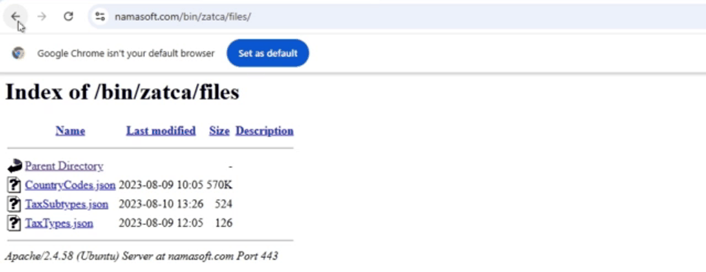

**Show file name extensions.** In File Explorer, open **View** and tick **File name extensions**. Step 3 is about extensions, and with them hidden, `install.ba_` and `install.bat` look the same.

## 1. Download the SDK

Open [ZATCA's SDK download page](https://zatca.gov.sa/en/E-Invoicing/SystemsDevelopers/ComplianceEnablementToolbox/Pages/DownloadSDK.aspx), scroll to the terms, tick **I accept the above terms and conditions**, and click **Download SDK**. The file name carries the SDK version, for example `zatca-envoice-sdk-203.zip`.

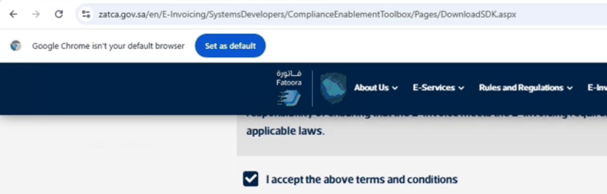

## 2. Extract it to C:\zatca_sdk

In **Downloads**, right-click the zip and extract it.

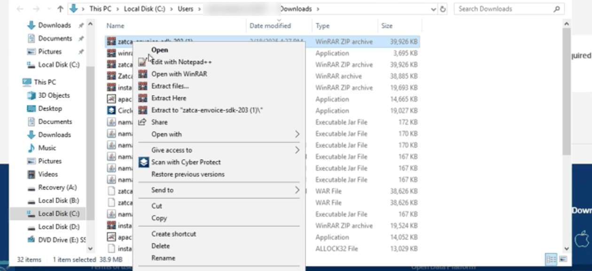

Move the extracted folder to `C:\` and rename it from `zatca-envoice-sdk-203` to `zatca_sdk`.

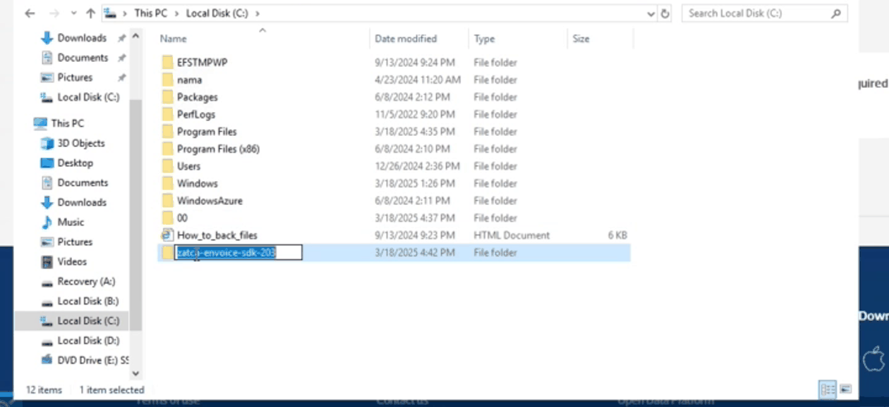

Open `C:\zatca_sdk`. The `Apps`, `Configuration`, `Data`, `Lib` and `Readme` folders and the `install.ba_`, `install.sh` and `LICENSE` files must sit directly inside it. If you see one more folder level, such as `C:\zatca_sdk\zatca-envoice-sdk-203\Apps`, move the inner folder's contents up one level.

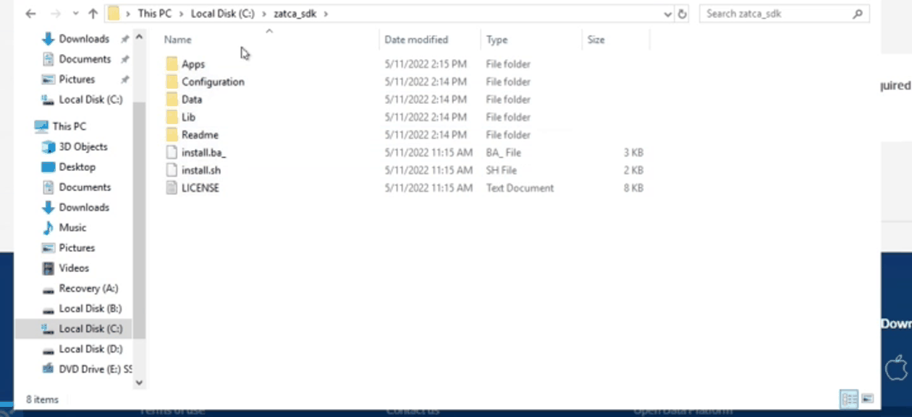

## 3. Give four files their real extensions

ZATCA ships the SDK's programs with the last letter of their extension replaced by an underscore, and Windows will not run them until they are renamed. Select each file, press **F2**, fix the extension, and answer **Yes** when Windows warns that the file might become unusable:

| Folder | Current name | New name |
|---|---|---|
| `C:\zatca_sdk\Apps` | `fatoora.ba_` | `fatoora.bat` |
| `C:\zatca_sdk\Apps` | `jq.ex_` | `jq.exe` |
| `C:\zatca_sdk\Configuration` | `jq.ex_` | `jq.exe` |
| `C:\zatca_sdk` | `install.ba_` | `install.bat` |

::: details The four renames, one by one
`Apps` — `fatoora.ba_` to `fatoora.bat`:

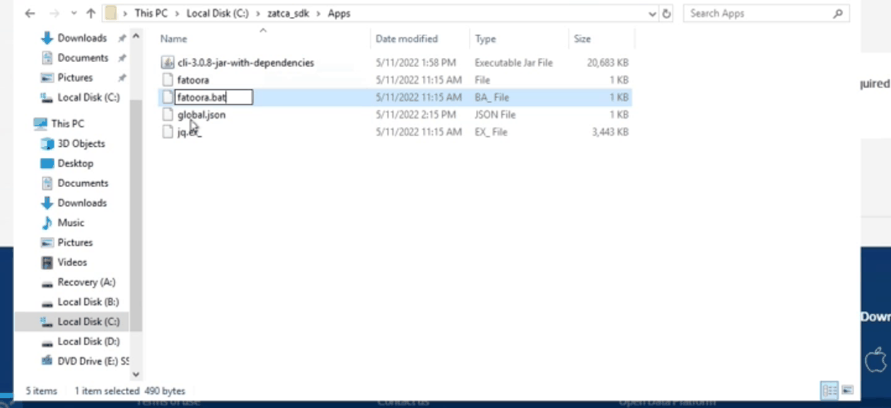

`Apps` — `jq.ex_` to `jq.exe`:

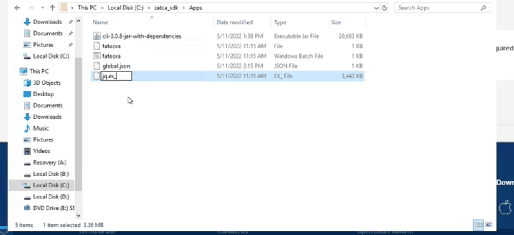

`Configuration` — `jq.ex_` to `jq.exe`:


`C:\zatca_sdk` — `install.ba_` to `install.bat`:

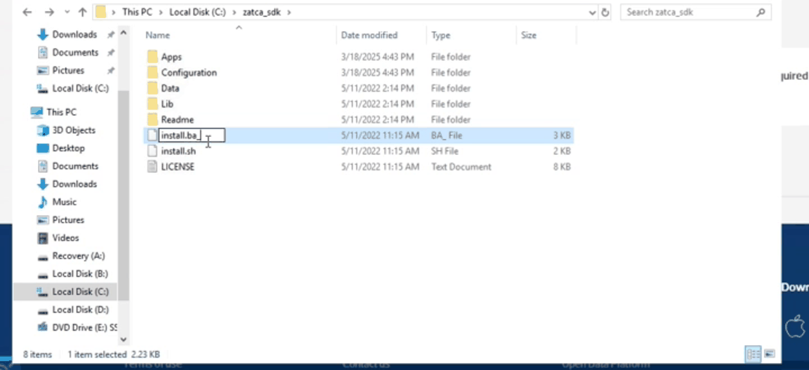
:::

## 4. Run install.bat

Double-click `C:\zatca_sdk\install.bat`. A command window opens and shows:

```text
WARNING: User credentials cannot be used for local connections.
```

This warning is normal and does not mean the installation failed.

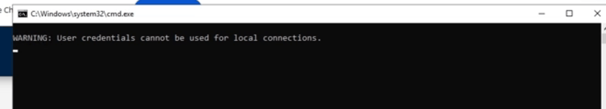

The script creates three **user** environment variables for the account you are logged in with:

| Variable | Value |
|---|---|
| `FATOORA_HOME` | `C:\zatca_sdk\Apps\` |
| `Path` | `C:\zatca_sdk\Apps\` added to it |
| `SDK_CONFIG` | `C:\zatca_sdk\Configuration/config.json` |

## 5. Copy SDK_CONFIG to the system variables

The variables from step 4 belong to your user account only. Tomcat runs as a Windows service under a different account, so it does not see them. The signing service needs just one of them, `SDK_CONFIG`, which tells it where `config.json` is. The other two serve ZATCA's own command-line tool, which Nama does not use, so they can stay as user variables.

1. Open the environment variables editor. Press Win + R and run:
   ```sh
   rundll32 sysdm.cpl,EditEnvironmentVariables
   ```
   You can also go through **System Properties → Advanced → Environment Variables**.
2. Under the user variables, double-click `SDK_CONFIG` and copy its value.

   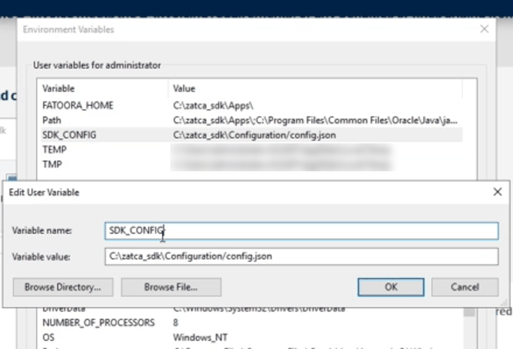

3. Under **System variables**, click **New**. Enter `SDK_CONFIG` as the name, paste the value, and click **OK**.

   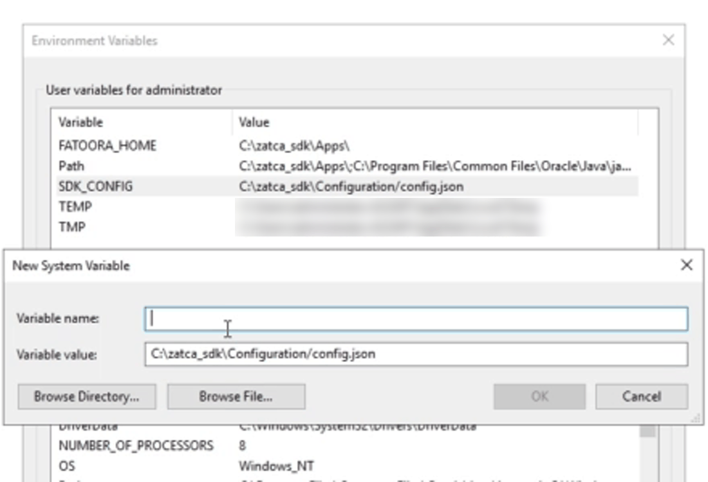

The system variables should now include `SDK_CONFIG`:


::: tip Copy the variable with PowerShell instead
Run this in PowerShell **as Administrator**, logged in as the same user who ran `install.bat`:
```powershell
$varName = "SDK_CONFIG"
$userValue = [Environment]::GetEnvironmentVariable($varName, "User")
if ($userValue) {
    Write-Host "Copying $varName with value '$userValue' to system environment..."
    [Environment]::SetEnvironmentVariable($varName, $userValue, "Machine")
    Write-Host "Copied successfully."
} else {
    Write-Host "User environment variable '$varName' not found."
}
```
:::

## 6. Check config.json

Open `C:\zatca_sdk\Configuration\config.json` in Notepad++ or Notepad. It is a single line of paths to the SDK's schemas, rule files and certificates. Every path must start with `C:\\zatca_sdk\\` and point at a file that exists:

```json
{ "xsdPath": "C:\\zatca_sdk\\Data\\Schemas\\xsds\\UBL2.1\\xsd\\maindoc\\UBL-Invoice-2.1.xsd", "enSchematron": "C:\\zatca_sdk\\Data\\Rules\\schematrons\\CEN-EN16931-UBL.xsl", "zatcaSchematron": "C:\\zatca_sdk\\Data\\...", ... }
```

If a path points anywhere else, for example a folder left over from an earlier installation, correct it and save the file. Check the file's modified date afterwards to confirm the save worked.

## 7. Deploy zatca.war on Tomcat

1. Download `zatca.war` from <https://namasoft.com/bin/zatca.war>. If an older copy is already in **Downloads**, the browser saves the new one as `zatca (2).war`.
2. Copy it into the `webapps` folder of **the Tomcat that runs Nama**, the one that already holds `erp.war` and `basic-services.war`. For example, `C:\Program Files\Apache Software Foundation\Tomcat 10.1\webapps`.
3. Rename it to exactly `zatca.war`.

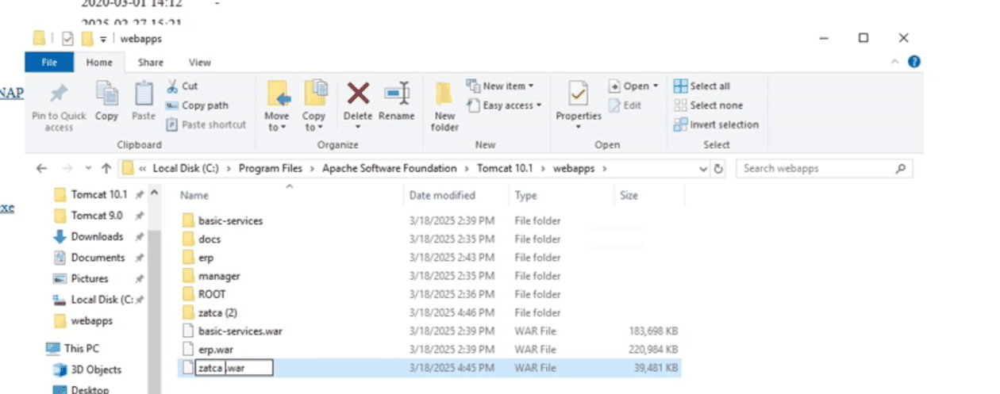

Nama hands each document to the signing service inside the server, not over the network. A `zatca.war` deployed on a different Tomcat or a different machine is never found, and Nama reports *Please update zatca JAR*.

::: warning Leave only one copy in webapps
Tomcat deploys a war as soon as it lands in `webapps`. If the file arrived as `zatca (2).war`, Tomcat may already have unpacked it into a `zatca (2)` folder, as in the screenshot above. Delete that folder and any other old `zatca` copy. Every copy registers itself as the signing service, and when Tomcat stops one copy, Nama loses the signing service even though another copy is still running. The result is *Please update zatca JAR*.
:::

4. Restart the Tomcat service. This deploys `zatca` under its correct name and lets Tomcat read the new `SDK_CONFIG` system variable. If signing still fails because the SDK cannot be found, restart the server: on some Windows versions, services only see a new system variable after a restart.

## 8. Check that it works

On the server, open `http://localhost:<port>/zatca/api` in a browser, using the port Nama runs on. It answers:

```text
Zatca war is running
```

This confirms the service is deployed. The SDK itself is first used when you run **Approve System**, so a wrong `config.json` path shows up there. Next, switch the ZATCA page on in Global Configuration, as described in [Switching the ZATCA page on](./zatca-guide.md#Switching-the-ZATCA-page-on).
