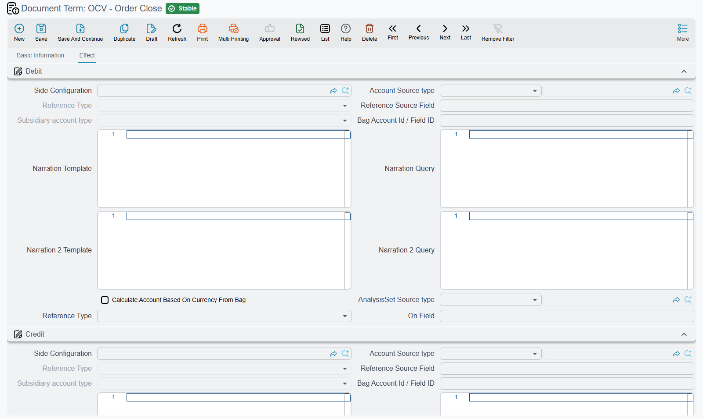

# Costing, Resource and Mold Document Terms

Most manufacturing documents move quantities and leave the money to the stock documents they generate. A few create ledger entries themselves: the **Order Close** voucher, the **Resource Voucher**, and the three mold documents. Their terms are where the accounts come from.

How manufacturing terms work in general is on [Production Order and Planning Document Terms](/modules/manufacturing/document-terms/mfg-terms-production-orders#How-manufacturing-terms-work). The debit and credit blocks on these terms are ordinary accounting sides — an account source, a subsidiary, narration templates — and work as described in [Accounting Effects Configuration](/modules/supplychain/document-terms/doc-term-accounting-effects).

::: info Required license
The order close, resource voucher and standard price terms belong to the core `manufacturing` license; the three mold terms need `manufacturing-molds`.
:::

## Order Close

The order close voucher creates two kinds of entry.

**Overheads.** For every overhead line on the voucher, the amount is recorded on the debit and credit sides defined **on the overhead type**, not on the term. The amount is the line's actual value, or its overhead value where no actual value has been filled in. **Do Not Update Accounting Effects With Actual Values** (عدم تحديث القيود بالقيم الفعلية, `termConfig.doNotUpdateAccountingEffectsWithActualValues`), in the **Overhead** block, makes it always record the planned overhead value instead — useful where actual overheads are distributed for analysis but the books must keep the planned figure.

**Overhead** (التكاليف الغير مباشرة, `termConfig.overhead`), in the same block, is the voucher's default overhead type. It takes priority over the production order term's overhead.

**Standard cost deviation.** **Standard Deviation Debit** (مدين الإنحراف, `termConfig.deviationDebit`) and **Standard Deviation Credit** (دائن الإنحراف, `termConfig.deviationCredit`) are the accounts of the standard cost deviation entry. The entry is made only when both are filled, the deviation is not zero, and the production order's term has **Calculate Deviations With Save** ticked — without that option no deviation is ever worked out. The block they sit in shows an untranslated title on screen.

How the close works is on [Production Costing](/modules/manufacturing/production-costing).

## Resource Voucher

The resource voucher charges machine and labour time to an order and creates the journal entry for it.

**The main entry.** The **Debit** (`termConfig.config.debit`) and **Credit** (`termConfig.config.credit`) blocks on the **Effect** tab record each line's total. A resource that has its own debit or credit side defined uses that instead, so the term's sides are the fallback for resources with none. Both sides must resolve to an account for a line to be recorded.

**Tax**, in the **Taxes Info** block:

| Option | Field id | What it does |
|---|---|---|
| **Taxable** (خاضع للضريبة) | `termConfig.taxable` | Off, every tax percentage on the voucher is forced to zero. |
| **Tax Plan** (سياسة الضريبة) | `termConfig.taxPlan` | Its first and second percentages become the lines' **Tax 3** and **Tax 4**. **Tax 1** and **Tax 2** come from each resource's own tax plan. |
| **Modifiable Tax** (يمكن تعديل الضريبة) | `termConfig.modifiableTax` | Off, the percentages are reset from the tax plans on every save. On, percentages typed by the user are kept. |
| **Tax1 Debit** … **Tax4 Credit** | `termConfig.tax1Debit` … `termConfig.tax4Credit` | The sides each tax is recorded on, used when the resource has no tax sides of its own. A tax is recorded only when both its sides resolve. |
| **Do Not Add Tax 1 To Cost** … **Do Not Add Tax 4 To Cost** | `termConfig.doNotAddTax1ToCost` … `termConfig.doNotAddTax4ToCost` | Leaves that tax out of the line's total after taxes, the figure used as the resource cost when an order is costed per batch or with deviations. |

The voucher itself is on [Resource Vouchers](/modules/manufacturing/manufacturing-resource-voucher).

## Manufacturing Standard Price

The standard price document's term has no options of its own — only the common top of the screen.

## Mold Receipt, Mold Voucher and Mold Disposal

Each of the three mold terms has a single **Effect** tab with a **Debit** (`termConfig.config.debit`) and a **Credit**
(`termConfig.config.credit`) block, and each records one figure per line. Both sides must be filled.

| Term | What each line records |
|---|---|
| **Manufacturing Mold Receipt** | The mold's **current value** — the cost it enters the books with. |
| **Manufacturing Mold Voucher** | The usage charge: the line's total, its cost per hour times its count. |
| **Manufacturing Mold Disposal** | The mold's **remaining value** — what is written off when it is scrapped. |

Molds are on [Manufacturing Molds](/modules/manufacturing/manufacturing-molds).
