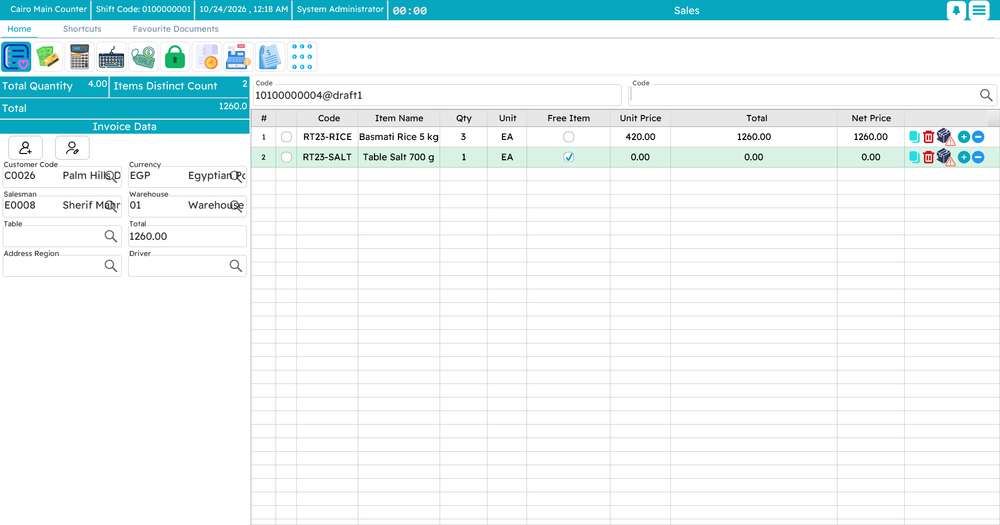

# Nama POS — Technical Points of Use Guide

Nama ERP is a web-based system, but its **Nama POS** module includes a dedicated **desktop application** for Points of Sale (POS), offering both online and offline capabilities:

* POS operates offline using a local POS database.
* It automatically syncs with the Nama ERP central database.
* Integrates with payment terminals, including an embedded credit-card processor for mobile phones.
* POS functionality is available on Android and iOS via the **Captain Order** mobile app.

## Nama POS Pole Display Configuration Using Tempo


---

## POS Pole Display Setup

To configure a pole display for Nama POS, follow these steps:

1. Go to the **"Pos Pole Display Specs"** screen.
2. Set:

* **Communication Type**: **CommPort** — the register drives the pole display through a serial (COM) port.
* **Printer Name Or Port Number**: the COM port the display is plugged into, such as `COM3`. A `commPortName` line in the register's `nama.properties` file takes precedence over this field; with neither, the register uses `COM4`.
3. Link the pole display configuration to a machine by setting the **"Pos Pole Display Specs"** field in the machine record.

---

## Displaying Data on the Pole Display

Nama POS allows defining **template-based messages** for different events in the sales process. Templates are configured in the **"Pos Pole Display Specs"** screen.

### Supported Functions

* **Clear Line:**

```
@CLEARLINE@
```

Each `@CLEARLINE@` sends the display's clear command, which empties the pole display; the text after it is written to the empty display. Text placed before it is written first and then wiped.

**Example:**

```
@CLEARLINE@@CLEARLINE@ Welcome
```

Clears the display, then displays: `Welcome`.

* **Last Modified Line:**

```tempo
{lastModifiedLine}
```

Use this to get the most recently added invoice line.

**Example:**

```tempo
{lastModifiedLine.qty.value}
```

Gets the quantity of the last added item.

---

## Pole Display Templates

### Idle Template

Displayed when the register starts, when a screen is opened for the first time in the session, and three seconds after a new, empty document is started (for example after a sale is finished). Its fields are the register's fields.

```tempo
@CLEARLINE@@CLEARLINE@**** Welcome to Register {name2}
```

Clears the display and shows a welcome message with the register's name.

---

### Line Adding Template

Displayed when a new item is added to the invoice.

```tempo
@CLEARLINE@@CLEARLINE@
{padleft(20)}Item: {lastModifiedLine.item.name2}{endpad}
{padleft(20)}Qty: {lastModifiedLine.qty.uom.name2} - {round(lastModifiedLine.qty.value,0)}{endpad}
```

Shows item name and quantity info, padded for alignment.

---

### Total Template

Displayed when the Tender screen is opened (before payment).

```tempo
@CLEARLINE@@CLEARLINE@
{padleft(20)}Total: {round(netPrice,2)}${endpad}
```

Displays the invoice total amount.

---

### Remaining Template

Displayed when the invoice is saved with change to give back; a sale paid with the exact amount does not show it.

```tempo
@CLEARLINE@@CLEARLINE@
{padleft(20)}Remaining: {round(change,2)}${endpad}
```

Displays the remaining change to be returned to the customer.

---

### Delete Line Template

Displayed when a line is deleted from the invoice. Like the line adding template, its fields are the invoice's fields.

---

These templates provide a flexible way to control real-time messaging on POS displays using Tempo syntax.

## Filtering Search Screens in POS Using Machine Dimensions

In Nama ERP, access dimension filters (such as company, branch, sector, etc.) are applied automatically on standard screens. However, in the **POS system**, these filters are not applied automatically because the system relies on the machine's (register's) dimensions rather than the user's dimensions.

To enable filtering in POS search screens based on machine dimensions, use the **POS Settings** screen, specifically the **"Filter Dimensions On Sending"** table.

### Example:

Suppose you want to filter the **Address Region (used in the delivery address)** in a **POS Sales Invoice** so that only regions linked to the current machine's branch are displayed:

1. Open the **POS Settings** screen.
2. In the **"Filter Dimensions On Sending"** table:

    * Add a new row.
    * Select the type **"Address Region"** in the **For Type** field.
    * In the **"Filtered In Type"** field, select **"POS Sales Invoice"**.
    * Enable the **"Filter On Branch"** option.
3. You can also pick an **Entity Type List** containing "Address Region" and other data types to apply the same filtering to all of them.

A row with **Filtered In Type** left empty applies on every POS screen. When several rows match the same data type on a screen, the first one in the table is used. Records that carry the register's own value of the ticked dimension stay in the list, and so do records that carry the shared record that stands for no value.

### Available Filtering Options:

* Filter On Legal Entity
* Filter On Branch
* Filter On Sector
* Filter On Department
* Filter On Analysis Set

## Logging In Using an API Key in POS

A new login mechanism has been added to the POS system using an **API Key** instead of a username and password. The purpose of this mechanism is to avoid storing the password (even if encrypted) inside POS configuration files, while ensuring the POS continues to work even after a password change.

This mechanism can be activated in two ways:

---

### Method 1: Automatic Creation via Traditional Login

1. Start the POS using the username and password as usual.
2. The system automatically:
   - Creates an `APICredentials` file
      - The file's code includes the user ID that was used.
   - Saves the API key inside the `nama.properties` file.
   - On startup, the system first looks for an `APICredentials` file with the matching code; if found, it uses it instead of creating a new one.

This method enables a smooth transition to API key login without any manual configuration.

---

### Method 2: Manual Creation

1. Create an `APICredentials` file manually and assign the user under whose name POS operations will be performed (reading/writing records).
2. Copy the key from the resulting file.
3. You can use the key in one of the following places:
   - Enter it in the initial settings window.
   - Or place it directly in the POS `nama.properties` file:
     ```
     apiKey=dddsbddhbskbsdhdd
     ```

In the initial settings window the key goes in the **API Key** field of the **Server Settings** group. The window's checks still require the **Server Login Id** and **Server Login Password** fields.


---

Using an API Key gives you greater flexibility and security, especially when updating passwords or managing a large number of POS terminals.

## Advanced Methods for Changing Sales Table Column Widths in POS

The sales table is the grid in the middle of the sales screen: one row per invoice line, with columns such as **Code**, **Item Name**, **Qty**, **Unit**, **Free Item**, **Unit Price**, **Total** and **Net Price**. Which columns appear comes from the register's POS interface settings; the two methods below control how wide each one is.



### Manual Method (Drag and Direct Edit)

- **How to use**:
  - Drag column borders manually (similar to Excel) to change the width.
  - When a width is modified for the first time, the system automatically saves the new values in the file:
    ```screenProperties.properties```
  - You can copy this file after adjusting all fields as required.

- **Deploying changes to POS machines**:
  - **Option 1**: Paste the file manually on each machine.
  - **Option 2**: Open the **Register** record → paste the file contents into **Sales Lines Screen Properties** → tick **"Send Properties To POS Register"** → save. The machine writes the text into its `screenProperties.properties` when it next receives the register record.

- **Advantages**:
  - Flexible and quick for initial adjustments.
  - Allows precise control based on user needs.

- **Disadvantages**:
  - Requires manual intervention when updating across multiple machines.

---

### Controlling Width via POS Interface Settings

- **How to use**:
  - In the **"Pos UI Settings"** record, each field line of the sales table has a **"Width Size"** column.
  - You pick the column size from fixed options, each a fixed share of the screen width: **1-Tiny** (2.5%), **2-Very Small** (5%), **3-Small** (7.5%), **4-Medium** (10%), **5-Large** (12.5%), **6-XLarge** (15%) and **7-XXLarge** (17.5%).

- **When to use?**
  - When you want to set widths in an organized way without manual dragging.
  - For proportional distribution of fields within the table.

- **What if you want manual dragging with this feature enabled?**
  - Leave the **"Width Size"** field empty, which allows the user to manually adjust the size at runtime.

- **Advantages**:
  - No manual editing required on each machine.
  - Provides predefined options for a consistent look across branches.

- **Disadvantages**:
  - Less flexible than the manual method in some special cases.

---

## Call Center & Item Add-ons

These two topics have moved to the operational guide:

- **Call center / electronic orders** — sending orders from one machine to another — is now part of [Tables, reservations & Captain Order](./pos-tables-and-restaurant.md#Suspended-orders-and-the-call-center).
- **Item add-ons** (extras, sizes, colours) is now its own page: [Item add-ons](./pos-item-addons.md).

## Resetting the Send Attempt Counter for Unsent Documents

When POS documents fail to send to the server, the system increments a failed-attempt counter (`writeFailures`). The retry limit and the ways to reset it from the register screen or from the register record are described in [How POS Data Syncs with the Server](/modules/pos/pos-data-sync#When-a-document-will-not-go-up).

To reset the counter of every unsent document directly, run the following query against the POS database:

```sql
UPDATE POSSalesInvoice SET writeFailures = 0 WHERE sent = 0;
UPDATE POSSalesReturn SET writeFailures = 0 WHERE sent = 0;
UPDATE POSSalesReplacement SET writeFailures = 0 WHERE sent = 0;
UPDATE POSPaymentToRegistery SET writeFailures = 0 WHERE sent = 0;
UPDATE POSReceiptFromRegistery SET writeFailures = 0 WHERE sent = 0;
UPDATE POSShiftOpen SET writeFailures = 0 WHERE sent = 0;
UPDATE POSShiftClose SET writeFailures = 0 WHERE sent = 0;
UPDATE POSCustomer SET writeFailures = 0 WHERE sent = 0;
UPDATE POSStockTransferReq SET writeFailures = 0 WHERE sent = 0;
UPDATE POSOrderReservation SET writeFailures = 0 WHERE sent = 0;
UPDATE POSCreditNote SET writeFailures = 0 WHERE sent = 0;
UPDATE POSDiscountCoupon SET writeFailures = 0 WHERE sent = 0;
UPDATE POSStockTakingDetailsDoc SET writeFailures = 0 WHERE sent = 0;
UPDATE POSStockReceipt SET writeFailures = 0 WHERE sent = 0;
UPDATE POSScrapDoc SET writeFailures = 0 WHERE sent = 0;
UPDATE POSShortfallsDoc SET writeFailures = 0 WHERE sent = 0;
UPDATE POSError SET writeFailures = 0 WHERE sent = 0;
UPDATE POSInternalMessage SET writeFailures = 0 WHERE sent = 0;
UPDATE POSInventory SET writeFailures = 0 WHERE sent = 0;
```

::: warning
Make sure to resolve the underlying issue that caused the send failure (such as network problems or server configuration) before running this query.
:::

## Fingerprint Login

The POS system supports login using a fingerprint via the Digital Persona URU4500 device, allowing users to switch quickly and securely without needing to type login credentials each time.

For full details: [Fingerprint Login in POS](./pos-fingerprint-login.md)
