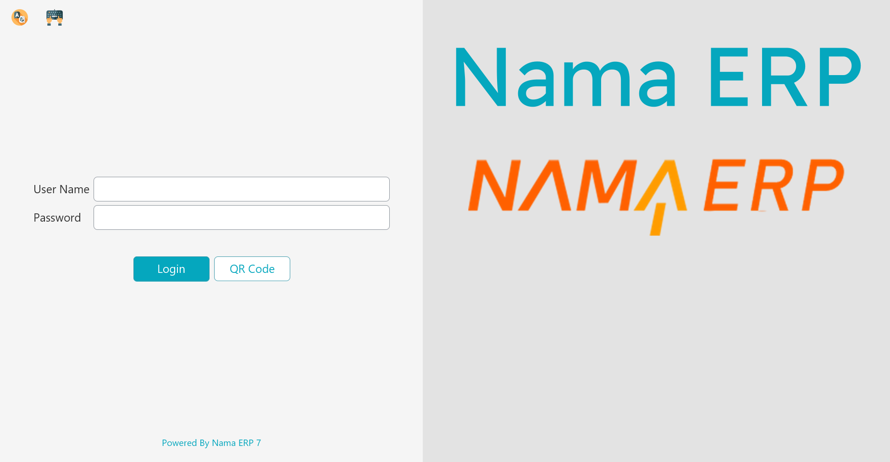

# Getting Started at the Register

This page walks through the everyday basics: starting the application, signing in, finding your way around the menu, locking the screen when you step away, and switching language or theme.

## Starting the application

When you launch Nama POS you first see a **splash screen** with a progress bar while the register wakes up.

Behind that splash, the register is doing a few things: opening its **local database**, applying its saved language and theme, loading its configuration and prices from cache, and — if it can reach the server — pulling down any fresh data and pushing up anything left over from last time. If the server cannot be reached, the register simply carries on in offline mode; you can still sell.

## Signing in

Once the register is ready, the **login screen** appears.

| Button | Arabic caption | What pressing it does |
|---|---|---|
| **Login** | «دخول» | Signs in with the user name and password typed above (Enter does the same). |
| **QR Code** | «QR Code» | Shows a QR code holding this register's address, for the register's mobile apps (such as Captain Order) to scan and connect. If the computer has several network cards you pick one first. |
| **Arabic** / **English** (icon, top corner) | «العربية» / «الإنجليزية» | Switches the register's language. The button is named after the language it switches to. |
| **Keyboard** (icon, top corner) | «لوحة المفاتيح» | Opens the Windows on-screen keyboard, for touch screens. |

There are three ways to sign in, and they can all be used at the same register:

**Username and password.** The classic way. Type your user name, then your password, and press Enter. Your **security profile** loads with you — that is what decides which actions you are allowed to perform (see [Lock and security](#Lock-and-security) below).

**Fingerprint.** If your fingerprint has been enrolled, just place your finger on the reader — no typing at all. The reader is listening in the background on the login screen, the unlock screen, and the supervisor-authorization prompt. Enrolment and setup are covered in [Fingerprint login](./pos-fingerprint-login.md).

**API key.** Instead of storing a password on the machine, a register can sign in with an **API key** tied to a user. This keeps working even after that user's password changes, and avoids keeping a password (even encrypted) in the register's files. You can paste the key into the initial-settings window in place of the user name and password. The detailed setup lives in the [technical points guide](./nama-pos.md#Logging-In-Using-an-API-Key-in-POS).

## Finding your way around

### The slide menu

The main menu slides in from the side of the screen when you press the **Menu** button (☰) at the right of the title bar. It holds buttons for the common actions — new sale, payment, returns, shifts, held invoices, reports, lock, and so on. The first level is a list of groups; press a group to see its entries, and press **Main** («الرئيسية») in the trail at the top to go back. The search box under the trail finds an entry by name. Entries that print a key after their name show the default shortcut.

An entry whose permission the user lacks is hidden, unless the POS settings say not to hide such fields. The groups and what their entries do:

| Group | Entry | Arabic caption | What pressing it does |
|---|---|---|---|
| **Documents** «مستندات» | **Sales Screen** | «شاشة المبيعات» | Opens a new sales invoice. |
| | **Sales Return** / **Sales Replacement** | «مردودات مبيعات» / «استبدال مبيعات» | Opens a new return or exchange — see [Returns & replacements](./pos-returns-and-replacements.md). |
| | **Stock Transfer Request**, **Stock Receipt**, **Stock Taking Details**, **Shortfalls Documents**, **Scrap Documents** | «طلب تحويل مخزني»، «توريد مخزني»، «لجنة جرد مخزني»، «مستندات النواقص»، «مستندات الهوالك» | Opens that stock document — see [Inventory operations](./pos-inventory-operations.md). |
| | **shiftScreen** / **Cash Count Screen** | «شاشة الورديات» / «شاشة الجرد» | Opens the shift screen or the cash count — see [Shifts & cash](./pos-shifts-and-cash.md). The English caption of the shift entry is in lower case on screen. |
| | **Receipts** / **Payments** | «مقبوضات» / «مصروفات» | Opens a pay-in or pay-out document. |
| | **Create Payment To Credit Note** | «إنشاء سند مصروف لأشعار دائن» | Opens a pay-out against a customer's credit note. |
| | **Write Internal Message** | «كتابة رسائل داخليه» | Opens the internal-message screen — see [Reports & tools](./pos-reports-and-tools.md). |
| | **Reservation Screen** / **Cancel Reservation Screen** | «شاشة حجز اوردر» / «شاشة إلغاء الحجز» | Only when reservations are in use: opens a reservation or its cancellation — see [Tables & restaurant](./pos-tables-and-restaurant.md). |
| **Data Settings** «إعدادات بيانات الارسال» | **Show Data Statistics** | «إحصائيات البيانات» | Shows the register's statistics of the data it has read from the server. |
| | **Instant Data Sync** | «مزامنة فورية للبيانات» | Asks which data to fetch now — customers, items, sales price lists, sales offers — and pulls it from the server without waiting for the next scheduled read. |
| | **Notifications** | «التنويهات» | Opens the notifications list. |
| | **Errors Show** | «عرض أخطاء نقل البيانات» | Lists the errors the register met while sending data. Needs the permission to see data-transfer errors. |
| | **Transfer Credit Notes** | «نقل جميع إشعارات الخصم» | Sends credit notes that have not reached the server yet. |
| | **Activate Server Log** / **Deactivate Server Log** | «تفعيل اللوج التفصيلي بالخادم» / «تعطيل اللوج التفصيلي بالخادم» | Turns detailed logging of the register's server calls on or off, for support work. |
| **Invoice Actions** «اجراءات الفاتورة» | **Hold Invoice**, **Show Held Invoices**, **Show Call Center Held Invoices**, **Invoice Payment**, **Delete Held Invoice**, **Open Invoice**, **Apply Discount** | «تعليق فاتورة»، «الفواتير المعلقة»، «فواتير خدمة العملاء المعلقة»، «دفع الفاتورة»، «مسح فاتورة معلقة»، «اختيار فاتورة»، «تخفيض» | The same as the toolbar buttons Hold, List Hold Invoices, Call Center, Payment, Delete Hold Document, Show Document and Discount — see [the sales screen's buttons](./pos-sales-invoice.md#Buttons-on-the-sales-screen). |
| | **Apply Line Discount** … **Apply Line Discount 8** | «تخفيض 1 على السطر» … «تخفيض 8 على السطر» | Unlocks that discount column of the line grid for typing. Each level has its own permission. |
| | **Return After Allowed Period** | «عمل مردود بعد تجاوز مدة المردود المسموح بها» | On a return or replacement: asks for the invoice code, fetches from the server any extension of that invoice's return period, and loads the invoice. Needs the permission to return after the allowed period and a connection to the server. |
| | **Delete Line** / **Edit Line Quantity** | «حذف سطر» / «تعديل كمية السطر» | Deletes the selected line, or opens the quantity editor for it. |
| | **Access Sales Table** / **Access header** | «الوصول لجدول الأصناف» / «الوصول لرأس المستند» | Moves the cursor to the line grid or to the header fields. |
| | **Open Search Table** | «فتح جدول البحث» | Opens the search list of the field the cursor is in. |
| | **Delete Discount** | «إلغاء الخصم» | Removes the invoice discount. |
| | **Can Edit Invoice Classification** | «تعديل تصنيف الفاتورة» | Moves the cursor to the invoice classification field. |
| | **Delayed Payment Invoices** | «الفواتير المؤجلة الدفع» | Lists the invoices saved with deferred payment, so you can open one. |
| **Sales Man Actions** «اجراءات مندوب المبيعات» | **ChangeSalesman** / **DeleteSalesman** | «تغيير مندوب المبيعات» / «حذف مندوب المبيعات» | Moves the cursor to the salesman field, or clears the salesman. The English captions appear as written here. |
| **Customer Actions** «اجراءات العميل» | **Change Customer**, **Delete Customer**, **Add New Customer**, **Edit Customer** | «تغيير العميل»، «حذف العميل»، «إضافة عميل جديد»، «تعديل عميل» | Moves to the customer field, clears the customer, or opens the new-customer or edit-customer window. |
| **UI Settings** «إعدادات الواجهه» | **Change Font** | «تعديل الفونت» | Picks the screen font from the font files in the register's **Fonts** folder. |
| | **Edit Sizes** | «تعديل ألأحجام» | Changes the font size of text fields, grid headers and grid cells, and the height of the shortcut buttons. |
| | **Reset Columns Size** | «إعادة ضبط الأعمدة» | After a confirmation, forgets every column width and screen size you customised and closes the application. |
| **Actions** «اجراءات اخري» | **List Action History** | «عرض سجل الاجراءات» | Lists the register's action log: sign-ins and sign-outs, prints, locks and record changes. |
| | **Lock Screen** / **Terminate** | «قفل الشاشة» / «إنهاء» | Locks the screen, or closes the application. |
| | **Inquiry Item Price** | «استعلام عن سعر صنف» | Opens the price inquiry. |
| | **Reports** | «التقارير» | Opens the reports list — see [Reports & tools](./pos-reports-and-tools.md). |
| | **Change Password** | «تغيير كلمة السر» | Changes the signed-in user's password. Needs a connection to the server. |
| | **Mobile Apps QR Code** | «QR Code لأجهزه الموبايل» | Shows the QR code the mobile apps scan to connect (the same as on the login screen). |
| | **Split Invoice** | «تقسيم الفاتورة» | On a sales invoice: splits its lines into separate invoices. |
| | **Invoice Tables** / **Tables Inquiry** | «طاولات المستند» / «استعلام عن طاولات» | Opens the halls and tables for the invoice or reservation, or the table-status inquiry. |
| | **Recalculate Shift Close Details** | «إعادة احتساب تفاصيل إغلاق وردية» | Asks for a start date and recalculates the details of the shift closings from that date. |
| | **Hide Offers Dialog** / **Show Offers Dialog** | «إخفاء Dialog العروض» / «إظهار Dialog العروض» | Stops or resumes the pop-up that offers the customer an available offer. Needs the permission to hide the offers dialog. |
| | **Show Images** / **Hide Images** | «عرض الصور» / «إخفاء الصور» | Shows item pictures on the favourite-item buttons, or hides them. |
| | **Customer Display Window** | «نافذة العميل» | Opens or closes the customer-facing window. |
| | **ShowMore** | «ShowMore» | Switches the header between its main fields and the extra fields set in the register's UI settings. The caption is shown as written here in both languages. |
| | **ReSendAllDocs** | «ReSendAllDocs» | Opens **Send All** with two choices: **Force Send** («إرسال إجباري») sends every document again; **Reset and Force Send** («إعادة تعيين وإرسال إجباري») resets the documents that failed and sends them again. The caption is shown as written here in both languages. |
| | **Disable Printing** / **Enable Printing** | «تعطيل الطباعة» / «تفعيل الطباعة» | Stops or resumes printing on this register until the application closes. |
| | **User Security Capabilities By Another User** | «صلاحيات تمت بمستخدم اخر» | Lists the actions a supervisor authorized for the signed-in user. |
| | **Fingerprint Enrollment** | «تسجيل بصمة إصبع» | Registers a user's fingerprint — see [Fingerprint login](./pos-fingerprint-login.md). |
| | **Inquiry POS Online Order Status** | «استعلام عن حالة طلب نقاط بيع أون لاين» | Looks up the status of an online order — see [Tables & restaurant](./pos-tables-and-restaurant.md). |
| | **Check Printer Specifications** | «فحص مواصفات الطابعة» | Runs a Windows check that reports the printers' page limits. |
| **DownloadAppLogs** | — | «DownloadAppLogs» | Saves the application's log files, for support. The caption appears as written here in both languages; its tooltip reads *Download Application Logs* — «تحميل ملفات اللوج». |
| **Temporal Documents** «المستندات المحفوظة مؤقتا» | **Show Temporarily Saved Documents** / **Delete Temporarily Saved Documents** | «عرض المستندات المؤقتة» / «حذف المستندات المؤقتة» | Only when the POS settings auto-save the open document: reopens or deletes the copies kept in case the register closed unexpectedly. |
| **Settings** | — | «الإعدادات» | At the bottom of the menu: opens the register's settings window. Needs **Edit Settings**. |
| **System Mode** | — | «وضع النظام» | At the bottom of the menu: switches the look between Traditional, Compact, Colorful and Dark modes. |

### Keyboard shortcuts

A busy counter runs on the keyboard, not the mouse. Nama POS ships with sensible default shortcuts (your administrator can change any of them on the server, so yours may differ):

| Shortcut | Action | Shortcut | Action |
|---|---|---|---|
| `Alt+F1` | New sale | `F6` | Hold (suspend) the invoice |
| `F1` | Move between the line grid and header | `Ctrl+F6` | Show held invoices |
| `Ctrl+F1` | Sales return | `Alt+F6` | Delete the held invoice on screen |
| `Shift+F1` | Sales replacement (exchange) | `Ctrl+Shift+F6` | Show call-center held orders |
| `F2` | Shift screen (open/close) | `F7` | Choose the customer |
| `Ctrl+F2` | Cash Count | `Shift+F7` | Add a new customer |
| `F3` | Item / record search | `Ctrl+F7` | Remove the customer |
| `Ctrl+F3` | Open an existing invoice | `F8` | Choose the salesman |
| `F4` | Change font size | `Ctrl+F8` | Remove the salesman |
| `F5` | Payment / tender | `Ctrl+F9` | Price inquiry |
| `F10` | Invoice discount | `Alt+1` … `Alt+8` | Line discount levels 1–8 |
| `Ctrl+F10` | Remove the invoice discount | `Ctrl+Q` | Edit the selected line's quantity |
| `F11` | Lock the screen | `Ctrl+Del` | Delete the selected line |
| `Ctrl+F11` | Show all notifications | `+` | Duplicate the selected line |
| `F12` | Help | `Alt+P` | Reprint |
| `Alt+R` | Pay using reward points | `Ctrl+O` | Online-order inquiry |
| `Page Up` | Jump to the header fields | `Page Down` | Jump to the line grid |
| `Alt+F4` | Close the application | `Ctrl+I` | Open a held invoice by code |

::: tip
You do not need to memorize these. The slide menu shows the shortcut next to each action, and the most-used ones (new sale, payment, hold, discount) become second nature within a day.
:::

## Lock and security

### Locking the screen

Whenever you step away from the register — even for a moment — **lock the screen** with `F11`. The screen is then covered by a prompt, and someone must sign in to use the register again. This keeps sales from being rung up under your name while you are not there, and the lock/unlock is recorded for auditing.

To unlock, sign in again (your own credentials, or another authorized user's, or a fingerprint) and press **Sign in** («تسجيل الدخول») or Enter. `Esc` does not close the prompt. Whoever unlocks becomes the active operator.

### Supervisor authorization

Some actions are deliberately restricted — a large discount, a return after the allowed period, cancelling an invoice. When a cashier without that permission tries one, Nama POS does not just refuse. Instead it pops up a small **authorization window** asking for the credentials of someone who *does* have the permission.

The supervisor types their user name and password (or uses their fingerprint), the action goes through, and the cashier carries on — no logging out and back in. Every such authorization is logged.

### Users and security profiles

Two ideas work together here:

- A **POS user** is a login account, tied to an employee.
- A **security profile** is a named bundle of permissions — "Cashier", "Supervisor", "Manager" and so on. Each user is assigned one profile, and many users can share the same profile.

A profile is what answers questions like: *Can this person give a discount? Process a return? See the expected cash total when closing a shift? Open the cash drawer?* These are all set up centrally on the server and pushed down to every register, so changing a profile updates everyone who has it.

## Language & theme

Nama POS can run in more than one language. From the settings area you can switch the interface language; the choice is remembered on that register.

You can also switch between a **light** and a **dark** theme — dark is easier on the eyes in a dim shop, light is clearer under bright lights.

Individual text labels can also be **overridden** per register — for example a café might prefer the word "Bill" to "Invoice". These overrides are set up centrally and pushed to the register, so the wording you see may be tailored to your business.

## Messages you may see

Changing the shortcut keys is done on the server, on the **Nama POS Shortcuts** screen, and that screen refuses a save with one of these.

| Message | Why | What to do |
|---|---|---|
| *You must select functionality or field ID* — «filed id يجب أختيار إجراء أو» | A shortcut row names neither an action nor a screen field, so the key would do nothing. (The Arabic text reads back to front and misspells *field*; that is how the product raises it.) | Choose one of the two on that row, or delete the row. |
| *You must select key* — «يجب اختيار مفتاح» | A shortcut row has an action but no key. | Pick the key, or delete the row. |
| *You must use Ctrl/Alt with alphabetic letters* — «يجب استخدام Ctrl/Alt مع الحروف الأبجدية» | A row binds a bare letter key. A plain letter is needed for typing at the register, so a letter shortcut must be combined. | Tick Ctrl or Alt on the row, or move the shortcut to a function key. |
| *Shortcut in line {0} repeated in line {1}* — «الاختصار في سطر رقم {0} متكرر في سطر رقم {1}» | Two rows bind the same key combination. The message names both line numbers. | Change one of the two combinations. |
