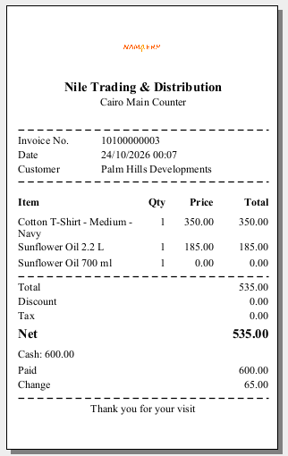

# Payment & Tender

Pressing `F5` on a finished invoice opens the **tender screen** — the moment of truth where money changes hands. This page covers how that screen works and every way a customer can pay.

## The tender screen

The layout is built for speed:

- The **invoice value** — what is owed — sits at the top.
- A row for each **payment method** the register accepts lets you type how much is being paid by that method. Card, credit-note and coupon rows also have a field for an authorization or reference number.
- The **remaining** figure at the bottom updates with every keystroke. Zero means the invoice is fully covered; a leftover means there is still money to collect; an overpayment in cash is simply the **change** to hand back.

You confirm to finish the sale, the receipt prints, and you are back on a clean sales screen for the next customer.

### Buttons on the tender screen

Most buttons on this screen are icons; hover over one to see its name. The row buttons sit to the right of each payment method's **Process Number** field, and which of them a row gets depends on the method.

| Button | Arabic caption | What pressing it does |
|---|---|---|
| **Load Remaining To Method** (hand-and-coin icon, on every method row) | «تحويل المبلغ لطريقة الدفع» | Empties every amount on the screen and puts the whole invoice value on this method — the one-tap way to say "all of it by card". From the keyboard, `Alt+1` does the same for the first method row, `Alt+2` for the second, and so on up to `Alt+0` for the tenth; a method can also have its own key, set with the register's payment methods. |
| **Add** (`+`, on every row except cash) | «إضافه» | Adds a second row for the same method, so two cards of the same type can be taken on one invoice, each with its own process number. |
| **Remove** (on a row added with **Add**) | «حذف» | Removes that extra row and recalculates the remaining. |
| Card-terminal icon (only on methods linked to a payment terminal) | — | Sends the amount typed on that row to the terminal and records the terminal's answer on the row — see [Card / payment terminal](#Card--payment-terminal) below. |
| **UnLock** / **Lock** (only on a method marked **Critical Pos Payment Method**, for a cashier whose profile lacks **Can Use Critical Methods**) | «فتح القفل» / «قفل» | The row opens locked. **UnLock** checks the permission — and, if that permission is on the register's [authorization list](./erp-setup/pos-security-profiles.md#Asking-a-supervisor-instead-of-refusing), asks a supervisor to sign in — then lets you type on the row. **Lock** locks it again. |
| Pencil icon (only on the **Credit Note** row, for a cashier whose profile has **Can Not Modify Credit Note Value In Payment**) | — | The credit-note amount is filled from the note and cannot be typed over. When that restriction is on the register's authorization list, the pencil asks for a supervisor who is not under it and, once one signs in, makes the amount editable; otherwise the pencil is refused. |
| **Redeem Reward Points** (rosette icon, on the **Coupon** row) | «استبدال نقاط المكافأة» | Opens the reward-points window described under [Reward / loyalty points](#Reward--loyalty-points) below (`Alt+R`). |
| **Show Additional payment Methods** (under the keypad; only when some methods are marked **Show In Additional Methods**) | «عرض طرق الدفع الإضافية» | Methods marked that way are kept off the main list. This opens a window with one button per such method; pressing one adds its row to the tender screen and puts the cursor in it. |
| **Keyboard** (under the keypad) | «لوحة المفاتيح» | Opens the Windows on-screen keyboard, for touch registers with no physical keyboard. |
| Keypad `0`–`9`, `.`, `C`, `.25`, `.5`, `.75` | — | Types into the field that has the cursor. `C` deletes the last character; the three fraction keys type `0.25`, `0.5` and `0.75`. |
| **Confirm** (`F5` or `Alt+Enter`) | «تأكيد» | Checks the amounts and completes the sale: the invoice is saved and the receipt prints. A **Debit Value** with no customer on the invoice is refused. |
| **Cancel** | «إلغاء» | Closes the tender screen and returns to the invoice, unpaid. |

## Ways to pay

### Cash

Type the cash the customer handed over. If it is more than the total, the remaining goes negative and that figure is the **change** due. Cash can always overpay — that is the whole point of change.

### Card / payment terminal

Card payments go through an integrated **payment terminal**. Enter the amount on the card row and send it to the terminal (there is a dedicated button on the row). The terminal does its work and hands back the result — approval, card type, the masked card number — which the register records against that payment line. If a terminal response cannot be matched to a configured method, the cashier is told rather than left guessing. Setting up the terminal itself and the rules that match a card to a payment method is covered in [Payment Methods and Payment Terminals](/platform/payments/payment-methods-and-terminals).

While the customer pays, the register waits in a small window with a **Cancel** button. Cancelling — or waiting more than three minutes — makes the register ask the terminal for its last transaction before giving up, so a card that was in fact approved is still recorded and must not be charged or keyed in again. The whole sequence and its messages are in [How a Card Payment Travels Through PGW](/platform/payments/pgw-card-payment-flow#In-Nama-POS).

### Split across several methods

A single invoice can be settled by more than one method — say half cash, half card. Enter each amount; the **remaining** keeps you honest, and the sale completes only when it reaches zero (or goes negative as change on cash). Methods can also be grouped into collapsible sections to keep a long list tidy.

### Deferred (pay later)

Sometimes the customer pays later — a credit account, a reserved order. Choosing the **deferred** option clears the amounts to zero and saves the invoice with the balance still outstanding, without opening the drawer or (by default) printing a receipt. Whether a cashier may defer at all is a permission.

### Credit notes and coupons

A customer can pay with a **credit note** (store credit, often issued from an earlier return) or a **discount coupon** (from a promotion). Enter its code; the register checks it is valid, has balance left, and belongs to the right customer where that applies, then applies its value against what is owed. Whatever is left is paid normally. The mechanics of issuing these are on the [Returns & replacements](./pos-returns-and-replacements.md) page.

### Reward / loyalty points

If the customer is on a loyalty programme, press `Alt+R` to redeem points toward the bill. The dialog shows their points balance and its cash value, and you enter how much to redeem (up to the invoice total). Where the programme requires it, a **one-time password** is requested and entered before the redemption is accepted; the system also supports the STC loyalty programme. The redeemed value comes off the bill and the rest is paid as usual.

#### Buttons in the Redeem Amount window

| Button | Arabic caption | What pressing it does |
|---|---|---|
| **Request OTP** | «إرسال OTP» | Asks the loyalty programme to send the customer a one-time password. **Redeem** and the OTP field stay disabled until this succeeds. The button is not shown when the register's reward-points setup allows redeeming without an OTP. |
| **Redeem** | «إستبدال\|صرف» | Checks the amount (not negative, not above the remaining reward amount, not above the invoice total), redeems it, and puts the resulting coupon code on the tender screen's **Coupon** row, so the redeemed value is paid as a coupon. With the STC programme you type the amount in **Redeem With Amount** after requesting the OTP. |
| **Cancel** | «إلغاء» | Closes the window without redeeming. |

## Money rules worth knowing

A few rules keep the till honest:

- **Change is cash.** Overpayment is expected on cash and becomes change. Card and other non-cash methods, by contrast, are normally not allowed to overpay — you cannot give change on a card.
- **Authorization numbers are required where they matter.** A card payment needs its approval code; a credit note or coupon needs its reference. The sale will not complete without them.
- **Amounts are rounded** to the currency's decimal places for display, while the maths underneath keeps full precision.
- **A payment-method discount** (for example "2% off for cash") recalculates the net automatically when that method is used, and is undone if the payment is cancelled.

## The receipt

Once payment is confirmed the **receipt prints**. There are options at the bottom of the tender screen for printing a fully itemized invoice, and — for those with permission — for suppressing the printout. Receipts can be reprinted later from the sales screen with `Alt+P`. On an empty sales screen `Alt+P` reprints the last invoice only when the POS setting **Print Last Document If No Current Open Document** is on.

What the receipt shows is up to your print form: a **Report Definition** whose **Report Type** is **Form**, for the **POS Sales Invoice**, with **Used In POS** ticked. The receipt below comes from a simple form of that kind.

