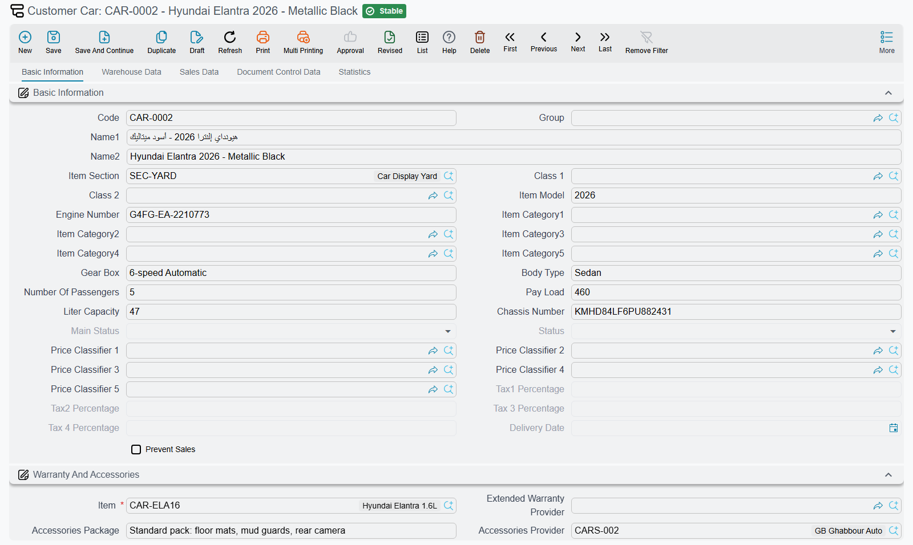

# The Car Dealership in Nama

Al-Sahra Motors runs two businesses on one plot of land. On one side is the service centre, which
repairs anybody's car. On the other is the showroom, which buys NAWA cars from the importer, keeps
them in a yard, and sells them. This half of the documentation is about the showroom.

A car in a showroom is an awkward thing for an ERP system to hold. It is stock — it has a cost, it
sits in a warehouse, it is sold and relieved to cost of sales like any other item. But it is not
interchangeable stock. When Layla Al-Harbi buys a NAWA Rimal 2.4 she does not buy "one unit of item
`MDL-RIMAL24`", she buys **chassis `NWA7R24C26K000318`** — the one with 12 kilometres on the clock,
the one whose customs release came through on Tuesday, the one parked in slot `A-14` with key `K-318`
in the cabinet. Every question anybody asks about that car — where is it, who is it promised to, has
its traffic letter come back, what did it actually cost us — is a question about that individual
vehicle, not about the model.

So Nama gives each physical car its own master-file record, and hangs it off the ordinary
supply-chain item as an **item dimension**. The item stays what it always was — NAWA Rimal 2.4, one
line in the item file, with a selling price and an item group. The car record is the individual unit
underneath it, and it is what the line on a purchase invoice, a stock receipt or a sales invoice
actually points at.

::: info Required licence
`srvcenter-subitems`. Nothing in the `cars` menu exists on a base installation.
:::

## The vocabulary bridge — read this before anything else

The same object has two names, and you will meet both on your first day.

- In the **menu** and on its own screen it is **السيارة / Customer Car**.
- In roughly forty configuration options and
  [document-term option labels](/modules/servicecenter/document-terms/servicecenter-terms-cars-and-other.md)
  it is **الصنف الفرعي / Sub Item**.

*Create Sub Item From Line Information*, *Default SubItem Configuration*, *Sub Item Status
Movements* — every one of those options is talking about the car record. There is no separate
"sub item" screen to hunt for. Throughout these pages we call it **the car record** or **the car
file** in prose, and reproduce the on-screen label verbatim whenever we quote a field.

## What is on a car record

One record, one physical vehicle. It carries:

- **Identity** — chassis number, engine number, model (free text), gearbox, body type, number of
  passengers, colour-style classifiers.
- **The warranty pack** — has catalogue, has mats, has toolkit, has spare key, has warranty, the
  warranty period and any extended warranty, and who provides it.
- **Where it physically is** — warehouse, locator, key number, slot number, plate number, mileage,
  condition, PDI details.
- **The paperwork** — customs list number, customs paid flag and date, customs release number and
  date, vessel name, carrier, the OEM documents block and the registration documents block.
- **A read-only trail** — which purchase order, purchase invoice, stock receipt, sales order, sales
  invoice, traffic letter and salesperson touched it, and the complete list of status changes.

All of it is described field by field on [The Car File](/modules/servicecenter/cars-setup/car-master-file.md).

## The two registers are separate

Nama holds **two** vehicle files, and they are not connected.

| | The car record | [The workshop's product file](/modules/servicecenter/workshop-setup/servicecenter-product-file.md) |
|---|---|---|
| Menu | `سيارات` (cars) > ملفات السيارات | مركز خدمة > الملفات > منتج |
| What it is | A serialised unit of a supply-chain item | The customer's vehicle as a serviced asset |
| Carries | Chassis, customs, warehouse slot, sales stamps | Odometer history, service contract, last-service register |
| Used by | Purchase, receipt, allocation, sales, delivery | Service requests, estimations, job orders, gate passes |
| Licence | `srvcenter-subitems` | `srvcenter` |
| Status values | Its own 20-value list, entirely configured | A different, workshop-specific list |

Al-Sahra sells `CAR-000318` to Layla in March, and if Layla brings it back for its first service in
September the workshop opens a **new and unrelated** product file for it. Nothing carries over: not
the chassis number, not the warranty pack, not the purchase history.

::: info The sold car and the serviced car are separate records
The two registers are kept apart: a workshop works from its own product file, and the dealership
record holds the sale.

If you need the two joined — for example so a warranty claim can be checked against the sale date —
that is a configuration project at your site.
:::

## Nothing about a car's behaviour is built in

A purchase invoice does not make a car *In Transit*, a receipt does not make it *Free Stock* and a
sales invoice does not make it *Invoiced* out of the box: apart from *ما قبل المبدئي / Pre Initial*,
stamped when a document line creates the car record, every status and every legal move is drawn by
you, per item, in a **Car Status Configurations** record. How to draw it is the subject of
[Car Status Configurations](/modules/servicecenter/cars-setup/car-status-configurations.md).

## Before any of it works

::: danger The cars half is switched off by default and needs four separate pieces of setup
It is not enough to hold the `srvcenter-subitems` licence. Until all four of these are in place, the
car records either never appear or never get created — and in the most common failure nothing is
reported at all.

1. **The Sub Items feature must be switched on.** The supply-chain feature `scSubItem`
   (*الأصناف الفرعية / Sub Items*) is what makes every car-related field visible in the first place —
   the item's *Has SubItem* tick, the item's configuration slots, and the **السيارة (Customer Car)**
   column on document lines. A database migrator **added it to the Config Group's *Prevented
   Features* list when older databases were upgraded**, so on such an installation it is switched
   off. Remove it from *Prevented Features* before you look for anything else.
2. **The item must be flagged as having sub items.** On the NAWA Rimal 2.4 item, tick *Has
   SubItem*. Decide this before you transact — the flag is locked once the item has movements.
3. **The item must carry a Car Status Configurations record.** It is attached at
   *Item ▸ Configurations ▸ SubItem Status Configurations*, and automatic car creation refuses to run
   without it, failing with *Item {0} does not have {1}* — «الصنف {0} ليس له {1}». Note the message is
   reported against the **item** column of the document line, which sends most people hunting in the
   wrong place. The full rule is on
   [Car Status Configurations](/modules/servicecenter/cars-setup/car-status-configurations).
4. **You must add the chassis and engine columns to your purchase screen.** Out of the box the Car
   Purchase Order, Car Proforma Purchase Invoice, Car Purchase Invoice and Car Purchase Return show no
   chassis number, engine number, gearbox or key/slot column, and the Car Receipt shows only the five
   warranty-pack tick boxes (the Sub Item Assembly Document is the one purchasing screen with chassis
   and engine columns). So the documents that create cars from their lines have, as shipped, nowhere
   for anyone to type a chassis number. Add the line-grid columns through a screen modification
   **before** you rely on automatic car creation.
:::

The Service Center setting **إعدادات حالة الصنف الفرعي الافتراضية / Default SubItem Configuration**
does not replace step 3: it only feeds the car picker's status filters — see
[Car Status Configurations](/modules/servicecenter/cars-setup/car-status-configurations).
Nothing checks that a chassis number is unique either; see
[The Car File](/modules/servicecenter/cars-setup/car-master-file).

## What is in the `cars` menu

The English menu root reads **`cars`**, in lower case — reproduce it as it is when telling somebody
where to click. In Arabic it is **سيارات**. Underneath it are seven folders:

| Folder | Arabic | What lives there |
|---|---|---|
| Car Files | ملفات السيارات | The car record, Car Status Configurations, the five sales price classifiers, Customer, External Agency, Insurance Company |
| [Car Purchases](/modules/servicecenter/car-purchasing/car-purchase-invoice.md) | مشتريات السيارات | Purchase order, purchase invoice, proforma purchase invoice, purchase return, Sub Item Assembly Document |
| [Car Inventory](/modules/servicecenter/car-purchasing/car-receipt.md) | مخازن السيارات | Car receipt and its cancel, car final delivery and its cancel |
| [Car Sales](/modules/servicecenter/car-sales/car-sales-cycle.md) | مبيعات السيارات | Sales order, sales invoice, traffic letter requests and traffic letters with their cancels, sales return, allocation, quotation request, quotation, sales approval, proforma sales invoice |
| Car Sales Cancellation | إلغاء مبيعات سيارات | Car Sales Order Cancel and Car Allocation Cancel |
| Car Installment | تقسيط سيارات | Instalment programmes, finance companies and instalment quotations |
| Car Insurance | تأمين سيارات | Insurance programmes, customer insurance policies, the nine policy documents, and the insurance purchase invoice and purchase return |

Two master files in Car Files surprise people by their location. **Insurance Company**
sits in Car Files, not in Car Insurance, and it belongs to this licence — which means an
insurance-only customer cannot create one. And **External Agency** sits there too.

## External Agency

**معرض خارجي / External Agency** is a small party master file in **cars > Car Files**. It can
carry a subsidiary account and tax data like any other party, and it exists so a site can register
the outside bodies it deals with — a traffic department office, a clearing agent, an inspection
centre.

It is worth being blunt about it: **no Service Center document references an External Agency.** It
takes part in no car flow, no purchase and no sale; outside the module it is offered where any party
can be picked, such as a subsidiary.

## Where to go next

- [The Car File](/modules/servicecenter/cars-setup/car-master-file.md) — the record itself, tab by
  tab, and which fields are typed by a person versus written by a document.
- [Car Status Configurations](/modules/servicecenter/cars-setup/car-status-configurations.md) — how
  to draw the lifecycle, the full status catalogue, and the rules that decide whether a document is
  accepted.
- [Ordering Cars](/modules/servicecenter/car-purchasing/car-purchase-order.md) — the start of the
  buying chain, where most sites choose to have their car records born.
