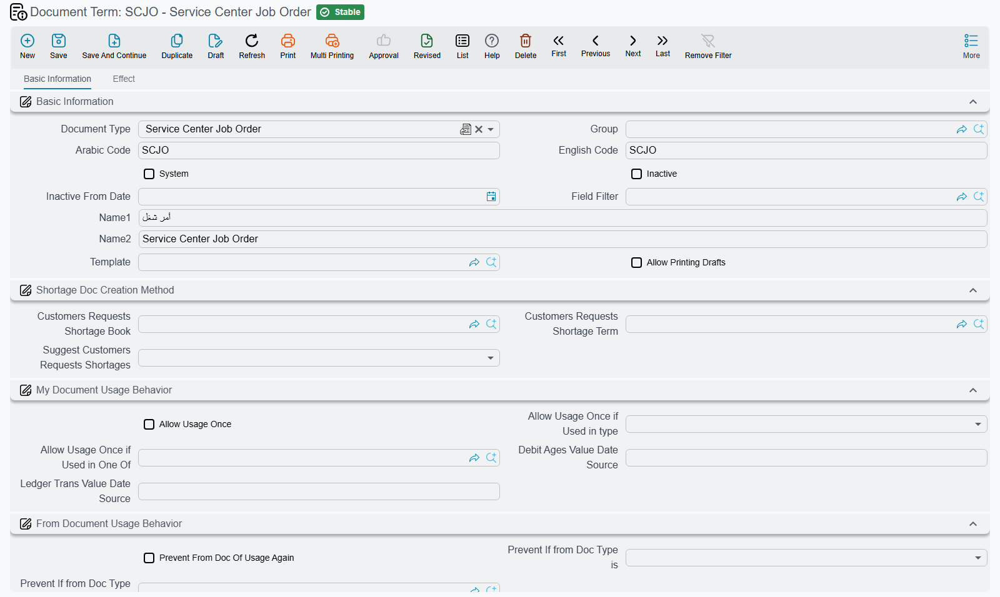

# Document Terms in Service Center

Two workshops running the same Nama installation can behave completely differently. One closes a job
order and a stock issue comes out of it; the other closes an identical job order and nothing leaves
the store. One car receipt brings the chassis into stock; the next branch's car receipt is a piece of
paper. Nobody wrote any code to make that happen — the difference lives entirely in the **document
term** (توجيه المستند).

Every Service Center document you save carries two things at the top of the screen: a **book**, which
decides how it is numbered, and a **term**, which decides how it behaves. The book is bookkeeping
hygiene. The term is the configuration — and, alongside [the module configuration screen](/modules/servicecenter/servicecenter-configuration.md), it is where most Service Center behaviour is decided.

::: info Required licence
`srvcenter` for the workshop documents. The car documents also need `srvcenter-subitems`, the policy
documents `srvcenter-insurance-and-installments`, the rental documents `srvcenter-rental-assets`, and
the courier documents `srvcenter-mobile-delivery`.
:::

## What a term actually decides

A term is a saved rulebook for one document type. You can have as many as you like — a term per
branch, a term per workflow, a term for the cash counter and another for the credit counter — and you
choose which one applies each time you raise a document.

Across Service Center, the settings on a term fall into four families. Learn these four and every
term screen in the module becomes readable, whichever document it belongs to.

**Accounts.** Most terms carry one or more pairs of accounting sides — a debit and a credit — which
say where the document's money lands in the ledger. Al-Sahra Motors' [job-order closing](/modules/servicecenter/job-cycle/servicecenter-job-order-closing.md) term, for
instance, names the pair that receives the customer share of a finished repair.

**Generation settings.** Several documents do their real work by creating a *second* document: a job
order closing creates the stock issue for the consumed parts; a [car receipt](/modules/servicecenter/car-purchasing/car-receipt.md) creates the stock receipt
that brings the chassis into the showroom store. The term names the **book and term of the document
to be generated**. This is the single most consequential block in the module, and the one this
documentation warns about most.

**Stamping settings.** Service Center terms are unusually chatty with master files. A workshop term
can move the [**serviced vehicle's status**](/modules/servicecenter/workshop-setup/servicecenter-product-file.md) when the document commits, and fire a notification when it does. A
car term can stamp a dozen back-references onto the car record — which invoice sold it, which traffic
letter was issued, which salesperson handled it.

**Behaviour switches.** The rest are plain rules: refuse the gate pass until the customer invoice is
paid, refuse the closing until every part has been issued, copy the job order's planned parts onto
the issue, split a quantity of six into six separate car records.

## Which documents share which term

A term is written against a **family** of documents, not always against one. Where two documents
share a family, one term record serves both — and a setting you make for one silently applies to the
other, which is worth knowing before you tune anything.

| Term family | Documents that use it |
|---|---|
| Common workshop documents | Service Request, Job Estimation, Estimation Update, Add Task To Job Order, Pending Operation, Resuming Operation, Product Inspection Document |
| Job Order | Job Order |
| Job Order Closing | Job Order Closing |
| Gate Pass | Gate Pass |
| Job Order Execution | Job Order Execution (the menu reads *Production Review*) |
| External Repair | External Repair |
| Spare Parts Issue | Spare Parts Issue |
| Spare Parts Issue Request | Spare Parts Issue Request |
| Spare Parts Return | Spare Parts Return |
| Car sales documents | Sales Quotation Request, Sales Quotation, Sales Approval, Sales Order, Sales Order Cancel, Allocation, Allocation Cancel, Pro-forma Sales Invoice, Final Delivery, Final Delivery Cancel, Traffic Letter Request, Traffic Letter Request Cancel, Traffic Letter, Traffic Letter Cancel |
| Car receipt documents | Car Receipt, Car Receipt Cancel |
| Car Sales Invoice | Car Sales Invoice |
| Car Sales Return | Car Sales Return |
| Car Purchase Order | Car Purchase Order |
| Car Pro-forma Purchase Invoice | Car Pro-forma Purchase Invoice |
| Car Purchase Invoice | Car Purchase Invoice |
| Car Purchase Return | Car Purchase Return |
| Sub Item Assembly Document | Sub Item Assembly Document — the only document in the module that needs the **`supplychain-assembly`** licence on top of `srvcenter-subitems` |
| Insurance Policy Order | Insurance Policy Issuance Order, Car Insurance Policy Renewal |
| Insurance Policy Receipt | Car Insurance Policy Receipt, Car Insurance Policy Receipt Cancellation |
| Insurance Policy Delivery | Car Insurance Policy Delivery, Car Insurance Policy Delivery Cancellation |
| Insurance Policy Purchase Invoice | Car Insurance Policy Purchase Invoice, Car Insurance Policy Purchase Return |
| Rental | Rental Request, Rental Invoice |
| Reservation Cancel | Reservation Cancel |
| Delivery Document | Delivery Document |
| Batch Delivery Document | Batch Delivery Document |
| Invoice Receipt Document | Invoice Receipt Document |

Twenty-seven families for fifty-two documents — which means most of your configuration effort goes
into a handful of screens. The two that repay attention first are the [**Job Order**](/modules/servicecenter/job-cycle/servicecenter-job-order.md) term and the
[**Car sales**](/modules/servicecenter/car-sales/car-sales-cycle.md) term, because between them they cover the whole of both halves of the business.

## Nine documents have no term at all

Some documents in this module have nothing to configure. Their document book still shows a *توجيه*
tab, but there is no term class behind it, so there is no rulebook to write and nothing you can tune
per book:

- Service Center Attendance
- Kilo Metrage (the odometer reading log)
- Product Task Opening Document
- Loading Table
- External Delivery Order
- Car Insurance Policy Cancellation
- Car Insurance Policy Period Adjustment
- Car Insurance Policy Value Adjustment
- Car Installment Quotation

Three of those nine are insurance-policy documents: the cancellation and the two adjustments, and
none of them books anything. The
**Car Insurance Policy** itself is a master file, not a document, so it has no book and no term.

## The rule that governs the other two pages

Not every Service Center document creates a journal entry. The [car, insurance and rental terms
page](/modules/servicecenter/document-terms/servicecenter-terms-cars-and-other.md) lists which car
documents do; the four **traffic letter** documents and the **Car Pro-forma Purchase Invoice** do
not. Before you rely on a term's accounts, commit one document and look for its entry.

## Generation: the book, the term, and the two that double

The generation block is where terms cause real damage, and always in the same two ways.

::: info The book and the term decide generation
On the **Car Receipt**, the **Car Final Delivery**, the **Spare Parts Issue** and the **Spare Parts
Return**, generation is decided by the **Generation Book** and **Generation Term**
(`termConfig.generationConfigurations.generationBook`,
`termConfig.generationConfigurations.generationTerm`): fill both and the
document generates its stock document. To stop these documents generating, **clear the generation
book or the generation term**.
:::

And then the two symmetric traps: the Car Receipt and the Car Purchase Invoice can both bring the
same car into stock, and the Car Sales Invoice and the Car Final Delivery can both issue it. Fill the
generation book and term on exactly one document of each pair — the rule, Al-Sahra's set-up and the
second line of defence are on
[Car, Insurance and Rental Document Terms](/modules/servicecenter/document-terms/servicecenter-terms-cars-and-other).

## Where to go next

- [Workshop Document Terms](/modules/servicecenter/document-terms/servicecenter-terms-workshop.md) —
  the job order, the closing, the gate pass, the material documents and the shared workshop term.
- [Car, Insurance and Rental Document
  Terms](/modules/servicecenter/document-terms/servicecenter-terms-cars-and-other.md) — the car
  creation and stamping block, the generation settings, and the insurance, rental and courier terms.
