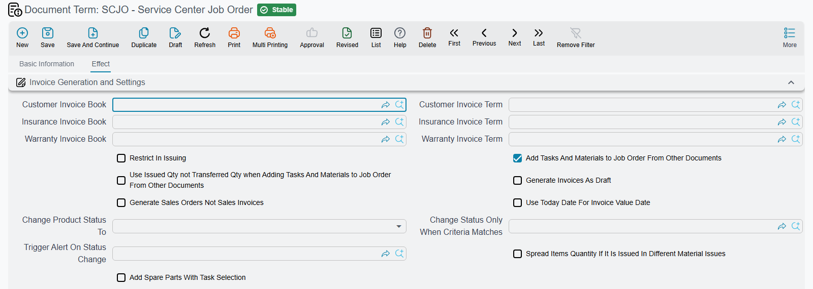

# Workshop Document Terms

The workshop half of Service Center has nine term families between it, and they divide the work
neatly: one shared term covers the small documents that only ever move a vehicle's status, and then
the job order, its closing, the gate pass, the execution sheet, the external repair and the three
material documents each get a rulebook of their own.

This page walks them in the order a new installation configures them, using Al-Sahra Motors'
workshop thread — job order `SCJO-2026-0417` for Fahad Al-Otaibi's Saif 1.6 — as the worked example
throughout.

::: info Required licence
`srvcenter`
:::

## The block that appears on nearly every workshop term

Before the individual screens, one block recurs so often that it is worth learning it once.

**The vehicle-status trio.** Almost every workshop term carries three fields together:

| Option | Arabic label | Field id | What it does |
|---|---|---|---|
| Change Product Status To | تغيير حالة الصنف إلى | `termConfig.changeProductStatusTo` | When the document commits, writes a status entry for the vehicle and recomputes the vehicle's current status |
| Change Status Only When Criteria Matches | تغيير الحالة فقط عند توافق المعيار | `termConfig.changeStatusOnlyWhenCriteriaMatches` | Guards the above with criteria, so the status only moves for documents that match |
| Notify On Status Change | تشغيل التنبيه عند تغير الحالة | `termConfig.notifyOnStatusChange` | Fires a notification for each vehicle whose status actually changed |

This is how the vehicle file tells you where the car is. Al-Sahra sets *Change Product Status To* =
*In Workshop* on the term used by the reception inspection sheet, and *Ready For Delivery* on the
term used by the job order closing, and the vehicle screen then reads correctly all day without
anybody typing a status.

The status is **replayed from the entries in date order**, not simply overwritten, so a back-dated
document inserts itself in the middle of the history rather than at the end.

**No tax settings on these terms.** The shared workshop term, the Job Order term and the Job Order
Closing term have no *Taxable*, *Tax Plan*, *Modifiable Tax* or *Allow Editing Header Tax In
Details* options on their screens. Among the workshop terms, only the
[External Repair term](#The-External-Repair-term) shows them.

::: tip One tax on operation lines
Workshop labour lines apply a single tax. Give the tax plans used on them one tax — Al-Sahra uses one
15 % VAT throughout.
:::

## The shared workshop term

One term family covers seven documents at once: [**Service Request**](/modules/servicecenter/job-cycle/servicecenter-service-request.md), [**Job Estimation**](/modules/servicecenter/job-cycle/servicecenter-job-estimation.md), **Estimation
Update**, **Add Task To Job Order**, **Pending Operation**, **Resume Operation** and the **Product
Inspection Document**.

It is a small screen, and deliberately so — these documents move paper and status, not money. It
carries the vehicle-status trio and one extra switch:

**Add Spare Parts With Task Selection** (`termConfig.addSparePartsWithTaskSelection`) — when a task is picked on the document, the task's standard
spare parts are added to the parts grid automatically. This one is offered on the Service Request,
the Job Estimation and the Add Task To Job Order only.

Two notes about this family. On the **Product Inspection Document**, the **Estimation Update**,
**Pending Operation** and **Resume Operation** the term screen shows only the status trio. And on
**Pending Operation** and **Resume Operation** the term field is shown but not required; those
documents work perfectly well without one.

## The Job Order term

This is the module's busiest term, because the [job order](/modules/servicecenter/job-cycle/servicecenter-job-order.md) is where money is planned and where the
[three invoices](/modules/servicecenter/job-cycle/servicecenter-job-order-invoicing.md) come from.

### The three invoice pairs

The heart of it. The job order's three invoicing buttons each need to know which book and which term
to build their invoice with:

| Pair | Field ids | Feeds |
|---|---|---|
| Customer Invoice Book / Term | `termConfig.customerInvBook` / `termConfig.customerInvTerm` | the customer's invoice — Al-Sahra's `SINV-2026-3311` for 695 |
| Insurance Invoice Book / Term | `termConfig.insuranceInvBook` / `termConfig.insuranceInvTerm` | the insurance invoice — `SINV-2026-3313` for 60 |
| Warranty Invoice Book / Term | `termConfig.warrantyInvBook` / `termConfig.warrantyInvTerm` | the warranty invoice — `SINV-2026-3312` for 2,400 |

Leave a pair empty and that payer's button has nothing to build with. Three more switches shape what
comes out:

- **Save Invoices As Draft** (`termConfig.saveInvoicesAsDraft`) — the generated invoice arrives uncommitted, so somebody reviews it
  before it is committed. Sensible where the service advisor prices the job and accounts commits it.
- **Generate Sales Orders Not Invoices** (`termConfig.generateSOrdersNotInvoices`) — produces sales orders instead of invoices, for
  installations that invoice from the sales side.
- **Use Today For Invoice Value Date** (`termConfig.useTodayForInvoiceValueDate`) — dates the invoice on the day it is generated rather than
  carrying the job order's value date.

### Parts behaviour

Four options decide how the job order and the parts documents relate:

| Option | Arabic label | Field id | Effect |
|---|---|---|---|
| Restrict In Issuing | المطابقة في السحب | `termConfig.restrictInIssuing` | Only lines ticked for matching are subject to the "issued exceeds planned" limit |
| Add Tasks And Materials to Job Order From Other Documents | إضافة مهام قطع غيار لأمر الشغل من سندات خارجيه | `termConfig.addTasksAndMatsToJOFromOut` | The order's grids are **rebuilt** from the issue and return documents; the planned-quantity checks are skipped entirely |
| Use Issued Qty not Transferred Qty | استعمال الكمية المصروفة و ليست المحولة | `termConfig.useIssuedNotTransferredQtyForAddedMats` | Which pair of quantities feeds that rebuild |
| Spread Items Quantity If It Is Issued In Different Material Issues | فرد كميات الأصناف في السطور | `termConfig.spreadItemsQtyIfItIsIssuedInDifferentMaterialIssues` | One job-order line per issue line, instead of one aggregated line per item |

The first two are a fork in the road. With *Add Tasks And Materials…* **off**, the job order is a
plan and the storekeeper must stay inside it — that is Al-Sahra's setup, and the one this
documentation assumes. With it **on**, the job order becomes a record of whatever was actually
issued, and every plan validation stops applying.

The term also carries the vehicle-status trio and *Add Spare Parts With Task Selection*.

## The Job Order Closing term

[The closing](/modules/servicecenter/job-cycle/servicecenter-job-order-closing.md) is where the workshop's money finally lands, and its term has three jobs.

**The accounting sides.** One debit and one credit pair (`termConfig.debit`, `termConfig.credit`). This is the entry the closing produces.

::: warning Only the customer amount reaches the ledger
The closing screen shows four money boxes — customer, insurance, warranty and internal. Al-Sahra's
closing `SCJOC-2026-0392` shows 695, 60, 2,400 and 60. The journal entry it produces carries the
**customer figure only: 695**, as one debit and one credit against the accounts on this term.

Insurance and warranty reach accounting later, through their own sales invoices. The internal 60
reaches accounting nowhere at all. Do not configure these two accounts expecting the full 3,215.
:::

**The stock issue.** *Issue Book* and *Issue Term* (`termConfig.issueBook`, `termConfig.issueTerm`) name the book and term of the **Stock Issue** the
closing generates for the parts consumed on the job — Al-Sahra's `STI-2026-1188`, relieving 1,668 of
inventory cost. Leave them empty and the closing consumes nothing from stock.

**The refusals.** Three switches decide when a closing is allowed:

| Option | Arabic label | Field id | Effect |
|---|---|---|---|
| Allow Closing Suspended Orders | — | `termConfig.allowClosingSuspendedOrders` | Lets a job order that is paused be closed anyway |
| Do Not Close Job Order If All Materials Are Not Issued | منع إغلاق أمر الشغل إذا لم يتم صرف الخامات بالكامل | `termConfig.doNotCloseJobOrderIfAllMaterialsAreNotIssued` | Refuses the closing while any planned part is short-issued |
| Do Not Consider Job Order Operations Lines Status | عدم اعتبار حالة سطور المهمات وقطع الغيار | `termConfig.doNotConsiderOperationsLinesStatus` | Closes regardless of whether the task lines are marked finished |

::: tip The materials check counts per item, not per task
*Do Not Close Job Order If All Materials Are Not Issued* totals each **item** across the whole order.
If five litres of oil were planned against one task and issued against another, the check is
satisfied. It is a completeness check on quantities, not a per-task reconciliation.
:::

Plus, as everywhere, the vehicle-status trio.

## The Gate Pass term — the financial release gate

[The gate pass](/modules/servicecenter/job-cycle/servicecenter-gate-pass.md) is the module's single most useful term block, and also its most misunderstood
document. It has nothing to do with barriers, directions or times of passage. It is a **release
check**: may this car leave, given what has and has not been paid?

Seven switches, in three symmetrical pairs plus one:

| Option | Arabic label | Field id |
|---|---|---|
| Allow Gate Pass Without Job Order | السماح بعمل التصريح بدون أمر شغل | `termConfig.allowGatePassWithoutJobOrder` |
| Allow Gate Pass Without Customer Invoice | السماح بعمل التصريح بدون فاتورة العميل | `termConfig.allowGatePassWithoutCustomerInvoice` |
| Allow Gate Pass Without Fully Paying The Customer Invoice | السماح بعمل التصريح بدون دفع فاتورة العميل بالكامل | `termConfig.allowGatePassWithRemainingInCustomerInvoice` |
| Allow Gate Pass Without Insurance Invoice | السماح بعمل التصريح بدون فاتورة التأمين | `termConfig.allowGatePassWithoutInsuranceInvoice` |
| Allow Gate Pass Without Fully Paying The Insurance Invoice | السماح بعمل التصريح بدون دفع فاتورة التأمين بالكامل | `termConfig.allowGatePassWithRemainingInInsuranceInvoice` |
| Allow Gate Pass Without Warranty Invoice | السماح بعمل التصريح بدون فاتورة الضمان | `termConfig.allowGatePassWithoutWarrantyInvoice` |
| Allow Gate Pass Without Fully Paying The Warranty Invoice | السماح بعمل التصريح بدون دفع فاتورة الضمان بالكامل | `termConfig.allowGatePassWithRemainingInWarrantyInvoice` |

Every switch is an **allowance**, so the strict configuration is all seven off. That is what Al-Sahra
uses: gate pass `SCGP-2026-0475` could not be issued until the customer invoice was committed **and**
paid in full — Fahad's 799.25 in cash — and until the insurance and warranty invoices existed. The
insurance and warranty payment switches are left **on**, because an insurer takes weeks to settle and
nobody is going to hold the car for that.

The status trio is here too, and it is the natural place to set the vehicle's status to *Delivered*.

## The Job Order Execution term

Small, but with a trap.

| Option | Arabic label | Field id | Effect |
|---|---|---|---|
| Prevent Opening More Than One Unfinished Task | منع فتح اكثر من مهمة للفنى في نفس اليوم | `termConfig.preventOpenMoreOneUnFinTask` | Refuses a save that would leave one technician with two unfinished tasks on the same date |
| Close Book / Close Term | — | `termConfig.closeBook` / `termConfig.closeTerm` | The book and term used for the Job Order Closing produced by the *Generate Closing* button |
| Allow Time Overlap | السماح بتداخل الوقت | `termConfig.allowTimeOverlap` | Lets one technician have overlapping from/to intervals on two lines. Unticked, the save is refused when the intervals overlap |

Plus the vehicle-status trio.

::: warning A blank term silently switches this document off
The Job Order Execution document does not require a term. Leave the field empty and the document
saves happily — but the one-open-task-per-technician check never runs, and the *Generate Closing*
button has no book or term to build with. If either behaviour matters to you, make picking a term
part of the procedure.
:::

## The External Repair term

[The external repair](/modules/servicecenter/spare-parts/servicecenter-external-repair.md) is a supplier's invoice for sublet work — Al-Sahra sent the A/C compressor to
Al-Faisal Auto Electric for a bench test, 400 on document `SCER-2026-0061`.

Its term carries the standard invoice account block: the debit and credit sides
(`termConfig.config.debit`, `termConfig.config.credit`, with *Shorten Ledger*
`termConfig.config.shortenLedger`), cash, line and invoice discounts, the seven extra discount
accounts, the tax accounts and four service-fee pairs (`termConfig.serviceFees1Debit` …
`termConfig.serviceFees4Credit`). All of this is genuinely read — the external repair really does
create a journal entry.

One switch changes the direction of the entry:

**Is Sales Not Purchase** (تعمل مبيعات ليست مشتريات, `termConfig.isSalesNotPurchase`) — off, the
default, books a **payable** to the supplier; on, it books a receivable instead, for the rare
installation that does sublet work for others through this screen.

The rest of the **General Effect Settings** group, and the switches at the top of the **Serivce
Fees** group (the label is misspelt on screen), work as on any purchase invoice:

| Option | Field id | What it does |
|---|---|---|
| **Expand Payment Method Effect** | `termConfig.expandPaymentMethodEffect` | The payment lines' entries are written in full — the payment value and the payment-method fees as separate lines — instead of netting the fees off the payment line. |
| **Taxable** | `termConfig.taxable` | Copied onto the document header on every save; untick it for a term whose repairs carry no tax. |
| **Modifiable Tax** | `termConfig.modifiableTax` | Copied onto the header on every save; lets the user override the calculated tax. |
| **Tax Plan** | `termConfig.taxPlan` | The header tax plan, copied onto the document on every save — so changing it changes what the next save of an existing external repair calculates. |
| **Allow Editing Header Tax In Details** | `termConfig.allowEditingHdrTaxInDetails` | Copied onto the header on every save; lets a line carry a different tax from the header. |
| **Pay Installments In Order** | `termConfig.payInstallmentsInOrder` | The repair's payment schedule must be settled oldest instalment first. Off, any instalment can be paid at any time. |
| **Service Fees 1 Deduction** … **Service Fees 4 Deduction** | `termConfig.serviceFees1Deduction` … `termConfig.serviceFees4Deduction` | Treats that service fee as a deduction from the document's net value instead of an addition, and reverses its entry accordingly. |
| **Do Not Add Service Fees Effect Without Account Side** | `termConfig.doNotAddServiceFeesEffectWithoutAccSide` | A service-fee line whose own debit or credit side is empty is left out of the entry, instead of being booked to the term's main sides. |

The **Discount Effects** tab ends with the **External Effects** grid (تأثير سندات الدفع,
`termConfig.externalEffectLines`). Each row adds a debit/credit pair to the repair's own journal
entry for every payment document recorded against it — the payment lines that vouchers add to the
repair — using the payment's value:

| Column | Field id | What it does |
|---|---|---|
| **For Type** | `termConfig.externalEffectLines.forType` | Limits the row to payment documents of this type. Empty means every type. |
| **Apply When Payment Document Matches Criteria** | `termConfig.externalEffectLines.applyWhenPaymentDocMatchesCriteria` | Applies the row only to payment documents that match these criteria. |
| **Apply When Payment Document Matches Query** | `termConfig.externalEffectLines.applyWhenPaymentDocMatchesQuery` | The same filter, written as a query. |
| **Debit** / **Credit** | `termConfig.externalEffectLines.debit` / `termConfig.externalEffectLines.credit` | The account sides of the added pair. |

::: warning The external repair's value never reaches the job order
The 400 is recorded in the ledger against the supplier and the line's account, and it marks the covered
tasks *Finished*. It does **not** join the job order's 3,215, it does not appear on any of the three
invoices, and no term option makes it. To recover it from the customer, add a task or material value
on the job order by hand.
:::

## The three material terms

The [Spare Parts Issue](/modules/servicecenter/spare-parts/servicecenter-spare-parts-issue.md), the Spare Parts Return and the Spare Parts Issue Request share one shape — except that the
last two rows below, *Do Not Copy Details From Job Order* and *Use Job Order For Qty Tracking*, are
on the Spare Parts Issue and the Spare Parts Issue Request terms only. The Spare Parts Return term
does not have them.

| Option | Arabic label | Field id | Effect |
|---|---|---|---|
| Generation Book / Generation Term | دفتر المستند / توجيه المستند | `termConfig.generationConfigurations.generationBook` / `termConfig.generationConfigurations.generationTerm` | The book and term of the generated **Stock Issue** (issue) or **Stock Receipt** (return). Empty means no stock document at all, and any existing one is deleted |
| Transfer Not Issue | تحويل لا صرف | `termConfig.transferNotIssue` | Switches the whole document from issue/receipt to a **Stock Transfer** between the store and the job order's work-in-progress store |
| Transfer Book / Transfer Term | دفتر التحويل المخزني / مستند التحويل المخزني | `termConfig.transferBook` / `termConfig.transferTerm` | The book and term of that transfer |
| Do Not Copy Details From Job Order | عدم نسخ التفاصيل من أمر الشغل | `termConfig.doNotCopyDetailsOfFromDocfFromJobOrder` | Stops the planned parts being copied in when the job order is picked |
| Use Job Order For Qty Tracking | استخدام أمر الشغل لمتابعة الكميات | `termConfig.useJobOrderForQtyTracking` | Hangs the executed/remaining quantities off the job order rather than the source document |

*Transfer Not Issue* is the fork here. Off, the storekeeper issues parts and stock leaves the parts
store — Al-Sahra's `SCRMI-2026-1902` generating stock issue `STI-2026-1188` out of `WH-PARTS`. On,
the parts move to the work-in-progress store `WH-WIP` instead and stay on the books until the job
consumes them.

To stop an issue or a return creating its stock document, **clear the Generation Book and the
Generation Term** — or, in transfer mode, the Transfer Book and Transfer Term.

The Spare Parts Issue Request is a paper request that the issue is later built from: it moves no
stock and creates no journal entry. The stock settings that apply are the ones on the issue's own
term.

---

For the module-wide rules behind these screens, see [Document Terms in Service
Center](/modules/servicecenter/document-terms/servicecenter-terms-basics.md). For the showroom side,
see [Car, Insurance and Rental Document
Terms](/modules/servicecenter/document-terms/servicecenter-terms-cars-and-other.md).
