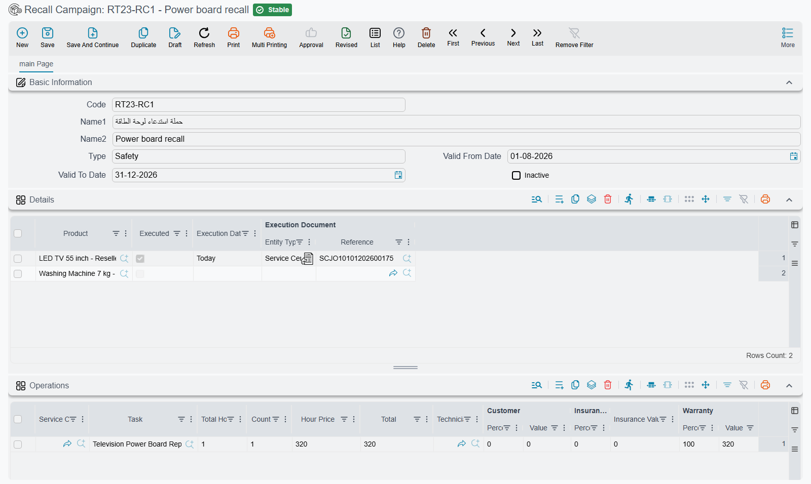

# Recall Campaigns

A recall campaign is the list of vehicles that must come back to the workshop for a specific fix. The
manufacturer announces that a batch of power steering pumps is faulty; the dealer gets a list of
chassis numbers; every one of those cars has to have the pump replaced before it is serviced for
anything else. The **Recall Campaign** screen holds that list, and the
[job order](/modules/servicecenter/job-cycle/servicecenter-job-order.md) uses it in two ways: it
refuses to open ordinary work on a listed vehicle until the recall is dealt with, and it ticks the
vehicle off the list once a job order does the recall work.

You will find it at **Service Center → Master Files → Recall Campaign**.

::: info Required licence
`srvcenter`
:::

## The campaign screen

The header is short:

| Field | Arabic | What it is for |
|---|---|---|
| Code, Name1, Name2 | الكود، الاسم العربي، الاسم الإنجليزي | The campaign's reference, such as `RC-2026-PSP`, and its Arabic and English names. |
| Type | النوع | Free text for your own grouping, for example *Safety* or *Service bulletin*. Nothing reads it. |
| Valid From Date / Valid To Date | صالحه من تاريخ / صالحه إلي تاريخ | The window in which the campaign blocks job orders. Either end may be left empty, meaning open-ended. |
| Inactive | غير نشط | Tick it to switch the campaign off without deleting it. |

Below it sit three grids.

**Details** (التفاصيل) is the one that matters: one line per vehicle, picked from the
[vehicle file](/modules/servicecenter/workshop-setup/servicecenter-product-file.md). The other three
columns — **Executed**, **Execution Date** and **Execution Document** — are filled by the system, not by
you. They start empty (Executed is off) and are stamped when a job order does the recall work.

**Operations** (العمليات) and **Spare Parts** (قطع غيار) describe the standard recall work: the
services and tasks with their hours and prices, the parts with their quantities, and the same
customer / insurance / warranty / internal split columns the job order has (a manufacturer recall is
usually 100% warranty). Unit prices and the payer values fill in the same way as on a job order.
These two grids are a reference for the reception engineer. Nothing copies them into the job order,
so add the recall work to the job order yourself.

Saving a campaign has no other effect: it moves no stock and creates no accounting entry.

## What a campaign does to a job order

When a job order is saved and committed, the system looks for campaigns that list the job order's
vehicle and are still waiting for it. A campaign counts when all of these hold:

- it has been saved and committed (a draft campaign blocks nothing);
- **Inactive** is off;
- the job order's value date falls inside **Valid From Date** – **Valid To Date** (an empty end does not
  limit it);
- the vehicle's line on the campaign is not yet **Executed**.

If such a campaign exists, the job order is refused with:

*{0} exists in recall campaign {1}* — «{0} موجود في حملة الإستدعاء {1}»

where `{0}` is the vehicle and `{1}` the campaign. The message carries a link to the campaign line, so
the reception engineer can open it straight away.

There are two ways forward, and they mean different things:

1. **This job order is the recall work.** Pick the campaign in the job order's **Recall Campaign**
   field (in the vehicle details block) and add the recall operations. The job order is then allowed,
   and committing it marks the vehicle's campaign line as executed.
2. **The customer came for something else and the recall is being handled separately** (or the
   customer declined it). Tick **Ignore Recall Campaign Validation** (تجاهل التحقق من حملات الاستدعاء)
   in the job order header. The job order is allowed and the campaign line stays open.

::: tip Draft job orders are not checked
The check runs on commit. A job order saved as a draft is not refused; it is refused when somebody
tries to commit it.
:::

## How a vehicle is ticked off

When a job order that names a campaign is committed, the system finds the vehicle's line on that
campaign and stamps it: **Executed** on, **Execution Date** = the job order's value date, **Execution
Document** = the job order. Open the campaign and the Details grid becomes the progress report — every
line still unticked is a car that has not come in yet.

Deleting that job order clears the stamp again, so the vehicle goes back to waiting.

The same commit also writes the campaign onto the vehicle file's own **Recall Campaign** field, if that
field is empty. From then on, every new service request, estimation and job order for that vehicle
picks the campaign up from the vehicle file. That is why a job order for a vehicle that already went
through a recall is never refused again, as described in
[the job order's checks](/modules/servicecenter/job-cycle/servicecenter-job-order.md#What-the-job-order-refuses).

## A worked example

Al-Sahra Motors receives a power steering pump recall for two vehicles, `SP-0054` and `SP-0055`.

1. The service manager creates campaign `RC-2026-PSP`, type *Safety*, valid from 1 August to
   31 December, lists both vehicles in Details, and adds the pump replacement task at one hour,
   100% warranty, in Operations.
2. `SP-0055` arrives on 23 October for an oil change. The reception engineer creates a job order
   for it. On commit it is refused with the recall message, which names the vehicle and
   `RC-2026-PSP`.
3. The engineer picks `RC-2026-PSP` in the job order's **Recall Campaign** field, adds the pump task
   at 100% warranty next to the oil change, and commits. The job order is saved, and on the campaign
   the `SP-0055` line now shows Executed, 23-10-2026, and the job order number.
4. `SP-0054` is still unticked, which tells the service manager which customer to call.
