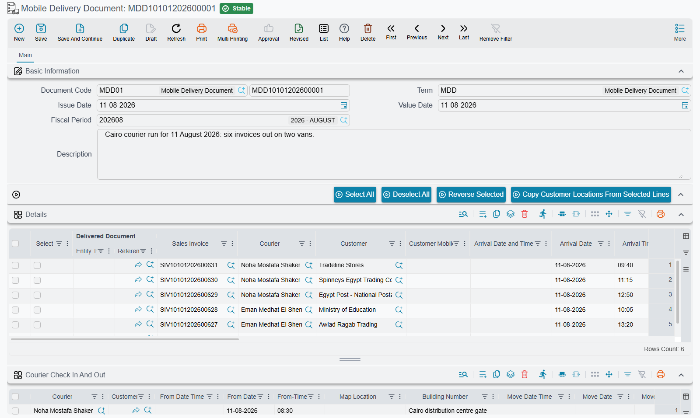

# Delivering with the Driver App

::: info Required licence
`srvcenter-mobile-delivery`. All three documents in this folder are gated behind it. The [External Delivery Order](#External-Delivery-Order) needs a licence of its own.
:::

::: danger These documents have nothing to do with vehicles
Read this before anything else, because the folder's position inside Service Center makes the wrong reading almost irresistible.

**Mobile Delivery has no connection whatsoever to car delivery.** It is not the [Car Final Delivery](/modules/servicecenter/car-sales/car-final-delivery.md), it does not hand a sold car over to a buyer, it does not touch the [car register](/modules/servicecenter/cars-setup/car-master-file.md), and no code path connects the two. A delivery line here can point at a sales invoice, a sales return, a work task or an invoice receipt document — a car final delivery is not even an option.

What it actually is: **the route sheet for a courier carrying goods to customers**, driven from the Nama Delivery phone app. If you came here looking for how a sold car is handed over, that belongs to the [car sales cycle](/modules/servicecenter/car-sales/car-sales-cycle.md) and this is the wrong folder.
:::

## What it is for

Al-Sahra Motors sells spare parts over the counter and also runs a small van that takes parts out to fleet customers around Riyadh. Every morning somebody has to decide which of yesterday's invoices go on the van, in what order, and with which crates and cool-bags. At the end of the day somebody has to know which drops actually happened.

That is the whole job of this sub-module. You reach it from **Service Center → Mobile Apps - Service Center**, and it consists of three documents:

| Document | Arabic | What it is |
|---|---|---|
| **Mobile Delivery Document** | مستند الحركة | One courier's route sheet — a list of stops for the day. |
| **Multi Mobile Delivery Document** | مستند حركة مجمع | A batch generator. Collects invoices and work tasks by date and time window and produces one route sheet per group. |
| **Invoice Receipt Document** | مستند استلام الفاتورة | What the customer actually received against a delivered sales invoice, and what packaging came back. |

The first two are covered on the [delivery documents page](/modules/servicecenter/mobile-delivery/servicecenter-mobile-delivery-documents.md); the third has [its own page](/modules/servicecenter/mobile-delivery/servicecenter-invoice-receipt-document.md).

## External Delivery Order

The same menu holds one more document, the **External Delivery Order** (*أمر توصيل خارجي*). It needs the licence `crm-united-pharma-app`, which was made for the United Pharma customer, and the screen is available only under it.

An external delivery order is a delivery that did not start as a Nama sales invoice: an order whose invoice lives in another system, sent to a receiver who may not be the customer it is billed to. The order holds:

- **who it is for** — a **Customer** from the customer file, or, for a customer who is not in the system, an **External Customer Code** and **External Customer Name**. One of the three must be filled;
- **who receives it** — **Receiver Code** or **Receiver Name** (one of them), **Receiver Mobile**, and the **Receiver Address** with its first address line and map location. All of these are required, because they are everything the courier gets;
- the **Invoice Code** and **Invoice Total** of the outside invoice, and the counts **Package 1 … Package 7**.

The Multi Mobile Delivery Document collects these orders with its button **Collect External Delivery Orders By Chosen Date And Time** (*تجميع أوامر التوصيل الخارجية حسب الوقت والتاريخ المختارين*), using the same date and time window as for invoices. Each order becomes a delivery line that carries the order's own receiver, mobile, address and package counts; an order already on a delivery line is skipped. On a delivery line that points at an external delivery order, the receiver's address from the order is kept — it is never replaced by the customer's address from the customer file.

## What these documents change

Very little, and that is the honest answer.

- **No accounting effect.** Neither the delivery document nor the batch document produces a journal entry. There are no accounts on their [توجيه](/modules/servicecenter/document-terms/servicecenter-terms-cars-and-other.md) to fill in, and nothing reaches the ledger when they commit.
- **No inventory effect of their own.** The batch document moves no stock at all.
- **One real effect.** A Mobile Delivery Document can optionally generate **stock transfers** that move packaging items — crates, boxes, cool-bags — onto the courier's own locator, so that what is riding in the van is visible in the warehouse figures. That happens only when the توجيه is configured for it, and the mechanics are on the delivery documents page.

Everything else the sub-module does is record-keeping: which stop belongs to which courier, when the courier arrived, what state the drop ended in, and what the courier said about it.

## The courier's day

The delivery document is written for a phone app the courier carries, not for the Nama screen. The flow, from the courier's side:

1. **The courier opens the app and sees the stops.** The list is drawn from delivery-document lines where the courier is the logged-in employee — or where no courier has been named at all — whose delivery state is still open (*Initial*, *Moved* or *Customer Not Available*), and whose value date falls inside a recent window. Lines are also limited to the courier's own legal entity and branch, as set on the courier's employee record; a line with no legal entity or branch is shown to everyone. The stops still waiting at the branch and the stops already on the road are listed separately.

   ::: info The collection window is configurable
   The window is the setting **Previous Days Count To Limit Mob Deliver Document Search Period** (*عدد الأيام السابقة للبحث عن مستند حركة*) on the **Mobile Apps Configurations** screen. Left empty, it is **three days**. If a courier reports that yesterday's stop is missing from the app, that window is the first thing to check — then the legal entity and branch on the courier's employee record.
   :::

2. **The courier moves the orders out.** Leaving the branch, the courier picks the stops being taken and records the move. Each picked stop goes from *Initial* to **Moved**, takes this courier if it had none, and gets its own line in the **Courier Check In And Out** grid with the **Move Date Time** and the **Move Location** (the phone's position). Only stops waiting at the branch are moved; a stop taken by another courier, already delivered or marked *Customer Not Available* is refused.

3. **At each stop the courier checks in and out.** Check-in is done per stop: it fills the check-in time and position on that stop's line in the *Courier Check In And Out* grid, and check-out fills the departure time and position on the same line. A check-in is refused for a stop that is still waiting at the branch, or that this courier never moved.

4. **The app can re-order the stops.** The courier asks for the route to be arranged, and the stops come back in driving order rather than the order somebody happened to type them in.

5. **The courier records what happened.** Each line carries a **delivery state** — *Initial*, *Moved*, *Delivered* or *Customer Not Available* — plus the arrival date and time, the customer address as the courier found it, free remarks, and a voice note. The state can only move forward:

   | From | Allowed next states |
   |---|---|
   | *Initial* (waiting at the branch) | *Moved*, *Delivered*, *Customer Not Available* |
   | *Moved* | *Delivered*, *Customer Not Available* |
   | *Customer Not Available* | *Moved* (another visit), *Delivered* |
   | *Delivered* | none — it is final |

   Nothing goes back to *Initial*.

6. **The courier can raise work from the road.** Beyond updating stops, the app can create a receipt voucher for cash collected, a sales return, an item request, a sales order, a work task, and a suggestion or complaint. Those are ordinary Nama documents; they are not part of the delivery document itself.

::: warning Courier edits bypass the document's own checks
When the app writes the delivery state, the arrival time, the address, the remarks or the voice note back to a line, it writes **straight onto the line** — the delivery document is not opened for editing, its validations do not run, and its effects are not re-applied.

This is expected behaviour, not a fault to report, but support staff need to know it for two reasons. First, changes made from the app do not appear in the document's editing history the way a change made on the Nama screen would, so an apparently unexplained value on a line is usually the courier. Second, whatever the document would normally check on save is simply not checked for those fields.
:::

### Messages the courier may see

These messages have no Arabic text; they appear in English on Arabic phones too.

| Message | Why | What to do |
|---|---|---|
| *The order of {0} has not left the branch yet* | Check-in at a stop that is still *Initial*. | Move the order out first, then check in. |
| *The courier {0} did not move the order of {1}* | Check-in at a stop this courier never moved. | Move the order, then check in. |
| *The courier {0} did not check in at the order of {1}* | Check-out at a stop with no check-in. | Check in first. |
| *The order of {0} belongs to the courier {1}* | Check-in at another courier's stop. | Leave it to that courier, or change the courier on the delivery document. |
| *The order of {0} was taken by the courier {1}* | Moving another courier's stop. | As above. |
| *The order of {0} is already {1}* | Moving a stop that is delivered or marked *Customer Not Available*. | Report its state instead; a *Customer Not Available* stop goes back on the road by setting it to *Moved*. |
| *The order of {0} can not go from {1} to {2}* | A state change the table above does not allow, such as reopening a delivered stop. | None from the app; a supervisor corrects the line on the delivery document. |

## Addresses go back onto the customer file

One thing on the delivery document reaches outside it. The courier types the address as actually found — *"gate 4, behind the mosque"* — and the delivery screen has an action that copies the addresses from the selected lines **back onto the customer master files**.

That is deliberate, and it is how a delivery operation gradually cleans up its address book. But it is a master-file change made from a document screen, so treat it accordingly: it is not local to the document, and it will affect every future document raised for that customer.

::: warning One bad line stops the rest
If a selected line's recipient is not a party that can hold contact information, the copy stops there — the remaining selected lines are silently skipped rather than processed. After running the action on a large selection, spot-check that the addresses you expected actually landed.
:::

## Where to read next

- [Delivery Documents](/modules/servicecenter/mobile-delivery/servicecenter-mobile-delivery-documents.md) — the single route sheet and the batch generator, with the setup rules that keep them usable.
- [Invoice Receipt Document](/modules/servicecenter/mobile-delivery/servicecenter-invoice-receipt-document.md) — recording what the customer actually received and crediting the shortfall.
