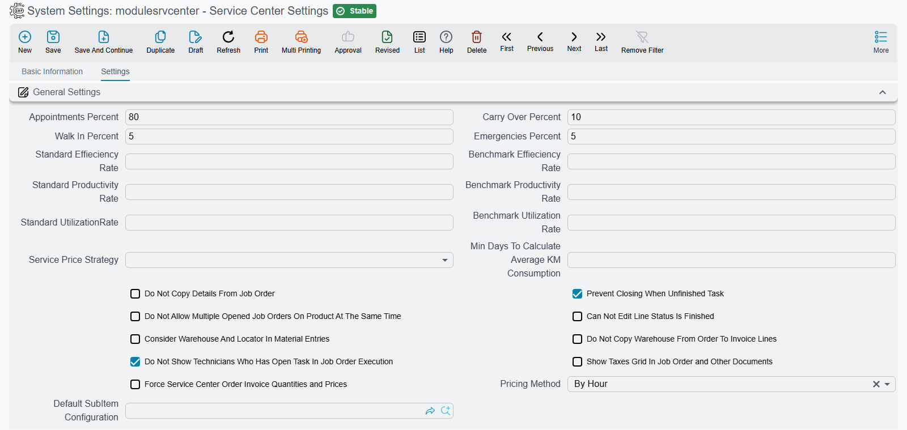

# Service Center Settings

Almost everything that changes how this module behaves is configured **per document book**, on the document term. What is left over — the handful of decisions that have to be the same everywhere — lives on one settings screen, and this page walks through its options group by group.

::: info Required licence
The settings screen belongs to the module as a whole. It has no entry in the Service Center menu (that menu's **Settings** folder holds the loading table, inspection and visit-type lists instead): open **Administration → Settings → System Settings** and pick the record named **Service Center Settings**. Which options are meaningful depends on which of the six licence codes you hold; the rental pricing method, for instance, matters only with `srvcenter-rental-assets`.
:::

::: warning Save this screen once before using the module
Several parts of the module — closing a job order and recalculating prices among them — need this record to exist. Open it and save it once, even with every default untouched. This is a genuine prerequisite, not boilerplate.
:::

One more thing before the tables. Keep **one settings record for the whole database**. If you need different behaviour per branch or per sector, get it from the document terms, not from here.

## Capacity — How the Working Day Is Divided

These four percentages seed the capacity split that a [loading table](/modules/servicecenter/workshop-execution/servicecenter-loading-table.md) proposes when you create it, and the appointment share doubles as the fallback the booking check uses when no loading table covers the day.

| Option (Arabic / English) | Default | What it does |
|---|---|---|
| نسبة الحجز / **Appointments Percent** | 80 % | The share of the day's hours reserved for booked appointments. This is the only bucket that is actually enforced when a [service request](/modules/servicecenter/job-cycle/servicecenter-service-request.md) is booked. |
| نسبة الطوارئ / **Emergencies Percent** | 5 % | The share reserved for emergencies. Planning information. |
| **Walk In Percent** | 5 % | The share reserved for walk-in customers. Planning information. |
| **Carry Over Percent** | 10 % | The share reserved for work carried over from previous days. Planning information. |

Al-Sahra Motors leaves these at 80 / 5 / 5 / 10, which turns the mechanical hall's forty available hours into **32 appointment hours** a day.

The two English-only rows are not a mistake in this table: *Walk In Percent* and *Carry Over Percent* have no Arabic translation and display in raw English on the Arabic screen, sitting next to two neighbours that are translated properly. Look for the English words.

## Pricing

| Option (Arabic / English) | Values | What it does |
|---|---|---|
| سياسة تسعير الخدمات / **Service Price Strategy** | Normal · MSRP | Decides whether a task's hourly rate and a service's total price come from the ordinary price columns or from the manufacturer's recommended price columns. Applied at the moment a price is pulled onto a document. |
| طريقة التسعير / **Pricing Method** | By Hour (default) · By Day | **Rental assets only.** Whether a rental is charged by the hour or by the day. It changes the arithmetic *and* the screen layout of the rental documents, and it is one setting for the whole installation — not per asset, not per booking. |

Both are worth settling before the first document exists. Prices already written onto documents are not revisited when you flip the strategy, so a mid-life change leaves an installation with two generations of prices and no way to tell them apart. On the rental side, see [Renting Out Assets](/modules/servicecenter/rental-assets/servicecenter-rental-overview.md).

## Job Orders and Invoicing

| Option (Arabic / English) | Default | What it does |
|---|---|---|
| منع إغلاق أمر الشغل في حالة وجود مهام غير منتهية / **Prevent Closing When Unfinished Task** | **On** | Refuses a [job order closing](/modules/servicecenter/job-cycle/servicecenter-job-order-closing.md) while any recorded task is still missing a start or end time. Leave it on unless you have a deliberate reason. |
| عدم السماح بفتح اكتر من أمر شغل للمنتج في نفس الوقت / **Do Not Allow Multiple Opened Job Orders On Product At The Same Time** | Off | Refuses a second open [job order](/modules/servicecenter/job-cycle/servicecenter-job-order.md) for a vehicle that already has one. Useful in a busy shop where the same car can be booked in twice by two advisors. |
| الالتزام بأصناف وكميات وأسعار أمر الشغل في الفاتورة / **Force Service Center Order Invoice Quantities and Prices** | Off | Locks the generated invoice to the job order's own items, quantities and prices, so nobody edits the invoice away from the job it came from. |
| عدم نسخ المخزن من سطور أمر الشغل الى الفاتورة / **Do Not Copy Warehouse From Order To Invoice Lines** | Off | Stops the warehouse being carried from the job order's lines onto the [generated invoice](/modules/servicecenter/job-cycle/servicecenter-job-order-invoicing.md) lines. Switch it on where invoicing and stock live in different stores. |
| إظهار الضرائب في أوامر الشغل ومستنداتها / **Show Taxes Grid In Job Order and Other Documents** | Off | A pure layout switch: shows or hides the taxes grid on the job order and its related screens. |
| إعتبار المخزن و الموقع في جدول قطع الغيار النظامى / **Consider Warehouse And Locator In Material Entries** | Off | Makes the system's [spare-parts ledger](/modules/servicecenter/spare-parts/servicecenter-spare-parts-overview.md) key on warehouse and locator as well as item, so the same part issued from two stores is tracked separately. |

## The Execution Screen

| Option (Arabic / English) | Default | What it does |
|---|---|---|
| عدم نسخ السطور عند إختيار أمر الشغل / **Do Not Copy Details From Job Order** | Off | When on, picking a job order on the [execution document](/modules/servicecenter/workshop-execution/servicecenter-production-execution.md) does not pre-fill its task and material lines. Useful where technicians clock only part of an order. |
| لا يمكن التعديل في السطر الذى حالته منتهى / **Can Not Edit Line Status Is Finished** | Off | Makes every column of a finished execution line read-only, so a completed clocking cannot be quietly edited afterwards. |
| لا تظهر الفنيين المفتوح لهم مهمة في مستند تنفيذ أمر شغل / **Do Not Show Technicians Who Has Open Task In Job Order Execution** | **On** | Filters technicians who already have an unfinished task out of the picker on the execution document. |

## Vehicle History

| Option (Arabic / English) | What it does |
|---|---|
| أقل عدد من الأيام لحساب متوسط إستهلاك الكيلومتر / **Min Days To Calculate Average KM Consumption** | The minimum number of days that must have elapsed between two odometer readings before the vehicle's average daily distance is recalculated. It stops a reading taken the morning after the last one from producing a wild average. See [Odometer Readings and Service Intervals](/modules/servicecenter/job-cycle/servicecenter-odometer-and-service-intervals.md). |

## Cars

| Option (Arabic / English) | What it does |
|---|---|
| إعدادات حالة الصنف الفرعي الإفتراضية / **Default SubItem Configuration** | Supplies the status-filter rows that the car picker offers — and only when the **item** has no car status configuration of its own. |

::: warning What Default SubItem Configuration does not do
This option is read in exactly one place: the filter list on the car picker. It is commonly misread as a fallback that makes the car lifecycle work for items nobody configured. It is not.

Both the status engine and automatic car creation read the configuration attached to the **item**, and neither falls back to this setting — car creation refuses outright with a message saying the item has no car status configurations. Note also that the fallback is keyed on the item, not on the car.

So: **every vehicle item still needs its own Car Status Configurations record.** Setting a default here changes nothing about statuses or car creation. See [Car Status Configurations](/modules/servicecenter/cars-setup/car-status-configurations.md).
:::

## What Is Not Here

Two absences worth stating, because both send people hunting.

**There are no Service Center options on the Global Config screen.** Everything module-wide is on the screen described above; everything else is on document terms.

**And there is no per-feature licensing inside the module.** The six licence codes in [Service Center](/modules/servicecenter/servicecenter-overview.md) are the whole of the granularity available. Any screen that appears to enumerate finer-grained "features" for this module is not showing you Service Center features and should be ignored.

For everything configured per document book — invoice generation, gate-pass conditions, stock movement, accounting sides — go to [Document Terms in Service Center](/modules/servicecenter/document-terms/servicecenter-terms-basics.md).
