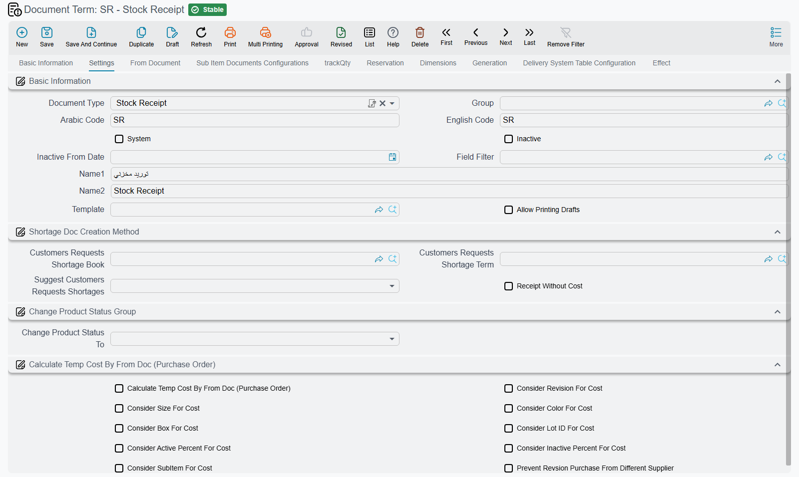

# Document-Specific Options

Most term-config options are shared across document types and are covered on the other pages (General, From-Document, Quantity Tracking, Reservation & Delivery, Pricing/Taxes/Discounts, Sub-Item). This page collects the options that surface **only for specific document types** — they appear on the term screen depending on the **Document Type** the term targets.

::: info Where to find it
Open the document's **Document Term** (توجيه). The options below show up only when the term's **Document Type** is one of the documents noted in each group.
:::

## Stock Receipt

*Applies to: Stock Receipt (توريد مخزني).*

**Returnable** `termConfig.config.returnable` — Marks the receipt's accounting effect as a return so the supplier/customer side is validated accordingly.

**Calculate Temp Cost By From Doc** `termConfig.calculateTempCostByFromDoc` — Uses the from-document's cost as the temporary receipt cost instead of recalculating it.

**Allow Revision Purchase From Different Supplier** `termConfig.allowRevsionPurchaseFromDifSupplier` — Allows receiving an item revision from a supplier other than the revision's default supplier. On the English screen this box is captioned *Prevent Revsion Purchase From Different Supplier*, but ticking it **allows** the purchase; the Arabic caption «السماح بشراء الإصدارات من مورد مختلف» says what it does.

**Receipt Without Cost** `termConfig.config.rwc` — Lets a stock receipt stand on its own, with no invoice behind it: the goods enter stock as a receipt without cost and are costed later. With the box clear, a receipt that is not built on an invoice is refused on save with *Document is not linked with invoice* — «المستند غير مرتبط بفاتورة». The box is also checked when a purchase invoice built on another document drops a receipt from its stock-documents grid: if the receipt's term does not have it, the invoice is refused with *Stock Receipt {0} cannot be removed from stock docs, please make sure the option Receipt Without Cost is checked in its document term {1}* — «لا يمكن حذف سند التوريد {0} من سطور السندات المخزنية. يرجي التأكد من التعليم علي الاختيار توريد غير مكلف في توجيه التوريد {1}».

**Do Not Auto Collect In Invoices** `termConfig.doNotAutoCollectInInvoices` — Flags every receipt saved with this term so the **Collect** button on a purchase invoice skips it. The receipt can still be linked to an invoice by hand. The same option is on the Stock Issue term, where it keeps issues out of a sales invoice's **Collect**.

The **Consider … For Cost** family makes the cost layer/valuation distinguish receipts by the chosen dimension, so units that differ only in that dimension are costed separately.

| Option | Field ID |
|---|---|
| Consider Revision For Cost | `termConfig.considerRevisionForCost` |
| Consider Size For Cost | `termConfig.considerSizeForCost` |
| Consider Color For Cost | `termConfig.considerColorForCost` |
| Consider Box For Cost | `termConfig.considerBoxForCost` |
| Consider Lot Id For Cost | `termConfig.considerLotIdForCost` |
| Consider Active Percent For Cost | `termConfig.considerActivePercentForCost` |
| Consider Inactive Percent For Cost | `termConfig.considerInActivePercentForCost` |
| Consider Sub Item For Cost | `termConfig.considerSubItemForCost` |

## Stock Issue

*Applies to: Stock Issue (صرف مخزني).*

**Returnable** `termConfig.config.returnable` — Marks the issue's accounting effect as a return; checked when validating the supplier/customer side of the document.

**Do Not Auto Collect In Invoices** `termConfig.doNotAutoCollectInInvoices` — Flags every issue saved with this term so the **Collect** button on a sales invoice skips it; the issue can still be linked by hand.

## Opening Stock

*Applies to: Opening Stock Document (سند افتتاح مخزني).*

**Allow Normal Periods** `termConfig.allowNormalPeriods` — An opening stock document normally has to sit in an opening fiscal period; in a *Normal* period it is refused with *Period must not be Normal* — «لا يمكن إنشاء المستند في فترة عادية». Tick this to accept normal periods too.

## Stock Transfer Request

*Applies to: Stock Transfer Request (طلب تحويل مخزني).*

**use With Collect** `termConfig.useWithCollect` — Makes the request a collecting one: each line you add or change must name the **Stock Transfer Req** it comes from, and that request must have the same from and to warehouses as this one.

## Aggregated Stock Transfer Request

*Applies to: Aggregated Stock Transfer Request (طلب تحويل مخزني مجمع).*

Saving an aggregated request generates ordinary stock transfer requests from its lines. The term holds the book and term of those requests and decides how lines are shared out between them. The full story is on [Moving Stock Between Warehouses](../moving-stock.md).

| Option | Field ID | What it does |
|---|---|---|
| Stock transfer Request Book | `termConfig.stockTransferReqBook` | Book of the generated requests. Required. |
| Stock transfer Request Term | `termConfig.stockTransferReqTerm` | Term of the generated requests. Required. |
| Group by From Warehouse | `termConfig.groupByFromWarehouse` | One generated request per source warehouse. |
| Group by To Warehouse | `termConfig.groupByToWarehouse` | One generated request per destination warehouse; with both ticked, one per pair. |
| Max Lines for Generated Stock Transfer Req | `termConfig.maxLinesForGenStockTransReq` | Splits a bigger group into requests of at most this many lines. Empty or zero means no cap. |

## Stock Transfer

*Applies to: Stock Transfer (تحويل مخزني).*

**Transfer Type** `termConfig.transferType` — Classifies the transfer (e.g. internal vs. inter-branch), which controls its effects.

**Reverse Transfer Capability** `termConfig.reverseTransferCapability` — The security capability required to reverse/undo a transfer.

**Internal Transfer Type** `termConfig.internalTransferType` — Sub-classification for internal transfers, governing warehouse-to-warehouse handling.

## Returns

*Applies to: Sales Return and Purchase Return (مردود مبيعات / مردود مشتريات).*

**Return Type** `termConfig.returnType` — Selects the return mode/flavor, affecting pricing and stock handling (sales return).

**Invoice Calculation** `termConfig.sourceInvoiceCalculation` — Controls how amounts are recomputed against the source invoice (proportional, from-doc, or recalculated).

**Use From Doc For Debt Ages** `termConfig.useFromDocForDebitAges` — Uses the originating document's dates for debt-aging instead of the return's own date.

**Allow Return Not Issued Invoices** `termConfig.allowReturnNotIssuedInvoices` — Permits returning against invoices whose goods were never issued from stock (sales return).

**Prevent Return Invoice If Free Items Found** `termConfig.preventReturnInvoiceIfFreeItemsFound` — Blocks returning an invoice that contains free/promotional items (sales return).

**Recreate Invoice Stock Document With Return Invoice Saving** `termConfig.recreateInvStockDocWithReturnInv` — Recreates the original invoice's stock document when the return invoice is saved (purchase return).

## Returns & Replacement — Coupons & Payment

*Applies to: Sales Return / Purchase Return / SI Purchase Return and their request documents.*

**Mark Generated Coupon By Returned Invoice As Used** `termConfig.markGeneratedCouponByReturnedInvoiceAsUsed` — Marks coupons that were generated by the returned invoice as used, preventing their reuse.

**Prevent Return Invoice With Used Generated Coupon** `termConfig.preventReturnInvoiceWithUsedGeneratedCoupon` — Blocks returning an invoice whose generated coupon has already been used.

**Add Return To Invoice Payment Docs and Decrease Remaining** `termConfig.addReturnToInvoicePayment` — Adds the return value into the invoice's payment documents and reduces its remaining balance.

**Payment Of Invoice Installments With Return Invoice** `termConfig.allowPaymentOfInvoiceInstallementsWithReturn` — Allows the return to settle the invoice's installments.

## Sales Replacement

*Applies to: Sales Replacement (إحلال مبيعات) and replacement-request documents.*

**Must Have Sales And Return Lines** `termConfig.mustHaveSalesAndReturnLines` — Requires the replacement to contain both a sale line and a return line.

**Prevent Save If Replaced Item Not Exist In From Doc** `termConfig.preventSaveIfReplacedItemNotExistInFromDoc` — Blocks saving when a replaced item is not found in the from-document.

## Invoices

*Applies to: Sales Invoice and Purchase Invoice (فاتورة مبيعات / فاتورة مشتريات), as noted per option.*

**Quantity Of Invoice Should Match Stock Document** `termConfig.quantityOfInvoiceShouldMatchStockDocument` — Validates that invoice quantities equal the related stock document quantities (purchase invoice).

**Distribute Cost Based On Receipt Quantity** `termConfig.distributeCostBasedOnReceiptQty` — Distributes additional cost across lines weighted by received quantity (purchase invoice).

**Use External Wares** `termConfig.useExtenalWares` — Treats stock as external/non-system wares, skipping internal stock validation (purchase invoice/return and sales return).

**For Previous Year** `termConfig.previousYear` — Marks the invoice as belonging to the previous fiscal year for accounting and aging.

**Credit** `termConfig.creditInvoice` — Treats the invoice as a credit invoice (deferred/credit sale).

**Spread Assembly Components With Save** `termConfig.spreadAssemblyComponentsWithSave` — For an item that has a **Disassembly Bom Components Spread Method**, saving the sales document adds that BOM's components as free lines under the item's line, and the item's own line is left out of the generated stock issue, so stock leaves as the components (sales documents).

**Spread Assembly Components With Insert** `termConfig.spreadAssemblyComponentsWithInsert` — Adds the component lines on screen, under the item's line, as soon as that line has both the item and a quantity, so the user sees the components before saving; saving then does not spread the item a second time. Keep **…With Save** ticked as well: it is the option that keeps the item's own line out of the stock issue (sales documents).

**Bom Alt Item Field** `termConfig.bomAltItemField` — Names one of the line's reference columns (Ref 1–4) as the place for an alternative item. When that column holds an item, the line's stock and cost effect, on issue and on return, uses that item instead of the line's own item, with the line's size, colour and revision. The option is read from the document's own term, then from the terms up its From Document chain (invoices).

The **Electronic Invoice** group appears on Sales Invoice and Sales Return terms (and their service-centre, carton and POS variants). Both fields name a field on the invoice; how they are filled and sent is explained in the [Egyptian e-invoice guide](/modules/invoicing/egypt-einvoice-guide#The-two-term-fields).

| Option | Field ID | What it does |
|---|---|---|
| E-Invoice Bank Account Field | `termConfig.eInvoiceBankAccountField` | The invoice's reference field where users pick the bank account reported to the tax authority. |
| E-Invoice Payment Terms Field | `termConfig.eInvoicePaymentTermsField` | The invoice's text field where users type the payment terms reported to the tax authority. |

## Cancellation Documents

*Applies to: Reservation Cancellation and Delivery Cancellation documents (إلغاء حجز / إلغاء تسليم).*

**Re-commit Upper Document Of Type** `termConfig.recommitUpperDocumentOfType` — After cancellation, re-commits the parent/upper document of the given entity type.

**Remove Line With From Document If Reserved Quantity Is Zero** `termConfig.removeLineWithFromDocIfReservedQtyIsZero` — Drops a from-doc-linked line when its reserved quantity becomes zero (reservation cancellation).

## Assembly / Multi-Assembly

*Applies to: Assembly Document (تجميع) and Multi-Assembly (تجميع متعدد), as noted per option.*

**Calculate BOM Qty From Co-Products** `termConfig.calculateBOMQtyFromCoProducts` — Derives BOM quantities from the co-product output quantities (assembly).

**Spread Issue Lines When Co-Products Qty Changed** `termConfig.spreadIssueLinesWhenCoProductsQtyChanged` — Re-spreads the issued-material lines when co-product quantities change (assembly).

**Use Planned Details For Cost Calculation** `termConfig.usePlannedDetailsForCostCalculation` — Uses planned (rather than actual) details when calculating cost (assembly).

**Distribute Cost By Avg Sales Price** `termConfig.distributeCostByAvgSalesPrice` — Distributes the joint cost across products by their average sales price (assembly).

**Calculate Co-Products From Issued Item Assembly BOM** `termConfig.calculateCoProductsFromIssuedItemAssemblyBom` — Computes co-products from the issued item's assembly BOM (assembly).

**Allow Issue And Receipt The Same Item In The Same Assembly Doc** `termConfig.allowIssueAndReceiptTheSameItemInTheSameAssemblyDoc` — Permits issuing and receiving the same item within one assembly document (assembly).

**Prevent Save If Co-Product Not In Assembly Operations** `termConfig.preventSaveIfCoProdNotInAssemblyOperations` — Blocks saving when a co-product is not part of the assembly operations (assembly).

**Distribute Cost On Source Co-Product Line Only** `termConfig.distributeCostOnSourceCoProdLineOnly` — Restricts cost distribution to the source co-product line (assembly).

**Prevent Save Without Issued Items If Using BOM** `termConfig.preventSaveWithoutIssuedItemsIfUsingBOM` — Blocks saving with no issued items when a BOM assembly method is used (assembly).

**Calc Average Sales Price From Disassembly Issue Cost** `termConfig.calcAverageSalesPriceFromDisAssemblyIssueCost` — Derives the average sales price from the disassembly issue cost (assembly).

**Do Not Affect Issued Qty By Actual Receipt Qty** `termConfig.doNotAffectDetailsQtyByActualReceiptQty` — Normally the issued-material (details) quantities are recalculated from the quantity of finished product actually received. With this option on, they stay driven by the assembly quantity instead, so editing the actual receipt quantity no longer changes the issued quantities (assembly).

**Finished Product Issue Book / Term** `termConfig.finishedProductIssueBook` / `termConfig.finishedProductIssueTerm` — With both filled, saving the assembly document also generates a second stock issue that takes the received lines straight back out of the receipt warehouse. Leave either empty and no such issue is made (assembly). See [Assembly Requests & Assembly Documents](../assembly-and-packaging/assembly-documents-and-requests.md).

**Create Document For Lines Which Have Status** `termConfig.createDocLineWithStatus` — Only generates assembly documents for lines at the chosen status (multi-assembly).

**Use Required Quantity For Final Materials** `termConfig.useRequiredQtyForFinalMaterials` — Uses the required (planned) quantity for final-material consumption (multi-assembly).

**Assembly Document Book** `termConfig.assemblyDocumentBook` — Book for the assembly documents generated by a multi-assembly.

**Assembly Document Term** `termConfig.assemblyDocumentTerm` — Term for those generated assembly documents.

**Spread From Document Lines To Main Items** `termConfig.addFromDocLinesToMainItems` — Copies the From Document's lines into the **Main Items** grid instead of **Details**; quantity tracking against the source then follows the Main Items lines (multi-assembly).

**Spread Only Stock Items From Document** `termConfig.spreadOnlyStockItemsFromDoc` — Copies only stock items from the From Document, skipping service lines (multi-assembly).

**Save All Assembly Documents As Drafts** `termConfig.saveAllAssemblyDocumentsAsDrafts` — Ticks **Save As Draft** on every line, so the generated assembly documents are saved as drafts (multi-assembly). See [Multi-Level and Aggregated Assembly](../assembly-and-packaging/multi-level-and-aggregated-assembly.md).

## Aggregated Packaging Document

*Applies to: Aggregated Packaging Document (سند تعبئة متعدد).*

Its term has one **Settings** tab. Besides the shared From Document options (consistency, copy details, satisfied quantities, relate only once, customer/supplier required), it holds the books and terms of the documents the packaging document generates and the defaults for its Farza and Stale lines. [Multi-Level and Aggregated Assembly](../assembly-and-packaging/multi-level-and-aggregated-assembly.md#The-Aggregated-Packaging-Document) tells the whole story.

| Option | Field ID | What it does |
|---|---|---|
| Stock Issue Document Book / Term | `termConfig.stockIssueDocBook` / `termConfig.stockIssueDocTerm` | Book and term of the stock issue generated from the Spare Parts grid. |
| Stock Receipt Document Book / Term | `termConfig.stockReceiptDocBook` / `termConfig.stockReceiptDocTerm` | Book and term of the stock receipt generated from the receipt, previous-day, Farza and Stale lines. |
| Additional Cost Document Book / Term | `termConfig.additionalCostDocBook` / `termConfig.additionalCostDocTerm` | Book and term of the Receipt Additional Cost generated from the expense lines. |
| Automatically Calculate Additional Costs | `termConfig.autoCalcAddCosts` | Fills the expense lines on save from the expense items whose main material is used in the document. |
| Farza Dimensions (`termConfig.farzaDimensions`) | `termConfig.farzaDimensions.revisionId`, `termConfig.farzaDimensions.lotId`, `termConfig.farzaDimensions.box`, `termConfig.farzaDimensions.size`, `termConfig.farzaDimensions.color` | Default revision, lot, box, size and colour of the Farza lines. Each value is used only when the item tracks that dimension. |
| Stale Dimensions (`termConfig.halekDimensions`) | `termConfig.halekDimensions.revisionId`, `termConfig.halekDimensions.lotId`, `termConfig.halekDimensions.box`, `termConfig.halekDimensions.size`, `termConfig.halekDimensions.color` | The same defaults for the Stale (waste) lines created on save. |
| Fixed Cost Revisions | `termConfig.fixedCostRevisions` (column `termConfig.fixedCostRevisions.dimensions.revisionId`) | One row per revision; the document's **Fixed Costs** grid gets one row per main material and listed revision. |

## Glass Job Order

*Applies to: Glass Job Order (أمر تشغيل زجاج).*

**Force Price List** `termConfig.forcePriceList` — Forces line prices to come from a price list.

**Do Not Check Items Without Price List** `termConfig.doNotCheckItemsWithoutPriceList` — Skips the validation that items must have a price-list entry.

**Do Not Force Price List When There Sales Doc In From Doc** `termConfig.doNotForcePriceListWhenThereSalesDocInFromDoc` — Relaxes price-list enforcement when the from-document is a sales document.

**Ignore Current Price When Calculating Prices** `termConfig.ignoreCurrentPriceWhenCalculatingPrices` — Ignores existing prices during recalculation.

**Approval Not Required** `termConfig.approvalNotRequired` — Skips the approval step.

**Finish Not Required** `termConfig.finishNotRequired` — Skips the finish step.

**Stock Issue Book** `termConfig.stockIssueBook` — Book for the stock issue generated by the job order.

**Stock Issue Term** `termConfig.stockIssueTerm` — Term for that generated stock issue.

**Has Accounting Effects** `termConfig.hasAccountingEffects` — With it on, saving the job order records the accounting entry set on the term's Effect tab, as an invoice does. With it off no entry is made, and an entry made earlier is cancelled on the next save.

## Job Order Partial Delivery

*Applies to: Job Order Partial Delivery (تسليم جزئي لأمر الشغل).*

**Do Not Copy Lines With From Document** `termConfig.doNotCopyLinesWithFromDoc` — Picking the job order on a partial delivery normally copies its BOM lines with their undelivered quantities. With this on, only the customer is taken and the lines are left for the user to enter.

## Order Delivery / Execution / Finished

*Applies to: Order Delivery (تسليم أمر) and Order Execution (تنفيذ أمر).*

**Automatic Fill Order Items** `termConfig.automaticFillOrderItems` — Auto-fills the delivery lines from the order items (order delivery).

**Automatic Delivery** `termConfig.automaticFinished` — Automatically generates the order-finish document on delivery (order delivery).

**Order Finish Book** `termConfig.finishBook` — Book for the generated order-finish document.

**Order Finish Term** `termConfig.finishTerm` — Term for the generated order-finish document.

**Finishing Warehouse** `termConfig.finishingWarehouse` — Warehouse used by the finishing step.

**Payment With Invoice** `termConfig.paymentWithInvoice` — Captures payment together with the generated sales invoice.

**Automatic Sales Invoice** `termConfig.automaticSalesInvoice` — Auto-generates a sales invoice on delivery (using `termConfig.salesInvoiceBook` / `termConfig.salesInvoiceTerm`).

**Cost Mode** `termConfig.costMode` — Selects how the execution cost is calculated (order execution).

**Warehouse** `termConfig.warehouse` — The warehouse put on the stock issue that the order execution generates for its materials; the issue's book and term come from the Generation group (order execution).

## Purchase Price Comparing

*Applies to: Purchase Price Comparing (مقارنة أسعار مشتريات).*

The **Purchase Orders** group drives the **Generate Purchase Orders For Best Prices** action, which creates one purchase order per supplier (and currency) from the lines ticked **Best Price**. Running it again updates those orders. See [The Purchasing Journey](../purchasing-journey.md).

| Option | Field ID | What it does |
|---|---|---|
| Purchase Order Book | `termConfig.purchaseOrderBook` | Book of the generated orders. Required: the action is refused with *Field {0} in term can not be empty* — «الحقل {0} الموجود في التوجية لا يمكن أن يكون فارغاً» when it is empty. |
| Purchase Order Term | `termConfig.purchaseOrderTerm` | Term of the generated orders. Required, with the same message. |
| Copy Origin Doc From Lines To From Doc In Generated Purchase Order | `termConfig.copyOriginDocToPurchaseOrderFromDoc` | Sets the generated order's **From Document** to the **Copied From Doc** of its first line (usually the supplier's quotation) instead of the comparing document. |
| Purchase Order Fields Map | `termConfig.purchaseOrderFieldsMap` | Extra fields to copy into each generated order, written as a field map. |
| Run Fields Map on First Origin Doc from Details | `termConfig.runFieldsMapOnFirstOriginDocFromDetails` | Reads the field map's source values from the first line's **Copied From Doc** instead of the comparing document. |

## Start Stock Taking

*Applies to: Start Stock Taking (بدء جرد).*

**Missing Items Strategy** `termConfig.missingItemsStrategy` — Controls how items present in stock but absent from the count are handled.

**System Stock Calculation** `termConfig.stockCalculation` — The method used to compute the system (book) stock for comparison.

**Show Only Items That Have Stock Taking Details** `termConfig.showOnlyItemsThatHaveStockTakingDetail` — Restricts the count list to items that already have a stock-taking detail row.

The generated stock-adjustment documents use these books and terms:

| Option | Field ID |
|---|---|
| Stock Issue Book | `termConfig.issueBook` |
| Stock Issue Term | `termConfig.issueTerm` |
| Stock Receipt Book | `termConfig.receiptBook` |
| Stock Receipt Term | `termConfig.receiptTerm` |

## Quality Control / Assurance

*Applies to: Quality Control Document and Quality Assurance Document (مراقبة جودة / ضمان جودة).*

**Use Routing Details For Production Order** `termConfig.useRoutingDetailsForProductionOrder` — Pulls routing/operation details from the linked production order into the quality document.

## Item Cutting

*Applies to: Item Cutting Document (تقطيع أصناف).*

**Generated Assembly Document Book** `termConfig.generatedDocAssembBook` — Book for the assembly document generated from the cutting document.

**Generated Assembly Document Term** `termConfig.generatedDocAssembTerm` — Term for that generated assembly document.

## Processing Document

*Applies to: Processing Document (سند معالجة).*

Saving a processing document generates two stock issues and a stock receipt, and its indirect costs can make a journal entry. The term names the book and term of each generated document and the two sides of that entry. [Processing Documents & Assembly Machines](../assembly-and-packaging/processing-documents-and-machines.md#What-saving-creates) walks through it.

| Option | Field ID | What it does |
|---|---|---|
| Materials Issue Book / Term (group *Raw Materials*) | `termConfig.materialsIssueBook` / `termConfig.materialsIssueTerm` | Book and term of the stock issue made from the Raw Materials grid. |
| Indirect Materials Issue Book (both fields of group *Indirect Materials*) | `termConfig.indirectIssueBook` / `termConfig.indirectIssueTerm` | Book and term of the stock issue made from the Indirect Materials grid. In English both fields carry the same caption; the second is the term. |
| Received Items Book / Term (group *Outputs Materials*) | `termConfig.receiptBook` / `termConfig.receiptTerm` | Book and term of the stock receipt made from the outputs. |
| Debit / Credit (Effect tab) | `termConfig.feesDebit` / `termConfig.feesCredit` | Account sides of the indirect-cost entry. The entry is made only when both are set. Each is a full account side; see [Anatomy of an Account Side](./doc-term-accounting-effects.md#Anatomy-of-an-Account-Side). |

## Weight Scale Documents

The weighing chain has its own book and term options on three terms. [Weight Scale](../weight-scale.md) explains the process.

*Stock Issue Request (طلب صرف مخزني) — Generation tab, group Weight Scale:*

**Generated Weight Scale Preparation Document Book / Term** `termConfig.generatedWeightPreparationDocBook` / `termConfig.generatedWeightPreparationDocTerm` — When the scale station sends the weighing of a line of this request and no preparation document exists for it yet, the system creates one in this book and term.

*Weight Scale Preparation Document (سند تحضير - الميزان) — group Collect Lots:*

**Collect Lots From Smallest Sufficient Quantity, Otherwise From Largest** `termConfig.collectLotsByBestFitQty` — When lots are collected for a line, the lot with the smallest available quantity that still covers the whole line is taken first; when no single lot covers it, the largest lot comes first and the rule repeats for the rest. Without it, lots are taken in the usual order.

*Weight Scale Preparation Documents Generator (سند إنشاء سندات تحضير الميزان) — Generation tab, group Weight Scale:*

| Option | Field ID | What it does |
|---|---|---|
| Generated Weight Scale Preparation Document Book / Term | `termConfig.generatedWeightPreparationDocBook` / `termConfig.generatedWeightPreparationDocTerm` | Book and term of the preparation documents the generator creates. |
| Stock Issue Request Book | `termConfig.stockIssueReqBook` | **Documents To Prepare** lists only issue requests in this book, unless the generator document names a book of its own. |

## Receipt Additional Cost and LC Expense

*Applies to: Receipt Additional Cost (تكاليف إستلام إضافية) and the letter-of-credit Expense Document (سند مصروفات).*

**Do Not Copy Rate From Header To Lines** `termConfig.doNotCopyRateFromHeaderToLines` — Lines in the header's currency normally take the header currency rate every time the document is saved. With this on, a line that already has its own rate keeps it, and only lines with no rate take the header's.

## Post-Sales Offer Claim

*Applies to: Post Sales Offer Claim (مطالبة عرض ما بعد البيع).*

The term has a single **Effect** tab with two fields. Each points to an [Accounting Side Config](/platform/shared-master-files/accounting-side-config) record rather than holding a full account-side block.

| Option | Field ID | What it does |
|---|---|---|
| Debit | `termConfig.debit` | Debit side of the claim's entry. |
| Credit | `termConfig.credit` | Credit side of the claim's entry. |

Each line of the claim's **Invoices** grid becomes a ledger line for its **Claim Value**, in the legal entity's main currency. The account can come from the customer, the item, its section or its group. With both fields empty the claim makes no entry; fill both, since one side alone does not balance. The claim itself is described under [Pricing, Offers & Coupons](../pricing-offers-and-coupons.md#Post-Sales-Offers-PostSalesOffer).
