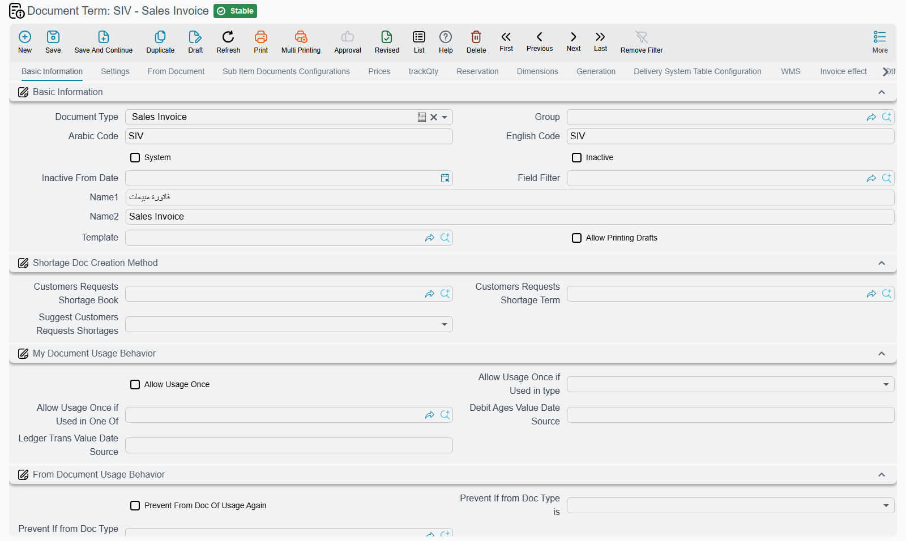

# General Configuration

A **Document Term** (توجيه المستند) is the main mechanism for customizing how a document type behaves in Nama — one document type can have several terms, each shaping its validation, generation, pricing, accounting and more. This **General** tab holds the term's identity (code, names, the document type it targets, active state, template flag and field filters) plus a few cross-cutting toggles that don't belong to any single feature area.

The rest of the term's behavior lives on the other tabs — From-Document, Sub-Item, Quantity Tracking, Reservation & Delivery, Pricing/Taxes/Discounts, Dimensions, Generation and Accounting Effects.

::: info Where to find it
Open the document's **Document Term** (توجيه), then the **General** tab.
:::

## Identity & Basic Information

These fields identify the term and define which document type it configures. They are shared by virtually every supply-chain term.

**Document Type** `documentType` — The entity type this term configures (e.g. StockReceipt). It drives which feature groups and document-specific options appear on the rest of the screen. Shown as a list column and a criteria field.

**Code / Alternative Code** `code`, `altCode` — The term's identifying code and an optional alternative code used to look it up.

**Name (Arabic) / Name (English)** `name1`, `name2` — The term's display names. `name1` is the Arabic name, `name2` the English name.

**System** `systemBookOrTerm` — Marks the term as system-owned. A system term is left out of the **Term** lookup on documents, so users cannot pick it by hand. Shown as a list column and a criteria field.

**Inactive** `inActive` — Disables the term so it can no longer be selected on new documents. Pair it with **Inactive From** `termInfo.inActiveFrom` to set the date on which it becomes inactive.

**Template** `template` — Marks the record as a template to be cloned when creating new terms, rather than used directly on documents.

**Allow Printing Drafts** `termInfo.allowPrintingDrafts` — Permits printing documents that are still drafts (not yet saved/committed).

**Field Filter** `filters` — Restricts which records the reference fields offer on every document that uses this term. It does not hide fields — see [field filters with criteria](/platform/field-filtering/field-filter-with-criteria).

## Shortage Document Creation

On a sales invoice, the **Add Current Line To Shortage Document** action (More menu) copies the selected line into a **Customers Requests Shortage Document**, recording demand the invoice could not meet. These three options must all be filled for the action to work.

**Customers Requests Shortage Book** `termConfig.customersReqsShortageBook` — The document book of the shortage document.

**Customers Requests Shortage Term** `termConfig.customersReqsShortageTerm` — The document term of the shortage document.

**Suggest Customers Requests Shortages** `termConfig.suggestCustomersReqsShortages` — How the action finds an existing shortage document to add the line to: **Date Only** (the first shortage document dated on or after the invoice date), **User Only** (one created by the current user, or with no creator), or **Date And User** (both). When none is found, a new one is created with this book and term.

## Product Status

**Change Product Status To** `termConfig.changeProductStatusTo` — Used when the document is created from a Service Center document that carries products (the cars or devices being serviced). On save, the document records a product status entry that sets those products' status to this value; deleting the document removes the entry.

## Cancellation

**Allow Cancel Even If It Has Non-System Related Stock Documents** `termConfig.allowCancelWithNonSystemRelatedStockDocs` — Lets a [Document Cancel Document](/platform/documents-and-records/document-cancel-document) cancel this document even when some of its stock documents are not final system-generated ones (created by hand, or generated as drafts). Without it the cancellation is refused with *Document {0} can not be cancelled, because it has non system related stock documents* — «المستند {0} لا يمكن إلغاؤه ، لأن له سندات مخزنية مرتبطة ليست نظامية». Applies to **Sales Invoice, Sales Return, Purchase Invoice and Purchase Return** only.

## Consolidated Purchase Request Lines

**Do Not Validate Lines With Purchase Req Lines** `termConfig.doNotValidateLinesWithPurchaseReqLines` — Skips the consistency check that the document's lines must match the originating purchase-request lines, allowing the lines to be edited freely. Applies to **Consolidated Purchase Request** only.
