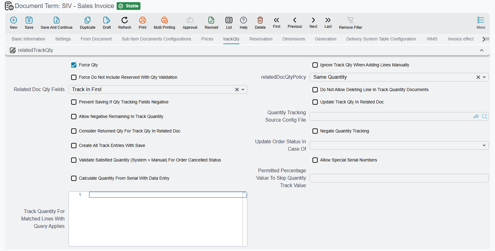

# Quantity Tracking Configuration

These settings control **quantity tracking** — the engine that links documents and records how much of a source document has been satisfied by the documents created from it (for example, how much of a Sales Order has been invoiced or delivered). The system keeps a tracking table of satisfied vs. remaining quantities and validates each new document against the policy you set here.

::: info Where to find it
Open the document's **Document Term** (توجيه), then the **Track Quantities** / **Related Doc Track Quantity** groups.
:::

::: tip Two policies, two directions
`trackInvoiceQuantity` is read from the **source** document's term: set it on the order's term to decide how much of that order the documents created from it (بناءً على) may satisfy. `relatedDocQtyPolicy` sits on the **later** document's term and is used only when **Force Qty** is ticked there and the source document's term leaves **Track Quantities** empty.
:::

## Tracking This Document's Quantities

This group is hidden entirely when the supply-chain configuration option to hide it is enabled; otherwise it is shown for all inventory document terms.

**Track Quantities** `termConfig.trackInvoiceQuantity` — The quantity-tracking policy of documents on this term, applied when other documents are created from them: it decides whether those documents together may satisfy more than this document's quantity.

**Track Invoice Quantity Fields** `termConfig.trackInvoiceQuantityFields` — Selects which quantity field (the first/primary quantity or the second quantity) the policy above is applied to.

**Update Qty at Save** `termConfig.updateQtyOnSave` — Controls which line quantity-tracking values are refreshed on every save: all values, only reservation-related values, or none.

The two policy fields above accept these values:

| Policy value (`trackInvoiceQuantity` / `relatedDocQtyPolicy`) | Label | Meaning |
|---|---|---|
| `LessQuantity` | Less Quantity | The total satisfied quantity may not exceed the source quantity (plus the **Permitted Percentage Value To Skip Quantity Track Value** of the later document's term). |
| `SameQuantity` | Same Quantity | The same limit as Less Quantity. |
| `MoreQuantity` | Over Quantity | The total satisfied quantity may exceed the source quantity. |
| `None` | None | No quantity tracking against this document; a later document's **Related Doc Qty Policy** is not used in its place. |

A save that pushes the total satisfied quantity of a source line over its limit is refused with *Satisfied quantity ({0}) greater than order quantity ({1})* — «الكمية المسلمة ({0}) أكبر من كمية المستند الأصلي ({1})».

The "fields" selectors above accept these values:

| Field selector (`trackInvoiceQuantityFields` / `relatedDocQtyFields`) | Meaning |
|---|---|
| `TrackInFirst` | Track against the first (primary) quantity. |
| `TrackInSecond` | Track against the second quantity. |

And `updateQtyOnSave` accepts:

| Value | Meaning |
|---|---|
| `None` | Do not refresh tracking values on save. |
| `UpdateAll` | Refresh all line tracking values. |
| `UpdateForReservation` | Refresh only reservation-related tracking values. |

## Tracking Related Documents' Quantities

This group is added for all inventory document terms. It governs how the document tracks its quantities back against the related (from/origin) document — and writes the satisfied amount back into it.

**Related Doc Qty Policy** `termConfig.relatedDocQtyPolicy` — The policy this document applies against its source document when **Force Qty** is ticked and the source document's term leaves **Track Quantities** empty. Uses the same values as `trackInvoiceQuantity`, and is required when **Force Qty** is ticked.

**Related Doc Qty Fields** `termConfig.relatedDocQtyFields` — Selects which quantity field (first or second) is tracked in that case.

**Force Qty** `termConfig.forceTrackQtyOfRelatedDocs` — Lets this document track its quantities against a source document whose term leaves **Track Quantities** empty, using **Related Doc Qty Policy**. When the supply chain option **Use System Table to Track Quantities** is on, a document creates quantity-tracking entries only when its term has **Force Qty** ticked.

**Ignore Track Qty When Adding Lines Manually** `termConfig.ignoreTrackQtyWhenAddingLinesManually` — Skips track-quantity validation and recording for lines the user adds by hand, rather than lines pulled from a linked document.

**Force Do Not Include Reserved With Qty Validation** `termConfig.forceDoNotIncludeReserved` — When validating available/remaining quantities, excludes already-reserved quantity from the calculation.

**Do Not Allow Deleting Line In Track Quantity Documents** `termConfig.doNotAllowDeletingLineInTrackQtyDocs` — Prevents deleting a line once it participates in quantity tracking, protecting the integrity of satisfied/remaining values.

**Prevent Saving If Qty Tracking Fields Negative** `termConfig.preventSavingIfQtyTrackingFieldsNegative` — Blocks the save when any tracked quantity field would become negative.

**Update Track Qty In Related Doc** `termConfig.updateTrackQtyInRelatedDoc` — On save, writes the satisfied quantity back into the related/source document's tracking values (for example, marking the Sales Order as partly invoiced).

**Allow Negative Remaining In Track Quantity** `termConfig.allowNegativeRemainingInTrackQty` — Permits over-satisfying: the remaining (un-satisfied) tracked quantity may go below zero.

**Quantity Tracking Source Config File** `termConfig.orderStatusQtyTrackConfig` — References a **Quantity Tracking Source Config File** (`OrderStatusQtyTrackConfig`) whose lines decide which quantity the document passes back to its source document — see [Specialized Scenarios](/modules/supplychain/specialized-scenarios).

**Negate Quantity Tracking** `termConfig.negativeQtyTrackValue` — Records the tracking quantity with a negated sign, used for return / reverse-direction documents.

**Create All Track Entries With Save** `termConfig.createTrackEntriesWithSave` — Creates all system quantity-tracking table entries immediately on save, rather than lazily on a later action.

**Update Order Status In Case Of** `termConfig.orderStatusWithQtyTrackType` — Chooses which tracked quantity field (first or second) drives automatic order-status updates — for example, changing the status when the first vs. second quantity is fully satisfied. Uses the `TrackQuantityFields` values.

**Validate Satisfied Quantity (System + Manual) For Order Cancelled Status** `termConfig.validateSatisfiedQtyWithCancelledOrderStatus` — When an order is set to Cancelled, validates that the satisfied quantity — both system-tracked and manually entered — is consistent before allowing the status change.

**Permitted Percentage Value To Skip Quantity Track Value** `termConfig.permittedPercentageToSkipQtyTrackValue` — A tolerance percentage by which the tracked quantity may be exceeded or skipped without triggering a track-quantity validation error.

**Track Quantity For Matched Lines With Query Applies** `termConfig.trackQtyForLinesMatchingQuery` — Restricts quantity tracking to the lines that match the given query/filter.

### Return-aware and stock-document tracking

These options apply only to specific document types.

**Consider Returned Qty For Track Qty In Related Doc** `termConfig.considerReturnQtyForTrackQtyInRelatedDoc` — Subtracts returned quantities when computing the satisfied quantity against the related document. Available only for Sales Invoice, Service-Center Sales Invoice, Purchase Invoice, and Service-Center Purchase Invoice terms.

**Deducting Track Quantity From Stock Document Quantity** `termConfig.deductTrackQtyFromStockDocQty` — Deducts the tracked quantity from the linked stock document's quantity, avoiding double-counting between the invoice and the stock receipt. Available only for Purchase Invoice and Service-Center Purchase Invoice terms.

**Allow Quantity Tracking for System Generated Documents** `termConfig.allowTrackQtyForSysGeneratedDocs` — When a Stock Issue or Stock Receipt is produced automatically by the system (a fully generated document spawned from another document's workflow), it normally sits outside quantity tracking — the system assumes its origin document already handled the tracking. Turn this on to bring those system-generated documents back into tracking, so they record and validate their satisfied/remaining quantities just like manually entered ones. Available only for Stock Issue and Stock Receipt terms.

## Serial & Special-Serial Handling

These options govern how serial numbers interact with quantity tracking and line-quantity entry.

**Allow Special Serial Numbers** `termConfig.allowSpecialSerialNumbers` — Allows special / non-standard serial numbers in the context of quantity tracking.

**Calculate Quantity From Serial With Data Entry** `termConfig.calcQtyFromSerialWithEntry` — Derives the line quantity from the count of serial numbers entered during data entry, so the quantity stays in step with the serials captured.
