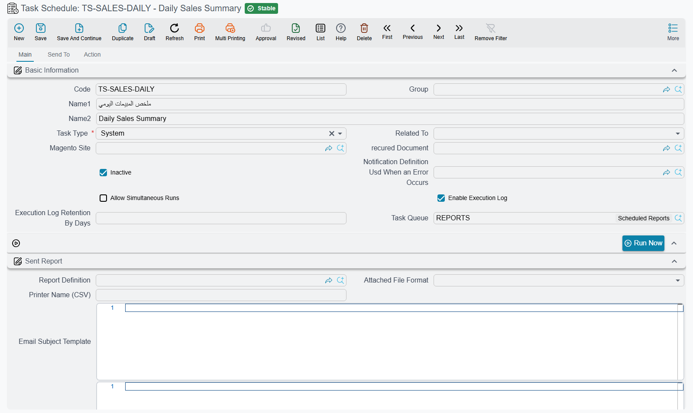

# Scheduled Tasks (Task Scheduler)

Task Scheduler lets you automate recurring operations in Nama ERP. Whether you need to send daily reports to managers, run system maintenance queries, generate recurring documents, or notify users when certain conditions are met, the Task Scheduler handles it all—running quietly in the background while you focus on your business.

A task starts running on its own schedule a few minutes after the server starts (see [Initial Delay](#Initial-Delay)), and you can also trigger any task instantly with the [Run Now](#Running-a-Task-on-Demand) button.



## Understanding Task Types

When you create a scheduled task, the first decision you'll make is choosing the **Task Type**. This determines what kind of action the task performs when it runs. Let's walk through each type:

### Report (Email Report)
A common use case. The system runs a report and emails it to the recipients you specify. You select a report definition, choose the output format (HTML, PDF, Excel, …), and decide who receives it.

### Print Report
On screen: **Report (Print)**. Like the Report type, but instead of emailing, the report is sent straight to a printer. You specify the printer name that's configured on the server.

### Notification
Sends notifications to users based on a query and one or more templates. You can target three channels at once:
- In-app notifications
- Email messages
- SMS messages

### System
Executes the native SQL statement in **Query** directly against the database; saving a System task with an empty **Query** is refused. Use this for maintenance operations, data cleanup, or batch updates. The statement runs as-is, so use it with care.

### Action
Runs a server action class. This is the most flexible option—you enter the fully qualified class name of the action and up to 15 parameters. The system validates the parameters before execution and shows a description of what the action does (and of each parameter it expects) directly on the screen. Instead of a class name, you can paste a Groovy script into **Groovy Script**: the task then runs the script, and **Class Name** shows the script's class name after saving. See [Groovy Script Examples](/entity-flows/groovy/) for ready-made scripts.

### Parameterized Report (Email)
On screen: **Parameterized Report**. A powerful variation of the Report type. Instead of running the report once, it first collects a set of parameter rows—either from a SQL query or from the **Parameters** grid—then runs the report once for every row. Each iteration can carry different parameter values and go to different recipients. See [Parameterized Reports](#Parameterized-Reports).

### Parameterized Report (Print)
The same as above, but each report iteration is sent to a printer instead of by email.

### Recurring Document
On screen: **Recur Document**. Automates the creation of recurring documents. You pick the definition in the **Recurring Document** field (required for this type), and it generates new documents according to the schedule.

### Read Magento Orders / Read Magento Returns
For e-commerce integration—pulls orders or returns from a configured Magento site. In a multi-site (replication) deployment, these run only on the head office or on the sites listed in **Run in Sites**.

### Purge Expired Reward Points
A specialized task for loyalty programs that removes expired reward points from the system.

### Read E-Invoice Notifications
On screen: **Read E Invoice Notifications From Intermediary Server**. For e-invoicing integrations—reads notifications back from the intermediary e-invoicing server.

## Scheduling Options

The scheduler offers two ways to express *when* a task runs: a friendly checkbox interface or direct cron-style fields. Whichever you choose, the result is the same underneath—the checkboxes are simply translated into the cron fields when you save.

### Simple Scheduling (Checkbox Mode)

When **Using Cron** is unchecked, you get an intuitive scheduling interface.

**Run Every X Minutes / Hours / Days / Months**
Set **Run Every (Count)** to a number and **Run Every (Unit)** to Minute, Hour, Day or Month. The pair replaces only the matching part of the schedule with "every N": the minute for Minute, the hour for Hour, the day of the month for Day, the month for Month. Every other part still comes from the time-of-day slots and the weekly and monthly ticks, and a part with nothing ticked means "every". So:
- 10 + Minute, no time slot ticked → every 10 minutes, all day
- 2 + Hour, with the 00:00 slot ticked → at minute 0 of every second hour
- 1 + Day, with the 08:00 slot ticked → once a day at 08:00

::: tip Tick a time slot with Hour, Day and Month
With Hour, Day or Month and no time slot ticked, the minute (and for Day and Month the hour too) is left open, so the task fires every minute of the matching hours or days. Tick one slot to pin the time. Without **Run Every**, a schedule with no time slot ticked runs at 00:00.
:::

**Weekly Schedule**
Check **Weekly**, then select which days of the week to run. Tick **On All Week Days** to run every day, or choose any combination of Saturday through Friday.

**Monthly Schedule**
Check **Monthly** and select:
- Which months to run (tick **On All Months**, or pick January through December)
- Which days of the month to run (tick **Run On All Days**, or pick 1st through 31st)

**Time of Day**
For weekly and monthly schedules, you specify exactly when during the day to run. Select any 30-minute time slots from 00:00 to 23:30.

### Advanced Scheduling (Cron Mode)

When **Using Cron** is checked, you fill in five separate scheduling fields directly. Each field controls one part of the timing:

| Field | Allowed values |
|-------|---------------|
| Minute | `0`-`59`, or `*` for every minute |
| Hour | `0`-`23`, or `*` for every hour |
| Day of Month | `1`-`31`, or `*` for every day |
| Month | `1`-`12` (or `JAN`-`DEC`), or `*` for every month |
| Day of Week | `0`-`7` where both `0` and `7` mean Sunday (or `SUN`,`MON`,`TUE`,`WED`,`THU`,`FRI`,`SAT`) |

Every field accepts the standard cron forms: a single value (`8`), a list (`1,3,5`), a range (`1-5`), or a step (`*/5`). A field left blank is treated as `*`. Each field must be a single token with **no spaces**.

::: info When exactly does it fire?
A task fires at the **start (second :00)** of every minute that matches all five fields. So `Minute = 0`, `Hour = 8` means "08:00:00 every day".
:::

**Common patterns:**
- Minute `0`, Hour `8` → every day at 8:00 AM
- Minute `*/30` → every 30 minutes
- Minute `0`, Hour `0`, Day of Month `1` → first day of every month at midnight
- Minute `0`, Hour `9`, Day of Week `1-5` → every weekday at 9:00 AM

If you enter an invalid combination, the task won't save—the system validates the schedule and answers *"Invalid cron expression. Error details: {0}"* (a field holding a space answers *"Schedule Fields can not have spaces"*).

## Running a Task on Demand

You don't have to wait for the next scheduled time. Open the task (or select tasks on the list) and click **Run Now** to execute it immediately—handy for testing a new task or re-running one after fixing a problem. A manual run is recorded in the [execution log](#Execution-Log) like a scheduled one, but it runs in your own session: when it fails, the error comes back to you on screen and no [error notification](#Error-Notification) is sent.

## Targeting Recipients

You have several ways to specify who receives reports and notifications, and they can be combined:

### Direct Email Addresses
Enter email addresses directly in the **E-mails** field, separated by commas or on separate lines.

### Target Reference
In **Reference**, select a single reference that resolves to one or more people:
- **Employee** → that specific employee
- **Organization Position** → all employees in that position
- **Master Group** → all members of the group
- **Special Responsible** → based on special-responsibility assignments

### Target Criteria
In **Criteria**, pick a [criteria definition](/platform/automation-and-rules/criteria-definitions) written for Employee: every employee it matches is a recipient.

### Target Lines
Add several references in the **Send To** grid on the **Send To** tab. Besides employees, positions, master groups and special responsibles, a line can name a security profile, a user or an employee group.

All of these are merged together: emails resolved from references, criteria, and target lines are combined with the direct **E-mails** into one recipient list.

## Parameterized Reports

This feature runs a single report many times with different parameters—ideal for sending each manager, customer, or branch their own tailored copy. Choose **Parameterized Report (Email)** or **Parameterized Report (Print)** as the schedule type.

There are two ways to supply the parameter rows:

1. **A SQL query** — put the query in the **Query** field and the column-name mapping in **Query Fields**. The report runs once per returned row. (If you leave **Query Fields** blank, the query's own column names are used.)
2. **The Parameters grid** — define rows manually instead of writing a query (see [Parameters Collection](#Parameters-Collection)).

::: warning One source only
You can't use both a **Query** and the **Parameters** grid on the same task: saving answers *"You can not specify query and parameters for the same task"*. Choose one.
:::

**Choosing the channel.** Each iteration respects two switches:
- **Send As Mail** (on by default) → emails the rendered report.
- **Send As Notification** → also sends the report as an in-app notification to each recipient that is a record (an employee, user, customer and so on) rather than a plain address in **E-mails**.

::: tip Skip the email when an iteration has no data
If you don't want a message sent for an iteration whose report comes out empty, control this in the **report template (JasperReports)** itself rather than in the task. Set the template's **"When No Data"** behavior to **No Pages** (instead of "Blank Page" or a "No Data" section). A report that produces no pages generates nothing to attach, so that recipient is simply skipped—no empty email goes out. This applies to the plain **Report** type as well.
:::

### Query result column conventions

When you drive the report from a query, special column names tell the system how to use each value:

| Column | Meaning |
|--------|---------|
| `subject` | The email subject line for that row |
| `sendto` | A plain email address to send that row to |
| `sendto#type` and `sendto#id` | A reference (employee/position/group) whose members receive that row |
| `parameterName#type` and `parameterName#id` | A reference value for the report parameter named `parameterName` |
| `parameterName` | A plain value for the report parameter named `parameterName` |

**Example: Employee Residency Expiration Alerts**

This sends a personalized report to each employee's supervisor about residency permits that are expiring.

**Query:**
```sql
select
  case when DATEDIFF(day, GETDATE(), residencyEnd) < 1
       then N'الاقامة انتهت منذ '
       else N'باقي علي انتهاء الاقامة '
  end + cast(ABS(DATEDIFF(day, GETDATE(), residencyEnd)) as nvarchar(100)) + N' يوم' as subject,
  'Employee' as sendto#type,
  supervisor_id as sendto#id,
  'Employee' as employee#type,
  id as employee#id
from Employee
where DATEDIFF(day, GETDATE(), residencyEnd) < 30
order by 2
```

**Query Fields:**
```
subject,sendto#type,sendto#id,employee#type,employee#id
```

This runs the report for each employee whose residency expires within 30 days, fills in the report's `employee` parameter, and emails the result to that employee's supervisor.

**Alternative: send to the employee's own email**

Replace the `sendto` reference columns with the employee's contact email:
```sql
select
  case when DATEDIFF(day, GETDATE(), residencyEnd) < 1
       then N'الاقامة انتهت منذ '
       else N'باقي علي انتهاء الاقامة '
  end + cast(ABS(DATEDIFF(day, GETDATE(), residencyEnd)) as nvarchar(100)) + N' يوم' as subject,
  contactInfoEmail as sendto,
  'Employee' as employee#type,
  id as employee#id
from Employee
where DATEDIFF(day, GETDATE(), residencyEnd) < 30
order by 2
```

## Query-Based Notifications

Use the **Notification** task type to send in-app notifications, emails, or SMS messages built from a SQL query. Fill in:

1. **Query** — a SQL query that returns the notification data. When it returns no rows, nothing is sent.
2. **Query Fields** — the comma-separated column names (optional; defaults to the query's own column names).
3. The **template(s)** for the channel(s) you want—Email, Notification, and/or SMS (see [Notification Templates](#Notification-Templates)). A channel is used only when its template is filled in.

The query's columns are data for the templates only; the `sendto` and `subject` column conventions of parameterized reports do not apply here. The recipients come from the **Send To** tab ([Targeting Recipients](#Targeting-Recipients)): with **E-mails** filled, the email goes once to that list together with the targets' addresses; with **E-mails** empty, each target employee gets an email of their own. In-app notifications and SMS messages go to each target employee.

To send each row, or each group of rows, to a different person, the template opens a separate message with `{openmsg}` … `{closemsg}` and names its recipient with `{sendto}…{endsendto}`: an employee's id or code for an in-app notification, an address for an email, a number for an SMS. The markup is described in [Tempo: Creating and Sending Messages](/admin/tempo#4-Creating-and-Sending-Messages).

**Example:** each supervisor receives one notification about their own employees whose residency ends within 30 days.
```sql
select e.code, e.name1, e.residencyEnd, s.code supervisorCode
from Employee e
join Employee s on s.id = e.supervisor_id
where DATEDIFF(day, GETDATE(), e.residencyEnd) < 30
order by s.code
```

Notification template:
```tempo
{loop()}
{header(supervisorCode)}
{openmsg}{sendto}{supervisorCode}{endsendto}
Residencies ending within 30 days:
{endheader}
{code} {name1} {residencyEnd}{enter}
{footer(supervisorCode)}
{closemsg}
{endfooter}
{endloop}
```

The query is ordered by the supervisor so that `header`/`footer` group each supervisor's rows into one message.

## Notification Templates

When using the Notification task type, you can configure templates for three channels:

**Email Template** — HTML content for the email body. Use placeholders like `{columnName}` to insert query-result values.

**Notification Template** — content for in-app notifications.

**SMS Template** — short text content for SMS messages.

Each template supports the complex-renderer syntax, with placeholders filled from the query results.

## Email Customization

### Subject and Attachment Name Templates
You can customize email subjects and attachment filenames using templates with placeholders:

- **Email Subject Template** — a template whose placeholders are filled from the report or query.
- **Email Subject Query** — a SQL query that supplies values for the subject template.
- **Attachment Name Template** — a template for the attached file's name.
- **Attachment Name Query** — a SQL query that supplies values for the attachment name.

### Output Format
**Attached File Format** picks the format of the report file attached to the email; left empty, it is HTML:
- HTML, PDF
- Excel (XLSX, XLS), Word (DOCX), RTF, PowerPoint (PPTX), OpenDocument (ODT, ODS)
- TXT — the report laid out as plain text
- CSV — the report's grid as comma-separated values
- JSON — one entry per printed line of the report, with its cells lined up under the column headers; useful when the
  file is read by another system rather than by a person

### Preferred Email Sender
In **Preferred Email Sender**, select a specific configured email sender to use for outgoing emails from this task.

## Monitoring & Error Handling

### Execution Log
Turn on **Enable Execution Log** to keep a history of every run. Each time the task executes—whether on schedule or via [Run Now](#Running-a-Task-on-Demand)—a new line is recorded in the **Task Schedule Execution Log** grid on the task, capturing:

- **Start Time** — when the run began
- **End Time** — when it finished
- **Status** — *Running* while in progress, then *Success* or *Failed*
- **Error Message** — a short reason when the run failed

This gives you an at-a-glance audit trail: you can confirm a task is actually firing on schedule, see how long each run takes, and spot a run that failed.

To stop the history growing without end — an every-minute job writes more than 1,400 lines a day — fill **Execution Log Retention By Days** on the task header. Each logged run then deletes this task's log lines older than that many days. Leave it at 0 or empty to keep every line.

### Error Notification
Configure **Notification Definition Used When an Error Occurs** to send an alert whenever a scheduled run fails. The field offers only notification definitions written for Task Schedule, and the chosen one must have **Manually** ticked, or saving answers *"The notification definition must be manual and for task schedule"*.

If no error notification is configured, the system notifies the **admin** user with the error details. A failed **Run Now** sends neither; its error is shown to you instead.

### Error Information
When a scheduled run fails, the error is carried by the notification described above: the admin notification shows a brief **Error Message** and the full technical trace (**Error Description**), and an error notification definition can show the same two values in its template. The **Task Schedule Errors (From Notifications)** list on the task shows the notifications raised for it.

## Advanced Options

### Task Queue

By default every scheduled task shares a single lane and runs in single file, so a task that overruns delays whatever was due next. Set **Task Queue** to move this task into a lane of its own: tasks on **different** queues run at the same time, tasks on the **same** queue never do, and a task with no queue stays in the default lane. Two tasks that write to the same data belong on the same queue. Creating queues, how the same queues carry deferred entity flows, and how many are worth having are on [Task Queues](/platform/background-processing/task-queues).

### Seeing what is scheduled and what is running

Two read-only pieces of information are available for every scheduled task:

- **Expected Next Run** — when the scheduler will fire this task next.
- **Currently Running** — whether it is executing at this moment.

They are read live from the running scheduler rather than stored on the task, so they appear only where the system can ask the scheduler for them: on the **Pending Task Schedules** list (**Administration → Settings**), which also has a **Task Queue** column, and on the **Queued Task Schedules** grid of each Task Queue. They are not available as columns on the task's own list view, and they are blank on a server that is not running scheduled tasks at all.

The Pending Task Schedules list is the fastest answer to "why has this task not run?" — a task that is scheduled appears there with its next run time; a task that does not appear is not scheduled at all, and the reason will be on the task itself (inactive, never committed, or restricted to other sites).

### Allow Simultaneous Runs
By default a run that starts while the same task is still running is refused, so the task never overlaps itself; **Run Now** then answers *"The task {0} is already running, please wait until it finishes"*. Enable **Allow Simultaneous Runs** to lift that guard, for example so that **Run Now** can start while a scheduled run is still going. Scheduled runs of one task still follow each other, because each queue runs its tasks one at a time.

### Run in Sites (Replication)
For multi-site deployments with replication enabled, you can specify in **Run In Sites** which sites should run this task. Left empty, the task runs on every site; with sites listed, it runs only on those. (Magento and similar integration tasks additionally restrict themselves to the head office unless sites are listed here.)

### Inactive
Check **Inactive** to temporarily disable a task without deleting it. The task stays in the system but won't be scheduled or run.

### Development Mode
By default, scheduled tasks don't run while the server is in debug mode. To enable task execution during development, add this to `nama.properties`:
```properties
run-task-schedules-in-debug-mode=true
```

### Initial Delay
Tasks don't start the instant the server starts—there's a 5-minute default delay so the system can settle first. Customize it in `nama.properties`:
```properties
tasks-initial-delay-minutes=10
```

## Implementation Repository Integration
Tasks can be saved to the Implementation Repository for deployment across environments:
- **Save To Implementation Repository** — include this task in exports.
- **System** — mark it as a system-provided task.

## Parameters Collection
For Parameterized Report tasks, you can define the parameter rows in the **Parameters** grid instead of a SQL query. Each line specifies:
- **Send To** — the recipient for this parameter set: an employee, user, customer, supplier, partner or third party.
- **P1 through P15** — the parameter values. Each can be a reference, a date/time, a static value, or a dynamic expression evaluated against the task.

For a report parameter that accepts several values, save the values once as a [Multi Value Report Parameter](/platform/reports/multi-value-report-parameters) and pick that record in the slot's **Ref** column.

The grid and a **Query** exclude each other, as described under [Parameterized Reports](#Parameterized-Reports).

## Practical Example Scenarios

### Daily Sales Summary to Management
- Type: Report
- Report: Daily Sales Summary
- Output Format: PDF
- Weekly: all weekdays selected
- Time: 08:00
- E-mails: management@company.com

### Monthly Invoice Reminders
- Type: Parameterized Report (Email)
- Query: select unpaid invoices older than 30 days, mapping each customer's email to `sendto`
- Report: Invoice Reminder Letter
- Monthly: all months, Day 1
- Each customer receives their own copy

### Nightly Database Maintenance
- Type: System
- Query: `EXEC sp_updatestats`
- Daily at 02:00
- No recipients needed

### Real-time Order Sync
- Type: Read Magento Orders
- Run Every (Count): 5, Run Every (Unit): Minute
- Magento Site: configured site reference
- Enable Execution Log to confirm each sync ran

## In practice

- About 9 in 10 Nama installations have scheduled tasks. A typical company runs around half a dozen,
  and the busiest more than twenty.
- **Action** is the most widespread type, found in about 3 in 4 of the companies that schedule tasks.
  **Notification** follows in more than half and **System** in about a third. Emailed **Report**
  tasks appear in about a quarter, and **Parameterized Report** in fewer than 1 in 10.
- Daily is by far the usual rhythm: about 8 in 10 companies have at least one daily task. More than
  half also have tasks that run several times a day, about a quarter run monthly tasks, and about
  1 in 5 run something every few minutes.

The tasks companies set up most often (shares are of companies that schedule tasks):

| What it does | Key settings | How common |
|---|---|---|
| Housekeeping: delete old files and old notifications, clear old files out of the server's temporary folder | [Action](#Action) tasks running [EADeleteOldFiles](/entity-flows/core/EADeleteOldFiles), [EADeleteNotificationsByDuration](/entity-flows/core/EADeleteNotificationsByDuration) and [EAEmptifyTomcatTemp](/entity-flows/core/EAEmptifyTomcatTemp), daily, outside working hours | about half |
| Warn finance about cheques and commercial papers falling due | A [Notification](#Query-Based-Notifications) task, daily, whose query reads `FinancialPaper` where `DATEDIFF(day, GETDATE(), dueDate)` is a few days, with each message addressed by `{sendto}` in the template | about 3 in 10 |
| Pull attendance from the attendance machine and calculate it | Action tasks running [EATimeAttendanceFromDBImporter](/entity-flows/hr/EATimeAttendanceFromDBImporter) and then [EAEmpAttendanceSysEntryCalculator](/entity-flows/hr/EAEmpAttendanceSysEntryCalculator), daily or hourly | about a quarter |
| Email a report on a schedule, such as daily sales or stock | A [Report](#Report-Email-Report) task with the output format and recipients filled in | about a quarter |
| Small SQL corrections at night: reclassify customers, set flags on employees or items | A [System](#System) task, daily | about a quarter |
| Warn about expiring residencies, IDs, contracts and licences | A Notification task on the end date, as in the residency example under [Query-Based Notifications](#Query-Based-Notifications) | about 1 in 5 |
| Re-save, recommit or run a flow over the records a query returns | Action tasks running [EARecommitFromQuery](/entity-flows/core/EARecommitFromQuery), [EASaveDraftsFromQuery](/entity-flows/core/EASaveDraftsFromQuery) or [EARunEntityFlowFromQuery](/entity-flows/core/EARunEntityFlowFromQuery) | about 1 in 5 |
