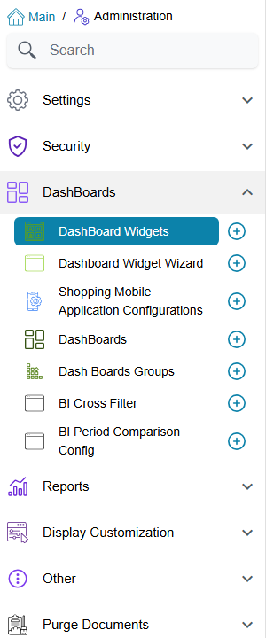

# BI Menus, Licence and Access

This page answers the three questions support hears first about dashboards: *where do I build
them*, *do we need a licence for them*, and *why can this user not see that chart*. There is no
separate BI security layer to learn. Dashboards are ordinary records, so the menu, the licence
and the security profile treat them exactly like any other screen, with two BI-specific twists
covered at the end.

## Where the BI screens live

Everything used to **build** dashboards sits in one menu group, *Administration → DashBoards*:

| Screen | Menu path | What it holds |
|---|---|---|
| **DashBoard Widget** | Administration → DashBoards → DashBoard Widget | One chart, table, card strip, calendar, report or other widget, with its SQL or wizard data source |
| **Dashboard Widget Wizard** | Administration → DashBoards → Dashboard Widget Wizard | A no-SQL data source that widgets can use instead of a query |
| **DashBoard** | Administration → DashBoards → DashBoard | The grid that places widgets, or a Tabbed dashboard that holds other dashboards |
| **Dash Board Group** | Administration → DashBoards → Dash Board Group | A hand-picked set of dashboards, used to put them on the menu |
| **BI Cross Filter** | Administration → DashBoards → BI Cross Filter | A shared filter (branch, date range, customer…) that slices several widgets at once |
| **BI Period Comparison Config** | Administration → DashBoards → BI Period Comparison Config | The "this period against last period" set-up used by comparison widgets |

How each one is used is in the [BI module guide](./bi-module-guide.md).

## The licence

The BI module has **no licence of its own**. All six screens above belong to the base licence,
`basic`, which every installation has. Any system can build and show dashboards, and a missing
dashboards menu is never a licence question: look at the menu and the security profile instead.

The licence only matters for what a widget *shows*. A widget is a query, so it reads whatever
tables it names whether or not the module that fills them is licensed; it simply finds nothing to
show when that module was never used.

## How users reach a dashboard

A user meets dashboards in three places.

**The home page.** The page a user lands on after signing in shows one dashboard. It is the
**DashBoard** chosen in the **Default Settings** of the user's own record; when that is empty,
the **DashBoard** chosen in the **Default Settings** of their security profile; when both are
empty, the home page shows no dashboard. So to give a whole team the same home dashboard, set it
once on their profile, and override it on the user record only for the exceptions.

**The menu.** A menu item opens dashboards in one of three ways (full details in
[Menu structure](/platform/menus/menu-structure)):

- an item of type **Dashboard** opens one dashboard;
- an item of type **Dashboards Group** lists every dashboard in a Dash Board Group as its own entry;
- an item of type **Auto Dash Boards** lists, as separate sub-menus, every Dash Board Group that has
  **Automatically Add To Menu** ticked. The menu that ships with the system already carries one, in a
  root folder named **DashBoards**, so a group with that tick appears there without anyone editing the
  menu. The steps are in [Dashboard Groups](./bi-module-guide.md#Dashboard-Groups----Putting-Dashboards-on-the-Menu).

**A record's screen.** A Screen Modifier can embed a dashboard on a page of any screen, fed with
the open record's values (**Page Dashboards**, see
[the Screen Modifier edit screen](/platform/screen-modifier/screen-modifier-edit-screen)).

If a dashboard entry is missing from one person's menu but not another's, it is a menu question,
not a BI one: work through [Who sees which menu](/platform/menus/menu-visibility).

## Who may build and change dashboards

The six screens are ordinary entity types, so the standard lines of a
[security profile](/platform/security/security-profiles) decide who may open, add, edit and delete
them. A typical set-up gives the dashboard designers add and edit rights on all six, and leaves
everyone else with view rights only, so they can open dashboards but not change a widget's query
or a dashboard's layout.

The edit right on **DashBoard Widget** also decides whether an AI assistant connected over MCP may
read the SQL a widget ran: it sees the SQL only when the user it signs in as may edit dashboard
widgets (see [Creating Dashboards with AI](./bi-module-guide.md#Creating-Dashboards-with-AI)).

## Hiding a widget or a tab from some users

The finer control is the record-level **View Capability**, the same one any record can carry
(**More → Change Capabilities**; how capabilities work is on
[Capability Types](/admin/users-counter-and-security-capabilities#Locking-one-record-with-a-capability)).
On BI records it behaves like this:

- **On a widget.** A user who does not hold the widget's View Capability simply does not get that
  widget. The rest of the dashboard draws normally and the widget's place stays empty; there is no
  message. Use it to keep, for example, a margin chart on the sales dashboard for managers only,
  without building a second dashboard for everyone else.
- **On a sub-dashboard of a Tabbed dashboard.** The tab still shows, so users can tell something is
  there, but opening it shows *You do not have permission to view this sub-dashboard.* instead of
  its widgets. This message has no Arabic text and appears in English on Arabic screens too.

Holding a record's **Update Capability** also counts as holding its View Capability, so the people
allowed to change a widget always see it.

::: tip Restrict the data, not only the widget
A View Capability decides whether a user sees a widget at all. It does not change what the widget's
query returns. When users should see the same chart but only their own branch's figures, bind the
widget to a branch cross-filter or filter the query on the signed-in user instead; see
[Cross-Filtering](./bi-module-guide.md#Cross-Filtering).
:::
