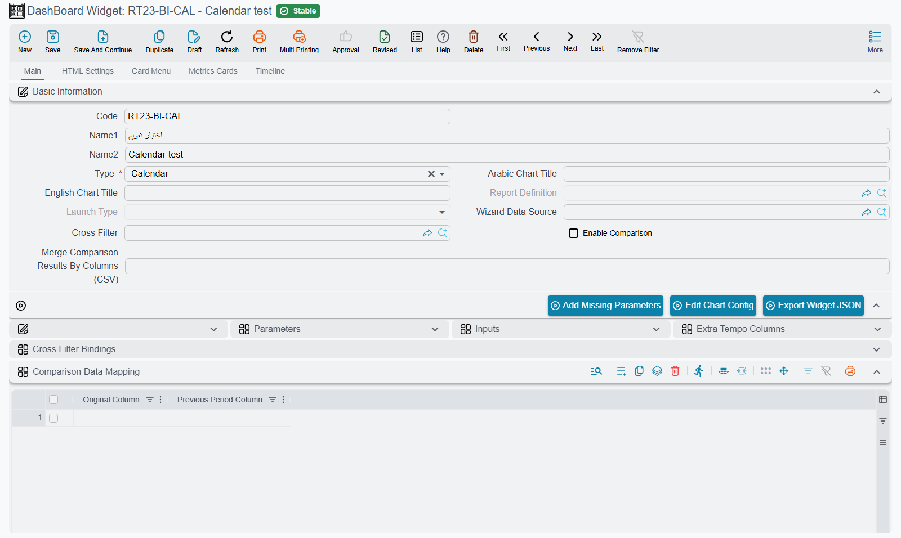
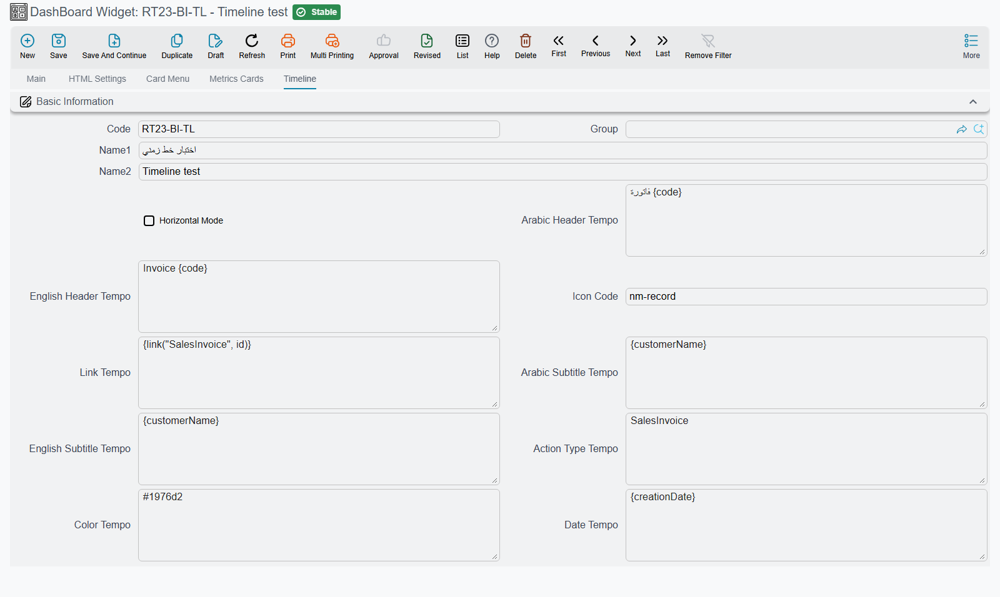
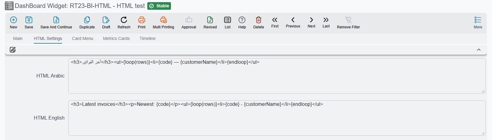
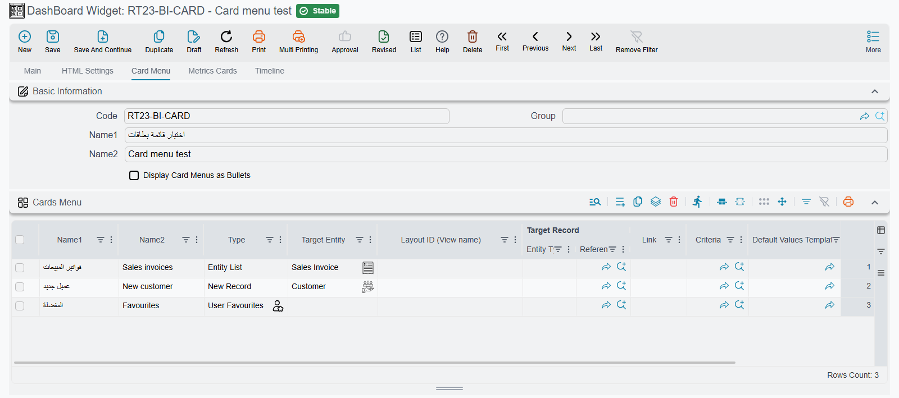

# BI Reference — Calendar, Timeline, Report and Other Widgets

Most dashboards are built from charts, tables and metric cards, and those have their own guides.
Seven older widget types fill the gaps between them: a **Calendar** and a **Resource View** for
anything with a start and an end, a **Timeline** for a stream of events, a **Report** that runs a
printed report inside the dashboard, an **HTML** block for free-form content built from a query,
a **Card Menu** of shortcut buttons and **Recent Visits**, which shows the screens a user opens
most. This page says when each one is the right choice and how to fill it in.

All seven are made on the **DashBoard Widget** screen (*Administration → DashBoards → DashBoard
Widget*): pick the **Type**, give the widget an **Arabic Chart Title** and **English Chart Title**,
and then fill the fields that type uses. They are placed on a dashboard like any other widget.

| Type | Use it for | Needs a query? |
|---|---|---|
| [Calendar](#Calendar) | Appointments, visits, deliveries, due dates on a month/week/day calendar | Yes |
| [Resource View](#Resource-View) | The same, laid out one row per person, room or machine | Yes |
| [Timeline](#Timeline) | A short history of events, newest or oldest first | Yes |
| [Report](#Report) | An existing report, shown inside the dashboard | No |
| [HTML](#HTML) | Free-form text or a list built from query rows | Optional |
| [Card Menu](#Card-Menu) | Big shortcut buttons to lists, new records, reports and dashboards | No |
| [Recent Visits](#Recent-Visits) | The screens this user opens most often | No |

::: info Timeline, Card Menu and Recent Visits need the new UI
Opened from the old interface, these three show a message that their type is supported in the new
UI only, with a link that opens the same dashboard there. Calendar, Resource View, Report and HTML
work in both.
:::

## The Parameters grid

Calendar and Resource View, and the link settings of several other types, are configured in the
**Parameters** grid on the main page of the widget. Each row pairs a fixed setting name with a
value, which is normally **the name of a column in your query**.

You do not type the setting names. Choosing the **Type** fills the grid with every row that type
understands, and the name column is read-only. If you changed the type, or the grid was emptied,
press **Add Missing Parameters** to bring the rows back: it adds what is missing and keeps the values
you already entered. In the value column, the screen suggests the column names of your query as you
type. Rows you do not need are simply left empty.

Column names are matched exactly, so `fromDT` in the query and `FromDT` in the grid do not match.

## Calendar

A **Calendar** shows each row of the query as an entry on a calendar with **month**, **week** and
**day** views; it opens on the current month. Use it whenever the question is *when*: technician
visits, delivery appointments, rental bookings, contract end dates, leave requests. Clicking an
entry opens the record behind it.

The query returns one row per entry. For an appointment list that could be:

```sql
SELECT s.id, 'SalesInvoice' entityType,
       s.code + ' ' + ISNULL(c.name2, '') title,
       CAST(s.creationDate AS datetime) fromDT,
       CAST(DATEADD(minute, 30, s.creationDate) AS datetime) toDT
FROM SalesInvoice s
LEFT JOIN Customer c ON c.id = s.customer_id
WHERE 1 = 1 /*AND-FILTERS*/
```

Then fill these rows of the Parameters grid with the column names:

| Setting | What to put in it |
|---|---|
| **Title** | The column whose text is shown on the entry |
| **FromDateTime** | The column holding the start date and time |
| **ToDateTime** | The column holding the end date and time. Left empty, each entry gets the calendar's default length |
| **LinkToType** and **LinkToID** | The column holding the entity type (such as `SalesInvoice`) and the column holding the record's id. Fill both, and clicking an entry opens that record |
| **URL** | Instead of LinkToType/LinkToID: a column holding a web address to open when the entry is clicked |
| **minTime** and **maxTime** | Not column names but fixed times, such as `08:00:00` and `18:00:00`. They limit the hours shown in the week and day views. Left empty, the whole day is shown |

The remaining rows (**FromDate**, **ToDate**, **FromTime**, **ToTime**) are an older way of
giving the start and end in separate columns. Leave them empty and use the two date-time rows.

::: tip Cast dates to `datetime`
Return the start and end as `datetime` values, as the example does with `CAST(... AS datetime)`. A
column that holds only a date, such as a document's value date, needs the cast to become a date and
time at midnight.
:::

The query takes cross-filters through its `/*AND-FILTERS*/` placeholder like any other widget, so a
branch or date-range filter on the dashboard narrows the calendar too.



## Resource View

A **Resource View** is the calendar turned sideways: one row per **resource** (a technician, a
room, a vehicle, a machine) and time running across, with **day**, **week** and **month** buttons;
it opens on the month. Use it when the question is *who is busy when*, for example to spot a free
technician or a double-booked room.

It takes every Calendar setting above, plus three of its own:

| Setting | What to put in it |
|---|---|
| **ResourceID** | The column that identifies the resource, such as an employee code. Entries with the same value share a row. A row whose ResourceID is empty is not placed on any resource |
| **ResourceName** | The column with the name shown at the start of the resource's row |
| **ParentResourceID** | Optional: the ResourceID of a parent, to group resources under a heading row, such as technicians under their team. The heading shows the parent's name when the parent is itself a resource in the query, and its ResourceID otherwise |

```sql
SELECT s.id, 'SalesInvoice' entityType, s.code title,
       CAST(s.creationDate AS datetime) fromDT,
       CAST(DATEADD(hour, 2, s.creationDate) AS datetime) toDT,
       c.code customerCode, c.name2 customerName
FROM SalesInvoice s
JOIN Customer c ON c.id = s.customer_id
WHERE 1 = 1 /*AND-FILTERS*/
```

Here **ResourceID** is `customerCode` and **ResourceName** is `customerName`, so each customer gets
its own row. Swap in your own tables: what matters is one row per booking, with the resource's
code and name on it.

## Timeline

A **Timeline** draws the query's rows as a chain of events, each with a heading, its date and
time, a short line of text and an icon. Use it for a story told in order, such as the last ten
invoices of the day, the steps of a project, or the latest changes on a customer's account. It
shows the rows in the order the query returns them, so end the query with the `ORDER BY` you want.

A Timeline does not use the Parameters grid. Its settings are on the widget's **Timeline** tab,
and each one is a [Tempo](/admin/tempo) template: write a column name in braces, `{code}`, to
use that column's value for each row.

| Field | What it does |
|---|---|
| **Horizontal Mode** | Ticked, the events run across the widget in a row; cleared, they run down it |
| **Arabic Header Tempo** / **English Header Tempo** | The heading of each event. When the event has a link, the heading is the link |
| **Arabic Subtitle Tempo** / **English Subtitle Tempo** | The line under the heading |
| **Date Tempo** | The event's date and time, normally just the column: `{creationDate}` |
| **Action Type Tempo** | A short label shown under the date. A known system name is translated, so `SalesInvoice` shows as *Sales Invoice* |
| **Icon Code** | The icon in the event's circle: a Material icon name such as `receipt`, or `{iconColumn}` to pick it per row |
| **Color Tempo** | The colour behind the icon, as `#1976d2` or `{colorColumn}` |
| **Link Tempo** | Where the heading leads. `{link("SalesInvoice", id)}` opens the record whose id is in the `id` column |

A worked example, for the latest invoices:

```sql
SELECT TOP 10 s.id, s.code, c.name2 customerName,
       CAST(s.creationDate AS datetime) creationDate
FROM SalesInvoice s
LEFT JOIN Customer c ON c.id = s.customer_id
WHERE 1 = 1 /*AND-FILTERS*/
ORDER BY s.creationDate DESC
```

with **English Header Tempo** `Invoice {code}`, **English Subtitle Tempo** `{customerName}`,
**Date Tempo** `{creationDate}`, **Action Type Tempo** `SalesInvoice` and **Link Tempo**
`{link("SalesInvoice", id)}`.

::: warning The Date Tempo must give a date and a time
The value has to read as a date followed by a time. A date-only column stops the widget with a message that starts *Error preparing chart: java.text.ParseException: Unparseable date*. Cast it in the query, `CAST(valueDate AS datetime)`, as the example does.
:::



## Report

A **Report** widget runs an existing report inside the dashboard, so a report that people open
every morning can sit beside the charts instead of in a separate window. It needs no query:

| Field | What to put in it |
|---|---|
| **Report Definition** | The report to run |
| **Launch Type** | **Direct** runs the report as soon as the dashboard opens and shows the result. **WithParamter** shows the report's parameters form inside the widget; the user fills it and runs the report from there |

Both fields are enabled only while the **Type** is Report, and choosing another type clears them.

Choose **Direct** for a report whose parameters all have sensible defaults, such as today's cash
position. Choose **WithParamter** when every user needs to pick something first, such as a customer
or a period. Give the widget a generous height either way, since a report needs more room than a
chart.

## HTML

An **HTML** widget shows content you write yourself, built from the rows of its query. Use it when
a chart is too much and a table too little: a sentence that reads *"23 orders are waiting for
dispatch, the oldest since Sunday"*, a short list of overdue tasks, or a block of instructions with
live figures in it.

The content is written on the widget's **HTML Settings** tab, in **HTML Arabic** and **HTML
English** (each user sees the one for their language). Both are [Tempo](/admin/tempo) templates
run over the query result:

- `{columnName}` gives that column's value from the **first row**;
- `{loop(rows)} … {endloop}` repeats its contents once **per row**.

For example, with the query

```sql
SELECT TOP 5 s.code, c.name2 customerName
FROM SalesInvoice s
LEFT JOIN Customer c ON c.id = s.customer_id
WHERE 1 = 1 /*AND-FILTERS*/
ORDER BY s.creationDate DESC
```

the template

```html
<h3>Latest invoices</h3>
<p>Newest: {code}</p>
<ul>{loop(rows)}<li>{code} - {customerName}</li>{endloop}</ul>
```

shows a heading, the newest invoice number and a list of all five.

The Parameters grid has one row for this type, **HTMLOpenInIFrame**. Left at `false`, the HTML is
placed straight into the dashboard and takes on the dashboard's own text style. Set to `true`, it is shown
in a separate frame of its own, which suits a complete page with its own styles.

::: tip HTML or Text Block?
For a heading or a fixed paragraph with no figures in it, use a **Text Block** widget instead: it
has a rich-text editor and needs no query. Use HTML when the content comes from the data. See
[TextBlock](./bi-module-technical-reference.md#9b-TextBlock-Widget).
:::



## Card Menu

A **Card Menu** is a block of large shortcut buttons, one per line of its grid. Put one on a
department's home dashboard so the screens that team uses every day are a single click away from
the figures they watch: *New Sales Order*, *Customers*, *Today's Deliveries*, the *Sales* reports.

It needs no query. Its lines are on the widget's **Card Menu** tab, and each line works like a menu
item:

| Column | What to put in it |
|---|---|
| Arabic and English name | The button's text in each language |
| **Type** and the target columns | What the button opens, exactly as for a menu item: a list, a new record (optionally with a **Default Values Template**), one record, a report, a dashboard, a link. See [What an entry can open](/platform/menus/menu-structure#What-an-entry-can-open) |
| **Icon Code** | A Material icon name. Left empty, an icon is chosen from the type |
| **Color** | The button's background colour. The text turns white or black to stay readable |

Four types turn one line into several buttons: **User Favourites** becomes a button per favourite of
the signed-in user, **All Reports** a button per report group, **Dashboards Group** a button per
dashboard in the group, and **Auto Dash Boards** a button per dashboard of every automatic group.

Tick **Display Card Menus as Bullets** to draw the buttons as a narrow vertical list instead of a
grid of cards, which fits a side column of the dashboard.

A Card Menu sizes itself to its buttons, so the height you give it on the dashboard is not used.



## Recent Visits

A **Recent Visits** widget shows the screens the user has opened most, grouped under the last day
they used the system, the day before, and earlier days. Each card names the screen or record, shows
roughly how often it was opened, and opens it again with one click. Once enough screens have been
opened three times or more, the ones opened only once or twice are left out, so the list stays
short. Opening a blank new record is not counted. It is a personal shortcut list
that builds itself, which makes it a good companion to a Card Menu on a home dashboard.

There is nothing to configure: choose the type, place it on the dashboard, and it fills up as the
user works. Its heading is always *Recent Visits*.

The list is kept by the browser, not on the server. It follows the browser rather than the user:
someone who signs in on a new computer starts with an empty list, and people who share one browser
see one shared list. Clearing the browser's site data empties it.

Like a Card Menu, it sizes itself to its content.
