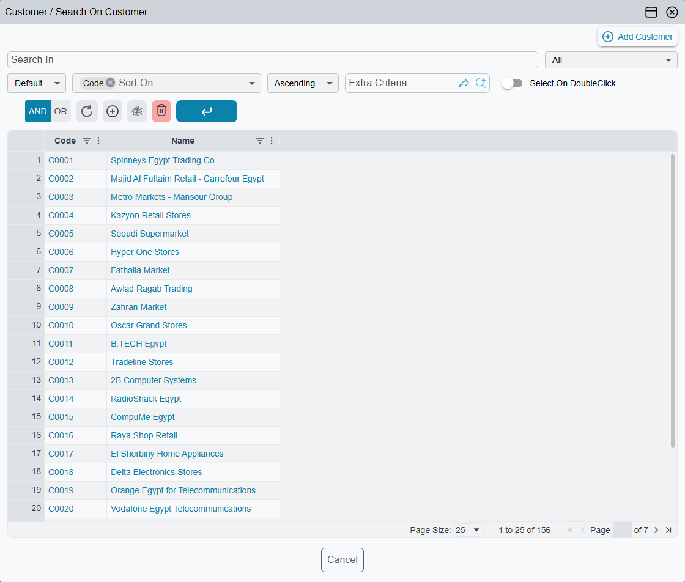
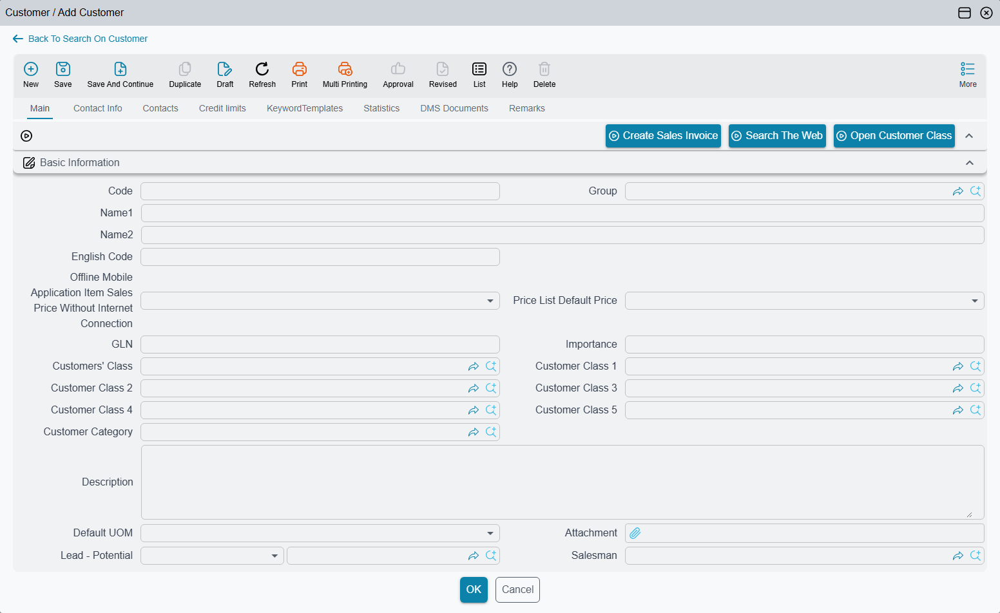

# Quick Create and Quick Edit from a Field

You are halfway through a sales invoice when the customer turns out not to exist yet. Leaving the invoice to open the Customer screen, saving the customer and coming back costs time and risks losing what you typed. Every reference field — the fields that point at another record, such as Customer, Item, Warehouse or Book — has a way round that: a pop-up window that searches for the record, creates a new one, or edits the one already chosen, and drops the result straight into the field.

## Opening the window

| How | What opens |
|---|---|
| The magnifier at the end of the field, or **F4** | The search page of the window. |
| The small arrow that appears at the end of an **empty** field | Straight into a new record (Quick Create). |
| **F8** | Straight into a new record, even when the field already has a value. |
| **F7**, or **Alt** + click on the magnifier | Straight into the chosen record for editing (Quick Edit). With the field empty, a new record. |
| **F6**, or **Ctrl** + click on the magnifier | No window: the chosen record — or a new one if the field is empty — opens in a new browser tab. |

Hovering over the magnifier shows these keys as a reminder. The full list of keyboard shortcuts is on [Keyboard Shortcuts](/platform/everyday-tools/shortcuts#Reference-Field-Shortcuts).

## Searching

The search page lists the records the field accepts, already narrowed by whatever the field itself would offer — the same dimensions, filters and criteria as typing in the field. Type in the **Search In** box to narrow the list further, select a row and press **OK**.

Above the list sit two buttons:

- **Add** *(record type)* — switches the window to a blank new record. It appears only for users allowed to create that kind of record.
- **Edit** *(the chosen record)* — switches to the record already in the field. It appears only when the field has a value and the user is allowed to edit that kind of record.

## Quick Create: a new record in the window

The window shows the record's own edit screen, so a customer created here is the same customer, with the same required fields and the same checks, as one created from the Customer screen. A few blocks that make no sense in a pop-up are left out.

1. Fill in the fields as you would on the full screen.
2. Press **OK**. The record is saved, and — if the field you came from can be edited — chosen in that field.
3. To go back to the list without saving, press **Back To** *Search On …* at the top. You are asked before anything you typed is thrown away.

When the new record is a book, a term, a group or a category opened from a document's field, Nama fills in the type it belongs to for you: a book created from the **Book** field of a sales invoice is already a sales invoice book.

A few fields go further and fill the new record from the screen you came from. A financial paper created from a payment voucher line starts with the voucher's party and amount; a lab test result created from a lab test request line starts with the patient and the admission. The user only adds what is missing.

::: tip Shaping the pop-up
The window uses the record's normal screen layout. To give it a shorter layout of its own — only the five fields a cashier needs to add a customer, for instance — create a Screen Modifier for that record type with **For Quick Creator View** ticked. See [Screen Modifier](/platform/screen-modifier/screen-modifier-overview).
:::

## Quick Edit: changing the chosen record

Quick Edit is the same window opened on the record already in the field. Correct the customer's phone number or the item's description, press **OK**, and the record is saved and stays chosen in the field. If the saved record fails a check, the window stays open with the error, exactly as the full screen would.

The window title always says where you are: the field you came from, followed by *Search On*, *Add* or *Edit* and the record. The buttons at the top right maximise the window or close it; **Esc** closes it too, asking first if there are unsaved changes.

## Picking several records in a grid

In a grid column — the Item column of an invoice's lines, for example — the search page lets you choose several records at once, and the **#** column at the start of each row says how many lines each one should produce. Typing a number in **#** also selects the row.

| Button | What it does |
|---|---|
| **OK** | Puts the first selected record in the current line and the others in the lines below it — reusing the lines that are there and adding new ones when the grid runs out — then closes the window. |
| **Insert** | The same as **OK**, but the window stays open for more. |
| **InsertAtEnd** | Adds the selected records as new lines at the end of the grid, each repeated as many times as its **#** says. The window stays open. |
| **Insert At End By Order** | Adds each selected record once at the end of the grid, in the order of the numbers typed in **#**. The window stays open. |

After each insert a message confirms how many lines were added:

*{0} Rows have been Inserted Successfully* — «تم إضافة {0} من السطور بنجاح»

## Opening a record from a dashboard

A dashboard chart whose points link to a record can open the clicked record in a pop-up window of the same kind, so it can be checked or corrected without leaving the dashboard. **Ctrl** + click opens it in a new tab instead.
