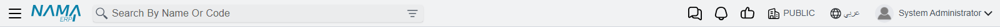
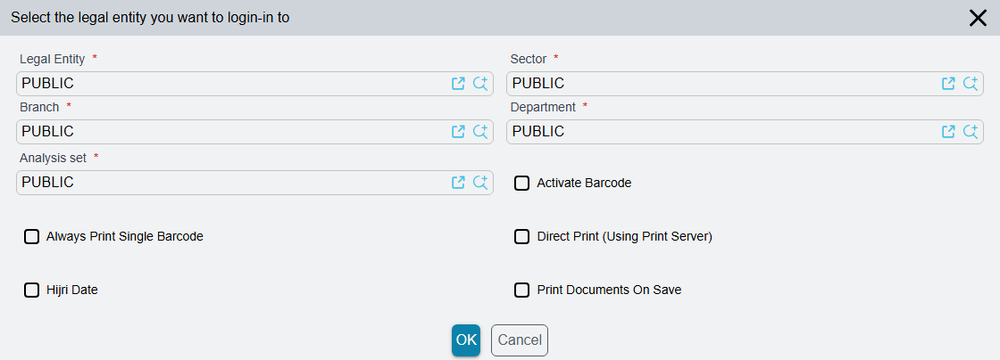
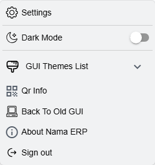

# The Top Bar and Your User Menu

The strip across the top of every screen is the one part of Nama that never changes as you move between modules. Most of it is a doorway to something documented elsewhere — the search box, the notification bell, the approvals list — but three things live only here: the **dimensions switcher** that changes which company or branch you are working in, the **language switch**, and the **user menu** under your name, which holds your profile, your password and your personal display preferences.

## What is on the bar

From one end to the other:

| Item | What it does |
|---|---|
| ☰ Menu button | Opens and closes the side menu. |
| Nama logo | Right-click it to open **About Nama ERP** — the version, build date, licence details and support end date. |
| Search box | Finds screens, records and fields from anywhere. **Ctrl + K** jumps into it. See [Searching From the Top Bar](/platform/everyday-tools/global-search). |
| Support badge | Shown only when the support contract is about to end (orange) or has ended (red). See [Licence and support contract are two different dates](/getting-started/licensing#Licence-and-support-contract-are-two-different-dates). |
| Progress icon | Appears with a count while actions you started are still running in the background. Click it to see how far each one has got. |
| AI assistant | Shown when the AI module is licensed and you are allowed to use it. See [The In-System AI Assistant](/modules/ai/ai-assistant). |
| Chat | Shown when you are allowed to use internal chat. See [Internal chat](/platform/notifications/bulk-messages-whatsapp-and-chat#Internal-chat). |
| Notification bell | Your latest unread notifications, and general announcements while one is running. **Mark As Read** clears the ones shown; **View All Notifications** opens the full list. See [Notifications](/platform/notifications/) and [General Announcements](/platform/notifications/general-announcements). |
| Approvals bell | Records waiting for your approval, with **View All Approvals** for the full list. See [Approvals](/platform/approvals/approvals-system). |
| Dimensions switcher | The name of the company you are logged in to. Click it to change company, branch, department, sector or analysis set — see below. |
| Language switch | Reads **عربي** in the English interface and **English** in the Arabic one. |
| Your name and picture | Opens the user menu — see below. |

On a phone the bar has no room for all of this. The search box, the support badge, the dimensions switcher, the language switch and the user menu move into a panel that slides down when you tap your picture at the end of the bar; tap the ✕ to close it.

## Changing company, branch or department

Every record you create is stamped with the dimensions of your session — the company, sector, branch, department and analysis set you are logged in to — and the lists you open are filtered by them. A user who serves two branches does not have to sign out and back in to move between them: the dimensions switcher on the top bar changes the session in place.

1. Click the company name on the top bar (its tooltip reads **Login Dimensions**).
2. The window **Select the legal entity you want to login-in to** opens with your current values already filled in: **Legal Entity**, **Sector**, **Branch**, **Department** and **Analysis set**.
3. Change the ones you need and press **OK**.

Everything you do after **OK** uses the new values: new records are stamped with them, and lists and lookups are filtered by them. The lookups inside this window offer what your **user record's** own dimensions allow, which is why a user fenced to the Jeddah branch on the user record never sees Riyadh in the list.

When the user record has **Prevent Modify Context** ticked, each value must be one listed on the user record — in the login context or in any row of the login context table. The values may come from different rows; a value that is on no row is refused with *Invalid authentication information, please re-login*. How those sets are defined is on [Record-Level Security](/platform/security/record-level-security#Login-Context-and-the-Alternate-Login-Context-Table).

The same window carries a few personal switches that belong to the session rather than to any one screen:

| Switch | What it changes |
|---|---|
| **Activate Barcode** | For scanning with a barcode reader. On item lines, each scanned code gets a quantity of 1 and the cursor moves on to the next line, ready for the next scan. |
| **Direct Print (Using Print Server)** | Printing goes straight to the printer through the print server instead of opening the print dialog. |
| **Hijri Date** | Date fields are shown as Hijri dates. |
| **Print Documents On Save** | A document is printed the first time it is saved, the same as when its book has print-on-save turned on. |

## Switching language

Click **عربي** (or **English** in the Arabic interface). The whole page reloads in the other language and comes back to the screen you were on. Because it is a reload, save the record you are editing first.

## The user menu

Click your name or picture to open it.

| Item | What it does |
|---|---|
| **Settings** | Opens your personal settings in a window — see the next section. Ctrl + click opens them in a new browser tab instead. |
| **Dark Mode** | Switches the interface between light and dark. |
| **GUI Themes List** | Picks one of the themes, with **Edit My Theme** at the end. See [Themes](/platform/everyday-tools/ui-themes). |
| **Qr Info** | Shows a QR code for setting up Nama's mobile apps on this server — the server address and your user code — with links to the apps on Google Play and the App Store. Only an administrator's QR (the `admin` user or a user with **Treat As Admin**) also carries the **Default Admin Pin** of the apps configuration. Scanning anyone else's QR leaves the phone's admin PIN as it was, and a new phone gets none, so an administrator scans their own QR on it or sets the PIN on the phone. |
| **Back To Old GUI** | Opens the screen you are on in the older interface, in a new browser tab. |
| **About Nama ERP** | The same About window as right-clicking the logo. |
| **Sign out** | Ends your session. |

### Settings

The **Settings** window has five tabs down its side.

**My Profile** shows your user code and your Arabic and English names, with your picture above them. The small button on the picture uploads a new one, or removes it — that picture is the one shown next to your name on the top bar. The names and code themselves are changed on the user record by an administrator.

**Edit Contact Info** changes three things on your own user record:

- **User Email** — your e-mail address.
- **Email Password** — the password of that mailbox. When both are filled in, documents and reports you send by e-mail from Nama go out from your own address instead of the company's sending account.
- **Mobile** — your mobile number.

**Reset Password** changes your login password: type the password you use now in **Current Password**, the new password in **Password** and again in **Confirm Password**, then **Save**. A wrong or empty **Current Password** is refused, so an unattended open session is not enough to take over the account. The **Change Password** window of the old interface asks for the current password the same way. The new password has to meet the company's password policy (see [Password policy](/platform/global-config/global-config-security#Password-policy)), and after a successful change you are signed out so that you log in again with it. Users who log in through LDAP or Active Directory change their password there, not in Nama.

**GUI Preferences** holds the display settings, which apply in this browser on this device only — the same user on another computer starts again from the defaults:

- **General Preferences** — **Density Mode** (normal, compact or ultra-compact spacing), **Dark Mode**, **Dark Nav Bar And Side Bar** and **Show Menu Icon Colors**.
- **Screens Preferences** — **Horizontal Mode** (label and field on the same row), **Quad Layout** (four fields to a row) and **Toolbar Labels** (titles under the toolbar icons). The **Screen Preview** beside them shows the effect on a sample screen as you switch.
- **Sound Effects** — a sound, or none, for notifications, approvals, chat messages and finished background tasks.
- **GUI Themes List** — the theme cards described on [Themes](/platform/everyday-tools/ui-themes).

**About** repeats the About Nama ERP information.

## Messages you may see

| Message | Why | What to do |
|---|---|---|
| *The current password is incorrect* — «كلمة المرور الحالية غير صحيحة» | **Current Password** is empty or is not the password you signed in with. | Type the password you use now. If you have forgotten it, ask an administrator to set a new one from your User record. |
| *New password and confirmed passwords do not match* — «كلمة المرور الجديدة لا تطابق تأكيد كلمة المرور» | The two password boxes differ. | Type the same password in both. |
| *New password is the same as old password, please use a different password* — «كلمة المرور الجديد مطابقة للحالية. يرجى استعمال كلمة مرور مختلفة.» | The company forbids reusing the current password. | Choose a different password. |
| *Password length must be greater than or equal {0}* — «طول كلمة المرور يجب ان يكون اكبر من او يساوي {0}» | The password is shorter than the policy allows. | Use at least the number of characters shown. |
| *Password must contains at least {0} Alphabetic Characters* — «يجب أن تحتوي كلمة المرور علي الأقل علي {0} من الحروف» | Too few letters. | Add letters. |
| *Password must contains at least {0} Numeric Characters* — «يجب ان تحتوي كلمة المرور علي الأقل علي {0} من الحروف الرقمية» | Too few digits. | Add digits. |
| *Password must contains at least {0} Special Characters* — «يجب أن تحتوي كلمة المرور علي الأقل علي {0} من العلامات أو الحروف الخاصة » | Too few symbols. | Add symbols such as `@` or `#`. |
| *Password must contains upper and lower case characters* — «يجب أن تحتوي كلمة المرور علي حالة الحروف الكبيرة والصغيرة» | The policy needs both capital and small letters. | Mix capital and small letters. |
| *Changing password is not supported for LDAP users* (English only) | Your login is checked against LDAP or Active Directory. | Change the password in your company directory. |
