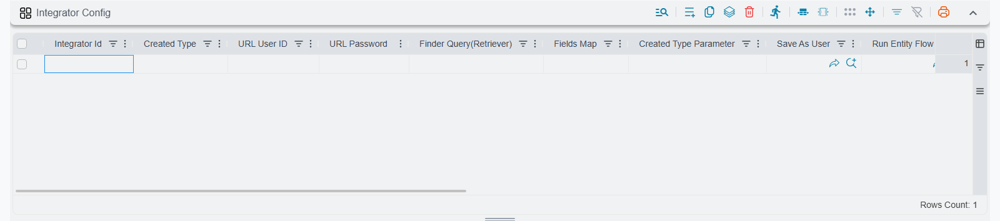

# Integrators and Public Links

Almost everything on this screen changes how Nama behaves for people who are already signed in. Three grids do something different: they open a door to the outside world.

Two of them let an external system — a web shop, a shipping company, a mobile application — push data into Nama through a named web address, without a person sitting at a screen. The third publishes a document back out, so a customer can follow a link in an SMS, or scan a QR code on a printed invoice, and download their own copy as a PDF with no Nama login at all.

Because all three are reachable from outside your network, the authentication columns on them are not decoration. Read this page carefully before you fill any of them in.

## Integrator Config

A web shop takes an order at two in the morning. Nobody is going to key it into Nama. What you want is an address the shop's software can call, handing over the order's data, so that a Sales Order appears in Nama immediately — and if the shop retries the call because its first attempt timed out, you want the same order updated, not a second copy created.

That address is what a line in this grid defines. You give the endpoint a name, decide what record type it creates, describe how the incoming values land on the record's fields, and hand the resulting address to whoever is writing the calling program.

| Column | What it does |
|---|---|
| Integrator Id | **Required.** The name of the endpoint. It appears in the address the external system calls, so it must be unique across the whole system. |
| Save As User | The Nama user the created record is saved as. Everything the endpoint does happens with this user's permissions. |
| URL User ID | The user name the caller must send in the address. |
| URL Password | The password the caller must send in the address. |
| Authenticate From URL User and Pass | The caller sends real Nama login details in the address instead of using the two columns above. |
| Authenticate From Session | The caller is already signed in to Nama in the same browser, and that session is used. |
| Integrator URL | Filled in by the system. This is the address to hand to the external system. |
| Response Fields (CSV - write mode) | The fields of the saved record to send back to the caller, separated by commas. |
| Created Type | The record type the endpoint creates — Sales Order, Customer, Stock Issue, and so on. |
| Created Type Parameter | An extra value passed along with the type, when the type on its own is not enough to decide what to build. |
| Finder Query(Retriever) | A query that looks for an existing record matching the incoming data. |
| Fields Map | Describes how the incoming values map onto the record's fields. |
| Response Template (Tempo) | Shapes the reply sent back to the caller, written in Tempo. |
| Close Browser Window | For endpoints opened in a browser tab: closes the tab when the call finishes. |
| Run Entity Flow | Hands the incoming data to an entity flow instead of filling fields directly. |
| Export Integrator | Marks the line as one that sends data out rather than taking data in. |
| Create Only (No-Updates) | The endpoint may create a record but must never touch an existing one. |

### The columns that decide whether calling twice is safe

**Finder Query(Retriever)** is the single most important column here. Without it, every call is a fresh record: the shop retries once and you have two identical Sales Orders. With it, the endpoint first looks for an existing record matching the incoming data — the same shop order number, the same customer reference — and updates that record instead of creating a new one. A well-written finder query is what makes an endpoint safe to call over and over, which is exactly what happens the moment a network hiccups.

**Create Only (No-Updates)** forces the opposite behaviour, and it is a deliberate choice, not a shortcut. With it ticked the endpoint refuses to touch an existing record: it either creates something new or fails. Use it where a repeat call should be treated as a mistake rather than a correction — an endpoint that records incoming payments, for instance, where quietly overwriting yesterday's payment would be far worse than an error message.

### Filling fields, or running a flow

**Fields Map** is the normal way to describe what the incoming data means: this value from the caller goes into the customer field, that one into the quantity on the first line, and so on.

**Run Entity Flow** is for when the work is more than filling fields — when the incoming data has to be looked up, converted, split across several records, or validated against something else first. The endpoint hands the data to an entity flow and lets the flow do the work. See [Introduction to Entity Flows](/platform/entity-flows/introduction-to-entity-flows) for how flows are written.

**Response Fields (CSV - write mode)** and **Response Template (Tempo)** shape what the caller gets back. Response Fields is the simple version: list the fields of the saved record you want returned, separated by commas — usually the code and the internal identifier, so the web shop can store the Nama document number against its own order. Response Template is the full version, written in Tempo, for when the caller expects a reply in a particular shape.

**Close Browser Window** only matters for endpoints a person opens in a browser tab rather than a program calls in the background — a link on an internal page that fires an action, for example. When the call finishes, the tab closes itself instead of leaving a blank page behind.

### The address the caller uses

Once the line is saved, the **Integrator URL** column shows the address, built from the endpoint's name and the credentials you entered. It follows this shape:

```
https://<your server>/erp/integrator?integrator=<Integrator Id>&user=<URL User ID>&pass=<URL Password>&authenticate=[true/false]&mode=[read/write]
```

`mode=read` asks the endpoint for data; anything else writes. The address the system builds for you is a template with your server name filled in as a placeholder — replace it with the real address of your server before handing it over.

::: warning Rules the screen enforces when you save
**The Integrator Id must be unique across the whole system.** Not just within this grid, and not just within this record — the check looks at every Integrator Config line and every Import Integrators line in every record in the database. If a name is already taken anywhere, the save is rejected.

**Choose one authentication style and stick to it.** Either you fill in **Save As User**, **URL User ID** and **URL Password** together — all three are then required — or you tick **Authenticate From URL User and Pass** or **Authenticate From Session** and leave all three empty. Mixing the two is rejected on save.

**Fields Map must be empty when Run Entity Flow is used.** Pick one or the other: either the endpoint fills fields from a map, or it hands everything to a flow. Filling both is rejected.
:::



## Import Integrators

This is the import-flavoured twin of the grid above. Instead of a single record's worth of values, the caller sends a **file** — a JSON payload or an Excel sheet — and the endpoint runs it through Nama's normal record import. A supplier sends a price list every night; a shipping company sends the day's delivery statuses as a spreadsheet; a branch system uploads a batch of stock counts. Nobody opens the import screen.

The first eight columns are the same as the grid above and behave identically: the endpoint's name, the credentials, the generated address, and the fields to return. What is added is everything the import screen would normally ask a person.

| Column | What it does |
|---|---|
| Integrator Id | **Required.** The endpoint name, unique across the whole system. |
| URL User ID / URL Password | The credentials the caller sends in the address. |
| Save As User | The Nama user the imported records are saved as. |
| Authenticate From URL User and Pass / Authenticate From Session | The alternative authentication styles, as above. |
| Integrator URL | Filled in by the system — the address to hand to the external system. |
| Response Fields (CSV - write mode) | The fields of each saved record to return. Left empty, the code and the internal identifier are returned. |
| Importing Type | **Required.** JSON or Excel — the format the caller will send. |
| Add | New records may be created. |
| Update | Existing records may be updated. |
| Ignore not found references | A reference that cannot be resolved is left empty instead of failing the row. |
| Continue On Errors | A bad row is skipped and the rest of the file continues. |
| Trim Extra Spaces | Stray spaces around incoming values are removed. |
| Save As Draft | The result is saved as a draft for someone to review rather than committed. |
| Use User Dimensions While Importing | The importing user's dimensions are applied to the imported records. |

Those seven switches are exactly the choices the interactive import screen puts in front of a person — and here they are fixed in advance, so the external system does not have to send them and cannot get them wrong. The quickest way to understand what each one really does is to read the import documentation first and then come back: [Importing Records](/platform/import-export/importing-records) covers the basics, and [Advanced Record Import](/platform/import-export/advanced-record-import) covers the harder cases such as unresolved references and partial failures.

Two of them deserve a moment's thought before you tick them. **Continue On Errors** decides whether one bad row ruins a two-thousand-row file or is simply reported and skipped; for a nightly price list, skipping is almost always right, but for a batch of financial documents a full stop is safer. **Save As Draft** turns the endpoint into a proposal rather than a decision — the records land in Nama but wait for a human before they count. That is the setting to reach for while you are still learning to trust a new integration.

::: tip An integrator that looks right but is never found
The line is only picked up when its **Inactive** column holds an explicit "no". A line created before this screen started tracking that column may have nothing stored there at all, and the endpoint will report that no integrator matches — even though the line is sitting there on screen looking perfectly correct.

The fix takes seconds: open the record, save it once, and the column is filled in. If a configuration looks right and is not being found, re-save the record before investigating anything else.
:::

## Invoice Retriever Lines

A customer wants their invoice. They do not have a Nama login and never will. You could e-mail a PDF, but then somebody has to generate and attach it, and if the invoice is corrected afterwards the copy in the customer's inbox is quietly wrong.

This grid turns a printed form into a public web address. Put that address in an SMS, in an e-mail, or behind a QR code on the printed invoice, and the customer opens their own document as a PDF the moment they follow it — no login, no attachment, no one in the middle.

| Column | What it does |
|---|---|
| Print Using System Defined Printing Form | Print each document with the form the system would pick for it when printed from its own screen, instead of one fixed form. Leave **Report Definition** empty when you tick it. |
| Report Definition | The printed form to run when the link is opened. Required unless the line prints using the system defined printing form, and must stay empty when it does. |
| Save Files In Folder | **Required.** The folder on the server where the generated files are kept. |
| URL Prefix | A word in the address that selects this line, so one system can publish several kinds of document. |
| Output Format | PDF, DOCX, ODS, ODT or XLSX. PDF is the sensible choice for anything a customer opens. |
| Do Not Cache | Regenerate the file on every visit instead of serving the stored copy. |
| Entity Type | Limits a system defined form line to documents of this type. Must stay empty on a line with a Report Definition. |
| Entity Type List | Limits a system defined form line to documents whose type is in this list. Must stay empty on a line with a Report Definition. Fill one, both or neither: with both, a document matching either is accepted; with neither, the line serves every type. |

### Printing with the system defined form

Without this option, every document type you publish needs its own report definition and its own line, even though the same form already prints that document from its screen. Tick **Print Using System Defined Printing Form** and one line serves them all: when a link is opened, the system loads the document and picks its form exactly as the Print button would — by entity type, book, term, document category, dimensions and form criteria — then prints it in the line's output format.

Two differences from printing on the screen come from the link having no signed-in user:

- A form restricted to a user, user group or security profile is never picked, nor is a form restricted to a menu. The document gets its general form.
- Draft documents follow the same draft printing rules as the Print button. Where drafts may not be printed, the link refuses them until the document is committed.

If no form matches the document, the link answers with an error instead of a file.

### Limiting a line to some entity types

**Entity Type** and **Entity Type List** keep a system defined form line from serving documents it was not meant for. They are only allowed on such a line: a line with a Report Definition already serves just the documents its form was built for.

A line is chosen by its prefix and then by the document's type: if the first line whose prefix matches does not accept the document's type, the next matching line is tried. So two lines can share a prefix — a system defined form line limited to the types you publish, followed by a line that runs a fixed form for whatever else arrives on that address.

Always fill one of these columns on a system defined form line. Without them it will print any document whose link has ever been generated — payroll and HR documents included.

### Caching, and when to turn it off

The first time someone opens the link, the form runs and the result is stored in the folder you named. Every later visit serves that stored file, which is why the link stays fast even if the underlying report is heavy. It also means the document is frozen: if the invoice is corrected next week, the customer still sees the version generated on the first click. (Deleting the file from the folder by hand forces it to be regenerated.)

**Do Not Cache** removes that freeze. The form runs on every single request, so the customer always sees the current state of the document. It is slower and it puts real work on the server each time the link is opened — the right trade for a document that can still change, such as a running statement of account, and the wrong one for a finalised invoice that thousands of customers might open.

### The public address

The address is your server, then `/r/`, then an identifier that stands for one specific document. Every record in Nama can produce that identifier on demand, and you insert it into the link using the `{retrieverFileId}` variable when writing a notification. The simplest form is:

```
https://<your server>/erp/r/{retrieverFileId}
```

Adding an extension makes browsers treat the download more sensibly, and the document's own code can ride along after a dot when you want it visible in the address itself — everything from the first dot onwards is ignored when the link is resolved:

```
https://<your server>/erp/r/{retrieverFileId}.pdf
https://<your server>/erp/r/{retrieverFileId}.{code}.pdf
```

The code must come **after a dot, not after a slash**: the last path segment is what the server reads as the identifier, so `…/{retrieverFileId}/{code}.pdf` makes it read the document's code instead and the link never resolves. The saved file is named after the document's code in either case.

And if the line has a **URL Prefix** — say `invoices` — that word goes in front of the identifier:

```
https://<your server>/erp/r/invoices/{retrieverFileId}
```

That prefix is what lets one system publish more than one kind of document: a line with prefix `invoices` running the invoice form, another with prefix `receipts` running the receipt form, each reached by its own address. The link reaches the customer in an ordinary notification — an SMS or an e-mail whose text carries the `{retrieverFileId}` variable, for example:

```
Thanks for visiting us, view your invoice by clicking on this link:
https://<your server>/erp/r/{retrieverFileId}
```

[Nama ERP Notification System](/platform/notifications/notifications-system) covers how that notification is set up.

::: warning Line order matters, and an empty prefix swallows everything
Lines are matched **in the order they appear in the grid**, and the first line whose prefix matches the incoming address wins. A line with an **empty URL Prefix** matches every address there is.

So if you use one, put it **last**. An unprefixed line sitting above your `invoices` and `receipts` lines will answer every request that was meant for them, and every customer will receive the same document type no matter which link they followed.
:::

The forms these lines run are ordinary printed forms, designed and maintained in the usual place — see the [Jasper Reports Complete Guide](/platform/reports/reports-guide) — and the server-wide printing and output settings that affect them live under [Reports and Printing](/platform/global-config/global-config-reports).

## Security note

Every other grid on this screen adjusts what a signed-in user sees. These three create routes into and out of the system that bypass the login screen entirely, which changes what a mistake costs.

The account named in **Save As User** is the one that actually does the work — it creates the Sales Orders, it commits the imported records. If that account is an administrator, then anyone who learns the endpoint's user name and password can do anything an administrator can do. Give integration accounts a security profile that permits exactly the records the integration touches and nothing else, and use a different account for each integration so that one leaked password does not open all of them.

The same logic applies to the invoice links. They are deliberately public: anyone holding the address can download that document without signing in. That is the point of the feature, and it is fine for a customer's own invoice — but it is worth remembering when choosing which forms to publish, because the address is the only thing standing between the document and whoever the customer forwards the message to. A line that prints using the system defined printing form publishes every type it accepts, so give it an **Entity Type** or **Entity Type List**.

[Security System Overview](/platform/security/security-overview) explains how permissions are structured, and [Security Profiles](/platform/security/security-profiles) is where the restricted account is actually built.

All three grids are applied by the server, so changes take effect as soon as the record is saved — no restart, and nothing to press.

## Settings on this tab

Every grid and column this page covers, with its exact on-screen label in both languages, so you can find a setting by the name you see. The last column points to the section that explains it. The scope columns (For Type, Entity List, On Field and the like) are the same on every grid and are listed on the [overview page](/platform/fields-and-entities-settings/fields-settings-overview#Settings-on-this-tab).

| Field id | English label | Arabic label | Meaning |
|---|---|---|---|
| `integratorConfig` | Integrator Config | Integrator Config | [Integrator Config](#Integrator-Config) |
| `integratorConfig.integratorId` | Integrator Id | Integrator Id | [Integrator Config](#Integrator-Config) |
| `integratorConfig.createdType` | Created Type | نوع المستند المنشأ | [Integrator Config](#Integrator-Config) |
| `integratorConfig.urlUserId` | URL User ID | URL User ID | [Integrator Config](#Integrator-Config) |
| `integratorConfig.urlPassword` | URL Password | URL Password | [Integrator Config](#Integrator-Config) |
| `integratorConfig.finderQuery` | Finder Query(Retriever) | Finder Query(Retriever) | [Integrator Config](#Integrator-Config) |
| `integratorConfig.fieldsMap` | Fields Map | Fields Map | [Integrator Config](#Integrator-Config) |
| `integratorConfig.createdTypeParam` | Created Type Parameter | Created Type Parameter | [Integrator Config](#Integrator-Config) |
| `integratorConfig.saveAsUser` | Save As User | Save As User | [Integrator Config](#Integrator-Config) |
| `integratorConfig.runEntityFlow` | Run Entity Flow | Run Entity Flow | [Integrator Config](#Integrator-Config) |
| `integratorConfig.exportIntegrator` | Export Integrator | Export Integrator | [Integrator Config](#Integrator-Config) |
| `integratorConfig.createOnly` | Create Only (No-Updates) | Create Only (No-Updates) | [Integrator Config](#Integrator-Config) |
| `integratorConfig.authenticateFromURL` | Authenticate From URL User and Pass | Authenticate From URL User and Pass | [Integrator Config](#Integrator-Config) |
| `integratorConfig.authenticateFromSession` | Authenticate From Session | Authenticate From Session | [Integrator Config](#Integrator-Config) |
| `integratorConfig.integratorUrl` | Integrator URL | Integrator URL | [Integrator Config](#Integrator-Config) |
| `integratorConfig.responseFields` | Response Fields (CSV - write mode) | Response Fields (CSV - write mode) | [Integrator Config](#Integrator-Config) |
| `integratorConfig.responseTemplate` | Response Template (Tempo) | Response Template (Tempo) | [Integrator Config](#Integrator-Config) |
| `importIntegratorLines` | Import Integrators | Import Integrators | [Import Integrators](#Import-Integrators) |
| `importIntegratorLines.integratorId` | Integrator Id | Integrator Id | [Import Integrators](#Import-Integrators) |
| `importIntegratorLines.urlUserId` | URL User ID | URL User ID | [Import Integrators](#Import-Integrators) |
| `importIntegratorLines.urlPassword` | URL Password | URL Password | [Import Integrators](#Import-Integrators) |
| `importIntegratorLines.saveAsUser` | Save As User | Save As User | [Import Integrators](#Import-Integrators) |
| `importIntegratorLines.authenticateFromURL` | Authenticate From URL User and Pass | Authenticate From URL User and Pass | [Import Integrators](#Import-Integrators) |
| `importIntegratorLines.authenticateFromSession` | Authenticate From Session | Authenticate From Session | [Import Integrators](#Import-Integrators) |
| `importIntegratorLines.importingType` | Importing Type | نوع الاستيراد | [Import Integrators](#Import-Integrators) |
| `importIntegratorLines.addRecord` | Add | إضافة | [Import Integrators](#Import-Integrators) |
| `importIntegratorLines.updateRecord` | Update | تحديث | [Import Integrators](#Import-Integrators) |
| `importIntegratorLines.ignoreUnfoundRefs` | Ignore not found references | تجاهل مراجع السجلات الغير موجودة | [Import Integrators](#Import-Integrators) |
| `importIntegratorLines.continueOnErrors` | Continue On Errors | المتابعة عند حدوث خطأ | [Import Integrators](#Import-Integrators) |
| `importIntegratorLines.trimExtraSpaces` | Trim Extra Spaces | حذف المسافات الزائدة | [Import Integrators](#Import-Integrators) |
| `importIntegratorLines.saveAsDraft` | Save As Draft | الحفظ كمسودة | [Import Integrators](#Import-Integrators) |
| `importIntegratorLines.useUserDimensions` | Use User Dimensions While Importing | استعمال محددات المستخدم اثناء الاستيراد | [Import Integrators](#Import-Integrators) |
| `importIntegratorLines.integratorUrl` | Integrator URL | Integrator URL | [Import Integrators](#Import-Integrators) |
| `importIntegratorLines.responseFields` | Response Fields (CSV - write mode) | Response Fields (CSV - write mode) | [Import Integrators](#Import-Integrators) |
| `invoiceRetrieverLines` | Invoice Retriever Lines | Invoice Retriever Lines | [Invoice Retriever Lines](#Invoice-Retriever-Lines) |
| `invoiceRetrieverLines.printUsingSystemForm` | Print Using System Defined Printing Form | طباعة بنموذج الطباعة المعرف بالنظام | [Printing with the system defined form](#Printing-with-the-system-defined-form) |
| `invoiceRetrieverLines.reportDefinition` | Report Definition | تعريف التقرير | [Invoice Retriever Lines](#Invoice-Retriever-Lines) |
| `invoiceRetrieverLines.entityType` | Entity Type | النوع | [Limiting a line to some entity types](#Limiting-a-line-to-some-entity-types) |
| `invoiceRetrieverLines.entityTypeList` | Entity Type List | قائمة الأنواع | [Limiting a line to some entity types](#Limiting-a-line-to-some-entity-types) |
| `invoiceRetrieverLines.outputFormat` | Output Format | الصيغة | [Invoice Retriever Lines](#Invoice-Retriever-Lines) |
| `invoiceRetrieverLines.saveFilesInFolder` | Save Files In Folder | Save Files In Folder | [Invoice Retriever Lines](#Invoice-Retriever-Lines) |
| `invoiceRetrieverLines.urlPrefix` | URL Prefix | URL Prefix | [Invoice Retriever Lines](#Invoice-Retriever-Lines) |
| `invoiceRetrieverLines.doNotCache` | Do Not Cache | Do Not Cache | [Invoice Retriever Lines](#Invoice-Retriever-Lines) |

## Related pages

- [Fields and Entities Settings — Overview](/platform/fields-and-entities-settings/fields-settings-overview) — the screen these grids live on, and how its lines are matched.
- [Importing Records](/platform/import-export/importing-records) — the interactive import whose options the Import Integrators grid fixes in advance.
- [Advanced Record Import](/platform/import-export/advanced-record-import) — unresolved references, partial failures, and the harder import cases.
- [Exporting Records](/platform/import-export/exporting-records) — the other direction, and the file shapes an integrator will be sent.
- [Introduction to Entity Flows](/platform/entity-flows/introduction-to-entity-flows) — for endpoints that run a flow instead of filling fields.
- [Importing Data from Excel or Queries](/platform/entity-flows/excel-and-sql-import-by-entity-flow) — scheduled, server-side alternative when nothing external needs to call in.
- [Nama ERP Notification System](/platform/notifications/notifications-system) — how the message carrying that link is sent.
- [Jasper Reports Complete Guide](/platform/reports/reports-guide) — designing the form an invoice retriever line runs.
- [Security System Overview](/platform/security/security-overview) — what an integration account should and should not be allowed to do.
