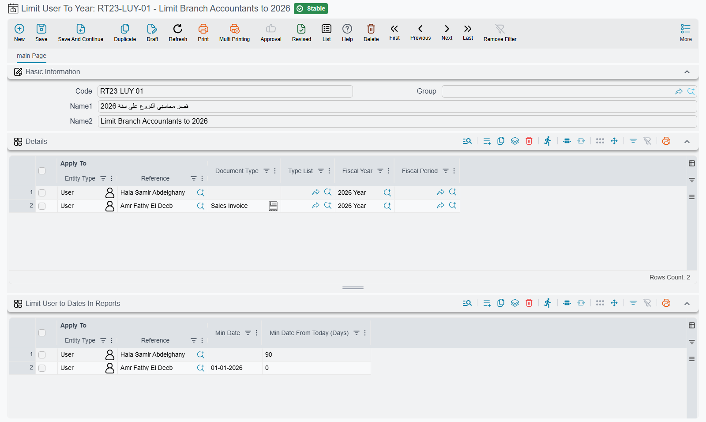

# Limit User To Year

This feature lets you restrict users to specific fiscal years and fiscal periods: document list screens show them only the documents of the years or periods they are allowed, and reports start no earlier than a minimum date you set.

## Screen Location

**Path**: Administration → Security → Limit User To Year

## Overview

The "Limit User To Year" screen is used to control:

1. **Document restrictions**: Hide documents outside the allowed fiscal years or fiscal periods from the user's document list screens. The restriction filters lists only; it does not stop the user from creating a document.
2. **Report restrictions**: Set a minimum date that a user can use in reports

## Details

### Fiscal Year and Period Restriction Fields

| Field | Description |
|-------|-------------|
| **Apply To** | The party the restriction will be applied to: user, user group, security profile, or employee |
| **Document Type** | The document type to restrict (optional) |
| **Type List** | A predefined list of document types to restrict at once (optional) |
| **Fiscal Year** | The fiscal year the user is allowed to work with |
| **Fiscal Period** | The fiscal period allowed (optional). A line with a period allows that period instead of its year. |

### Fiscal Year and Period Restriction Behavior

- If you leave both "Document Type" and "Type List" blank, the restriction will apply to **all document types**
- You can add multiple lines for the same party to allow several fiscal years
- Restrictions are **cumulative**: see [Application Priority](#Application-Priority)
- When a user ends up with both year lines and period lines, a document must match both: its fiscal year must be one of the allowed years **and** its fiscal period one of the allowed periods

## Limit User to Dates In Reports

### Date Restriction Fields

| Field | Description |
|-------|-------------|
| **Apply To** | The party the restriction will be applied to |
| **Min Date** | A fixed minimum date the user can select in reports |
| **Min Date From Today (Days)** | Number of days before the current date as a minimum date (a dynamic value) |

### Date Restriction Behavior

- If "Min Date From Today (Days)" is filled with a number other than zero, it takes priority over "Min Date" and the date is calculated from today
- Give each party one line. When the same party has several date lines, only one of them is used
- When several parties apply to the user, see [Application Priority](#Application-Priority)



## How the System Works

### 1. Restricting Document List Views

When displaying a document list (such as an invoice list), the system automatically:

```
1. Checks the document type
2. Looks up restrictions for the current user (directly or via group/security profile/employee)
3. Adds an automatic filter on the fiscal year and/or fiscal period
```

::: tip Note
The user will not see documents in unauthorized years, even if they have permission for the document type itself.
:::

### 2. Restricting Report Questions

When running a report, the system:

- **Date fields**: Raises a "from" date that is earlier than the minimum allowed date to that minimum date
- **Fiscal Year fields**: When the selected year is empty or starts before the earliest allowed year, replaces it with the earliest allowed year (the allowed year with the earliest start date). Only lines that leave both "Document Type" and "Type List" blank count here, and a prompt whose name contains `to` and not `from` is left alone
- **Fiscal Period fields**: The same rule, with the allowed periods

::: warning "To Date" is recognised by name, not by meaning
A to-date prompt has to be left alone or the range would collapse, and Nama decides which prompts those are from the parameter's **name**: a prompt is exempt when its name contains `to` and does not contain `from` (case ignored), or when the name is exactly `tdate`. So `toDate`, `dateTo` and `ToDocDate` are exempt, and `fromDate` is correctly raised.

A to-date named anything else — `endDate`, `until`, `dueDate` — matches none of that. It is raised like a from-date, the range turns inside out, and the restricted user gets an empty report while everyone else gets the right one. Two escapes exist: a date prompt declared as a multi-selection list is never touched, and the report author can add `ignoreMinDates` = `true` to the parameter to opt that one prompt out. See [When Nama changes the answer the user gave](/platform/reports/reports-guide#When-Nama-changes-the-answer-the-user-gave).
:::

## Practical Examples

### Example 1: Restrict an Accountant to the Current Year Only

1. Create a new record in the "Limit User To Year" screen
2. In the details grid:
   - **Apply To**: Select the user to restrict
   - **Fiscal Year**: Select the current fiscal year (e.g., 2024)
3. Save the record

**Result**: The user will not be able to see documents from previous years in any list.

### Example 2: Restrict a Group to the Last 90 Days in Reports

1. Create a new record
2. In the "Limit User to Dates In Reports" grid:
   - **Apply To**: Select the user group
   - **Min Date From Today (Days)**: 90
3. Save the record

**Result**: Any report run by a user in this group will have the "from" date set to at least 90 days before today.

## Application Priority

A restriction can reach a user from four sources: a line for the user directly, for the user's group, for the user's security profile, and for the employee linked to the user.

- **Fiscal years and periods** from all four sources are **combined**: the user receives the union of all allowed years and periods.
- **Report dates** are not combined that way. A date line for the user directly wins on its own. Only when there is none does the system take the latest (largest) date among the group, security profile and employee lines.

## Technical Notes

### Caching

- Restriction data is cached in memory to improve performance
- The cache is cleared automatically whenever any "Limit User To Year" record is changed

### Performance Impact

- Restrictions are added as SQL filters on document lists
- There is no noticeable performance impact during normal use
