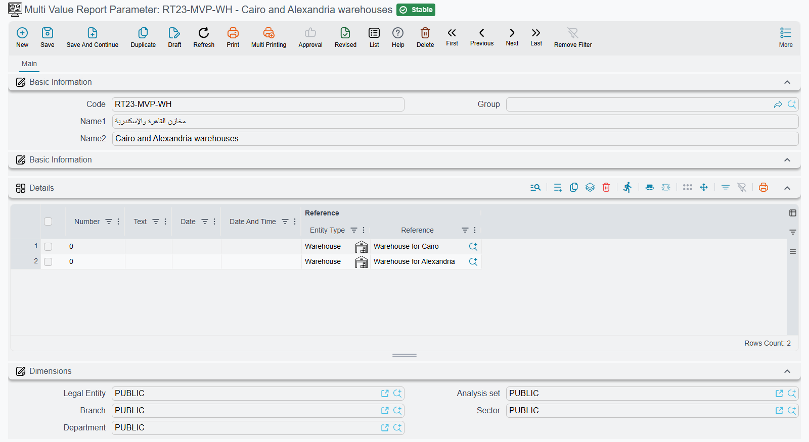

# Multi Value Report Parameter

A **Multi Value Report Parameter** is a saved list of values — four warehouses, three branches, a
handful of dates — that a scheduled task hands to a report parameter that accepts more than one
value.

## Why it exists

When a person runs a report, a parameter declared as a list lets them tick as many values as they
like on the parameters form: five employees, every branch except two. How a report author sets that
up, and the widgets the user gets, is in
[Multi-selection (list) parameters](/platform/reports/reports-guide#Multi-selection-list-parameters).

A [scheduled task](/platform/automation-and-rules/scheduled-tasks#Parameters-Collection) has nobody
to tick anything. Each line of its **Params** grid holds the answers for one run of the report, one
slot per parameter, and a slot's **Ref** column holds one record. So when the report should run for
the Cairo, Alexandria, Tanta and Mansoura warehouses together, you save those four warehouses once
as a Multi Value Report Parameter and put that one record in the slot.

## The screen

Open **Basic → Settings → Multi Value Report Parameter**. Besides the usual code and Arabic and
English names, the screen is one **Details** grid with one line per value. Each line offers five
columns — **Number**, **Text**, **Date**, **Date And Time** and **Reference** — and the report reads
only the one that fits the type of the parameter it is passed to:

| The report parameter is… | Column read on each line |
|---|---|
| A record (a warehouse, a branch, an employee…) | **Reference** |
| A date | **Date** |
| A date and time | **Date And Time** |
| A time | **Date And Time** (its time part) |
| A whole or decimal number | **Number** |
| A yes/no flag | **Text**, typed as `true` or `false` |
| Text, or anything else | **Text** |

The other columns are ignored, so fill the right one on every line. One record serves one kind of
value: keep "Delta warehouses" and "Weekly dates" as two separate records, not one record with mixed
lines.

## Using it in a scheduled task

1. Create the record — say **Delta warehouses**, with four lines whose **Reference** column names
   the four warehouses.
2. Open the scheduled task, of type **Parameterized Report** (sent by email) or **Parameterized
   Report (Print)**, and pick its report.
3. On a line of the **Params** grid, choose the warehouse parameter in a slot's **Param ID**. When
   the report declares that parameter as a list, the slot's **Ref** column switches to Multi Value
   Report Parameter on its own.
4. Pick **Delta warehouses** in **Ref**.

Every run of that line now passes all four warehouses at once, exactly as if a user had ticked them
on the form.

The values are read from the record each time the task runs, not copied into the task. Add a fifth
warehouse to **Delta warehouses** and every task line that points at it includes the new warehouse
from its next run — handy when the same list feeds a dozen tasks, and worth remembering before you
edit a record that other tasks share.

::: tip One value is fine too
A list parameter does not insist on a Multi Value Report Parameter. Put a single warehouse in **Ref**
and the report receives a list of one.
:::

## Report-based AI tools

A [report-based AI tool](/modules/ai/ai-tool-definitions#Type-2-Report-Based) fills its
**Fill Manually** parameters the same way a scheduled task fills its slots, so a Multi Value Report
Parameter placed in such a line's **Reference** column reaches a list parameter as its full list of
values.
