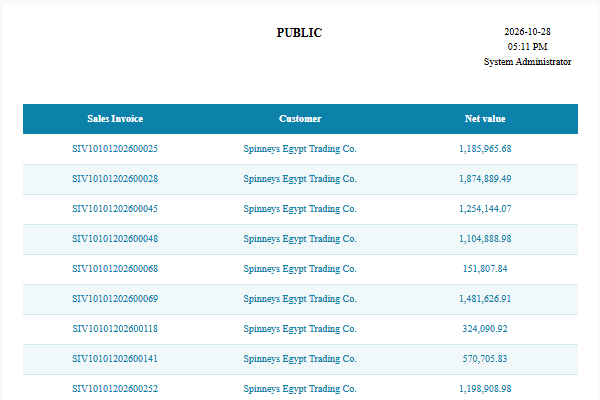
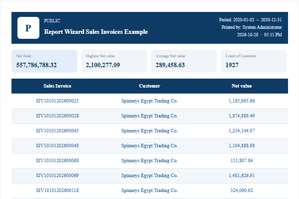
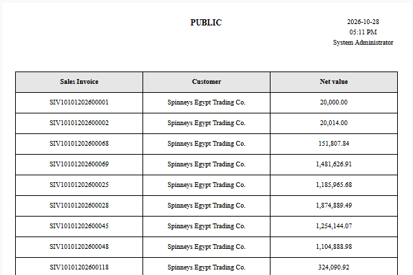
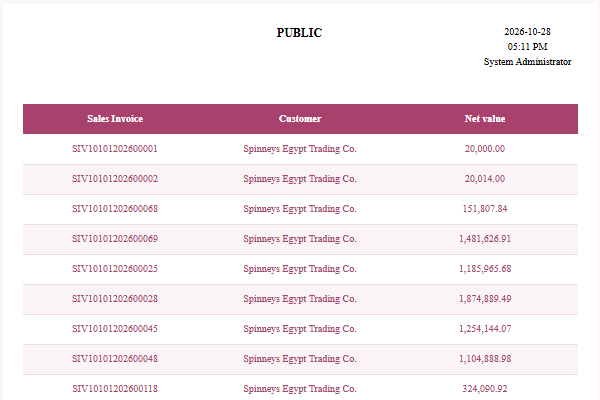
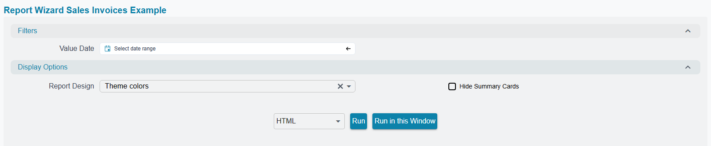
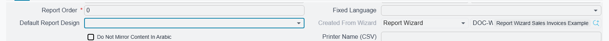
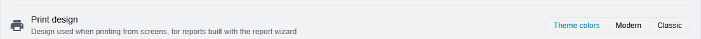
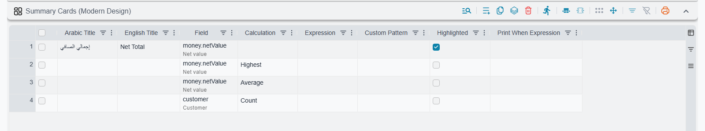
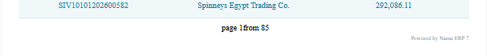

# Report Designs: Theme Colors, Modern and Classic

A report built with the Report Wizard can print in three looks, and the reader picks the look when the report runs, without anyone changing the report. The same sales invoice report can come out in the colours of the user's screen theme, in a modern layout with a banner and summary cards, or exactly as it always printed.

The design changes how the report looks: colours, lines, the banner and the cards. It never changes the figures. The same query runs, and the same rows and totals come out, in every design.

## The three designs

| Design | What the reader gets |
|---|---|
| **Theme Colors** (the default) | The column titles are filled with the main colour of the user's screen theme. The rows alternate between white and a light shade of the same colour. Totals get a light fill and a thicker line above them. The **summary cards** sit just above the table, tinted with the same colour. |
| **Modern** | A dark navy banner at the top with the company logo, the report title, the period and who printed it. Under it come the **summary cards**, then a navy table. The colours are fixed and do not follow the theme. |
| **Classic** | The report exactly as the wizard always built it: grey column titles, black borders, your own colours, with the **summary cards** in plain grey just above the table. Choose it when a report must look the way it did before. |

### Theme Colors follows the screen

**Theme Colors** takes its colour from the theme the user is working in at the moment the report runs. A user on the **Pink** theme gets a pink report, and a user on the default theme gets Nama blue:

A few details are worth knowing:

- **Dark mode does not darken the report.** A report is meant for paper, so it always prints on white and uses the theme's light-mode colour, even while the screen is dark.
- **A very light theme colour gets dark text.** When the header colour is too pale for white text to read, the header text turns dark on its own.
- **Changing the theme while a result is open.** The open result keeps the colours it was run with. Pressing **Apply** in the side panel with nothing else changed does not run the report again, because the questions are the same. Press **Re-Run With Parameters [F5]** (the ▷ button in the viewer), or just F5, and the report runs again in the new colours.
- **Runs that do not come from the new interface** use Nama blue: the old interface, scheduled tasks, and entity flows that attach or print a report.

To choose a theme, see [UI Themes](/platform/everyday-tools/ui-themes).

## Choosing a design when you run a report

Every wizard report asks for the design in a section of the question screen called **Display Options**. The section is collapsed and always comes last, after every other group of questions, so it stays out of the way of the questions people answer every day. Open it when you want something other than the default:

- **Report Design** — **Theme colors**, **Modern** or **Classic**. Left empty, the report prints in Theme Colors. The question remembers the last answer each user gave, so someone who prefers Modern picks it once.
- **Hide Summary Cards** — appears only when the report has summary cards (see [Summary cards](#Summary-cards)). Tick it to print the report without the cards, in any design. The space they took is removed, so no empty gap is left.

### Giving a report a default design

The design a report starts with is the **Default Report Design** field. It is on the **Main** tab of the **Report Wizard**, the **Printing Form Wizard** and the **Report Definition**:

What it does depends on what is being printed:

- **On a report**, the field only sets the answer the **Report Design** question starts with. The reader can still choose another design, and a reader who has run the report before sees their own last answer.
- **On a printed form or a printed list**, there is no question screen to ask, so the field decides the design. It overrides each user's **Print design** preference, described below. Use it when a form has to look the same whoever prints it, for example a tax invoice that must always print in Classic.

Set the field on the wizard rather than on the generated Report Definition. Each time the wizard is saved it copies its own value to the report, so a value typed only on the Report Definition is replaced the next time someone saves the wizard.

## Printing from a screen

When a user presses **Print** on a sales invoice, or prints a list, nothing asks which design to use. The design comes from:

1. The form's own **Default Report Design**, if it is set.
2. Otherwise the user's own choice in **Settings → GUI Preferences → General Preferences → Print design**:

Like the other GUI preferences, **Print design** belongs to the browser, not to the user. The same user on another computer starts again from **Theme colors**.

### Print-friendly colours on forms

A form goes to a printer, often many times a day, so forms do not use the solid colour fills of a report on screen. On a printed form or list, **Theme Colors** and **Modern** print:

- the header with only a light tint of the colour, and dark text,
- the rows on plain white,
- the colour only in the lines between rows and above the totals.

The page still carries the theme's colour or Modern's navy, without using much ink. **Classic** prints the form exactly as designed.

Which forms change:

- **Forms built with the Printing Form Wizard.** The grid of lines and the header block (customer, dates, totals boxes) both get the designs. In the header block the labels take the light tint, like the column titles, and the values print on white with a thin line under them. The layout stays as you gave it, borders you set on the block stay in the design colour, and a label or value with its own Report Style keeps that style.
- **Hand-written forms** that have opted in. See [Hand-written reports and forms](#Hand-written-reports-and-forms).

The banner and the summary cards are for reports only. On a form, **Modern** means the navy colours, not the banner.

## Summary cards

Summary cards are the boxes at the top of the report that show the reader the main totals before they read a single row: the total sales, the largest invoice, the number of customers. They print in every design, only on the first page, and only when the report defines them. In **Modern** they sit under the banner. In **Theme colors** and **Classic** they sit under the report's own header, just above the table.

You define them in the **Summary Cards** grid on the **Page Format Page** tab of the Report Wizard. Each line is one card:

| Column | What it does |
|---|---|
| **Arabic Title**, **English Title** | The label on the card. Leave both empty and the wizard names the card from the column and the calculation: *Total Net value*, *Highest Net value*, *Count of Customer*. |
| **Field** | The report field the card is about. It has to be one of the report's fields. |
| **Calculation** | **Sum**, **Count**, **Distinct Count**, **Average**, **Highest** or **Lowest**, over every row of the report. Empty means **Sum**. **Sum** and **Average** need a number field; the others work on any field. **Count** counts the rows where the field has a value; **Distinct Count** counts its different values, such as the number of customers. |
| **Expression** | A Jasper expression for a value that a field and a calculation cannot give, such as `$V{REPORT_COUNT}` (the number of rows) or a parameter. When it is filled, it is used instead of **Field** and **Calculation**. |
| **Custom Pattern** | The number format, such as `#,##0`. Empty means the field's own format, so an amount prints the way the column does. |
| **Highlighted** | Prints the card on a blue background to draw the eye to it. One highlighted card, usually the first, works best. |
| **Print When Expression** | A condition for this one card, for example `$P{showProfit}`. Use parameters here, not totals: the cards print at the top of the report, before any total is known. |

The four lines in the picture give the four cards of the Modern example above: a highlighted **Net Total**, then the highest invoice and the average invoice (one row of this report is one invoice), and *Count of Customer*. That last card counts the rows that have a customer, so it shows the number of invoices, not of customers. The same card with **Distinct Count** shows the number of customers.

Some behaviour to expect:

- **No lines, no cards.** A report whose grid is empty gets no cards and no **Hide Summary Cards** question. It goes straight from its header to the table.
- **Each design has its own colours.** In Modern the cards are light grey with navy numbers. In Theme colors they take a light shade of the theme colour, with the numbers in its dark shade. In Classic they are plain grey with black numbers. A highlighted card is one shade darker.
- **All cards share one row.** Four cards fill the width neatly. More than four make every card narrower, and the values shrink to fit.
- **Hidden cards leave no gap.** When a card's **Print When Expression** is false, only that card is left out. When all of them are false, or the reader ticks **Hide Summary Cards**, the whole row of cards disappears and the table moves up.

### What to put on a card

A card is read before the table, so a wrong number on it misleads more than a wrong row. Before adding a card, check:

- **It matches the table.** A **Sum** card runs over the same rows as the report, so it equals the column's total in the summary. Pick a column whose total the report already shows.
- **It can be added up.** Amounts and quantities can be summed. Balances, stock on hand, prices, rates and percentages cannot: use **Highest** or **Lowest**, or no card.
- **One currency.** If the rows can be in different currencies, a sum of the document amount means nothing. Use the local-currency amount if the report has it, or leave the card out.
- **Count counts rows.** In a report with one row per invoice, *Count of Customer* is the number of invoices. In a report with one row per invoice line, *Count of Sales Invoice* is the number of lines. To count the customers or the invoices themselves, use **Distinct Count**.
- **Average is the average row.** It is the average invoice when a row is an invoice, and the average line when a row is a line.
- **The title says what it is**, such as *Net Sales* or *Customers*. The automatic title is often not enough.
- **Two to four cards.** Highlight the report's main number.
- **Check it once.** Run the report for a short period and compare each card with the table.

## The "Powered by" line

Every report built with the Report Wizard and every form built with the Printing Form Wizard ends each page with a small grey line at the bottom right: **Powered by** followed by the application name, for example *Powered by Nama ERP 7*. On a branded installation it shows that brand's name. The line is a link: clicking it in a PDF or on screen opens the application's website.

It prints in every design, Classic included, and in English on Arabic reports too. The wizard adds it on its own; there is no setting to remove it yet. A hand-written report can show the same line with the two `NamaRep` calls in [Hand-written reports and forms](#Hand-written-reports-and-forms).

## What keeps its own look

The designs restyle the table: the column titles, the rows, the group lines and the totals. Some things stay as they are in every design:

- **A column that uses a [Report Style](/platform/reports/report-styles)** keeps that style. If you deliberately coloured a column, the design does not overwrite your choice. A column without a style, or with the wizard's line-by-line colouring, follows the design.
- **The lines you chose** show in every design. In Theme Colors and Modern they are drawn as thin lines in the design colour:
  - **Vertical Borders** and **Horizontal Borders** on a field line add lines on the sides of that column, in its title, its rows and its total.
  - **Border Line Preset** on the **Page Format Page** tab decides the lines of the table rows, in place of the design's own line under each row: **None** draws no lines, **Outline Border only** draws the two outer sides, and **Inside Border only** draws the lines between rows and columns.
  - The thick line above the totals stays in every case.
- **The header components** you added (filters, custom texts, images) still print. In Modern, the banner takes the place of the report title, the logo, the date and time, the user and the company name when those are placed on the first page only, so they do not print twice.
- **Crosstab reports** are not restyled.

## Reports that existed before the designs

A wizard report gets the designs, the cards grid and the Powered by line the next time its wizard is saved. Until then it prints as it always has. Saving with no change does not rebuild the report, so change something small, save, and change it back if needed. The same applies to forms built with the Printing Form Wizard.

## Hand-written reports and forms

A report or form whose `.jrxml` file was written by hand, rather than built by a wizard, prints as written. It can get the same three designs by **opting in**. The person who maintains the file adds a few markers, and when the file is saved on the **Report Definition** screen the system adds the rest by itself: the **Report Design** question, the colour parameters, and the colour and line settings on the marked cells.

The steps, in short:

1. **Opt the report in.** Add one property to the report: `<property name="nama-design" value="true"/>`. Changing the value to `false` switches the designs off again without removing the markers.
2. **Mark the table cells.** In each cell's `reportElement`, add `<property name="nama-design-role" value="..."/>` with one of these roles:

   | Role | Put it on | In Theme Colors and Modern |
   |---|---|---|
   | `header` | the column titles | filled with the design colour, light text, no borders |
   | `row` | the detail cells | alternating rows with a thin line under each one; link cells in the link colour |
   | `total` | summary, group header and group footer totals | light fill, bold colour, a thicker line above |

   Mark every cell of a row, including the empty ones, or the stripes have holes. Give a cell `mode="Opaque"` if it should show the fill. Cells keep their own fonts, sizes and alignment. In **Classic** every cell prints exactly as written. To draw your own lines in Theme Colors and Modern, also add `<property name="nama-design-lines" value="left,right"/>` to a cell, naming any of `top`, `left`, `bottom` and `right`.
3. **Subreports.** Opt in both the main report and the subreport file. The main report then passes the chosen design and its colours to the subreport on its own. A subreport whose main report has not opted in stays Classic.
4. **Summary cards (optional).** Draw the cards yourself inside a `frame` that carries the role `cards`, usually in the title band. The system makes that frame print only in Modern and only while **Hide Summary Cards** is not ticked, and adds that question. If the frame has its own print-when condition, that condition has to be true as well. So that hiding the cards leaves no gap, put nothing else in the frame's rows, and give the values `evaluationTime="Report"`, because the title prints before any row is read.
5. **The Powered by line (recommended).** Add a text field at the bottom of the page footer with the expression `NamaRep.poweredBy()` and a link to `NamaRep.appUrl()`. See [The application's own website](/platform/reports/reports-namarep-reference#The-applications-own-website).

The names `reportDesign`, `hideSummaryCards`, `reportDisplayOptions`, `reportThemeColor` and every parameter name that starts with `design` are reserved for this mechanism. Do not use them for parameters of your own.

To check the result, save the report on the Report Definition screen, where any mistake in the markers is reported. Then run it in **Classic**: it must look exactly as before. If it does not, a marker sits on the wrong element. Then run it in **Theme Colors** and **Modern**, in both languages; the Arabic copy is mirrored as usual.

::: tip A ready-made skill for AI assistants
The full set of steps, with complete `.jrxml` snippets for every marker, the card frame and the Powered by line, is published as an AI skill: **[Report Design skill](https://docs.namasoft.com/skills/report-design.md)** (raw Markdown). Give it to Claude Code or any coding assistant that edits your reports. In a local copy of the docs the same file is `docs/public/skills/report-design.md`.
:::

## Messages you may see

| Message | Why | What to do |
|---|---|---|
| *Summary card {0} needs a field or an expression* — «بطاقة الملخص {0} تحتاج إلى حقل أو تعبير» | Line {0} of the Summary Cards grid has neither a **Field** nor an **Expression**. | Fill one of them, or delete the line. |
| *The field {0} of summary card {1} is not one of the report fields* — «الحقل {0} في بطاقة الملخص {1} ليس من حقول التقرير» | The card names a field that the report does not read. | Pick a field that is a column of the report, or add it as a hidden column. |
| *Summary card {0} adds or averages the field {1}, which is not a number* — «بطاقة الملخص {0} تجمع أو تحسب متوسط الحقل {1} وهو ليس رقما» | **Sum** and **Average** need numbers; the field is a text, a date or a reference. | Choose **Count**, **Highest** or **Lowest**, or a number field. |
| *Some elements are marked with nama-design-role but the report does not enable the nama-design property* — «توجد عناصر عليها الخاصية nama-design-role لكن التقرير لا يفعّل الخاصية nama-design» | A hand-written report has cell markers but has not opted in. | Add `nama-design` = `true` to the report (step 1 above). |
| *The report enables nama-design but has no element marked with nama-design-role and no subreport* — «التقرير يفعّل الخاصية nama-design لكن لا يوجد به أي عنصر عليه الخاصية nama-design-role ولا أي تقرير فرعي» | The report has opted in, but nothing in it can be styled. | Mark the cells, or remove the property. |
| *Unknown nama-design-role {0} on the element at x {1} and y {2}, use header, row, total or cards* — «قيمة nama-design-role غير معروفة {0} على العنصر في الموضع x {1} و y {2}، استخدم header أو row أو total أو cards» | A marker has a value other than the four roles, often a typo such as `head` or `totals`. | Correct the marker at that position. |

## See also

- [Report Wizard Guide](/platform/reports/report-wizard-guide)
- [Printing Form Wizard](/platform/reports/printing-form-wizard-guide)
- [Report Styles](/platform/reports/report-styles)
- [UI Themes](/platform/everyday-tools/ui-themes)
