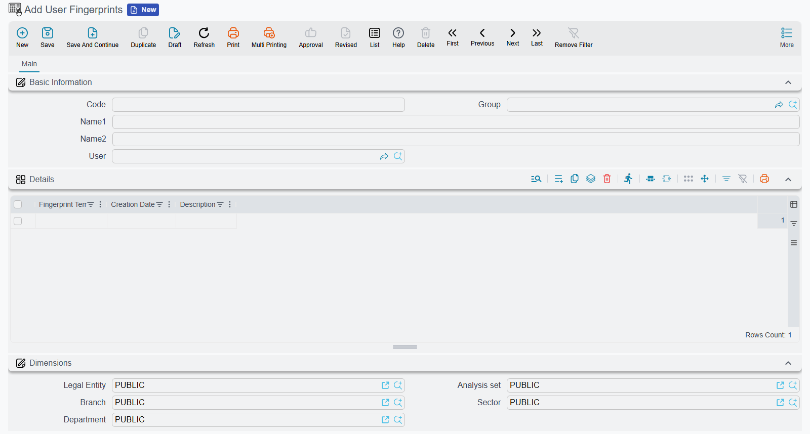

# User Fingerprints

A **User Fingerprints** record holds the fingerprints one user has enrolled for logging in at the point of sale. The cashier never sees this screen — fingerprints are captured on the register — but every fingerprint taken on any register ends up here, and this is where an administrator looks to see who has fingerprints on file, or to take one away.

**Path**: Basic → Documents → User Fingerprints

::: info Used by the POS only
Today the only part of Nama that reads these records is the POS desktop register: its login screen, its unlock window and its security authorisation window. Attendance machines keep their own fingerprints inside the machine and send Nama punches, not fingerprints (see [Attendance Machines](/modules/hr/attendance/attendance-machines)); the mobile app's fingerprint or face check is done by the phone itself.
:::

## How a record comes into being

Nobody creates these records by hand. The life of one goes like this:

1. A supervisor with the **Can Enroll Fingerprints** permission opens **Fingerprint Enrollment** on a register, picks a user, and has them place a finger on the reader four times. The whole procedure — the reader, the POS Settings switch and the permission — is on [Fingerprint Login in Point of Sale](/modules/pos/pos-fingerprint-login).
2. The register keeps **one record per user**. The first fingerprint creates it; every later fingerprint for the same user is added to it as another line. Its code is made from the user's identifier followed by `-POS-Fingerprint`.
3. The register sends the record to the server straight away when it is online, or with its next regular send when it is not. The server saves it with the register's own dimensions — company, branch and so on.
4. From the server the record travels back out to the registers like any other master file the POS downloads, so a cashier enrolled on register 1 can log in on register 2 once that register has picked up the change.

## What the screen shows

| Field | What it holds |
|---|---|
| **Code** and the Arabic and English names | The record's identity. The code is the one the register made; the names are usually empty. |
| **User** | The user these fingerprints log in as. |
| **Details** grid | One line per enrolled fingerprint. |
| ↳ **Fingerprint Template** | The scan, stored as a long block of encoded text. It is the reader's mathematical summary of the finger, not a picture, and cannot be typed or edited. |
| ↳ **Creation Date** | When the fingerprint was enrolled. |
| ↳ **Description** | The remark typed at enrollment, such as "Right index finger". |
| Dimensions | Taken from the register that sent the record. |

Because the template can only come from a reader, fingerprints cannot be added from this screen. A new fingerprint is always enrolled at a register.

## Removing a fingerprint

There are two ways, and both reach every register:

- **At the register** — open Fingerprint Enrollment, pick the user and press ✕ next to the fingerprint. The register sends the shortened record to the server.
- **On this screen** — delete the fingerprint's line from the **Details** grid and save, or delete the whole record to remove all of that user's fingerprints. The change is queued for the registers, and each one drops the fingerprint the next time it downloads changes.

When an employee leaves, deleting their record here is the quickest way to make sure no register will log them in by fingerprint. Their username and password are a separate matter, handled on the user record — see [Users and Login](/platform/security/users-and-login).

::: tip A revised record is closed to the registers too
Revising a User Fingerprints record locks it against the registers as well as against other users. A register that tries to send a new or removed fingerprint for that user is refused with this message, which has no Arabic text and appears in English on both languages:

*"The document {0} was revised, please unrevise it on the main system"*

Unrevise the record on the server, then enroll or remove the fingerprint again.
:::
