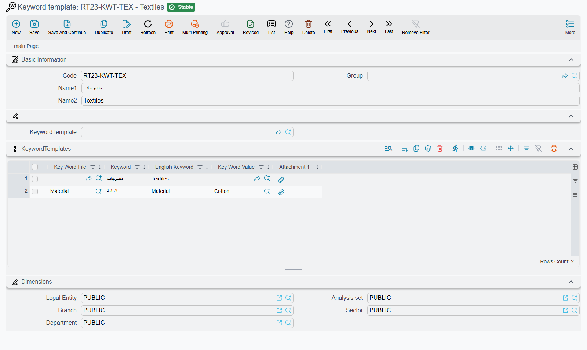

# Keywords and Keyword Templates

Keywords are descriptive tags you attach to an item or a customer — "cotton", "export quality",
"Ramadan range", "wholesale only" — so that lists and reports can pick out every record that carries
a tag. A **Keyword template** is a ready-made set of such tags: pick it on an item and its keywords are
copied onto the item in one step instead of being typed line by line.

Keywords do nothing on their own. They do not change prices, stock or accounting. Their value is in
filtering: a list view or a report can narrow to the records whose keywords include a given word or
value.

## Where keywords live

Items and customers each have a **KeywordTemplates** tab. (An
[Item Opening Request](/modules/supplychain/item-maintenance) has the same **Keyword template** field
and keywords grid; its lines are copied to the item created from the request.) The tab holds:

- **Keyword template** — pick a template to copy its keywords in (see below).
- **Reverse Delete Case** — flips **Delete With Save** on every line at once.
- The keywords grid, one line per keyword:

| Column | What it holds |
|---|---|
| **Delete With Save** | Tick to have the line removed when the record is saved. |
| **Key Word File** | Optional: the kind of keyword this line records, such as *Material* or *Season*. |
| **Keyword** / **English Keyword** | The keyword itself, in Arabic and English. |
| **Key Word Value** | Items only: the value of the keyword file on this item, such as *Cotton*. |
| **Relative weight** | A number you can record against the keyword. Nothing in the system sorts or ranks by it. |

## Free keywords and structured keywords

A line can be used in two ways.

**A free keyword** is just text: leave **Key Word File** empty and type the **Keyword** and
**English Keyword** yourself — *تصدير* / *Export*.

**A structured keyword** records an attribute and its value. Name the attribute in **Key Word File**
and the value in **Key Word Value**: *Material* = *Cotton*. When the record is saved, the system fills
**Keyword** and **English Keyword** from the key word file's own Arabic and English names, replacing
whatever was typed there. So on a saved line the **Keyword** column reads *Material*, and the
specific value sits in **Key Word Value**.

Structured keywords need two small master files, both under **Inventory → Master Files**:

- **Key Word File** — the attribute: a code, its Arabic and English names, and an **Allowed Values**
  grid listing the values it may take (each with an Arabic keyword, an English keyword and a
  **Key Word Value**).
- **Key Word Value** — one value, with an optional **Parent Key Word** naming the key word file it
  belongs to.

On an item line, the **Key Word Value** picker offers the values listed in the chosen key word file's
**Allowed Values**. When that grid is empty it offers the values whose **Parent Key Word** is that
file, together with values that have no parent at all.

## Keyword templates

A keyword template is a master file at **Inventory → Master Files → Keyword template**. Besides the
code and names it has a **Parent** field and a **KeywordTemplates** grid with the same columns as
above — **Key Word File**, **Keyword**, **English Keyword**, **Key Word Value** — plus
**Attachment 1**, which stays on the template and is not copied.

Templates form a tree through **Parent**: a *Textiles* template, with *Shirts* and *Trousers* below
it. Picking a template on an item or customer copies the keywords of the whole branch it belongs to:

1. every template above it, from the top down,
2. the template itself,
3. every template below it, at any depth.

So picking *Textiles* brings in the *Shirts* and *Trousers* keywords too, and picking *Shirts* brings
in *Textiles* and *Shirts* but not *Trousers*.

What happens to the grid:

- Keywords are **added**, never removed. Picking a second template later adds its keywords to the
  ones already there.
- **One line per keyword.** When two templates in the branch carry the same keyword, only the first is
  copied. Because a structured line's **Keyword** is its key word file's name, this also means one
  line per key word file: a branch that lists *Material* twice with two different values contributes
  only the first.
- Lines that have no **Keyword** are dropped from the grid when a template is picked.

To take keywords off, tick **Delete With Save** on those lines (or press **Reverse Delete Case** to
tick or untick them all) and save.

## Finding records by keyword

Because keywords are ordinary lines on the record, any list view, criteria or report can filter on
them — for example the items whose keyword lines carry the **Key Word Value** *Cotton*, or the
customers with the English keyword *Export*.
